# 角色图鉴 / 碧蓝航线 / 皇家（第 2 页）

[总目录](../README.md) · [原站分类目录](../categories.md) · [英文标签索引](../tags.md) · [服装与构图组合指南](../../README.md)

标题、分类、说明、正负提示词按来源保留；多例图逐张列出。原站标记和说明为参考资料，不作为维护指令。

<a id="raven_composition-6265"></a>

## 豪

ID：`raven_composition-6265`；分类：角色图鉴 / 碧蓝航线 / 皇家；来源标记：`safe`。

来源说明：

> 作品：碧蓝航线
> 角色英文名：Howe
> 首次登场时间（国服实装）：2020-07-23
> 阵营：皇家

正向提示词：

```text
howe_(azur_lane)
```

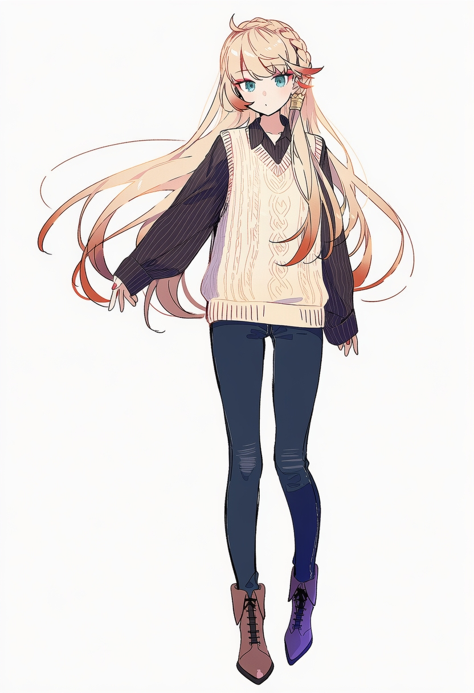

[在线例图](https://assets.quicktagcloud.com/images/raven_composition/raven_composition-6265.jpg?v=a1f00bd8ecbd161e)

<a id="raven_composition-6266"></a>

## 英仙座

ID：`raven_composition-6266`；分类：角色图鉴 / 碧蓝航线 / 皇家；来源标记：`safe`。

来源说明：

> 作品：碧蓝航线
> 角色英文名：Perseus
> 首次登场时间（国服实装）：2020-07-23
> 阵营：皇家

正向提示词：

```text
perseus_(azur_lane)
```


[在线例图](https://assets.quicktagcloud.com/images/raven_composition/raven_composition-6266.jpg?v=02512c7becbf8ffd)

<a id="raven_composition-6267"></a>

## 鹰

ID：`raven_composition-6267`；分类：角色图鉴 / 碧蓝航线 / 皇家；来源标记：`safe`。

来源说明：

> 作品：碧蓝航线
> 角色英文名：Eagle
> 首次登场时间（国服实装）：2020-07-23
> 阵营：皇家

正向提示词：

```text
eagle_(azur_lane)
```

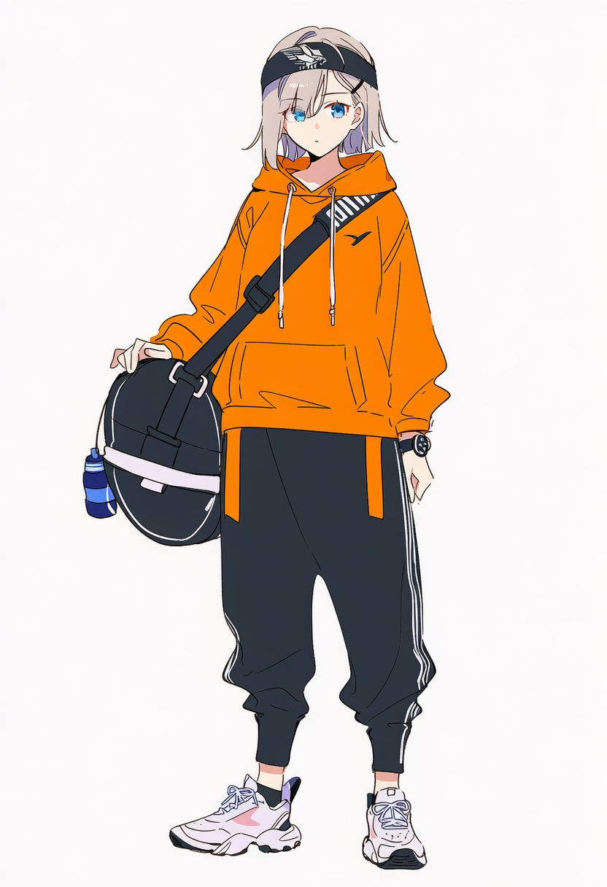

[在线例图](https://assets.quicktagcloud.com/images/raven_composition/raven_composition-6267.jpg?v=ed39825627e393be)

<a id="raven_composition-6281"></a>

## 黛朵μ

ID：`raven_composition-6281`；分类：角色图鉴 / 碧蓝航线 / 皇家；来源标记：`safe`。

来源说明：

> 作品：碧蓝航线
> 角色英文名：Dido µ
> 首次登场时间（国服实装）：2020-10-29
> 阵营：皇家

正向提示词：

```text
dido_(muse)_(azur_lane)
```


[在线例图](https://assets.quicktagcloud.com/images/raven_composition/raven_composition-6281.jpg?v=ccd8d14c58171664)

<a id="raven_composition-6283"></a>

## 光辉μ

ID：`raven_composition-6283`；分类：角色图鉴 / 碧蓝航线 / 皇家；来源标记：`safe`。

来源说明：

> 作品：碧蓝航线
> 角色英文名：Illustrious µ
> 首次登场时间（国服实装）：2020-10-29
> 阵营：皇家

正向提示词：

```text
illustrious_(muse)_(azur_lane)
```


[在线例图](https://assets.quicktagcloud.com/images/raven_composition/raven_composition-6283.jpg?v=fa6c18a3e8a58ede)

<a id="raven_composition-6299"></a>

## 佩内洛珀

ID：`raven_composition-6299`；分类：角色图鉴 / 碧蓝航线 / 皇家；来源标记：`safe`。

来源说明：

> 作品：碧蓝航线
> 角色英文名：Penelope
> 首次登场时间（国服实装）：2021-02-04
> 阵营：皇家

正向提示词：

```text
penelope_(azur_lane)
```

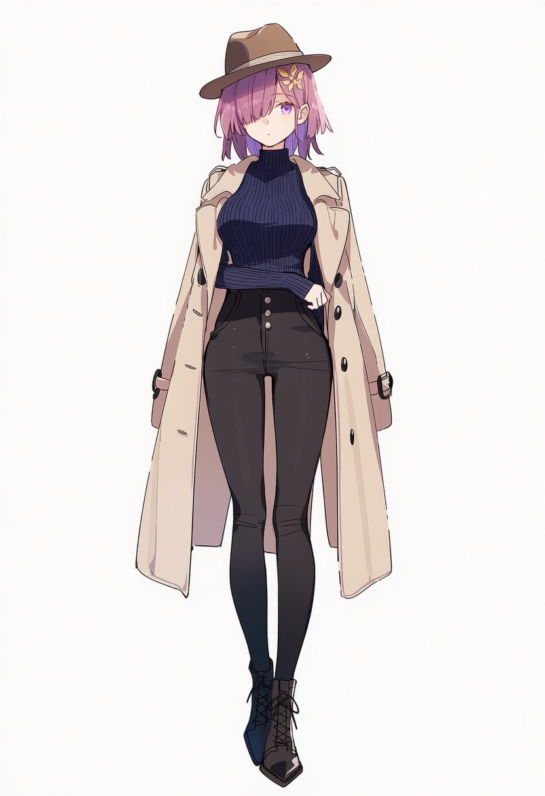

[在线例图](https://assets.quicktagcloud.com/images/raven_composition/raven_composition-6299.jpg?v=c1b5ceb5e53cb05e)

<a id="raven_composition-6359"></a>

## 卡律布狄斯

ID：`raven_composition-6359`；分类：角色图鉴 / 碧蓝航线 / 皇家；来源标记：`safe`。

来源说明：

> 作品：碧蓝航线
> 角色英文名：Charybdis
> 首次登场时间（国服实装）：2022-01-27
> 阵营：皇家

正向提示词：

```text
charybdis_(azur_lane)
```

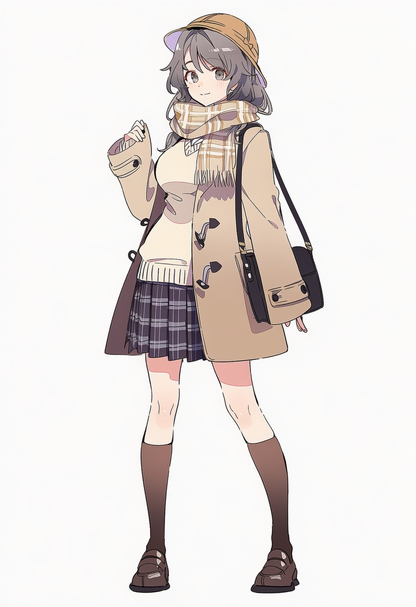

[在线例图](https://assets.quicktagcloud.com/images/raven_composition/raven_composition-6359.jpg?v=1359740423574b18)

<a id="raven_composition-6379"></a>

## 贾维斯

ID：`raven_composition-6379`；分类：角色图鉴 / 碧蓝航线 / 皇家；来源标记：`safe`。

来源说明：

> 作品：碧蓝航线
> 角色英文名：Jervis
> 首次登场时间（国服实装）：2022-05-26
> 阵营：皇家

正向提示词：

```text
jervis_(azur_lane)
```

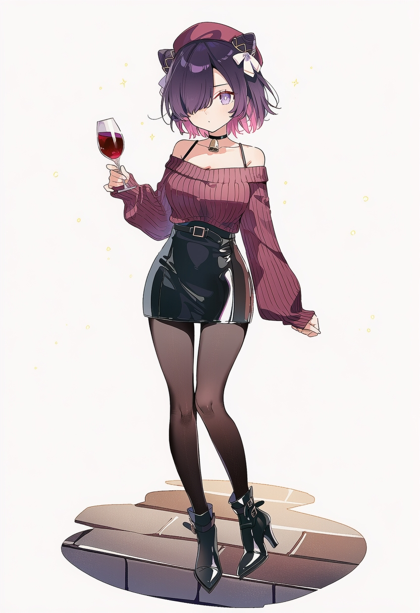

[在线例图](https://assets.quicktagcloud.com/images/raven_composition/raven_composition-6379.jpg?v=d46c044bb09a1a32)

<a id="raven_composition-6380"></a>

## 贝洛娜

ID：`raven_composition-6380`；分类：角色图鉴 / 碧蓝航线 / 皇家；来源标记：`safe`。

来源说明：

> 作品：碧蓝航线
> 角色英文名：Bellona
> 首次登场时间（国服实装）：2022-05-26
> 阵营：皇家

正向提示词：

```text
bellona_(azur_lane)
```


[在线例图](https://assets.quicktagcloud.com/images/raven_composition/raven_composition-6380.jpg?v=55bea5b65070cedf)

<a id="raven_composition-6382"></a>

## 复仇

ID：`raven_composition-6382`；分类：角色图鉴 / 碧蓝航线 / 皇家；来源标记：`safe`。

来源说明：

> 作品：碧蓝航线
> 角色英文名：Revenge
> 首次登场时间（国服实装）：2022-05-26
> 阵营：皇家

正向提示词：

```text
revenge_(azur_lane)
```


[在线例图](https://assets.quicktagcloud.com/images/raven_composition/raven_composition-6382.jpg?v=47af696c0c2733c8)

<a id="raven_composition-6383"></a>

## 前卫

ID：`raven_composition-6383`；分类：角色图鉴 / 碧蓝航线 / 皇家；来源标记：`safe`。

来源说明：

> 作品：碧蓝航线
> 角色英文名：Vanguard
> 首次登场时间（国服实装）：2022-05-26
> 阵营：皇家

正向提示词：

```text
vanguard_(azur_lane)
```

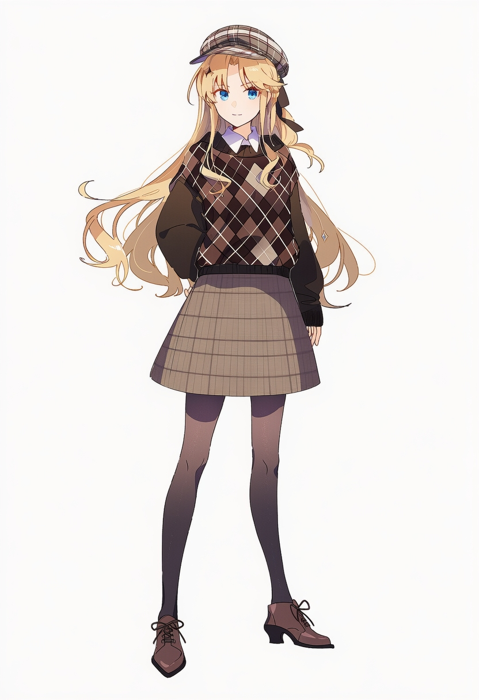

[在线例图](https://assets.quicktagcloud.com/images/raven_composition/raven_composition-6383.jpg?v=850f0711ba6db2f6)

<a id="raven_composition-6384"></a>

## 不挠

ID：`raven_composition-6384`；分类：角色图鉴 / 碧蓝航线 / 皇家；来源标记：`safe`。

来源说明：

> 作品：碧蓝航线
> 角色英文名：Indomitable
> 首次登场时间（国服实装）：2022-05-26
> 阵营：皇家

正向提示词：

```text
indomitable_(azur_lane)
```

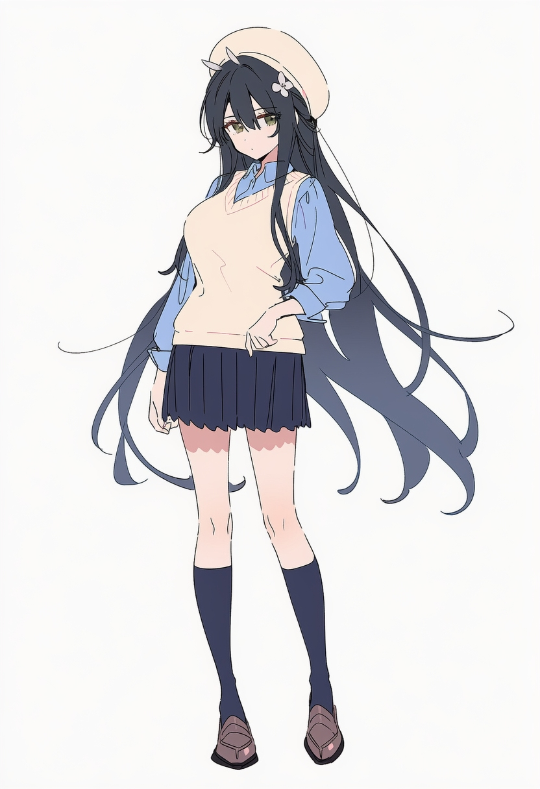

[在线例图](https://assets.quicktagcloud.com/images/raven_composition/raven_composition-6384.jpg?v=2ae8a02b0257ea62)

<a id="raven_composition-6385"></a>

## 小柴郡

ID：`raven_composition-6385`；分类：角色图鉴 / 碧蓝航线 / 皇家；来源标记：`safe`。

来源说明：

> 作品：碧蓝航线
> 角色英文名：Little Cheshire
> 首次登场时间（国服实装）：2022-05-26
> 阵营：皇家

正向提示词：

```text
little_cheshire_(azur_lane)
```

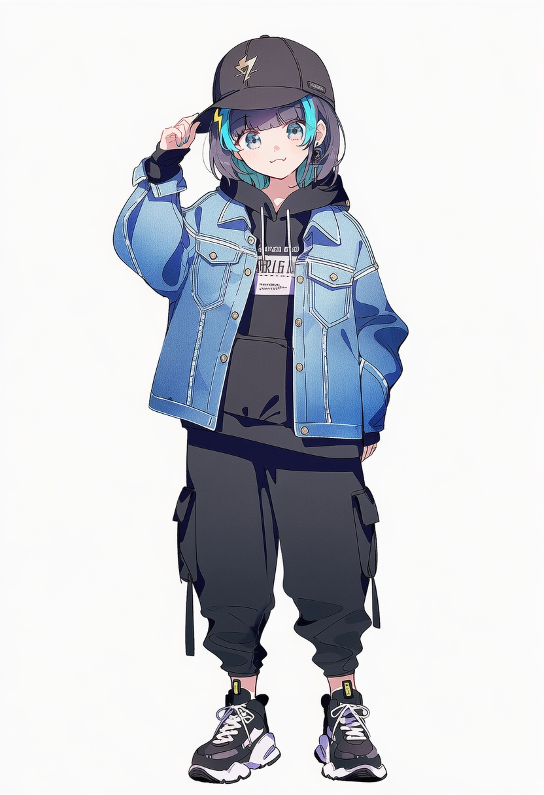

[在线例图](https://assets.quicktagcloud.com/images/raven_composition/raven_composition-6385.jpg?v=60c966a0f3899f3b)

<a id="raven_composition-6389"></a>

## 进取

ID：`raven_composition-6389`；分类：角色图鉴 / 碧蓝航线 / 皇家；来源标记：`safe`。

来源说明：

> 作品：碧蓝航线
> 角色英文名：Enterprise (HMS)
> 首次登场时间（国服实装）：2022-06-30
> 阵营：皇家

正向提示词：

```text
enterprise_(hms)_(azur_lane)
```

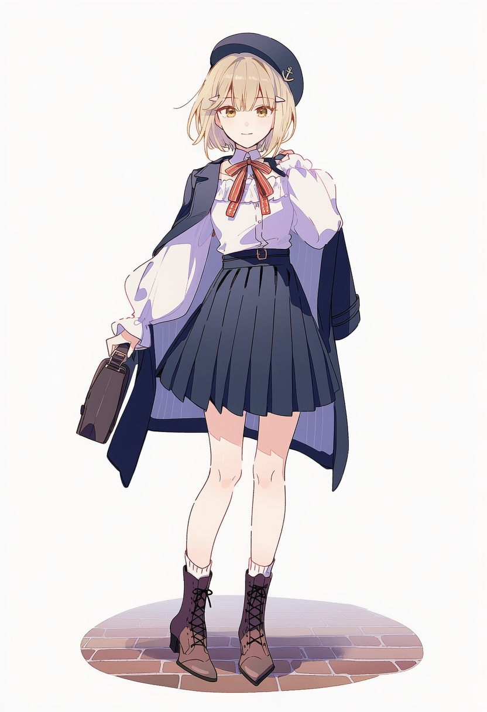

[在线例图](https://assets.quicktagcloud.com/images/raven_composition/raven_composition-6389.jpg?v=e966afa25f6f6550)

<a id="raven_composition-6395"></a>

## 普利茅斯

ID：`raven_composition-6395`；分类：角色图鉴 / 碧蓝航线 / 皇家；来源标记：`safe`。

来源说明：

> 作品：碧蓝航线
> 角色英文名：Plymouth
> 首次登场时间（国服实装）：2022-07-14
> 阵营：皇家

正向提示词：

```text
plymouth_(azur_lane)
```

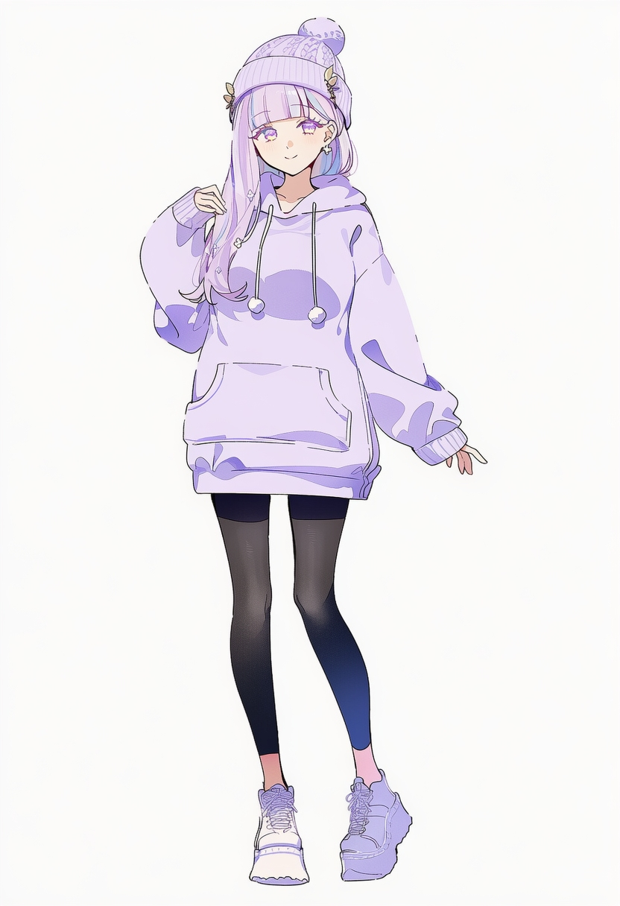

[在线例图](https://assets.quicktagcloud.com/images/raven_composition/raven_composition-6395.jpg?v=04ee9d549cfea532)

<a id="raven_composition-6412"></a>

## 雅努斯

ID：`raven_composition-6412`；分类：角色图鉴 / 碧蓝航线 / 皇家；来源标记：`safe`。

来源说明：

> 作品：碧蓝航线
> 角色英文名：Janus
> 首次登场时间（国服实装）：2022-10-27
> 阵营：皇家

正向提示词：

```text
janus_(azur_lane)
```


[在线例图](https://assets.quicktagcloud.com/images/raven_composition/raven_composition-6412.jpg?v=a62816f252262753)

<a id="raven_composition-6413"></a>

## 曼彻斯特

ID：`raven_composition-6413`；分类：角色图鉴 / 碧蓝航线 / 皇家；来源标记：`safe`。

来源说明：

> 作品：碧蓝航线
> 角色英文名：Manchester
> 首次登场时间（国服实装）：2022-10-27
> 阵营：皇家

正向提示词：

```text
manchester_(azur_lane)
```


[在线例图](https://assets.quicktagcloud.com/images/raven_composition/raven_composition-6413.jpg?v=337f007f30730179)

<a id="raven_composition-6414"></a>

## 阿尔比恩

ID：`raven_composition-6414`；分类：角色图鉴 / 碧蓝航线 / 皇家；来源标记：`safe`。

来源说明：

> 作品：碧蓝航线
> 角色英文名：Albion
> 首次登场时间（国服实装）：2022-10-27
> 阵营：皇家

正向提示词：

```text
albion_(azur_lane)
```

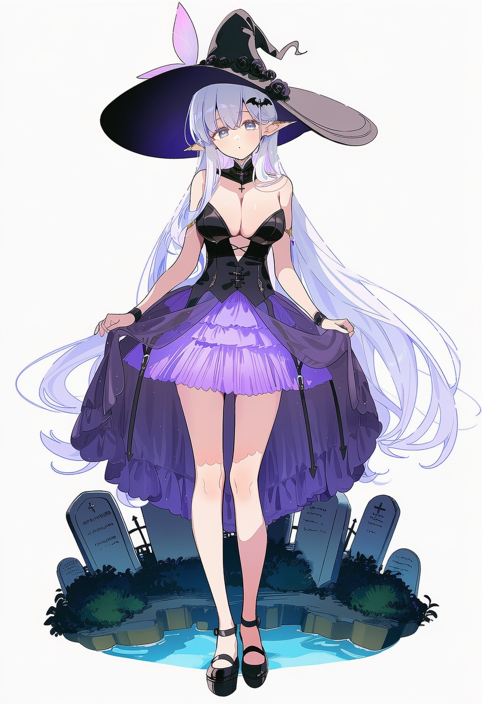

[在线例图](https://assets.quicktagcloud.com/images/raven_composition/raven_composition-6414.jpg?v=50233912f6b094ea)

<a id="raven_composition-6424"></a>

## 忒修斯

ID：`raven_composition-6424`；分类：角色图鉴 / 碧蓝航线 / 皇家；来源标记：`safe`。

来源说明：

> 作品：碧蓝航线
> 角色英文名：Theseus
> 首次登场时间（国服实装）：2023-01-18
> 阵营：皇家

正向提示词：

```text
theseus_(azur_lane)
```

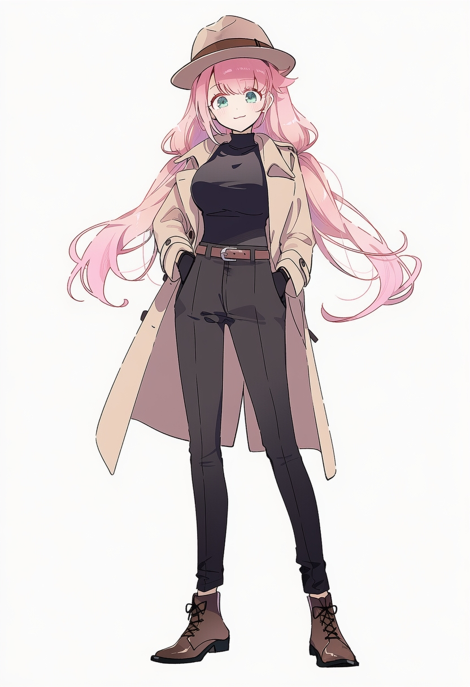

[在线例图](https://assets.quicktagcloud.com/images/raven_composition/raven_composition-6424.jpg?v=ac5d03b45d96471c)

<a id="raven_composition-6427"></a>

## 英雄

ID：`raven_composition-6427`；分类：角色图鉴 / 碧蓝航线 / 皇家；来源标记：`safe`。

来源说明：

> 作品：碧蓝航线
> 角色英文名：Hero
> 首次登场时间（国服实装）：2023-02-23
> 阵营：皇家

正向提示词：

```text
hero_(azur_lane)
```

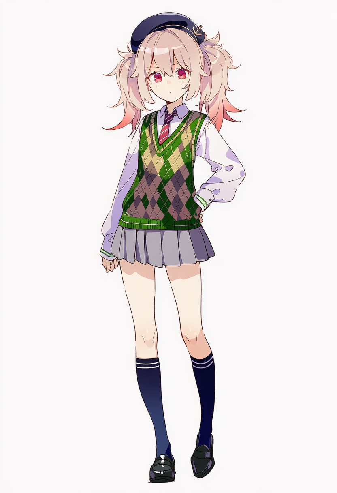

[在线例图](https://assets.quicktagcloud.com/images/raven_composition/raven_composition-6427.jpg?v=de71ec280b9ea6b5)

<a id="raven_composition-6428"></a>

## 皇家橡树

ID：`raven_composition-6428`；分类：角色图鉴 / 碧蓝航线 / 皇家；来源标记：`safe`。

来源说明：

> 作品：碧蓝航线
> 角色英文名：Royal Oak
> 首次登场时间（国服实装）：2023-02-23
> 阵营：皇家

正向提示词：

```text
royal_oak_(azur_lane)
```


[在线例图](https://assets.quicktagcloud.com/images/raven_composition/raven_composition-6428.jpg?v=1dd65d0acc19e721)

<a id="raven_composition-6429"></a>

## 百眼巨人

ID：`raven_composition-6429`；分类：角色图鉴 / 碧蓝航线 / 皇家；来源标记：`safe`。

来源说明：

> 作品：碧蓝航线
> 角色英文名：Argus
> 首次登场时间（国服实装）：2023-02-23
> 阵营：皇家

正向提示词：

```text
argus_(azur_lane)
```

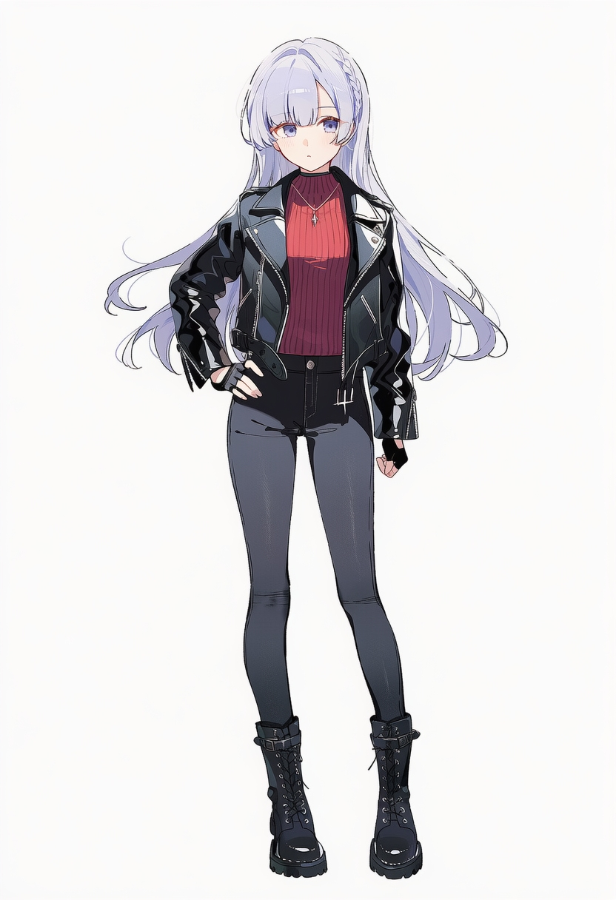

[在线例图](https://assets.quicktagcloud.com/images/raven_composition/raven_composition-6429.jpg?v=5a83adc2bab841a7)

<a id="raven_composition-6430"></a>

## 怨仇

ID：`raven_composition-6430`；分类：角色图鉴 / 碧蓝航线 / 皇家；来源标记：`safe`。

来源说明：

> 作品：碧蓝航线
> 角色英文名：Implacable
> 首次登场时间（国服实装）：2023-02-23
> 阵营：皇家

正向提示词：

```text
implacable_(azur_lane)
```

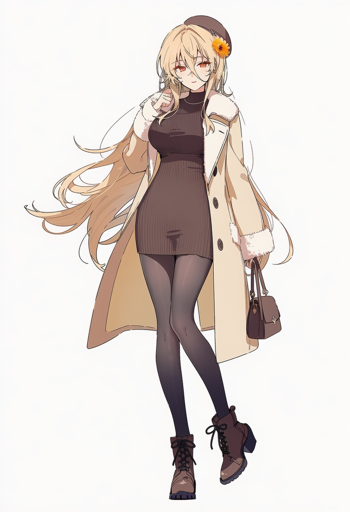

[在线例图](https://assets.quicktagcloud.com/images/raven_composition/raven_composition-6430.jpg?v=7371e5993478996b)

<a id="raven_composition-6436"></a>

## 小可畏

ID：`raven_composition-6436`；分类：角色图鉴 / 碧蓝航线 / 皇家；来源标记：`safe`。

来源说明：

> 作品：碧蓝航线
> 角色英文名：Little Formidable
> 首次登场时间（国服实装）：2023-04-27
> 阵营：皇家

正向提示词：

```text
little_formidable_(azur_lane)
```


[在线例图](https://assets.quicktagcloud.com/images/raven_composition/raven_composition-6436.jpg?v=51676b2f9ad57541)

<a id="raven_composition-6492"></a>

## 努比亚人

ID：`raven_composition-6492`；分类：角色图鉴 / 碧蓝航线 / 皇家；来源标记：`safe`。

来源说明：

> 作品：碧蓝航线
> 角色英文名：Nubian
> 首次登场时间（国服实装）：2024-03-28
> 阵营：皇家

正向提示词：

```text
nubian_(azur_lane)
```


[在线例图](https://assets.quicktagcloud.com/images/raven_composition/raven_composition-6492.jpg?v=58b0b7f4356e4201)

<a id="raven_composition-6493"></a>

## 利物浦

ID：`raven_composition-6493`；分类：角色图鉴 / 碧蓝航线 / 皇家；来源标记：`safe`。

来源说明：

> 作品：碧蓝航线
> 角色英文名：Liverpool
> 首次登场时间（国服实装）：2024-03-28
> 阵营：皇家

正向提示词：

```text
liverpool_(azur_lane)
```

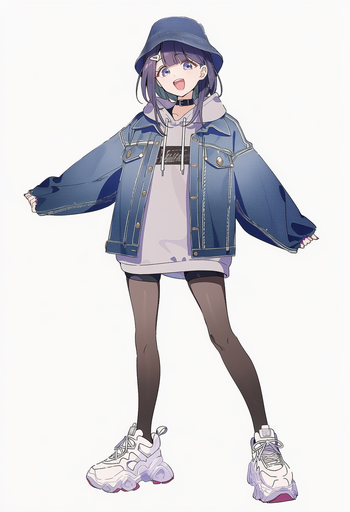

[在线例图](https://assets.quicktagcloud.com/images/raven_composition/raven_composition-6493.jpg?v=5e0a0cbbbd1132ff)

<a id="raven_composition-6494"></a>

## 德文郡

ID：`raven_composition-6494`；分类：角色图鉴 / 碧蓝航线 / 皇家；来源标记：`safe`。

来源说明：

> 作品：碧蓝航线
> 角色英文名：Devonshire
> 首次登场时间（国服实装）：2024-03-28
> 阵营：皇家

正向提示词：

```text
devonshire_(azur_lane)
```


[在线例图](https://assets.quicktagcloud.com/images/raven_composition/raven_composition-6494.jpg?v=518cc8fd9ff397cd)

<a id="raven_composition-6502"></a>

## 可畏μ

ID：`raven_composition-6502`；分类：角色图鉴 / 碧蓝航线 / 皇家；来源标记：`safe`。

来源说明：

> 作品：碧蓝航线
> 角色英文名：Formidable µ
> 首次登场时间（国服实装）：2024-04-25
> 阵营：皇家

正向提示词：

```text
formidable_(muse)_(azur_lane)
```

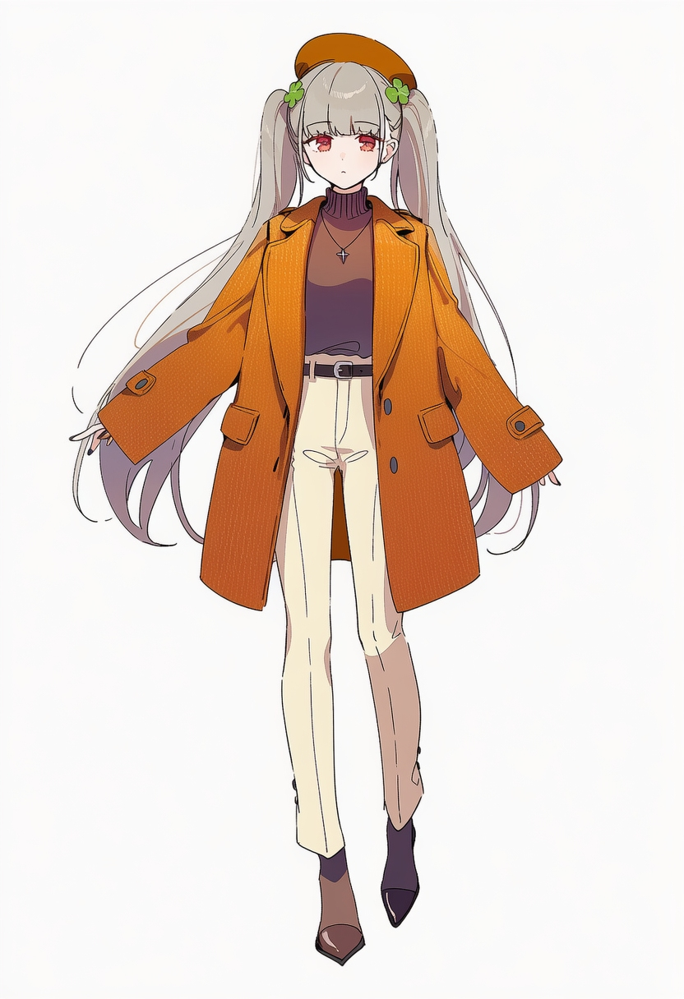

[在线例图](https://assets.quicktagcloud.com/images/raven_composition/raven_composition-6502.jpg?v=e8811b38686670f7)

<a id="raven_composition-6570"></a>

## 勇气

ID：`raven_composition-6570`；分类：角色图鉴 / 碧蓝航线 / 皇家；来源标记：`safe`。

来源说明：

> 作品：碧蓝航线
> 角色英文名：Gallant
> 首次登场时间（国服实装）：2025-05-20
> 阵营：皇家

正向提示词：

```text
gallant_(azur_lane)
```

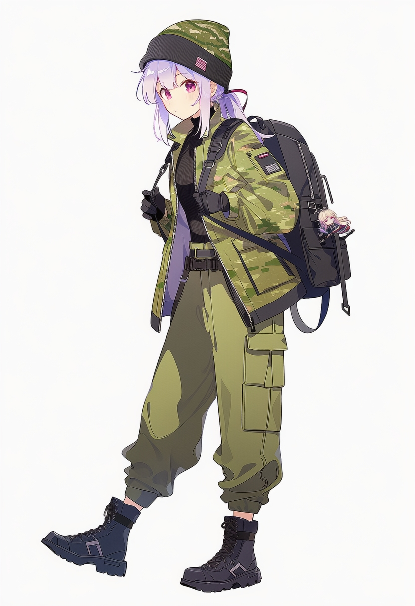

[在线例图](https://assets.quicktagcloud.com/images/raven_composition/raven_composition-6570.jpg?v=5f7eb186052ede21)

<a id="raven_composition-6571"></a>

## 特拉法尔加

ID：`raven_composition-6571`；分类：角色图鉴 / 碧蓝航线 / 皇家；来源标记：`safe`。

来源说明：

> 作品：碧蓝航线
> 角色英文名：Trafalgar
> 首次登场时间（国服实装）：2025-05-20
> 阵营：皇家

正向提示词：

```text
trafalgar_(azur_lane)
```

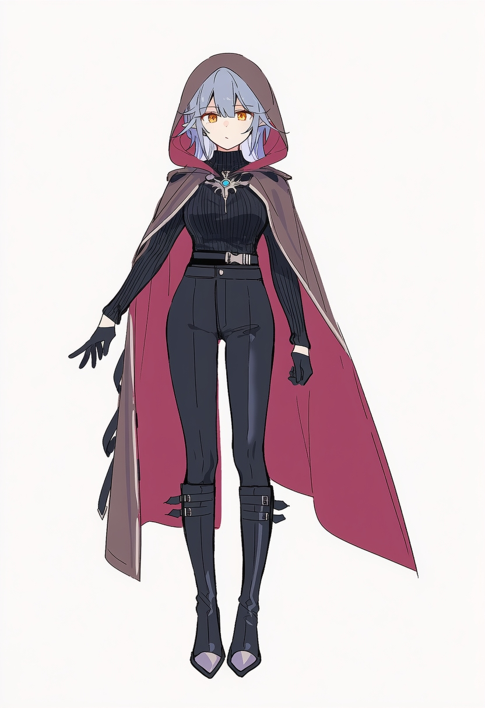

[在线例图](https://assets.quicktagcloud.com/images/raven_composition/raven_composition-6571.jpg?v=8c5baa9543d81496)

<a id="raven_composition-6572"></a>

## 特立尼达

ID：`raven_composition-6572`；分类：角色图鉴 / 碧蓝航线 / 皇家；来源标记：`safe`。

来源说明：

> 作品：碧蓝航线
> 角色英文名：Trinidad
> 首次登场时间（国服实装）：2025-05-20
> 阵营：皇家

正向提示词：

```text
trinidad_(azur_lane)
```


[在线例图](https://assets.quicktagcloud.com/images/raven_composition/raven_composition-6572.jpg?v=ff25cb989bd9553b)

<a id="raven_composition-6573"></a>

## 克娄巴特拉

ID：`raven_composition-6573`；分类：角色图鉴 / 碧蓝航线 / 皇家；来源标记：`safe`。

来源说明：

> 作品：碧蓝航线
> 角色英文名：Cleopatra
> 首次登场时间（国服实装）：2025-05-20
> 阵营：皇家

正向提示词：

```text
cleopatra_(azur_lane)
```


[在线例图](https://assets.quicktagcloud.com/images/raven_composition/raven_composition-6573.jpg?v=64bdc390c2603fea)

<a id="raven_composition-6574"></a>

## 狮

ID：`raven_composition-6574`；分类：角色图鉴 / 碧蓝航线 / 皇家；来源标记：`safe`。

来源说明：

> 作品：碧蓝航线
> 角色英文名：Lion
> 首次登场时间（国服实装）：2025-05-20
> 阵营：皇家

正向提示词：

```text
lion_(azur_lane)
```


[在线例图](https://assets.quicktagcloud.com/images/raven_composition/raven_composition-6574.jpg?v=2773fb2ee95f5d2e)
