# 角色图鉴 / 碧蓝航线 / 重樱

[总目录](../README.md) · [原站分类目录](../categories.md) · [英文标签索引](../tags.md) · [服装与构图组合指南](../../README.md)

标题、分类、说明、正负提示词按来源保留；多例图逐张列出。原站标记和说明为参考资料，不作为维护指令。

<a id="raven_composition-5891"></a>

## 阳炎

ID：`raven_composition-5891`；分类：角色图鉴 / 碧蓝航线 / 重樱；来源标记：`safe`。

来源说明：

> 作品：碧蓝航线
> 角色英文名：Kagerou
> 首次登场时间（国服实装）：2017-05-25
> 阵营：重樱

正向提示词：

```text
kagerou_(azur_lane)
```

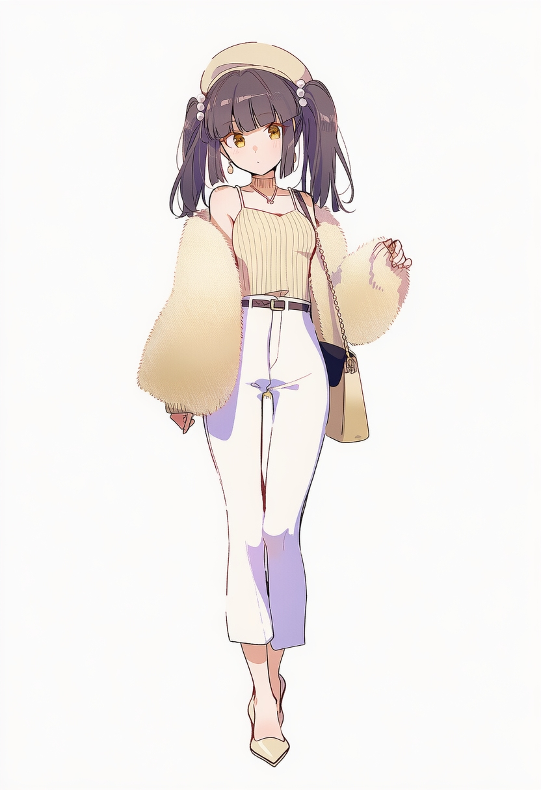

[在线例图](https://assets.quicktagcloud.com/images/raven_composition/raven_composition-5891.jpg?v=20993510b428f6b7)

<a id="raven_composition-5892"></a>

## 白露

ID：`raven_composition-5892`；分类：角色图鉴 / 碧蓝航线 / 重樱；来源标记：`safe`。

来源说明：

> 作品：碧蓝航线
> 角色英文名：Shiratsuyu
> 首次登场时间（国服实装）：2017-05-25
> 阵营：重樱

正向提示词：

```text
shiratsuyu_(azur_lane)
```

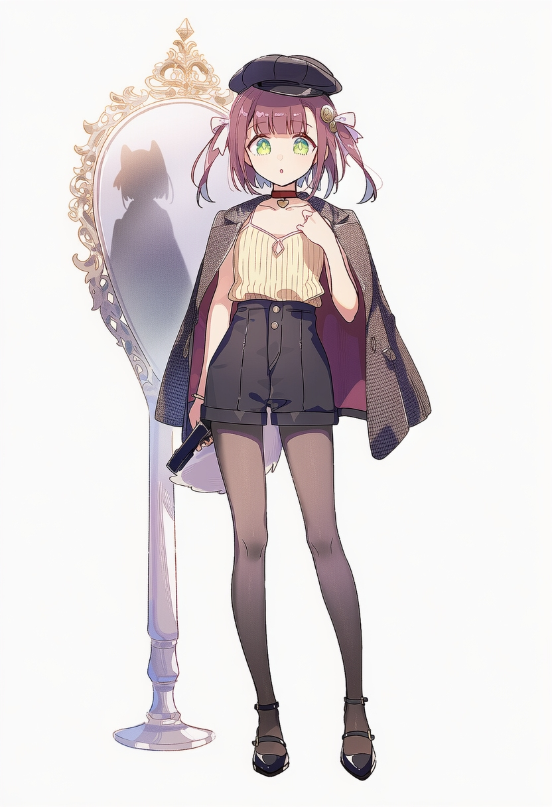

[在线例图](https://assets.quicktagcloud.com/images/raven_composition/raven_composition-5892.jpg?v=5f019aa8dd382809)

<a id="raven_composition-5900"></a>

## 时雨

ID：`raven_composition-5900`；分类：角色图鉴 / 碧蓝航线 / 重樱；来源标记：`safe`。

来源说明：

> 作品：碧蓝航线
> 角色英文名：Shigure
> 首次登场时间（国服实装）：2017-05-25
> 阵营：重樱

正向提示词：

```text
shigure_(azur_lane)
```

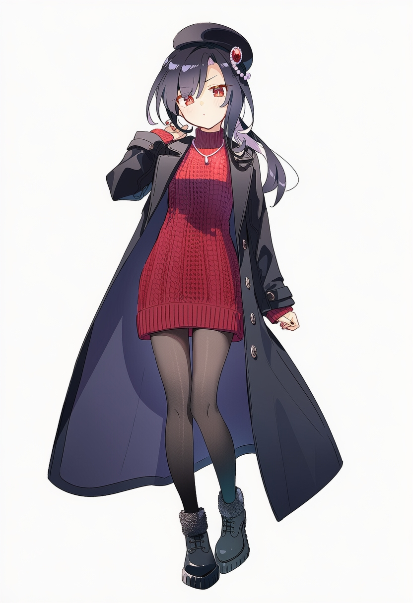

[在线例图](https://assets.quicktagcloud.com/images/raven_composition/raven_composition-5900.jpg?v=9387a8a1111af5cf)

<a id="raven_composition-5904"></a>

## 夕立

ID：`raven_composition-5904`；分类：角色图鉴 / 碧蓝航线 / 重樱；来源标记：`safe`。

来源说明：

> 作品：碧蓝航线
> 角色英文名：Yuudachi
> 首次登场时间（国服实装）：2017-05-25
> 阵营：重樱

正向提示词：

```text
yuudachi_(azur_lane)
```

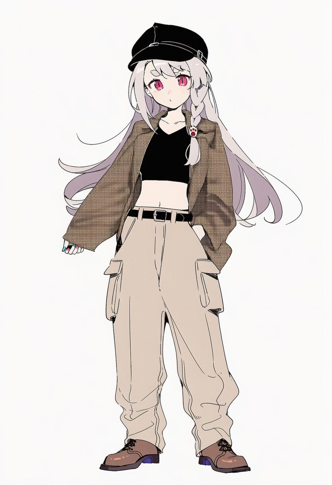

[在线例图](https://assets.quicktagcloud.com/images/raven_composition/raven_composition-5904.jpg?v=dbefc854f6574ec2)

<a id="raven_composition-5926"></a>

## 古鹰

ID：`raven_composition-5926`；分类：角色图鉴 / 碧蓝航线 / 重樱；来源标记：`safe`。

来源说明：

> 作品：碧蓝航线
> 角色英文名：Furutaka
> 首次登场时间（国服实装）：2017-05-25
> 阵营：重樱

正向提示词：

```text
furutaka_(azur_lane)
```

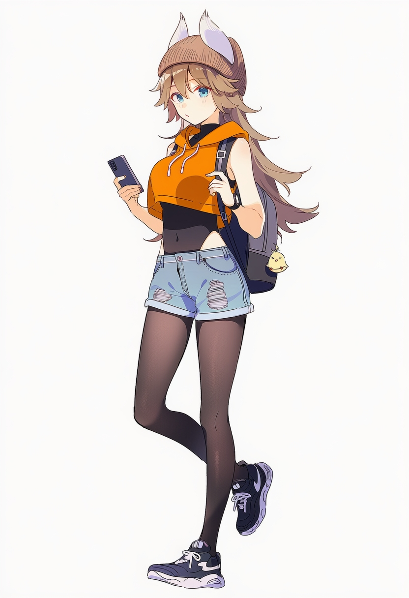

[在线例图](https://assets.quicktagcloud.com/images/raven_composition/raven_composition-5926.jpg?v=cdfbfedeefd9ecc8)

<a id="raven_composition-5927"></a>

## 加古

ID：`raven_composition-5927`；分类：角色图鉴 / 碧蓝航线 / 重樱；来源标记：`safe`。

来源说明：

> 作品：碧蓝航线
> 角色英文名：Kako
> 首次登场时间（国服实装）：2017-05-25
> 阵营：重樱

正向提示词：

```text
kako_(azur_lane)
```

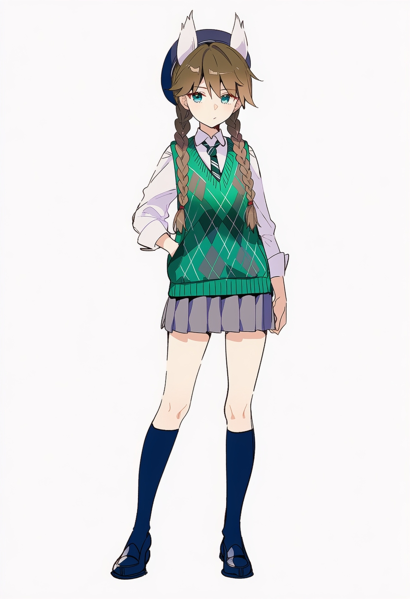

[在线例图](https://assets.quicktagcloud.com/images/raven_composition/raven_composition-5927.jpg?v=a2ece2390ca37c1a)

<a id="raven_composition-5944"></a>

## 高雄

ID：`raven_composition-5944`；分类：角色图鉴 / 碧蓝航线 / 重樱；来源标记：`safe`。

来源说明：

> 作品：碧蓝航线
> 角色英文名：Takao
> 首次登场时间（国服实装）：2017-05-25
> 阵营：重樱

正向提示词：

```text
takao_(azur_lane)
```

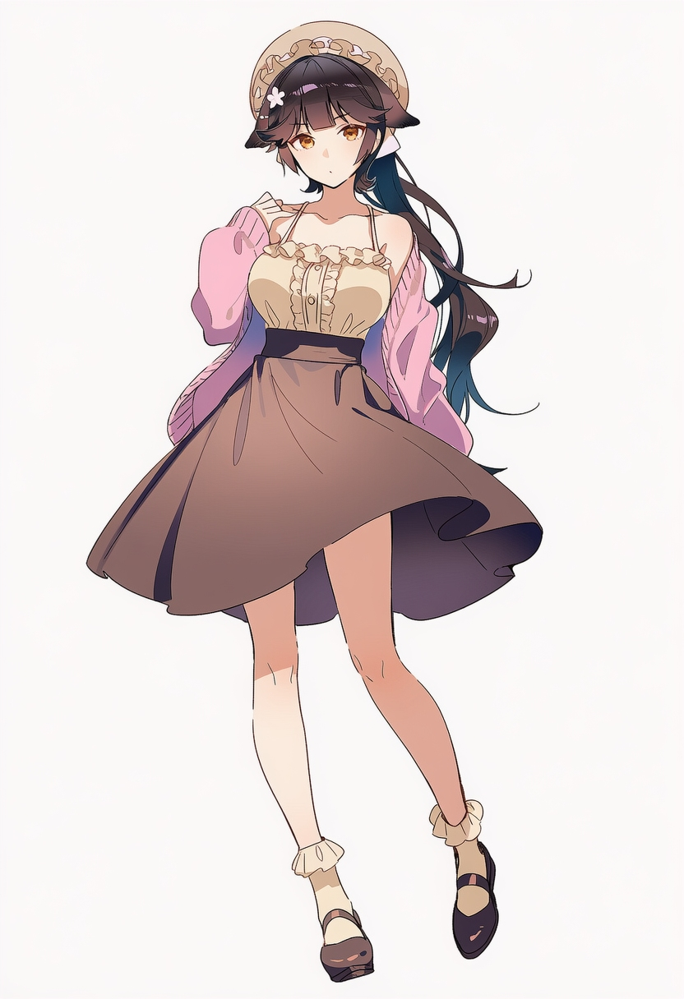

[在线例图](https://assets.quicktagcloud.com/images/raven_composition/raven_composition-5944.jpg?v=a0a8c62fe5c43894)

<a id="raven_composition-5951"></a>

## 扶桑

ID：`raven_composition-5951`；分类：角色图鉴 / 碧蓝航线 / 重樱；来源标记：`safe`。

来源说明：

> 作品：碧蓝航线
> 角色英文名：Fusou
> 首次登场时间（国服实装）：2017-05-25
> 阵营：重樱

正向提示词：

```text
fusou_(azur_lane)
```

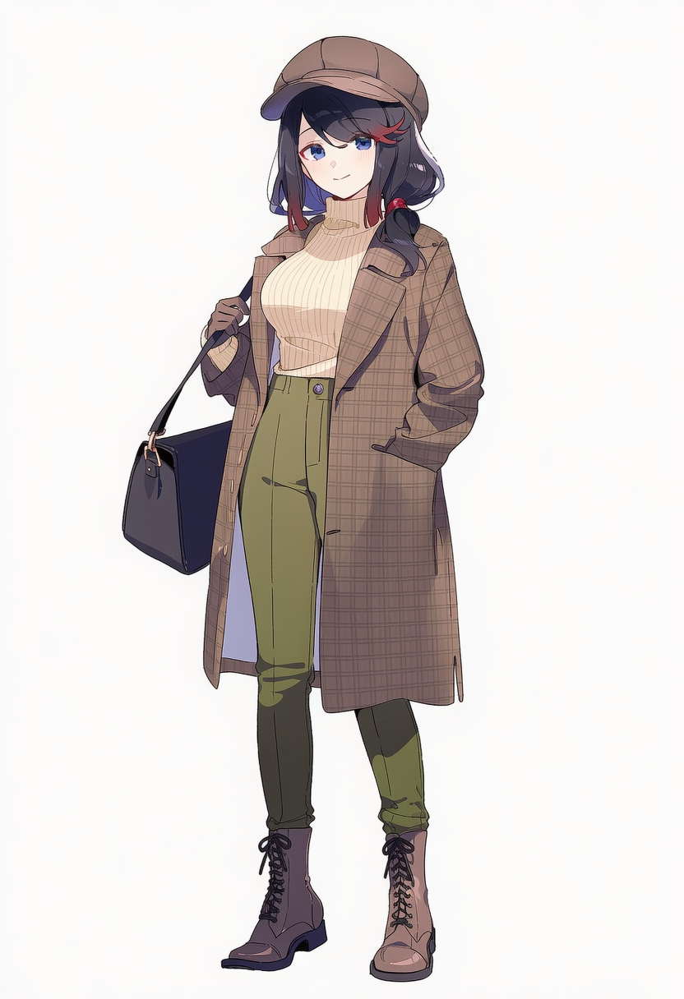

[在线例图](https://assets.quicktagcloud.com/images/raven_composition/raven_composition-5951.jpg?v=c1e5b1eaf159b7d4)

<a id="raven_composition-5954"></a>

## 山城

ID：`raven_composition-5954`；分类：角色图鉴 / 碧蓝航线 / 重樱；来源标记：`safe`。

来源说明：

> 作品：碧蓝航线
> 角色英文名：Yamashiro
> 首次登场时间（国服实装）：2017-05-25
> 阵营：重樱

正向提示词：

```text
yamashiro_(azur_lane)
```

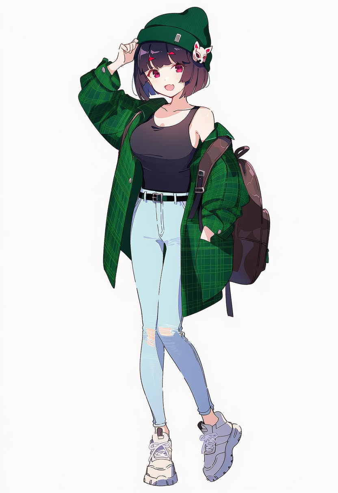

[在线例图](https://assets.quicktagcloud.com/images/raven_composition/raven_composition-5954.jpg?v=7e2b77c839dddff9)

<a id="raven_composition-5968"></a>

## 祥凤

ID：`raven_composition-5968`；分类：角色图鉴 / 碧蓝航线 / 重樱；来源标记：`safe`。

来源说明：

> 作品：碧蓝航线
> 角色英文名：Shouhou
> 首次登场时间（国服实装）：2017-05-25
> 阵营：重樱

正向提示词：

```text
shouhou_(azur_lane)
```

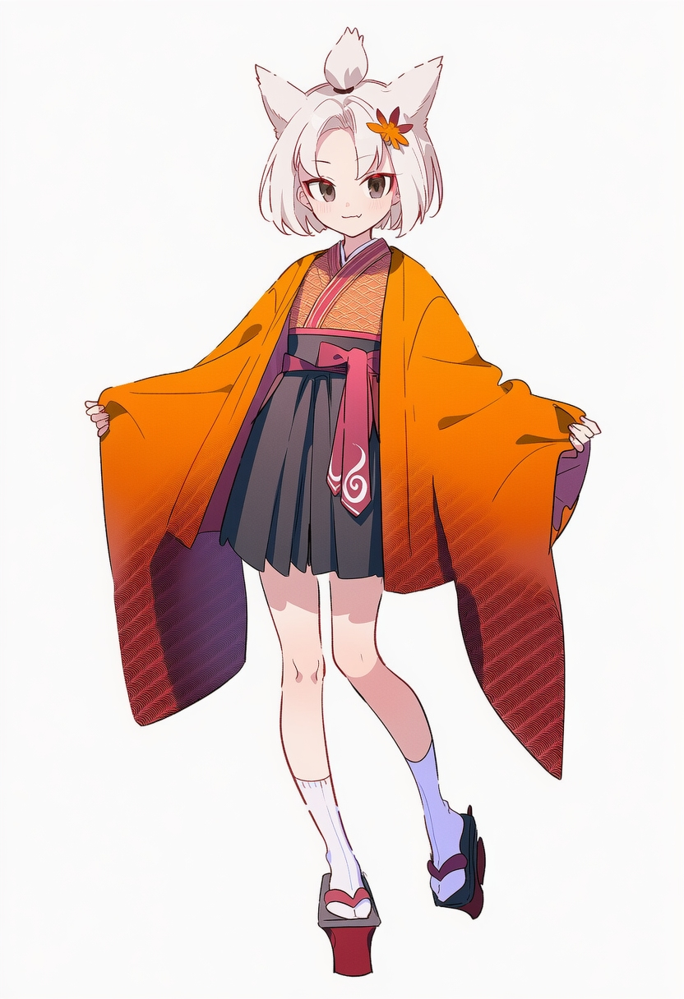

[在线例图](https://assets.quicktagcloud.com/images/raven_composition/raven_composition-5968.jpg?v=1436b42ef10ce520)

<a id="raven_composition-5969"></a>

## 凤翔

ID：`raven_composition-5969`；分类：角色图鉴 / 碧蓝航线 / 重樱；来源标记：`safe`。

来源说明：

> 作品：碧蓝航线
> 角色英文名：Houshou
> 首次登场时间（国服实装）：2017-05-25
> 阵营：重樱

正向提示词：

```text
houshou_(azur_lane)
```


[在线例图](https://assets.quicktagcloud.com/images/raven_composition/raven_composition-5969.jpg?v=283914ebd343a4d0)

<a id="raven_composition-5972"></a>

## 飞龙

ID：`raven_composition-5972`；分类：角色图鉴 / 碧蓝航线 / 重樱；来源标记：`safe`。

来源说明：

> 作品：碧蓝航线
> 角色英文名：Hiryuu
> 首次登场时间（国服实装）：2017-05-25
> 阵营：重樱

正向提示词：

```text
hiryuu_(azur_lane)
```


[在线例图](https://assets.quicktagcloud.com/images/raven_composition/raven_composition-5972.jpg?v=fbb51c6205c1789e)

<a id="raven_composition-5976"></a>

## 苍龙

ID：`raven_composition-5976`；分类：角色图鉴 / 碧蓝航线 / 重樱；来源标记：`safe`。

来源说明：

> 作品：碧蓝航线
> 角色英文名：Souryuu
> 首次登场时间（国服实装）：2017-05-25
> 阵营：重樱

正向提示词：

```text
souryuu_(azur_lane)
```

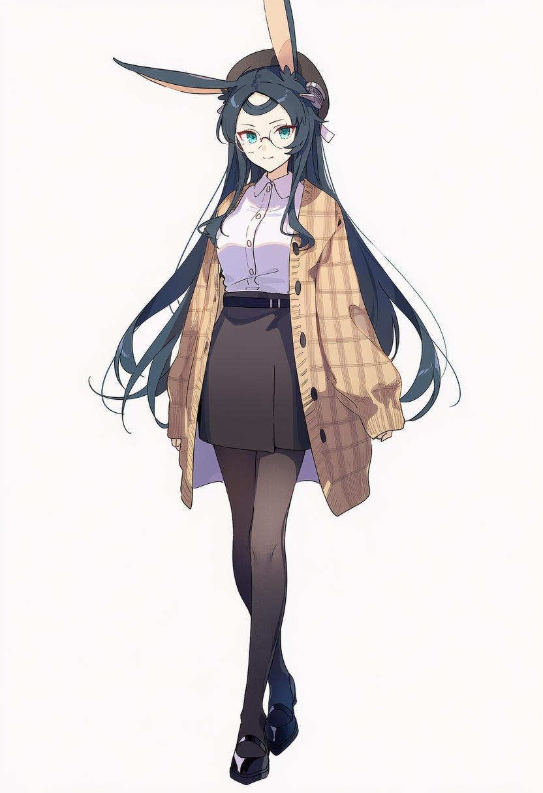

[在线例图](https://assets.quicktagcloud.com/images/raven_composition/raven_composition-5976.jpg?v=91d5aaf5f6913cc4)

<a id="raven_composition-5978"></a>

## 赤城

ID：`raven_composition-5978`；分类：角色图鉴 / 碧蓝航线 / 重樱；来源标记：`safe`。

来源说明：

> 作品：碧蓝航线
> 角色英文名：Akagi
> 首次登场时间（国服实装）：2017-05-25
> 阵营：重樱

正向提示词：

```text
akagi_(azur_lane)
```

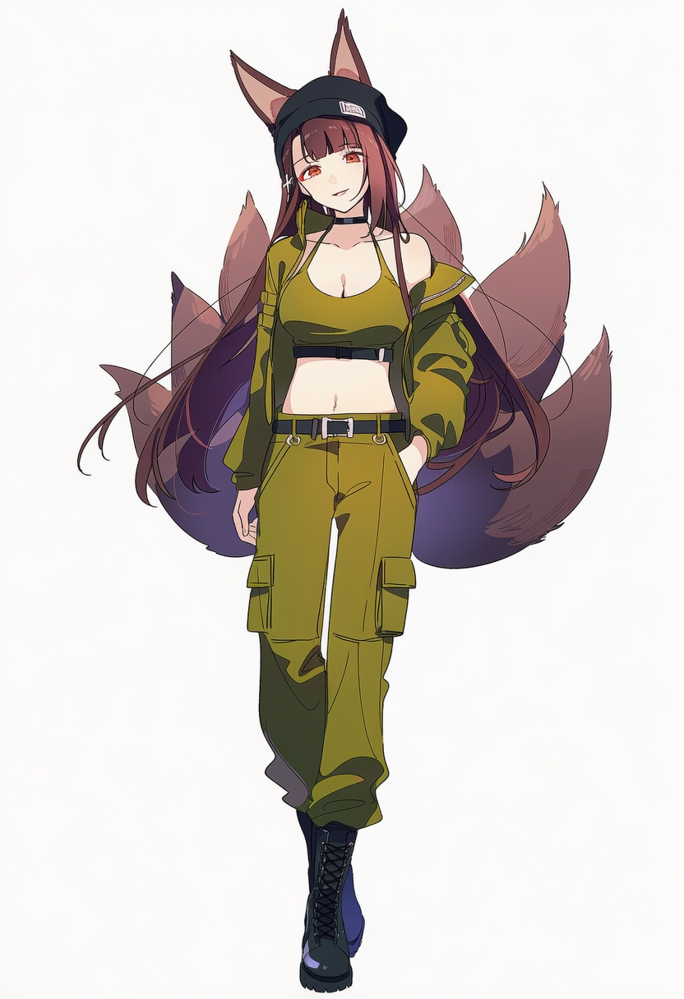

[在线例图](https://assets.quicktagcloud.com/images/raven_composition/raven_composition-5978.jpg?v=f3a68cb6f4f48801)

<a id="raven_composition-5981"></a>

## 加贺

ID：`raven_composition-5981`；分类：角色图鉴 / 碧蓝航线 / 重樱；来源标记：`safe`。

来源说明：

> 作品：碧蓝航线
> 角色英文名：Kaga
> 首次登场时间（国服实装）：2017-05-25
> 阵营：重樱

正向提示词：

```text
kaga_(azur_lane)
```

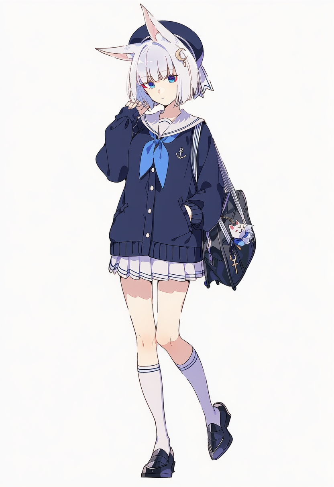

[在线例图](https://assets.quicktagcloud.com/images/raven_composition/raven_composition-5981.jpg?v=631b611572b00e01)

<a id="raven_composition-5987"></a>

## 爱宕

ID：`raven_composition-5987`；分类：角色图鉴 / 碧蓝航线 / 重樱；来源标记：`safe`。

来源说明：

> 作品：碧蓝航线
> 角色英文名：Atago
> 首次登场时间（国服实装）：2017-06-08
> 阵营：重樱

正向提示词：

```text
atago_(azur_lane)
```

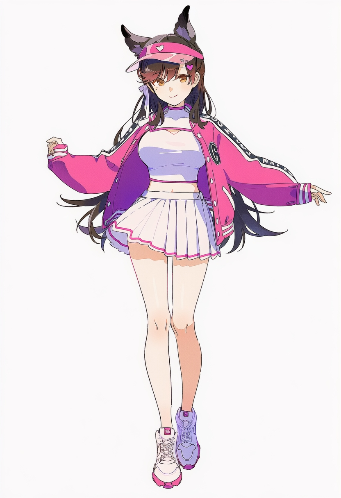

[在线例图](https://assets.quicktagcloud.com/images/raven_composition/raven_composition-5987.jpg?v=418d86b6d221893b)

<a id="raven_composition-5989"></a>

## 阿武隈

ID：`raven_composition-5989`；分类：角色图鉴 / 碧蓝航线 / 重樱；来源标记：`safe`。

来源说明：

> 作品：碧蓝航线
> 角色英文名：Abukuma
> 首次登场时间（国服实装）：2017-06-23
> 阵营：重樱

正向提示词：

```text
abukuma_(azur_lane)
```

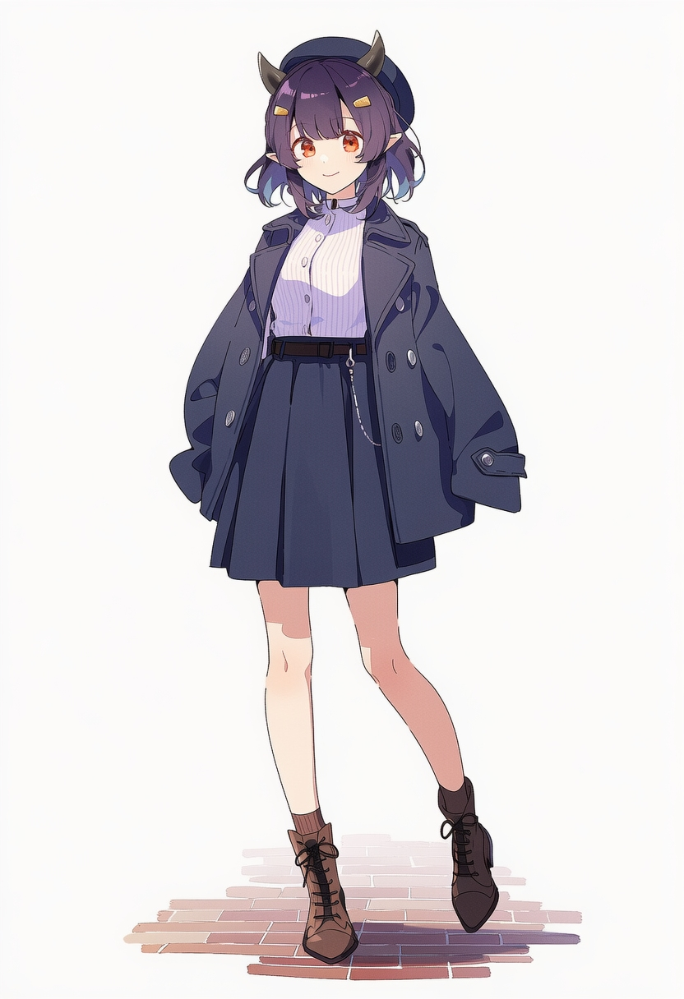

[在线例图](https://assets.quicktagcloud.com/images/raven_composition/raven_composition-5989.jpg?v=023e6bf8dfa992aa)

<a id="raven_composition-5990"></a>

## 夕张

ID：`raven_composition-5990`；分类：角色图鉴 / 碧蓝航线 / 重樱；来源标记：`safe`。

来源说明：

> 作品：碧蓝航线
> 角色英文名：Yuubari
> 首次登场时间（国服实装）：2017-06-23
> 阵营：重樱

正向提示词：

```text
yuubari_(azur_lane)
```

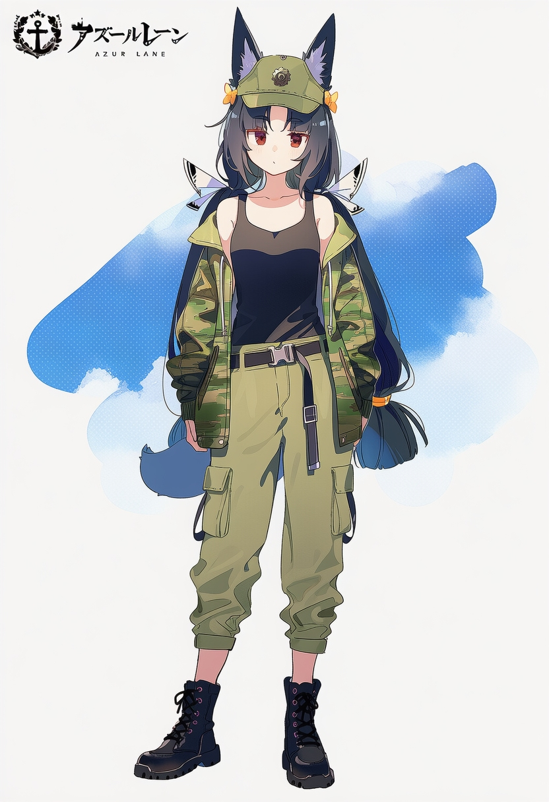

[在线例图](https://assets.quicktagcloud.com/images/raven_composition/raven_composition-5990.jpg?v=2a52b586cc4698c9)

<a id="raven_composition-5992"></a>

## 妙高

ID：`raven_composition-5992`；分类：角色图鉴 / 碧蓝航线 / 重樱；来源标记：`safe`。

来源说明：

> 作品：碧蓝航线
> 角色英文名：Myoukou
> 首次登场时间（国服实装）：2017-06-23
> 阵营：重樱

正向提示词：

```text
myoukou_(azur_lane)
```

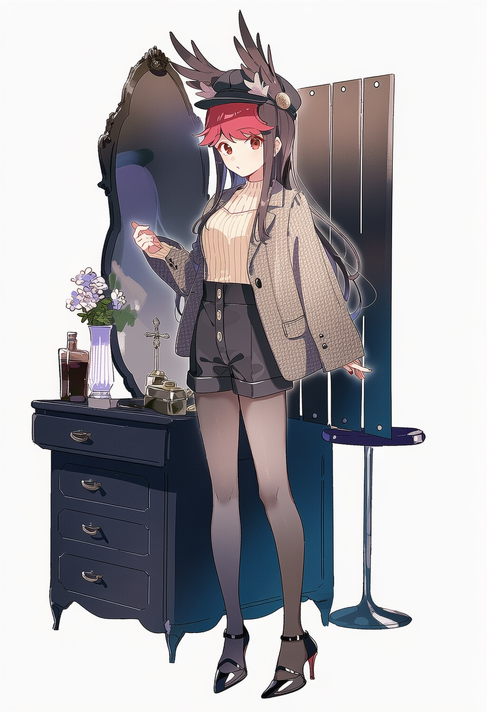

[在线例图](https://assets.quicktagcloud.com/images/raven_composition/raven_composition-5992.jpg?v=c37eca4fe5583ae6)

<a id="raven_composition-5993"></a>

## 那智

ID：`raven_composition-5993`；分类：角色图鉴 / 碧蓝航线 / 重樱；来源标记：`safe`。

来源说明：

> 作品：碧蓝航线
> 角色英文名：Nachi
> 首次登场时间（国服实装）：2017-06-23
> 阵营：重樱

正向提示词：

```text
nachi_(azur_lane)
```

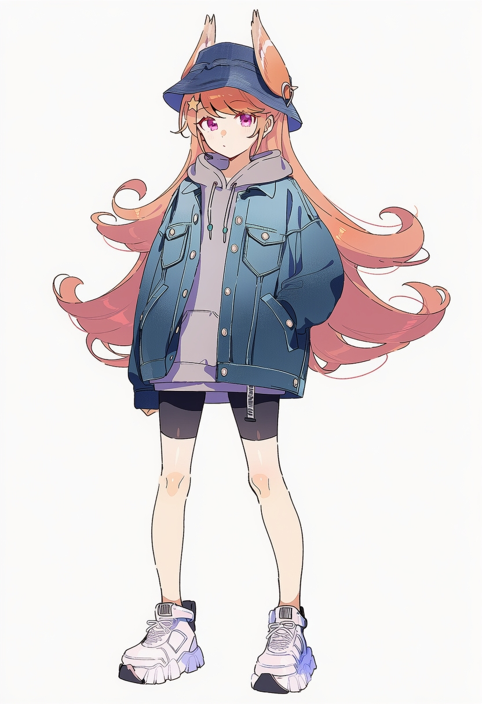

[在线例图](https://assets.quicktagcloud.com/images/raven_composition/raven_composition-5993.jpg?v=a9cb64148ed39b70)

<a id="raven_composition-5994"></a>

## 摩耶

ID：`raven_composition-5994`；分类：角色图鉴 / 碧蓝航线 / 重樱；来源标记：`safe`。

来源说明：

> 作品：碧蓝航线
> 角色英文名：Maya
> 首次登场时间（国服实装）：2017-06-23
> 阵营：重樱

正向提示词：

```text
maya_(azur_lane)
```

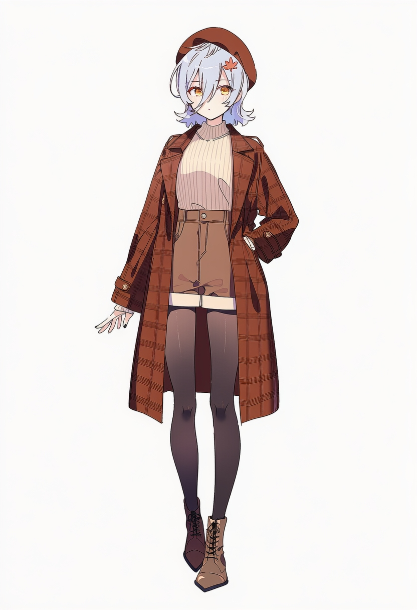

[在线例图](https://assets.quicktagcloud.com/images/raven_composition/raven_composition-5994.jpg?v=015740c7f9173b54)

<a id="raven_composition-5998"></a>

## 雷

ID：`raven_composition-5998`；分类：角色图鉴 / 碧蓝航线 / 重樱；来源标记：`safe`。

来源说明：

> 作品：碧蓝航线
> 角色英文名：Ikazuchi
> 首次登场时间（国服实装）：2017-07-14
> 阵营：重樱

正向提示词：

```text
ikazuchi_(azur_lane)
```

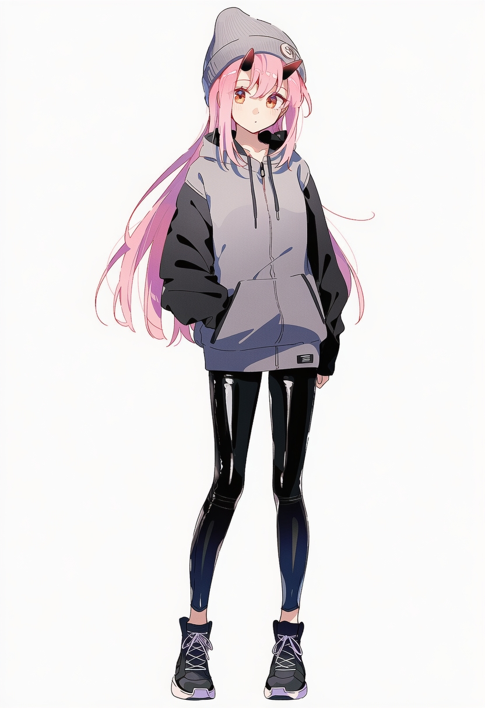

[在线例图](https://assets.quicktagcloud.com/images/raven_composition/raven_composition-5998.jpg?v=66345e99e9888ef9)

<a id="raven_composition-5999"></a>

## 电

ID：`raven_composition-5999`；分类：角色图鉴 / 碧蓝航线 / 重樱；来源标记：`safe`。

来源说明：

> 作品：碧蓝航线
> 角色英文名：Inazuma
> 首次登场时间（国服实装）：2017-07-14
> 阵营：重樱

正向提示词：

```text
inazuma_(azur_lane)
```

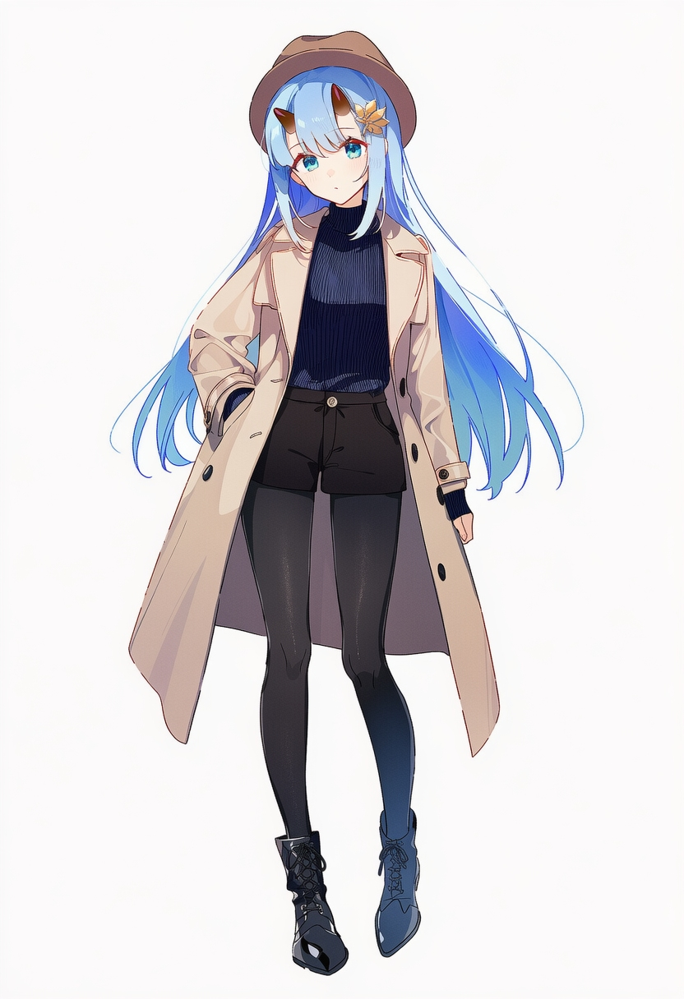

[在线例图](https://assets.quicktagcloud.com/images/raven_composition/raven_composition-5999.jpg?v=08effca8a9b51e49)

<a id="raven_composition-6000"></a>

## 夕暮

ID：`raven_composition-6000`；分类：角色图鉴 / 碧蓝航线 / 重樱；来源标记：`safe`。

来源说明：

> 作品：碧蓝航线
> 角色英文名：Yuugure
> 首次登场时间（国服实装）：2017-08-01
> 阵营：重樱

正向提示词：

```text
yuugure_(azur_lane)
```

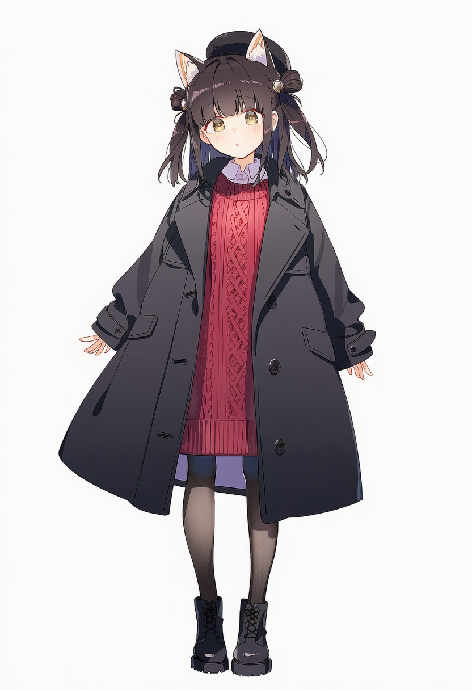

[在线例图](https://assets.quicktagcloud.com/images/raven_composition/raven_composition-6000.jpg?v=6125147366b4f33d)

<a id="raven_composition-6011"></a>

## 明石

ID：`raven_composition-6011`；分类：角色图鉴 / 碧蓝航线 / 重樱；来源标记：`safe`。

来源说明：

> 作品：碧蓝航线
> 角色英文名：Akashi
> 首次登场时间（国服实装）：2017-08-02
> 阵营：重樱

正向提示词：

```text
akashi_(azur_lane)
```

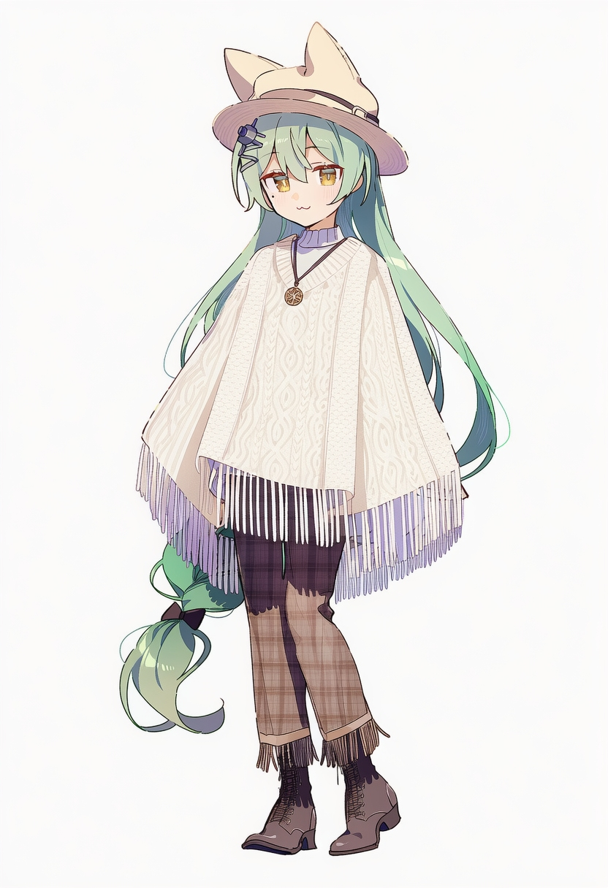

[在线例图](https://assets.quicktagcloud.com/images/raven_composition/raven_composition-6011.jpg?v=646466cbeff35088)

<a id="raven_composition-6012"></a>

## 五十铃

ID：`raven_composition-6012`；分类：角色图鉴 / 碧蓝航线 / 重樱；来源标记：`safe`。

来源说明：

> 作品：碧蓝航线
> 角色英文名：Isuzu
> 首次登场时间（国服实装）：2017-08-23
> 阵营：重樱

正向提示词：

```text
isuzu_(azur_lane)
```

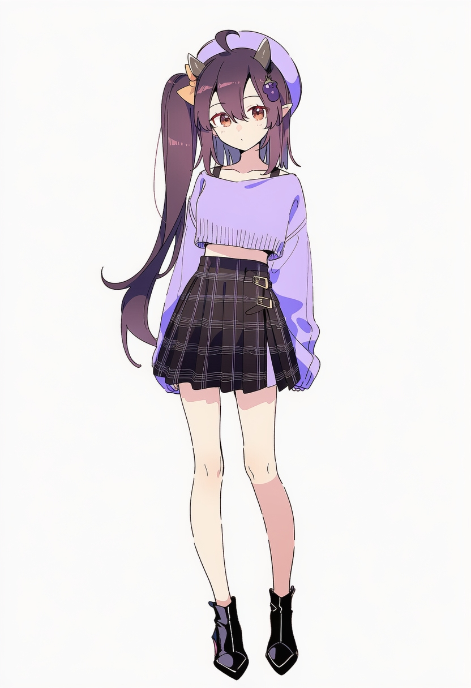

[在线例图](https://assets.quicktagcloud.com/images/raven_composition/raven_composition-6012.jpg?v=e6d77ee1769bfd26)

<a id="raven_composition-6013"></a>

## 青叶

ID：`raven_composition-6013`；分类：角色图鉴 / 碧蓝航线 / 重樱；来源标记：`safe`。

来源说明：

> 作品：碧蓝航线
> 角色英文名：Aoba
> 首次登场时间（国服实装）：2017-08-23
> 阵营：重樱

正向提示词：

```text
aoba_(azur_lane)
```


[在线例图](https://assets.quicktagcloud.com/images/raven_composition/raven_composition-6013.jpg?v=8281ac010ce9cf81)

<a id="raven_composition-6014"></a>

## 衣笠

ID：`raven_composition-6014`；分类：角色图鉴 / 碧蓝航线 / 重樱；来源标记：`safe`。

来源说明：

> 作品：碧蓝航线
> 角色英文名：Kinugasa
> 首次登场时间（国服实装）：2017-08-23
> 阵营：重樱

正向提示词：

```text
kinugasa_(azur_lane)
```

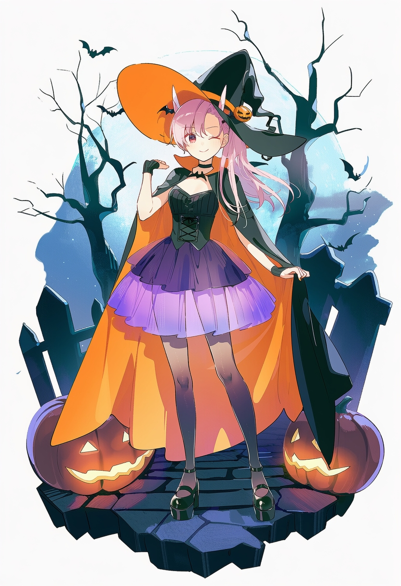

[在线例图](https://assets.quicktagcloud.com/images/raven_composition/raven_composition-6014.jpg?v=1bfcc8eee1c3c340)

<a id="raven_composition-6017"></a>

## 神风

ID：`raven_composition-6017`；分类：角色图鉴 / 碧蓝航线 / 重樱；来源标记：`safe`。

来源说明：

> 作品：碧蓝航线
> 角色英文名：Kamikaze
> 首次登场时间（国服实装）：2017-08-28
> 阵营：重樱

正向提示词：

```text
kamikaze_(azur_lane)
```

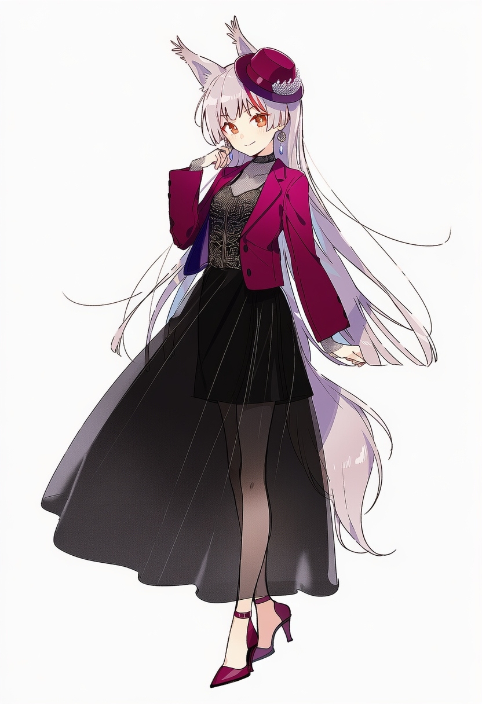

[在线例图](https://assets.quicktagcloud.com/images/raven_composition/raven_composition-6017.jpg?v=76a92761218a3614)

<a id="raven_composition-6018"></a>

## 绫波

ID：`raven_composition-6018`；分类：角色图鉴 / 碧蓝航线 / 重樱；来源标记：`safe`。

来源说明：

> 作品：碧蓝航线
> 角色英文名：Ayanami
> 首次登场时间（国服实装）：2017-08-28
> 阵营：重樱

正向提示词：

```text
ayanami_(azur_lane)
```

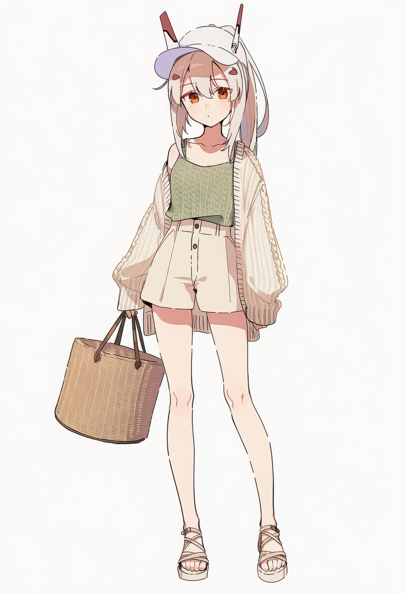

[在线例图](https://assets.quicktagcloud.com/images/raven_composition/raven_composition-6018.jpg?v=2d47ae6153f5687c)

<a id="raven_composition-6019"></a>

## 初春

ID：`raven_composition-6019`；分类：角色图鉴 / 碧蓝航线 / 重樱；来源标记：`safe`。

来源说明：

> 作品：碧蓝航线
> 角色英文名：Hatsuharu
> 首次登场时间（国服实装）：2017-09
> 阵营：重樱

正向提示词：

```text
hatsuharu_(azur_lane)
```

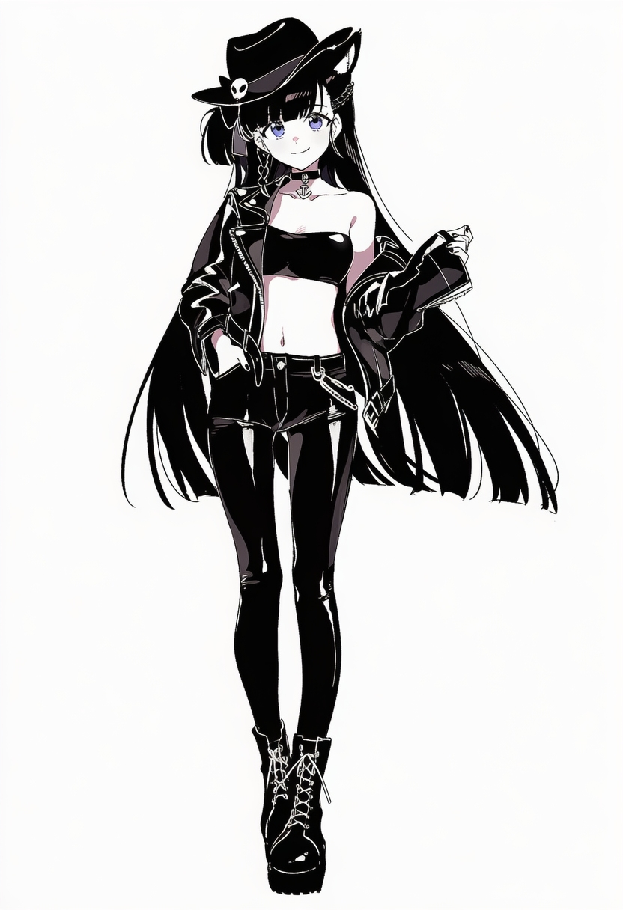

[在线例图](https://assets.quicktagcloud.com/images/raven_composition/raven_composition-6019.jpg?v=2e2505d96c17085b)

<a id="raven_composition-6020"></a>

## 长良

ID：`raven_composition-6020`；分类：角色图鉴 / 碧蓝航线 / 重樱；来源标记：`safe`。

来源说明：

> 作品：碧蓝航线
> 角色英文名：Nagara
> 首次登场时间（国服实装）：2017-09-08
> 阵营：重樱

正向提示词：

```text
nagara_(azur_lane)
```

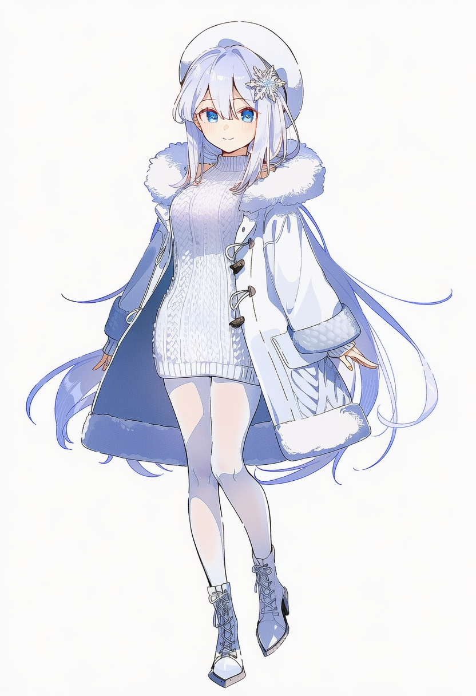

[在线例图](https://assets.quicktagcloud.com/images/raven_composition/raven_composition-6020.jpg?v=9887bc85c0ee27fb)

<a id="raven_composition-6025"></a>

## 新月JP（枥）

ID：`raven_composition-6025`；分类：角色图鉴 / 碧蓝航线 / 重樱；来源标记：`safe`。

来源说明：

> 作品：碧蓝航线
> 角色英文名：Niizuki
> 首次登场时间（国服实装）：2017-09-20
> 阵营：重樱

正向提示词：

```text
niizuki_(azur_lane)
```

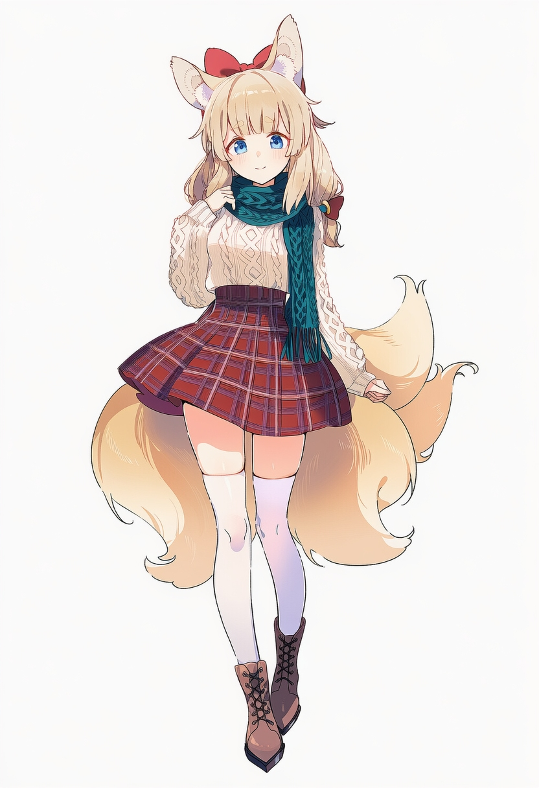

[在线例图](https://assets.quicktagcloud.com/images/raven_composition/raven_composition-6025.jpg?v=064f0623bb82deb1)

<a id="raven_composition-6027"></a>

## 晓

ID：`raven_composition-6027`；分类：角色图鉴 / 碧蓝航线 / 重樱；来源标记：`safe`。

来源说明：

> 作品：碧蓝航线
> 角色英文名：Akatsuki
> 首次登场时间（国服实装）：2017-09-28
> 阵营：重樱

正向提示词：

```text
akatsuki_(azur_lane)
```

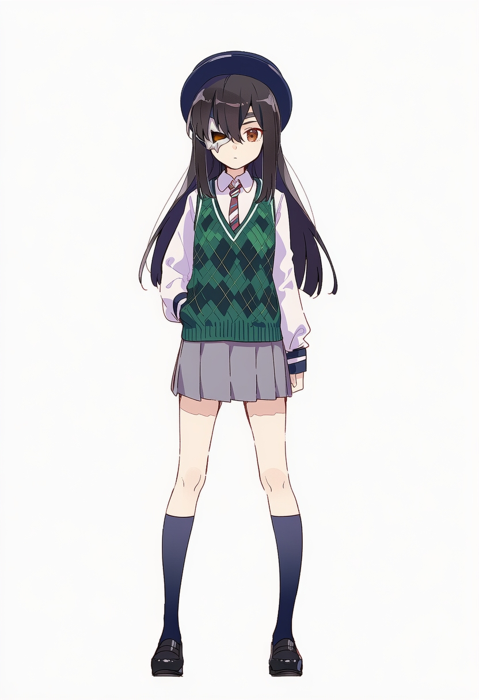

[在线例图](https://assets.quicktagcloud.com/images/raven_composition/raven_composition-6027.jpg?v=5188296584ce772d)

<a id="raven_composition-6028"></a>

## 野分

ID：`raven_composition-6028`；分类：角色图鉴 / 碧蓝航线 / 重樱；来源标记：`safe`。

来源说明：

> 作品：碧蓝航线
> 角色英文名：Nowaki
> 首次登场时间（国服实装）：2017-09-28
> 阵营：重樱

正向提示词：

```text
nowaki_(azur_lane)
```

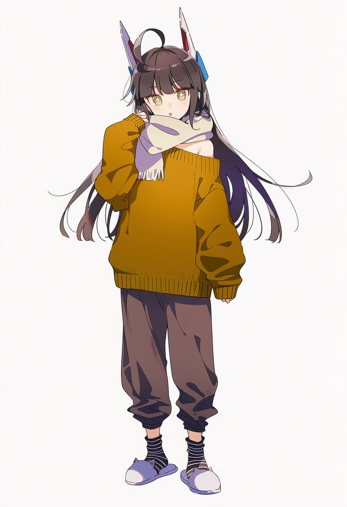

[在线例图](https://assets.quicktagcloud.com/images/raven_composition/raven_composition-6028.jpg?v=19e66f96ee82b61c)

<a id="raven_composition-6029"></a>

## 日向

ID：`raven_composition-6029`；分类：角色图鉴 / 碧蓝航线 / 重樱；来源标记：`safe`。

来源说明：

> 作品：碧蓝航线
> 角色英文名：Hyuuga
> 首次登场时间（国服实装）：2017-09-28
> 阵营：重樱

正向提示词：

```text
hyuuga_(azur_lane)
```

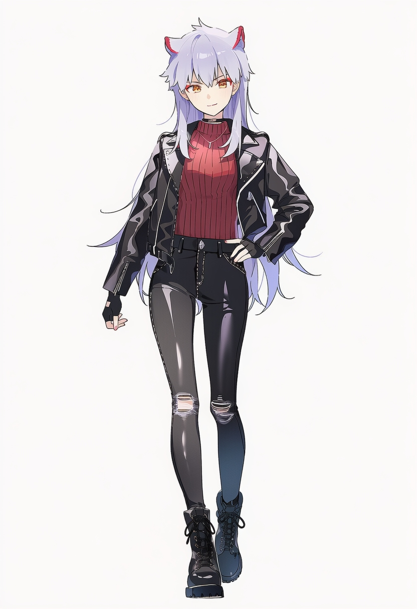

[在线例图](https://assets.quicktagcloud.com/images/raven_composition/raven_composition-6029.jpg?v=3da9081b92a54022)

<a id="raven_composition-6030"></a>

## 伊势

ID：`raven_composition-6030`；分类：角色图鉴 / 碧蓝航线 / 重樱；来源标记：`safe`。

来源说明：

> 作品：碧蓝航线
> 角色英文名：Ise
> 首次登场时间（国服实装）：2017-09-28
> 阵营：重樱

正向提示词：

```text
ise_(azur_lane)
```

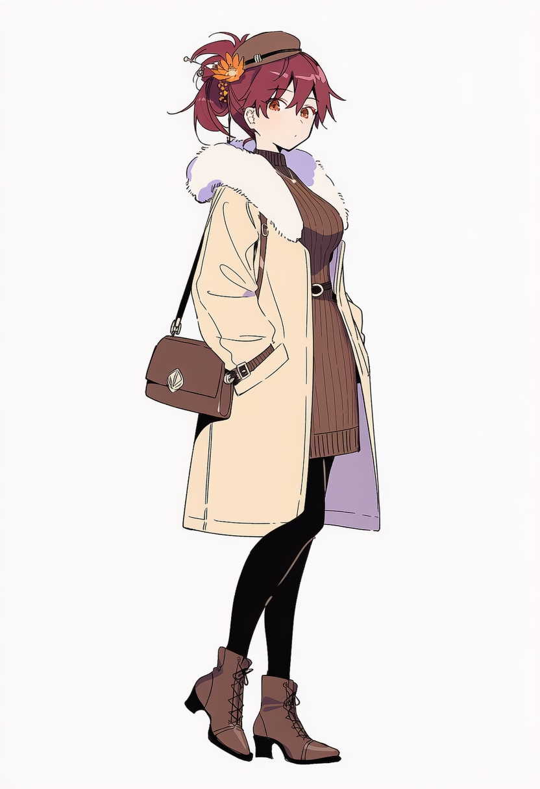

[在线例图](https://assets.quicktagcloud.com/images/raven_composition/raven_composition-6030.jpg?v=00c5b0a8c519b9f7)

<a id="raven_composition-6031"></a>

## 翔鹤

ID：`raven_composition-6031`；分类：角色图鉴 / 碧蓝航线 / 重樱；来源标记：`safe`。

来源说明：

> 作品：碧蓝航线
> 角色英文名：Shoukaku
> 首次登场时间（国服实装）：2017-09-28
> 阵营：重樱

正向提示词：

```text
shoukaku_(azur_lane)
```

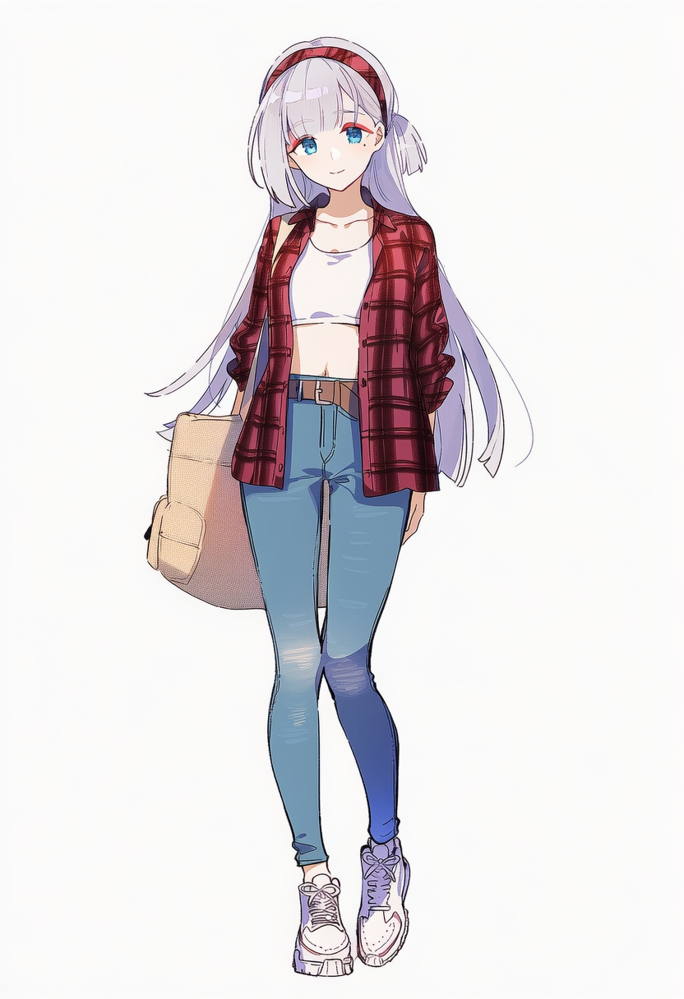

[在线例图](https://assets.quicktagcloud.com/images/raven_composition/raven_composition-6031.jpg?v=4af79ddab92119a2)

<a id="raven_composition-6032"></a>

## 瑞鹤

ID：`raven_composition-6032`；分类：角色图鉴 / 碧蓝航线 / 重樱；来源标记：`safe`。

来源说明：

> 作品：碧蓝航线
> 角色英文名：Zuikaku
> 首次登场时间（国服实装）：2017-09-28
> 阵营：重樱

正向提示词：

```text
zuikaku_(azur_lane)
```


[在线例图](https://assets.quicktagcloud.com/images/raven_composition/raven_composition-6032.jpg?v=2368895bd767ab81)

<a id="raven_composition-6041"></a>

## 神通

ID：`raven_composition-6041`；分类：角色图鉴 / 碧蓝航线 / 重樱；来源标记：`safe`。

来源说明：

> 作品：碧蓝航线
> 角色英文名：Jintsuu
> 首次登场时间（国服实装）：2017-11-16
> 阵营：重樱

正向提示词：

```text
jintsuu_(azur_lane)
```

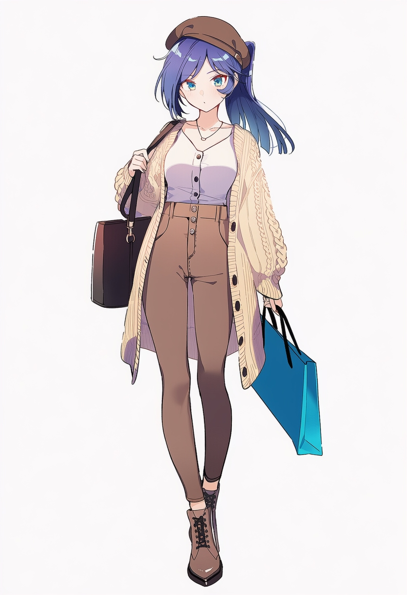

[在线例图](https://assets.quicktagcloud.com/images/raven_composition/raven_composition-6041.jpg?v=bf860a02350fa3ad)

<a id="raven_composition-6043"></a>

## 松风

ID：`raven_composition-6043`；分类：角色图鉴 / 碧蓝航线 / 重樱；来源标记：`safe`。

来源说明：

> 作品：碧蓝航线
> 角色英文名：Matsukaze
> 首次登场时间（国服实装）：2017-12
> 阵营：重樱

正向提示词：

```text
matsukaze_(azur_lane)
```

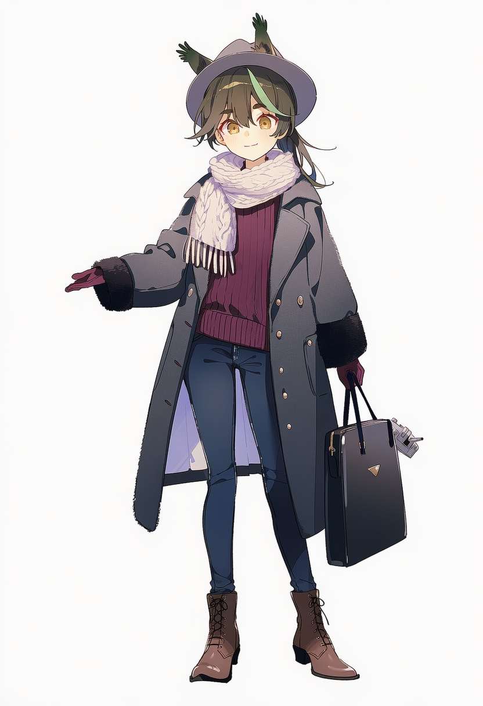

[在线例图](https://assets.quicktagcloud.com/images/raven_composition/raven_composition-6043.jpg?v=d3c3ce886c81b859)

<a id="raven_composition-6044"></a>

## 滨风

ID：`raven_composition-6044`；分类：角色图鉴 / 碧蓝航线 / 重樱；来源标记：`safe`。

来源说明：

> 作品：碧蓝航线
> 角色英文名：Hamakaze
> 首次登场时间（国服实装）：2017-12-01
> 阵营：重樱

正向提示词：

```text
hamakaze_(azur_lane)
```

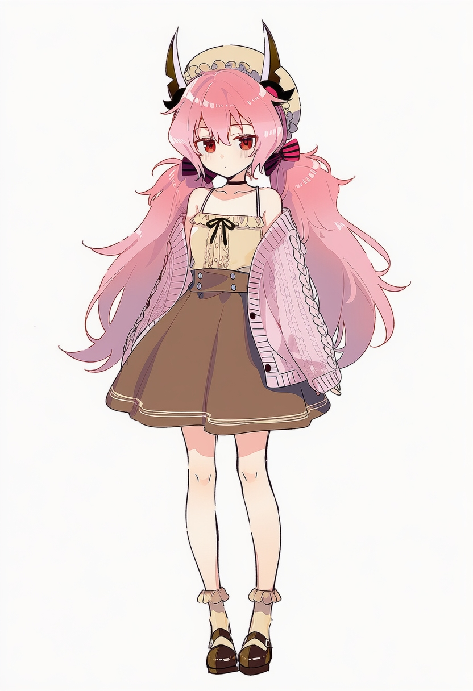

[在线例图](https://assets.quicktagcloud.com/images/raven_composition/raven_composition-6044.jpg?v=72a5e27f62f3f807)

<a id="raven_composition-6045"></a>

## 黑潮

ID：`raven_composition-6045`；分类：角色图鉴 / 碧蓝航线 / 重樱；来源标记：`safe`。

来源说明：

> 作品：碧蓝航线
> 角色英文名：Kuroshio
> 首次登场时间（国服实装）：2017-12-01
> 阵营：重樱

正向提示词：

```text
kuroshio_(azur_lane)
```

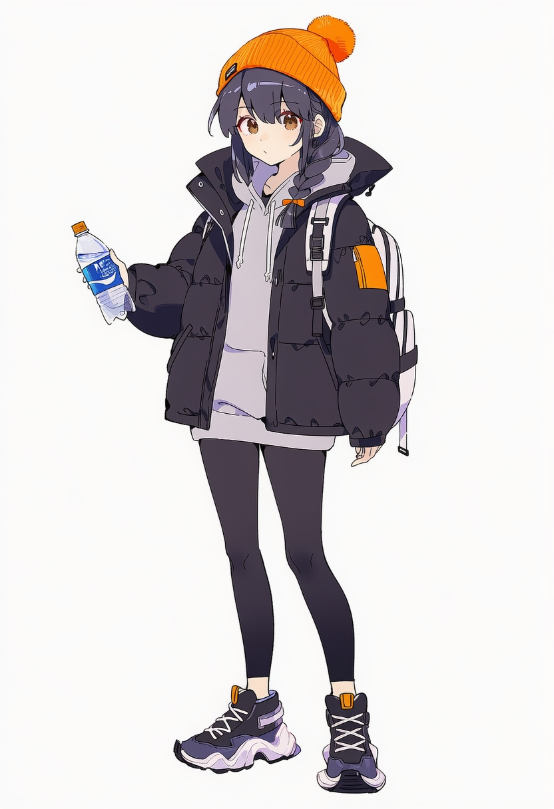

[在线例图](https://assets.quicktagcloud.com/images/raven_composition/raven_composition-6045.jpg?v=f06d4467b445ec71)

<a id="raven_composition-6046"></a>

## 亲潮

ID：`raven_composition-6046`；分类：角色图鉴 / 碧蓝航线 / 重樱；来源标记：`safe`。

来源说明：

> 作品：碧蓝航线
> 角色英文名：Oyashio
> 首次登场时间（国服实装）：2017-12-01
> 阵营：重樱

正向提示词：

```text
oyashio_(azur_lane)
```

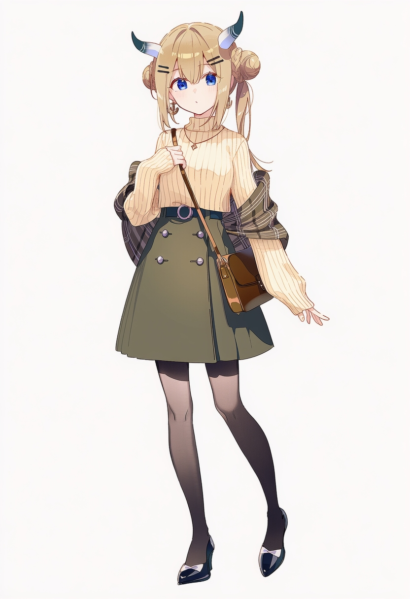

[在线例图](https://assets.quicktagcloud.com/images/raven_composition/raven_composition-6046.jpg?v=4e07097eb1830324)

<a id="raven_composition-6047"></a>

## 比叡

ID：`raven_composition-6047`；分类：角色图鉴 / 碧蓝航线 / 重樱；来源标记：`safe`。

来源说明：

> 作品：碧蓝航线
> 角色英文名：Hiei
> 首次登场时间（国服实装）：2017-12-01
> 阵营：重樱

正向提示词：

```text
hiei_(azur_lane)
```

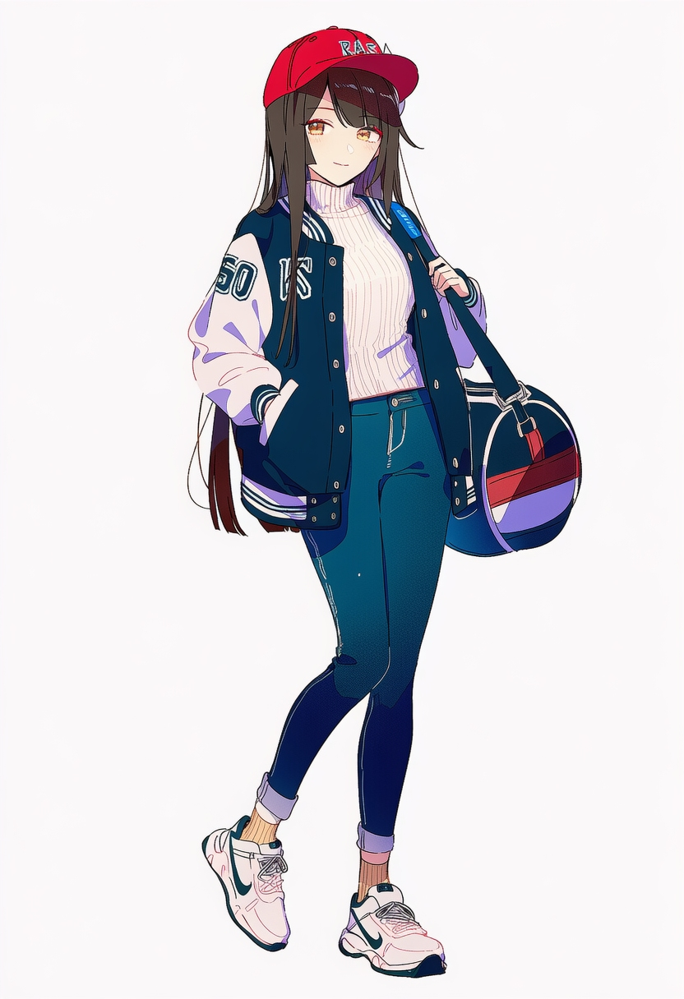

[在线例图](https://assets.quicktagcloud.com/images/raven_composition/raven_composition-6047.jpg?v=a615f46769545a4f)

<a id="raven_composition-6048"></a>

## 三笠

ID：`raven_composition-6048`；分类：角色图鉴 / 碧蓝航线 / 重樱；来源标记：`safe`。

来源说明：

> 作品：碧蓝航线
> 角色英文名：Mikasa
> 首次登场时间（国服实装）：2017-12-01
> 阵营：重樱

正向提示词：

```text
mikasa_(azur_lane)
```

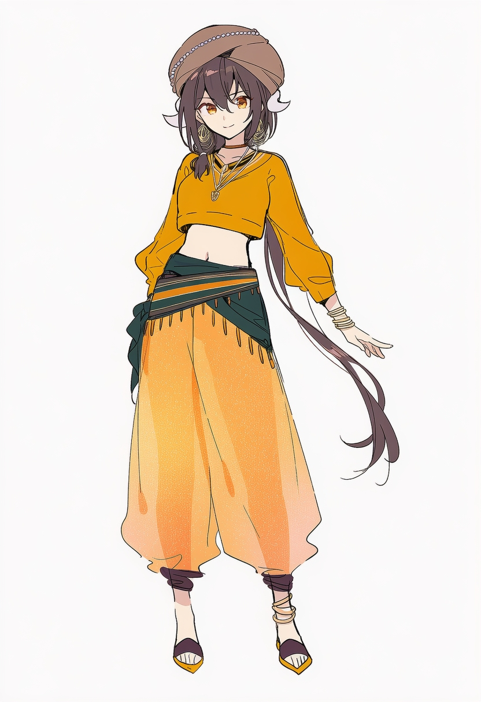

[在线例图](https://assets.quicktagcloud.com/images/raven_composition/raven_composition-6048.jpg?v=31154d5de4fa720f)

<a id="raven_composition-6050"></a>

## 吹雪

ID：`raven_composition-6050`；分类：角色图鉴 / 碧蓝航线 / 重樱；来源标记：`safe`。

来源说明：

> 作品：碧蓝航线
> 角色英文名：Fubuki
> 首次登场时间（国服实装）：2017-12-07
> 阵营：重樱

正向提示词：

```text
fubuki_(azur_lane)
```

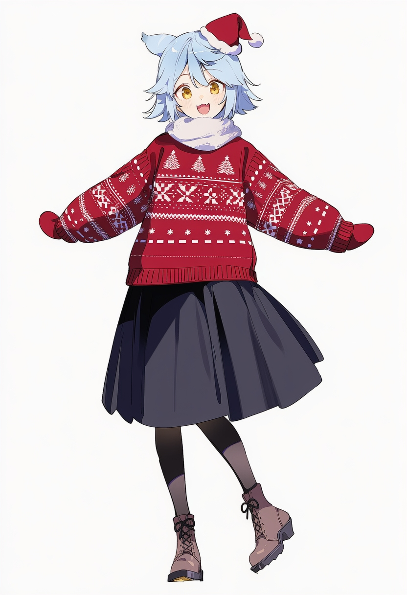

[在线例图](https://assets.quicktagcloud.com/images/raven_composition/raven_composition-6050.jpg?v=50092927550d9efa)

<a id="raven_composition-6057"></a>

## 若叶

ID：`raven_composition-6057`；分类：角色图鉴 / 碧蓝航线 / 重樱；来源标记：`safe`。

来源说明：

> 作品：碧蓝航线
> 角色英文名：Wakaba
> 首次登场时间（国服实装）：2018-01
> 阵营：重樱

正向提示词：

```text
wakaba_(azur_lane)
```

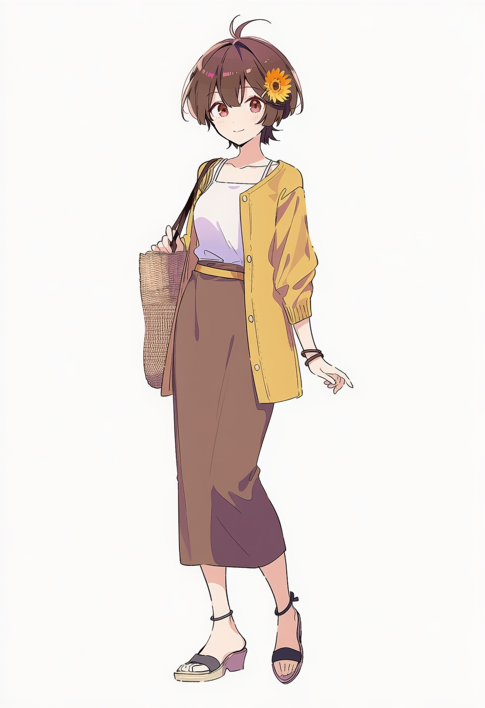

[在线例图](https://assets.quicktagcloud.com/images/raven_composition/raven_composition-6057.jpg?v=4bf5db65cb88d7f2)

<a id="raven_composition-6058"></a>

## 谷风

ID：`raven_composition-6058`；分类：角色图鉴 / 碧蓝航线 / 重樱；来源标记：`safe`。

来源说明：

> 作品：碧蓝航线
> 角色英文名：Tanikaze
> 首次登场时间（国服实装）：2018-01-19
> 阵营：重樱

正向提示词：

```text
tanikaze_(azur_lane)
```

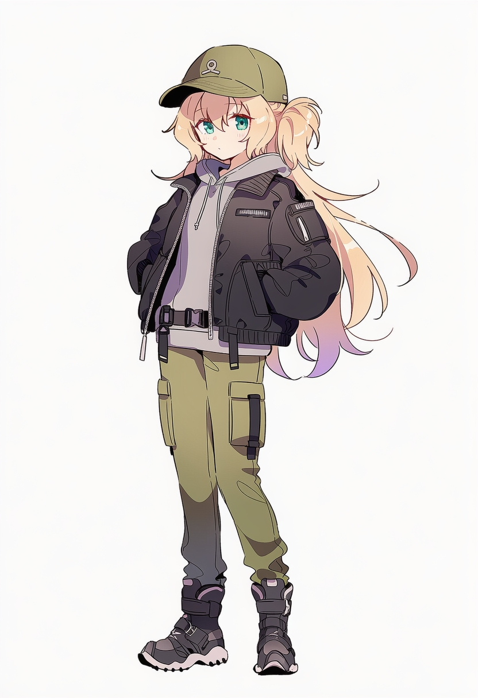

[在线例图](https://assets.quicktagcloud.com/images/raven_composition/raven_composition-6058.jpg?v=3328e5f72b60aa0e)

<a id="raven_composition-6060"></a>

## 浦风

ID：`raven_composition-6060`；分类：角色图鉴 / 碧蓝航线 / 重樱；来源标记：`safe`。

来源说明：

> 作品：碧蓝航线
> 角色英文名：Urakaze
> 首次登场时间（国服实装）：2018-02
> 阵营：重樱

正向提示词：

```text
urakaze_(azur_lane)
```

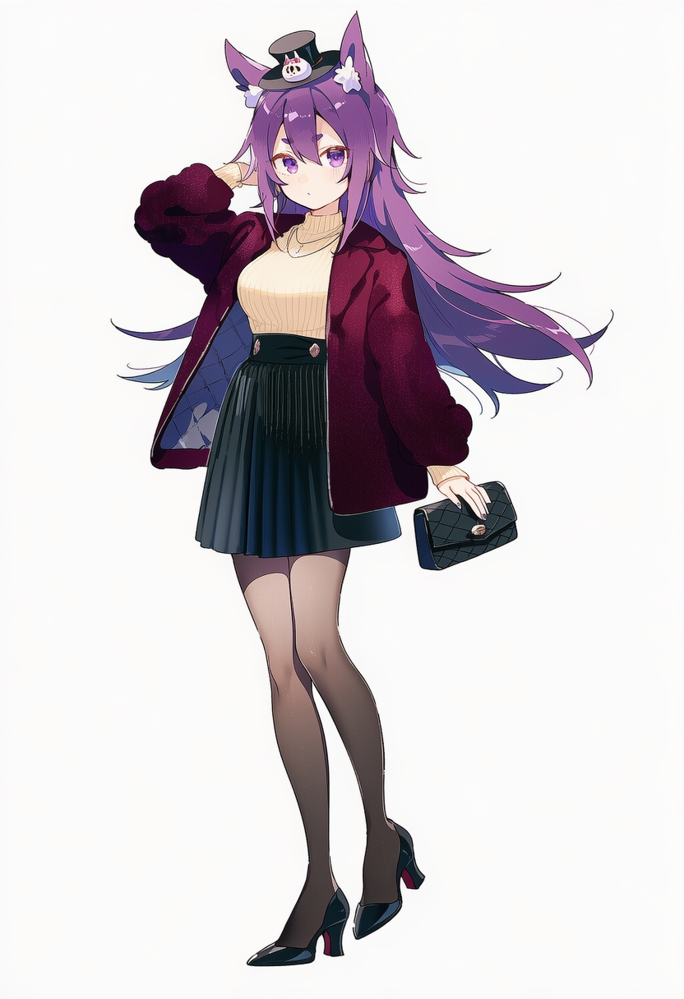

[在线例图](https://assets.quicktagcloud.com/images/raven_composition/raven_composition-6060.jpg?v=df57d0d1d01a397a)

<a id="raven_composition-6073"></a>

## 矶风

ID：`raven_composition-6073`；分类：角色图鉴 / 碧蓝航线 / 重樱；来源标记：`safe`。

来源说明：

> 作品：碧蓝航线
> 角色英文名：Isokaze
> 首次登场时间（国服实装）：2018-03
> 阵营：重樱

正向提示词：

```text
isokaze_(azur_lane)
```

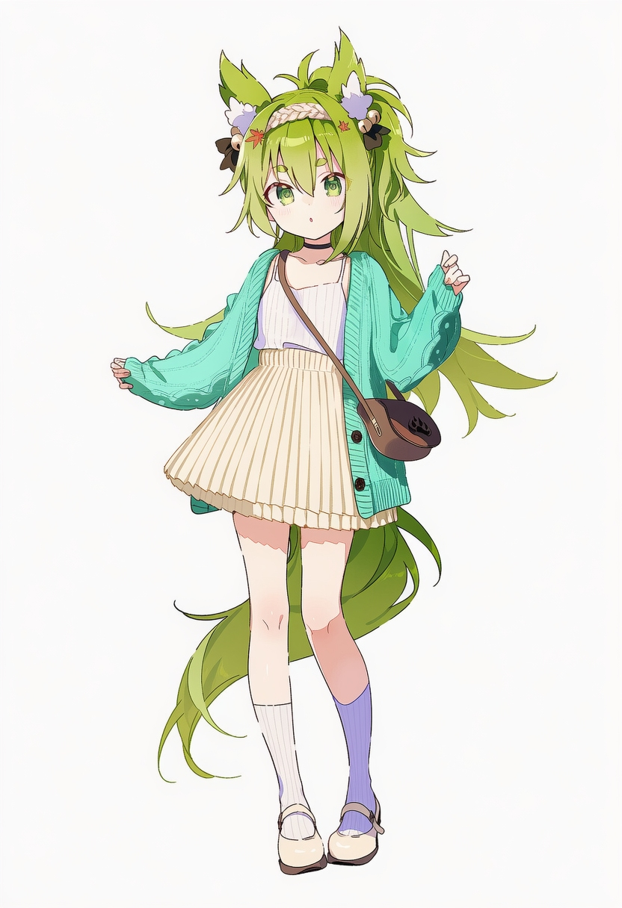

[在线例图](https://assets.quicktagcloud.com/images/raven_composition/raven_composition-6073.jpg?v=184066ef3cb2ec39)

<a id="raven_composition-6074"></a>

## 川内

ID：`raven_composition-6074`；分类：角色图鉴 / 碧蓝航线 / 重樱；来源标记：`safe`。

来源说明：

> 作品：碧蓝航线
> 角色英文名：Sendai
> 首次登场时间（国服实装）：2018-03-21
> 阵营：重樱

正向提示词：

```text
sendai_(azur_lane)
```

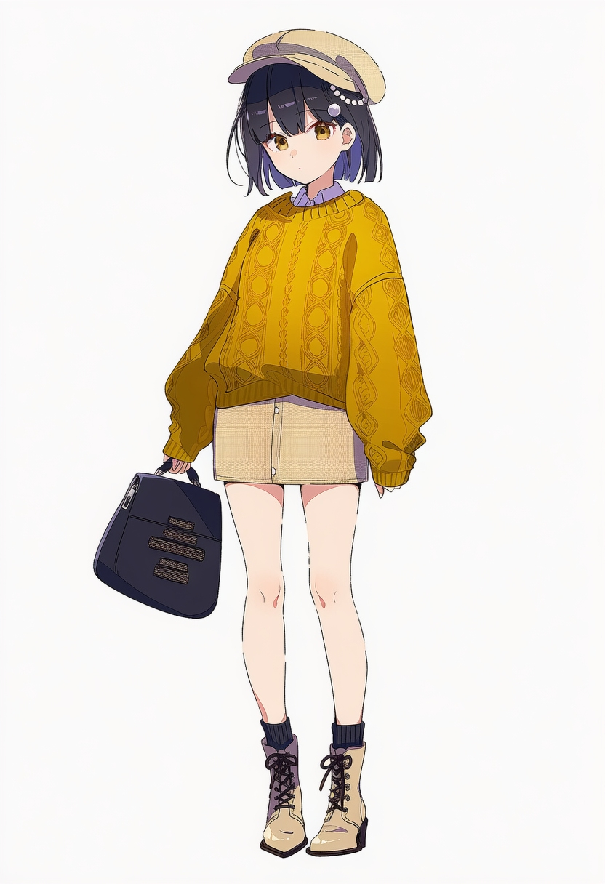

[在线例图](https://assets.quicktagcloud.com/images/raven_composition/raven_composition-6074.jpg?v=90d0f17935e2fbc3)

<a id="raven_composition-6075"></a>

## 阿贺野

ID：`raven_composition-6075`；分类：角色图鉴 / 碧蓝航线 / 重樱；来源标记：`safe`。

来源说明：

> 作品：碧蓝航线
> 角色英文名：Agano
> 首次登场时间（国服实装）：2018-03-21
> 阵营：重樱

正向提示词：

```text
agano_(azur_lane)
```

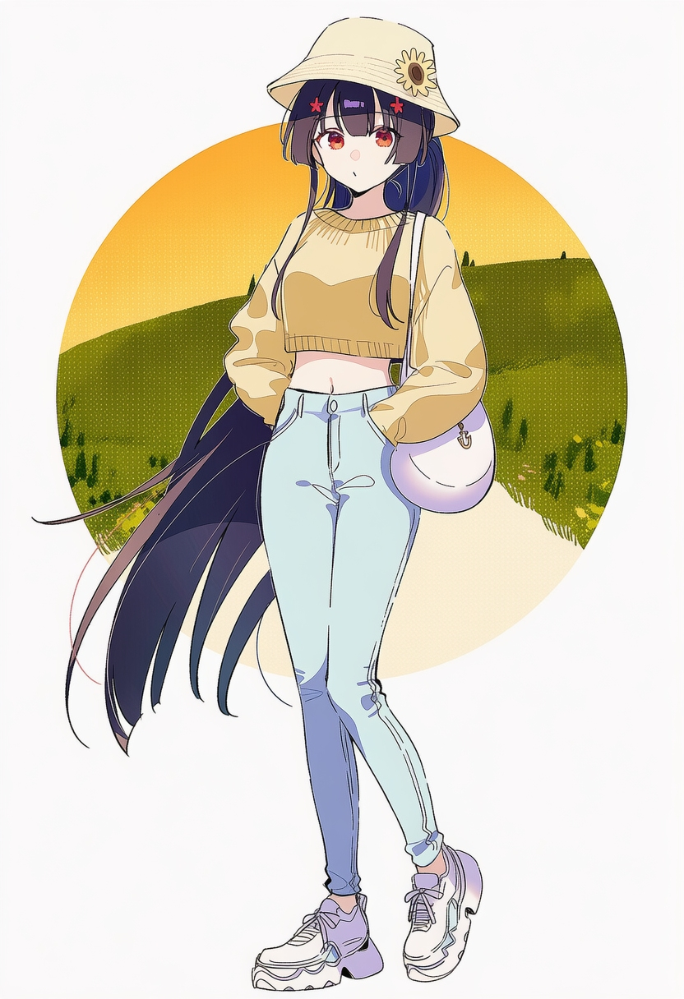

[在线例图](https://assets.quicktagcloud.com/images/raven_composition/raven_composition-6075.jpg?v=4d3a6deb77980b52)

<a id="raven_composition-6079"></a>

## 雪风

ID：`raven_composition-6079`；分类：角色图鉴 / 碧蓝航线 / 重樱；来源标记：`safe`。

来源说明：

> 作品：碧蓝航线
> 角色英文名：Yukikaze
> 首次登场时间（国服实装）：2018-03-29
> 阵营：重樱

正向提示词：

```text
yukikaze_(azur_lane)
```

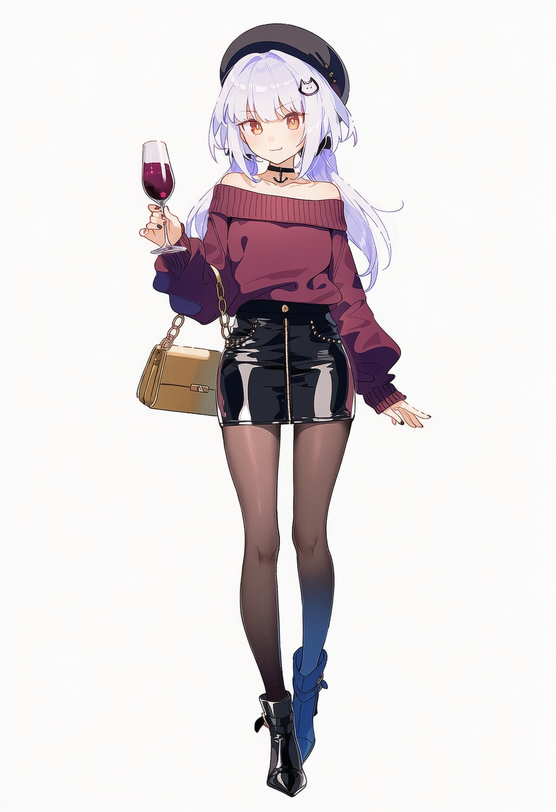

[在线例图](https://assets.quicktagcloud.com/images/raven_composition/raven_composition-6079.jpg?v=c0b5c25e89dc47e6)

<a id="raven_composition-6080"></a>

## 三隈

ID：`raven_composition-6080`；分类：角色图鉴 / 碧蓝航线 / 重樱；来源标记：`safe`。

来源说明：

> 作品：碧蓝航线
> 角色英文名：Mikuma
> 首次登场时间（国服实装）：2018-03-29
> 阵营：重樱

正向提示词：

```text
mikuma_(azur_lane)
```


[在线例图](https://assets.quicktagcloud.com/images/raven_composition/raven_composition-6080.jpg?v=73ae6953a8d76ade)

<a id="raven_composition-6081"></a>

## 最上

ID：`raven_composition-6081`；分类：角色图鉴 / 碧蓝航线 / 重樱；来源标记：`safe`。

来源说明：

> 作品：碧蓝航线
> 角色英文名：Mogami
> 首次登场时间（国服实装）：2018-03-29
> 阵营：重樱

正向提示词：

```text
mogami_(azur_lane)
```


[在线例图](https://assets.quicktagcloud.com/images/raven_composition/raven_composition-6081.jpg?v=cff6a789374207bb)

<a id="raven_composition-6082"></a>

## 满潮

ID：`raven_composition-6082`；分类：角色图鉴 / 碧蓝航线 / 重樱；来源标记：`safe`。

来源说明：

> 作品：碧蓝航线
> 角色英文名：Michishio
> 首次登场时间（国服实装）：2018-04
> 阵营：重樱

正向提示词：

```text
michishio_(azur_lane)
```


[在线例图](https://assets.quicktagcloud.com/images/raven_composition/raven_composition-6082.jpg?v=e5157da7bcd48fe8)

<a id="raven_composition-6084"></a>

## 鸟海

ID：`raven_composition-6084`；分类：角色图鉴 / 碧蓝航线 / 重樱；来源标记：`safe`。

来源说明：

> 作品：碧蓝航线
> 角色英文名：Choukai
> 首次登场时间（国服实装）：2018-04-26
> 阵营：重樱

正向提示词：

```text
choukai_(azur_lane)
```


[在线例图](https://assets.quicktagcloud.com/images/raven_composition/raven_composition-6084.jpg?v=e1352b2b51159de2)

<a id="raven_composition-6085"></a>

## 飞鹰

ID：`raven_composition-6085`；分类：角色图鉴 / 碧蓝航线 / 重樱；来源标记：`safe`。

来源说明：

> 作品：碧蓝航线
> 角色英文名：Hiyou
> 首次登场时间（国服实装）：2018-04-26
> 阵营：重樱

正向提示词：

```text
hiyou_(azur_lane)
```


[在线例图](https://assets.quicktagcloud.com/images/raven_composition/raven_composition-6085.jpg?v=0d8b83d428a76b0f)

<a id="raven_composition-6086"></a>

## 隼鹰

ID：`raven_composition-6086`；分类：角色图鉴 / 碧蓝航线 / 重樱；来源标记：`safe`。

来源说明：

> 作品：碧蓝航线
> 角色英文名：Junyou
> 首次登场时间（国服实装）：2018-04-26
> 阵营：重樱

正向提示词：

```text
junyou_(azur_lane)
```


[在线例图](https://assets.quicktagcloud.com/images/raven_composition/raven_composition-6086.jpg?v=1583352af578f75b)

<a id="raven_composition-6087"></a>

## 伊吹

ID：`raven_composition-6087`；分类：角色图鉴 / 碧蓝航线 / 重樱；来源标记：`safe`。

来源说明：

> 作品：碧蓝航线
> 角色英文名：Ibuki
> 首次登场时间（国服实装）：2018-04-26
> 阵营：重樱

正向提示词：

```text
ibuki_(azur_lane)
```


[在线例图](https://assets.quicktagcloud.com/images/raven_composition/raven_composition-6087.jpg?v=9005a0ff628de0b2)

<a id="raven_composition-6088"></a>

## 出云

ID：`raven_composition-6088`；分类：角色图鉴 / 碧蓝航线 / 重樱；来源标记：`safe`。

来源说明：

> 作品：碧蓝航线
> 角色英文名：Izumo
> 首次登场时间（国服实装）：2018-04-26
> 阵营：重樱

正向提示词：

```text
izumo_(azur_lane)
```


[在线例图](https://assets.quicktagcloud.com/images/raven_composition/raven_composition-6088.jpg?v=f65a106c766c43eb)

<a id="raven_composition-6093"></a>

## 有明

ID：`raven_composition-6093`；分类：角色图鉴 / 碧蓝航线 / 重樱；来源标记：`safe`。

来源说明：

> 作品：碧蓝航线
> 角色英文名：Ariake
> 首次登场时间（国服实装）：2018-05
> 阵营：重樱

正向提示词：

```text
ariake_(azur_lane)
```


[在线例图](https://assets.quicktagcloud.com/images/raven_composition/raven_composition-6093.jpg?v=c2ec93c02fe7aa4b)

<a id="raven_composition-6096"></a>

## 雾岛

ID：`raven_composition-6096`；分类：角色图鉴 / 碧蓝航线 / 重樱；来源标记：`safe`。

来源说明：

> 作品：碧蓝航线
> 角色英文名：Kirishima
> 首次登场时间（国服实装）：2018-05-31
> 阵营：重樱

正向提示词：

```text
kirishima_(azur_lane)
```


[在线例图](https://assets.quicktagcloud.com/images/raven_composition/raven_composition-6096.jpg?v=c4b81befc8fb19f0)

<a id="raven_composition-6098"></a>

## 伊26

ID：`raven_composition-6098`；分类：角色图鉴 / 碧蓝航线 / 重樱；来源标记：`safe`。

来源说明：

> 作品：碧蓝航线
> 角色英文名：I-26
> 首次登场时间（国服实装）：2018-05-31
> 阵营：重樱

正向提示词：

```text
i-26_(azur_lane)
```


[在线例图](https://assets.quicktagcloud.com/images/raven_composition/raven_composition-6098.jpg?v=52ce5676f7f8134b)

<a id="raven_composition-6099"></a>

## 伊58

ID：`raven_composition-6099`；分类：角色图鉴 / 碧蓝航线 / 重樱；来源标记：`safe`。

来源说明：

> 作品：碧蓝航线
> 角色英文名：I-58
> 首次登场时间（国服实装）：2018-05-31
> 阵营：重樱

正向提示词：

```text
i-58_(azur_lane)
```


[在线例图](https://assets.quicktagcloud.com/images/raven_composition/raven_composition-6099.jpg?v=37e83e8f09144952)

<a id="raven_composition-6100"></a>

## 伊19

ID：`raven_composition-6100`；分类：角色图鉴 / 碧蓝航线 / 重樱；来源标记：`safe`。

来源说明：

> 作品：碧蓝航线
> 角色英文名：I-19
> 首次登场时间（国服实装）：2018-05-31
> 阵营：重樱

正向提示词：

```text
i-19_(azur_lane)
```


[在线例图](https://assets.quicktagcloud.com/images/raven_composition/raven_composition-6100.jpg?v=3515cde6d9a8c8d8)

<a id="raven_composition-6102"></a>

## 初霜

ID：`raven_composition-6102`；分类：角色图鉴 / 碧蓝航线 / 重樱；来源标记：`safe`。

来源说明：

> 作品：碧蓝航线
> 角色英文名：Hatsushimo
> 首次登场时间（国服实装）：2018-06
> 阵营：重樱

正向提示词：

```text
hatsushimo_(azur_lane)
```


[在线例图](https://assets.quicktagcloud.com/images/raven_composition/raven_composition-6102.jpg?v=78fd019e50ed0f43)

<a id="raven_composition-6103"></a>

## 朝潮

ID：`raven_composition-6103`；分类：角色图鉴 / 碧蓝航线 / 重樱；来源标记：`safe`。

来源说明：

> 作品：碧蓝航线
> 角色英文名：Asashio
> 首次登场时间（国服实装）：2018-06-07
> 阵营：重樱

正向提示词：

```text
asashio_(azur_lane)
```


[在线例图](https://assets.quicktagcloud.com/images/raven_composition/raven_composition-6103.jpg?v=fb142badffcb9c5b)

<a id="raven_composition-6104"></a>

## 文月

ID：`raven_composition-6104`；分类：角色图鉴 / 碧蓝航线 / 重樱；来源标记：`safe`。

来源说明：

> 作品：碧蓝航线
> 角色英文名：Fumizuki
> 首次登场时间（国服实装）：2018-06-07
> 阵营：重樱

正向提示词：

```text
fumizuki_(azur_lane)
```


[在线例图](https://assets.quicktagcloud.com/images/raven_composition/raven_composition-6104.jpg?v=df8428fae5156187)

<a id="raven_composition-6105"></a>

## 大潮

ID：`raven_composition-6105`；分类：角色图鉴 / 碧蓝航线 / 重樱；来源标记：`safe`。

来源说明：

> 作品：碧蓝航线
> 角色英文名：Ooshio
> 首次登场时间（国服实装）：2018-06-07
> 阵营：重樱

正向提示词：

```text
ooshio_(azur_lane)
```


[在线例图](https://assets.quicktagcloud.com/images/raven_composition/raven_composition-6105.jpg?v=08d74e8b4791a370)

<a id="raven_composition-6106"></a>

## 春月

ID：`raven_composition-6106`；分类：角色图鉴 / 碧蓝航线 / 重樱；来源标记：`safe`。

来源说明：

> 作品：碧蓝航线
> 角色英文名：Harutsuki
> 首次登场时间（国服实装）：2018-06-07
> 阵营：重樱

正向提示词：

```text
harutsuki_(azur_lane)
```


[在线例图](https://assets.quicktagcloud.com/images/raven_composition/raven_composition-6106.jpg?v=78e21af305334ef9)

<a id="raven_composition-6107"></a>

## 宵月

ID：`raven_composition-6107`；分类：角色图鉴 / 碧蓝航线 / 重樱；来源标记：`safe`。

来源说明：

> 作品：碧蓝航线
> 角色英文名：Yoizuki
> 首次登场时间（国服实装）：2018-06-07
> 阵营：重樱

正向提示词：

```text
yoizuki_(azur_lane)
```


[在线例图](https://assets.quicktagcloud.com/images/raven_composition/raven_composition-6107.jpg?v=44fcede355b95375)

<a id="raven_composition-6108"></a>

## 江风

ID：`raven_composition-6108`；分类：角色图鉴 / 碧蓝航线 / 重樱；来源标记：`safe`。

来源说明：

> 作品：碧蓝航线
> 角色英文名：Kawakaze
> 首次登场时间（国服实装）：2018-06-07
> 阵营：重樱

正向提示词：

```text
kawakaze_(azur_lane)
```


[在线例图](https://assets.quicktagcloud.com/images/raven_composition/raven_composition-6108.jpg?v=8a80a879c20c7458)

<a id="raven_composition-6109"></a>

## 榛名

ID：`raven_composition-6109`；分类：角色图鉴 / 碧蓝航线 / 重樱；来源标记：`safe`。

来源说明：

> 作品：碧蓝航线
> 角色英文名：Haruna
> 首次登场时间（国服实装）：2018-06-07
> 阵营：重樱

正向提示词：

```text
haruna_(azur_lane)
```


[在线例图](https://assets.quicktagcloud.com/images/raven_composition/raven_composition-6109.jpg?v=6c077a1292d08d26)

<a id="raven_composition-6110"></a>

## 金刚

ID：`raven_composition-6110`；分类：角色图鉴 / 碧蓝航线 / 重樱；来源标记：`safe`。

来源说明：

> 作品：碧蓝航线
> 角色英文名：Kongou
> 首次登场时间（国服实装）：2018-06-07
> 阵营：重樱

正向提示词：

```text
kongou_(azur_lane)
```


[在线例图](https://assets.quicktagcloud.com/images/raven_composition/raven_composition-6110.jpg?v=6969dacab0a9421e)

<a id="raven_composition-6111"></a>

## 陆奥

ID：`raven_composition-6111`；分类：角色图鉴 / 碧蓝航线 / 重樱；来源标记：`safe`。

来源说明：

> 作品：碧蓝航线
> 角色英文名：Mutsu
> 首次登场时间（国服实装）：2018-06-07
> 阵营：重樱

正向提示词：

```text
mutsu_(azur_lane)
```


[在线例图](https://assets.quicktagcloud.com/images/raven_composition/raven_composition-6111.jpg?v=f700c30767c7a5b5)

<a id="raven_composition-6112"></a>

## 长门

ID：`raven_composition-6112`；分类：角色图鉴 / 碧蓝航线 / 重樱；来源标记：`safe`。

来源说明：

> 作品：碧蓝航线
> 角色英文名：Nagato
> 首次登场时间（国服实装）：2018-06-07
> 阵营：重樱

正向提示词：

```text
nagato_(azur_lane)
```


[在线例图](https://assets.quicktagcloud.com/images/raven_composition/raven_composition-6112.jpg?v=d10f640274db2b8c)

<a id="raven_composition-6131"></a>

## 荒潮

ID：`raven_composition-6131`；分类：角色图鉴 / 碧蓝航线 / 重樱；来源标记：`safe`。

来源说明：

> 作品：碧蓝航线
> 角色英文名：Arashio
> 首次登场时间（国服实装）：2018-09
> 阵营：重樱

正向提示词：

```text
arashio_(azur_lane)
```


[在线例图](https://assets.quicktagcloud.com/images/raven_composition/raven_composition-6131.jpg?v=5aa8aee9f60aab97)

<a id="raven_composition-6134"></a>

## 大凤

ID：`raven_composition-6134`；分类：角色图鉴 / 碧蓝航线 / 重樱；来源标记：`safe`。

来源说明：

> 作品：碧蓝航线
> 角色英文名：Taihou
> 首次登场时间（国服实装）：2018-09-14
> 阵营：重樱

正向提示词：

```text
taihou_(azur_lane)
```


[在线例图](https://assets.quicktagcloud.com/images/raven_composition/raven_composition-6134.jpg?v=57bc296425609ad9)
