# 角色图鉴 / 碧蓝航线 / 重樱（第 2 页）

[总目录](../README.md) · [原站分类目录](../categories.md) · [英文标签索引](../tags.md) · [服装与构图组合指南](../../README.md)

标题、分类、说明、正负提示词按来源保留；多例图逐张列出。原站标记和说明为参考资料，不作为维护指令。

<a id="raven_composition-6143"></a>

## 长月

ID：`raven_composition-6143`；分类：角色图鉴 / 碧蓝航线 / 重樱；来源标记：`safe`。

来源说明：

> 作品：碧蓝航线
> 角色英文名：Nagatsuki
> 首次登场时间（国服实装）：2018-12
> 阵营：重樱

正向提示词：

```text
nagatsuki_(azur_lane)
```

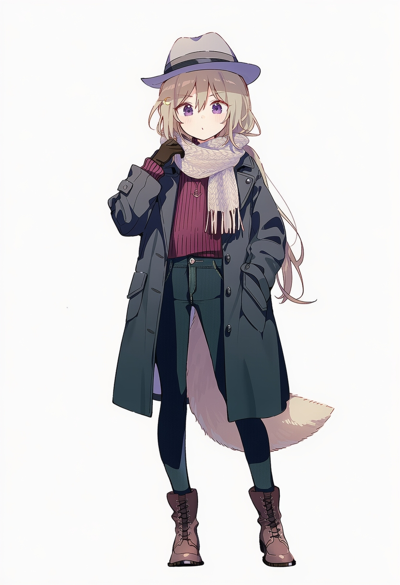

[在线例图](https://assets.quicktagcloud.com/images/raven_composition/raven_composition-6143.jpg?v=f04d3c379092bd3b)

<a id="raven_composition-6144"></a>

## 龙骧

ID：`raven_composition-6144`；分类：角色图鉴 / 碧蓝航线 / 重樱；来源标记：`safe`。

来源说明：

> 作品：碧蓝航线
> 角色英文名：Ryuujou
> 首次登场时间（国服实装）：2018-12-20
> 阵营：重樱

正向提示词：

```text
ryuujou_(azur_lane)
```

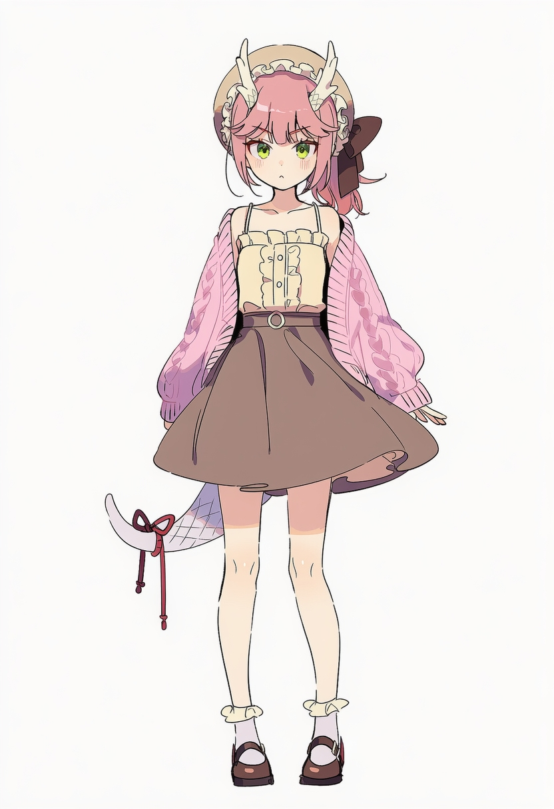

[在线例图](https://assets.quicktagcloud.com/images/raven_composition/raven_composition-6144.jpg?v=38e5703cfe3ca213)

<a id="raven_composition-6145"></a>

## 旗风

ID：`raven_composition-6145`；分类：角色图鉴 / 碧蓝航线 / 重樱；来源标记：`safe`。

来源说明：

> 作品：碧蓝航线
> 角色英文名：Hatakaze
> 首次登场时间（国服实装）：2018-12-27
> 阵营：重樱

正向提示词：

```text
hatakaze_(azur_lane)
```

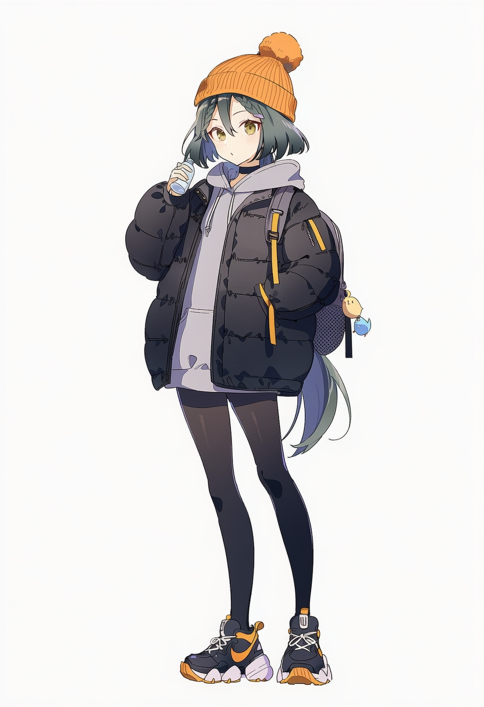

[在线例图](https://assets.quicktagcloud.com/images/raven_composition/raven_composition-6145.jpg?v=205040943316af1c)

<a id="raven_composition-6146"></a>

## 卷波

ID：`raven_composition-6146`；分类：角色图鉴 / 碧蓝航线 / 重樱；来源标记：`safe`。

来源说明：

> 作品：碧蓝航线
> 角色英文名：Makinami
> 首次登场时间（国服实装）：2018-12-27
> 阵营：重樱

正向提示词：

```text
makinami_(azur_lane)
```


[在线例图](https://assets.quicktagcloud.com/images/raven_composition/raven_composition-6146.jpg?v=0deb28169856abb8)

<a id="raven_composition-6147"></a>

## 那珂

ID：`raven_composition-6147`；分类：角色图鉴 / 碧蓝航线 / 重樱；来源标记：`safe`。

来源说明：

> 作品：碧蓝航线
> 角色英文名：Naka
> 首次登场时间（国服实装）：2018-12-27
> 阵营：重樱

正向提示词：

```text
naka_(azur_lane)
```

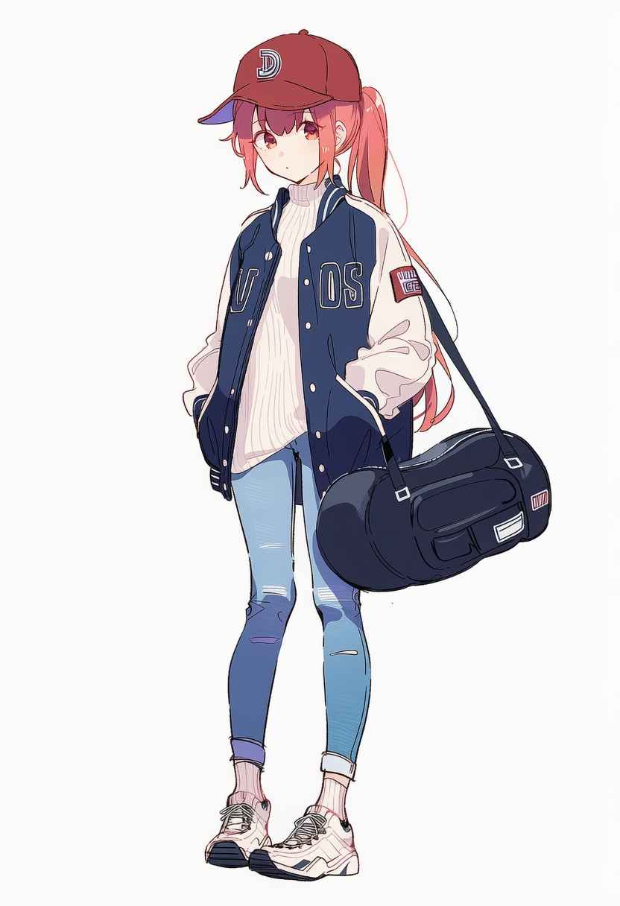

[在线例图](https://assets.quicktagcloud.com/images/raven_composition/raven_composition-6147.jpg?v=078b4c43d21566a0)

<a id="raven_composition-6148"></a>

## 足柄

ID：`raven_composition-6148`；分类：角色图鉴 / 碧蓝航线 / 重樱；来源标记：`safe`。

来源说明：

> 作品：碧蓝航线
> 角色英文名：Ashigara
> 首次登场时间（国服实装）：2018-12-27
> 阵营：重樱

正向提示词：

```text
ashigara_(azur_lane)
```

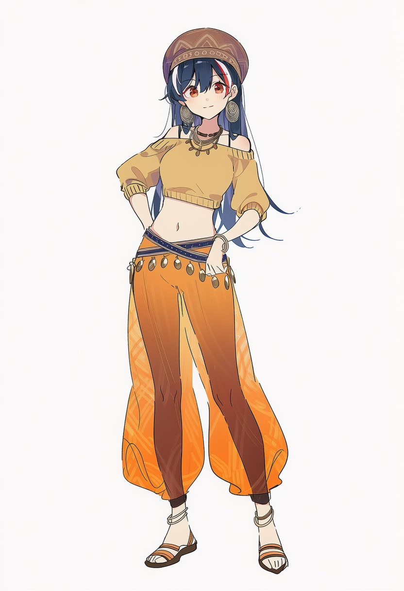

[在线例图](https://assets.quicktagcloud.com/images/raven_composition/raven_composition-6148.jpg?v=1573bb9e9894889c)

<a id="raven_composition-6149"></a>

## 天城

ID：`raven_composition-6149`；分类：角色图鉴 / 碧蓝航线 / 重樱；来源标记：`safe`。

来源说明：

> 作品：碧蓝航线
> 角色英文名：Amagi
> 首次登场时间（国服实装）：2018-12-27
> 阵营：重樱

正向提示词：

```text
amagi_(azur_lane)
```

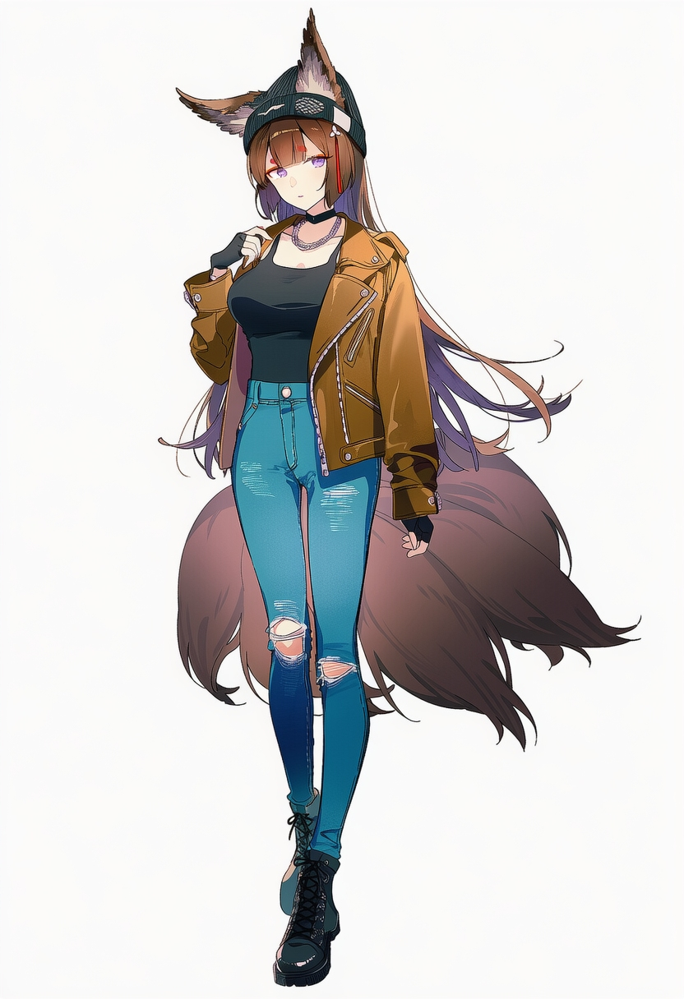

[在线例图](https://assets.quicktagcloud.com/images/raven_composition/raven_composition-6149.jpg?v=80581f7edabf257e)

<a id="raven_composition-6150"></a>

## 加贺(BB)

ID：`raven_composition-6150`；分类：角色图鉴 / 碧蓝航线 / 重樱；来源标记：`safe`。

来源说明：

> 作品：碧蓝航线
> 角色英文名：Kaga (BB)
> 首次登场时间（国服实装）：2018-12-27
> 阵营：重樱

正向提示词：

```text
kaga_(battleship)_(azur_lane)
```

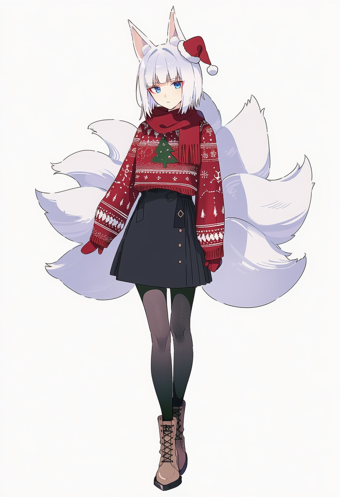

[在线例图](https://assets.quicktagcloud.com/images/raven_composition/raven_composition-6150.jpg?v=9444bdf9685e296e)

<a id="raven_composition-6165"></a>

## 铃谷

ID：`raven_composition-6165`；分类：角色图鉴 / 碧蓝航线 / 重樱；来源标记：`safe`。

来源说明：

> 作品：碧蓝航线
> 角色英文名：Suzuya
> 首次登场时间（国服实装）：2019-03-28
> 阵营：重樱

正向提示词：

```text
suzuya_(azur_lane)
```

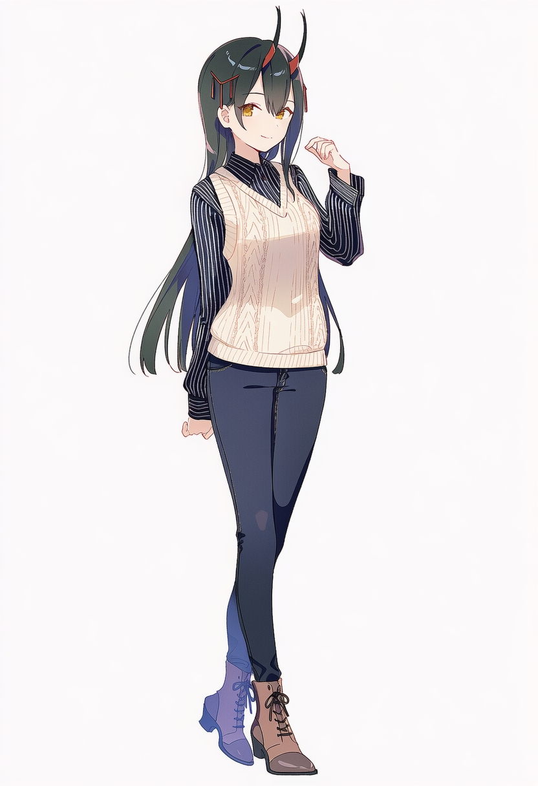

[在线例图](https://assets.quicktagcloud.com/images/raven_composition/raven_composition-6165.jpg?v=7f275e6f740e4445)

<a id="raven_composition-6166"></a>

## 伊13

ID：`raven_composition-6166`；分类：角色图鉴 / 碧蓝航线 / 重樱；来源标记：`safe`。

来源说明：

> 作品：碧蓝航线
> 角色英文名：I-13
> 首次登场时间（国服实装）：2019-03-28
> 阵营：重樱

正向提示词：

```text
i-13_(azur_lane)
```

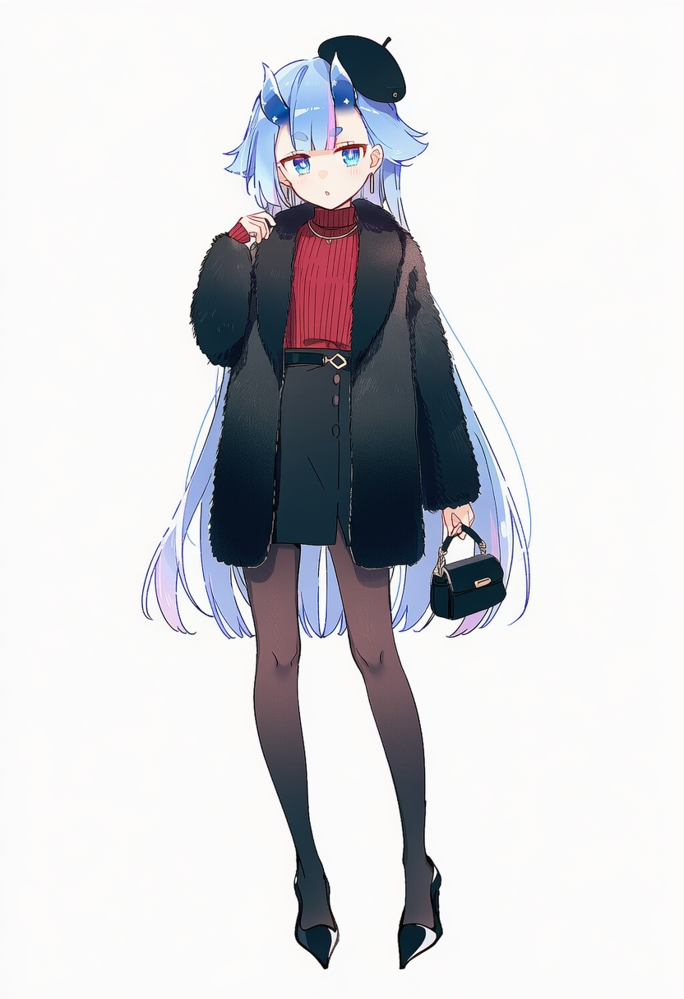

[在线例图](https://assets.quicktagcloud.com/images/raven_composition/raven_composition-6166.jpg?v=dbfd82f755923c61)

<a id="raven_composition-6169"></a>

## 北风

ID：`raven_composition-6169`；分类：角色图鉴 / 碧蓝航线 / 重樱；来源标记：`safe`。

来源说明：

> 作品：碧蓝航线
> 角色英文名：Kitakaze
> 首次登场时间（国服实装）：2019-04-18
> 阵营：重樱

正向提示词：

```text
kitakaze_(azur_lane)
```


[在线例图](https://assets.quicktagcloud.com/images/raven_composition/raven_composition-6169.jpg?v=c98e5cbdf8d43a7c)

<a id="raven_composition-6171"></a>

## 吾妻

ID：`raven_composition-6171`；分类：角色图鉴 / 碧蓝航线 / 重樱；来源标记：`safe`。

来源说明：

> 作品：碧蓝航线
> 角色英文名：Azuma
> 首次登场时间（国服实装）：2019-04-18
> 阵营：重樱

正向提示词：

```text
azuma_(azur_lane)
```


[在线例图](https://assets.quicktagcloud.com/images/raven_composition/raven_composition-6171.jpg?v=fce6237e8d5512fb)

<a id="raven_composition-6173"></a>

## 小比叡

ID：`raven_composition-6173`；分类：角色图鉴 / 碧蓝航线 / 重樱；来源标记：`safe`。

来源说明：

> 作品：碧蓝航线
> 角色英文名：Hiei-chan
> 首次登场时间（国服实装）：2019-04-26
> 阵营：重樱

正向提示词：

```text
hiei-chan_(azur_lane)
```

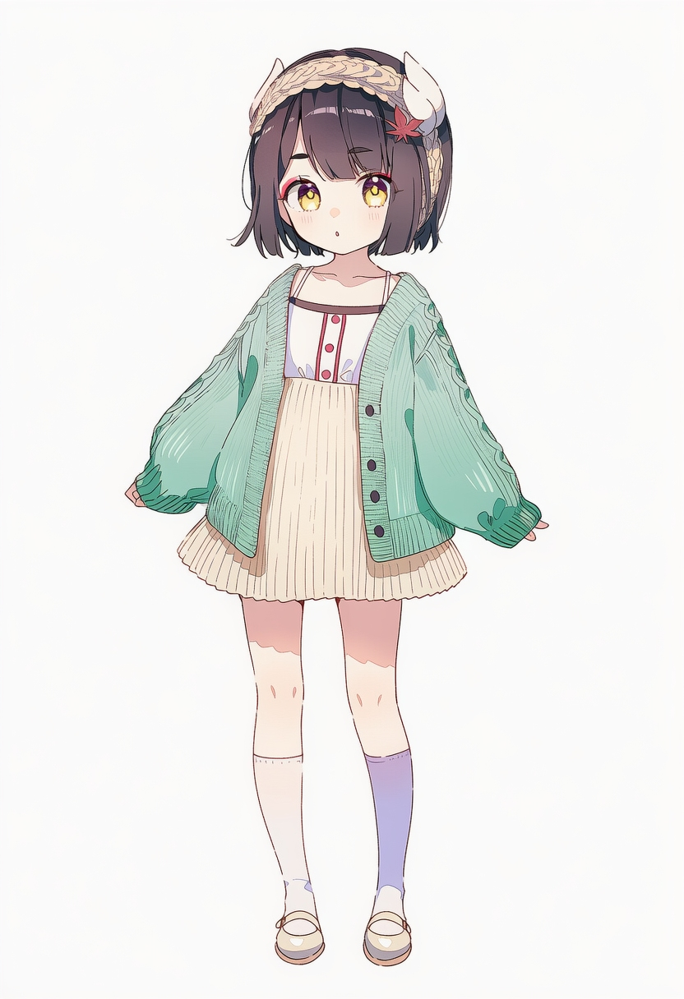

[在线例图](https://assets.quicktagcloud.com/images/raven_composition/raven_composition-6173.jpg?v=f319f59de3807aa6)

<a id="raven_composition-6174"></a>

## 小赤城

ID：`raven_composition-6174`；分类：角色图鉴 / 碧蓝航线 / 重樱；来源标记：`safe`。

来源说明：

> 作品：碧蓝航线
> 角色英文名：Akagi-chan
> 首次登场时间（国服实装）：2019-04-26
> 阵营：重樱

正向提示词：

```text
akagi-chan_(azur_lane)
```


[在线例图](https://assets.quicktagcloud.com/images/raven_composition/raven_composition-6174.jpg?v=454027349c139de3)

<a id="raven_composition-6189"></a>

## 伊25

ID：`raven_composition-6189`；分类：角色图鉴 / 碧蓝航线 / 重樱；来源标记：`safe`。

来源说明：

> 作品：碧蓝航线
> 角色英文名：I-25
> 首次登场时间（国服实装）：2019-07-11
> 阵营：重樱

正向提示词：

```text
i-25_(azur_lane)
```

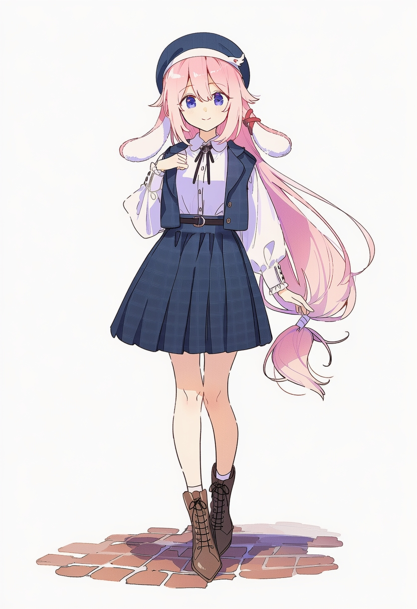

[在线例图](https://assets.quicktagcloud.com/images/raven_composition/raven_composition-6189.jpg?v=b5092cf253d1af2b)

<a id="raven_composition-6190"></a>

## 伊56

ID：`raven_composition-6190`；分类：角色图鉴 / 碧蓝航线 / 重樱；来源标记：`safe`。

来源说明：

> 作品：碧蓝航线
> 角色英文名：I-56
> 首次登场时间（国服实装）：2019-07-11
> 阵营：重樱

正向提示词：

```text
i-56_(azur_lane)
```

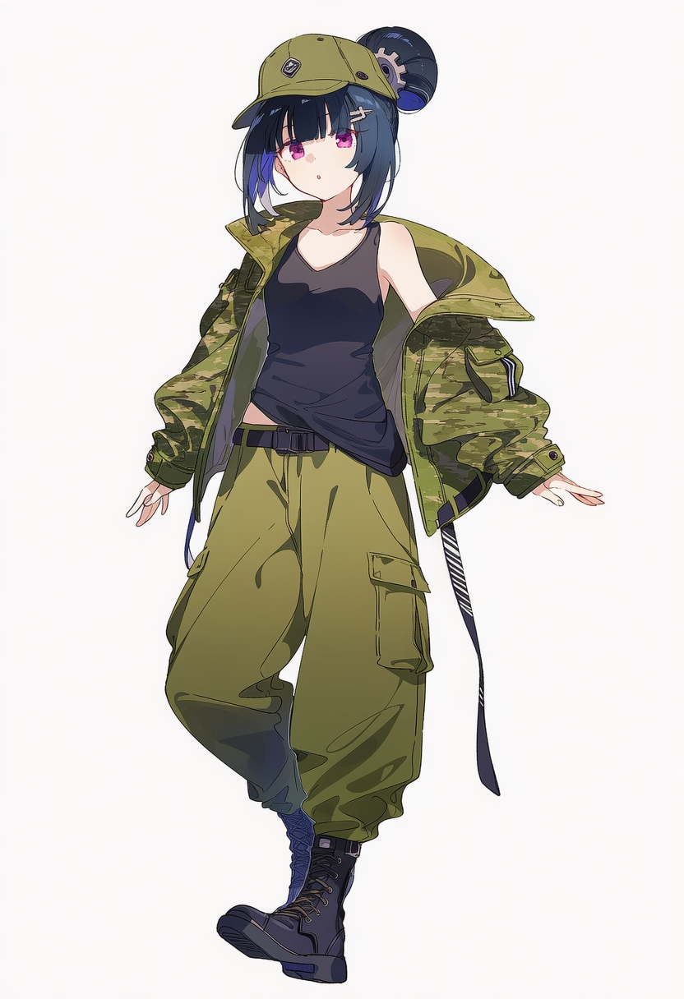

[在线例图](https://assets.quicktagcloud.com/images/raven_composition/raven_composition-6190.jpg?v=30553516a7935e5a)

<a id="raven_composition-6192"></a>

## 伊168

ID：`raven_composition-6192`；分类：角色图鉴 / 碧蓝航线 / 重樱；来源标记：`safe`。

来源说明：

> 作品：碧蓝航线
> 角色英文名：I-168
> 首次登场时间（国服实装）：2019-07-11
> 阵营：重樱

正向提示词：

```text
i-168_(azur_lane)
```

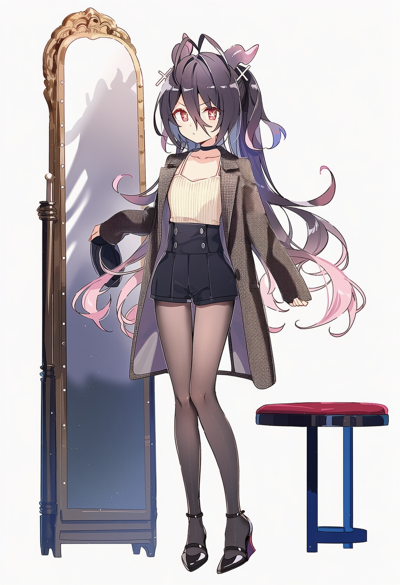

[在线例图](https://assets.quicktagcloud.com/images/raven_composition/raven_composition-6192.jpg?v=9119df6e101e893d)

<a id="raven_composition-6203"></a>

## 清波

ID：`raven_composition-6203`；分类：角色图鉴 / 碧蓝航线 / 重樱；来源标记：`safe`。

来源说明：

> 作品：碧蓝航线
> 角色英文名：Kiyonami
> 首次登场时间（国服实装）：2019-09
> 阵营：重樱

正向提示词：

```text
kiyonami_(azur_lane)
```

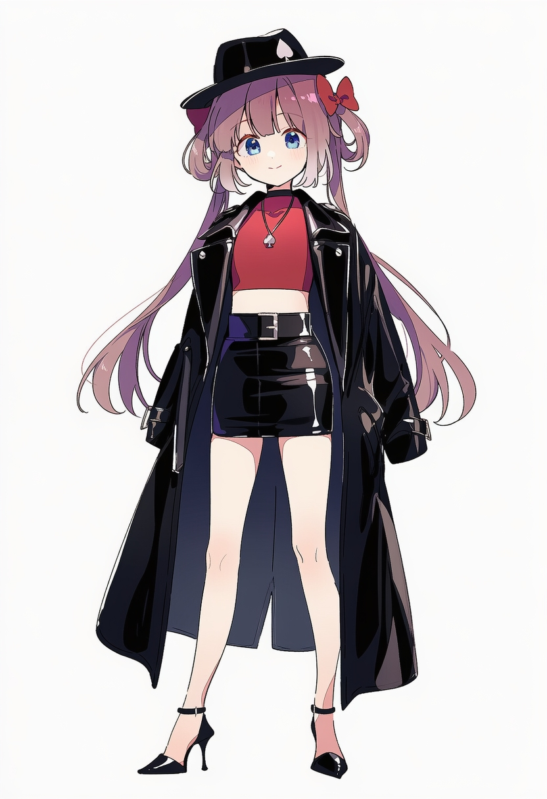

[在线例图](https://assets.quicktagcloud.com/images/raven_composition/raven_composition-6203.jpg?v=eedde1fe2dea9113)

<a id="raven_composition-6216"></a>

## 赤城μ

ID：`raven_composition-6216`；分类：角色图鉴 / 碧蓝航线 / 重樱；来源标记：`safe`。

来源说明：

> 作品：碧蓝航线
> 角色英文名：Akagi µ
> 首次登场时间（国服实装）：2019-10-31
> 阵营：重樱

正向提示词：

```text
akagi_(muse)_(azur_lane)
```

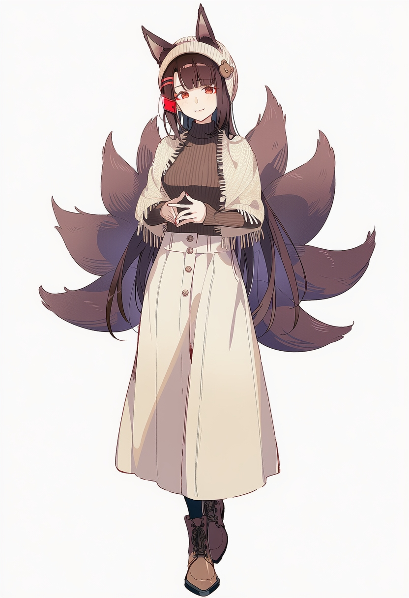

[在线例图](https://assets.quicktagcloud.com/images/raven_composition/raven_composition-6216.jpg?v=75bb673c9c781361)

<a id="raven_composition-6219"></a>

## 响

ID：`raven_composition-6219`；分类：角色图鉴 / 碧蓝航线 / 重樱；来源标记：`safe`。

来源说明：

> 作品：碧蓝航线
> 角色英文名：Hibiki
> 首次登场时间（国服实装）：2019-12-26
> 阵营：重樱

正向提示词：

```text
hibiki_(azur_lane)
```

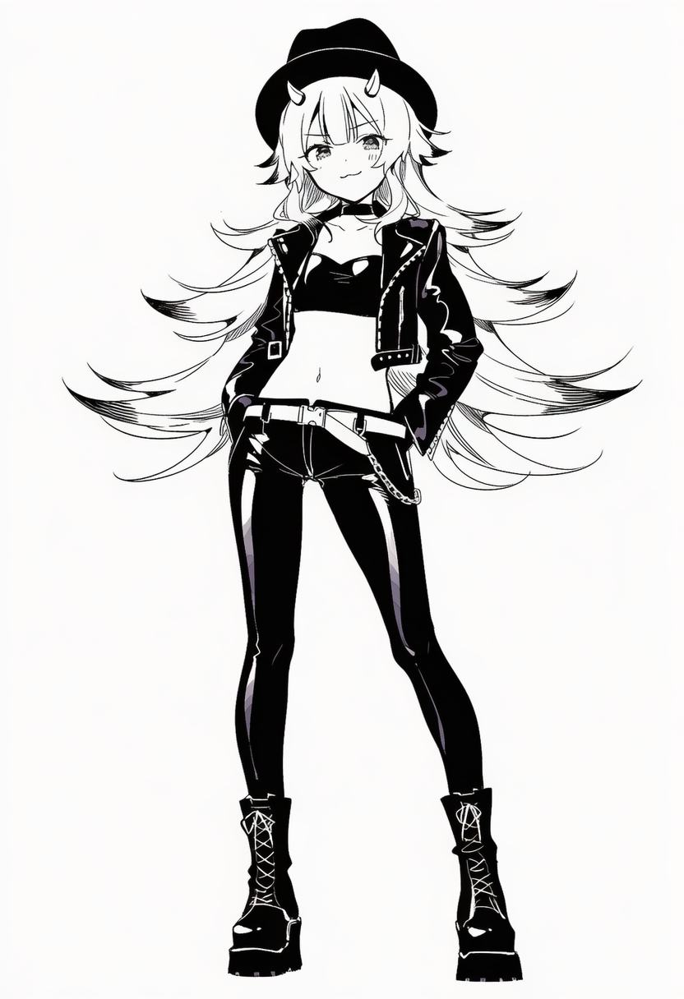

[在线例图](https://assets.quicktagcloud.com/images/raven_composition/raven_composition-6219.jpg?v=e379bd9c2f251c6c)

<a id="raven_composition-6220"></a>

## 霞

ID：`raven_composition-6220`；分类：角色图鉴 / 碧蓝航线 / 重樱；来源标记：`safe`。

来源说明：

> 作品：碧蓝航线
> 角色英文名：Kasumi
> 首次登场时间（国服实装）：2019-12-26
> 阵营：重樱

正向提示词：

```text
kasumi_(azur_lane)
```

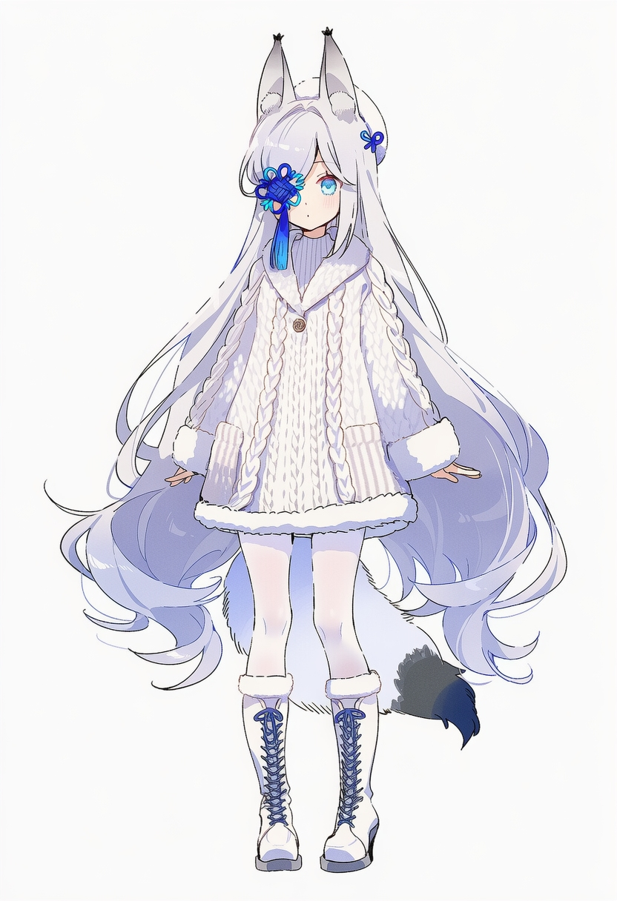

[在线例图](https://assets.quicktagcloud.com/images/raven_composition/raven_composition-6220.jpg?v=9ccde7f213c7428e)

<a id="raven_composition-6221"></a>

## 鬼怒

ID：`raven_composition-6221`；分类：角色图鉴 / 碧蓝航线 / 重樱；来源标记：`safe`。

来源说明：

> 作品：碧蓝航线
> 角色英文名：Kinu
> 首次登场时间（国服实装）：2019-12-26
> 阵营：重樱

正向提示词：

```text
kinu_(azur_lane)
```

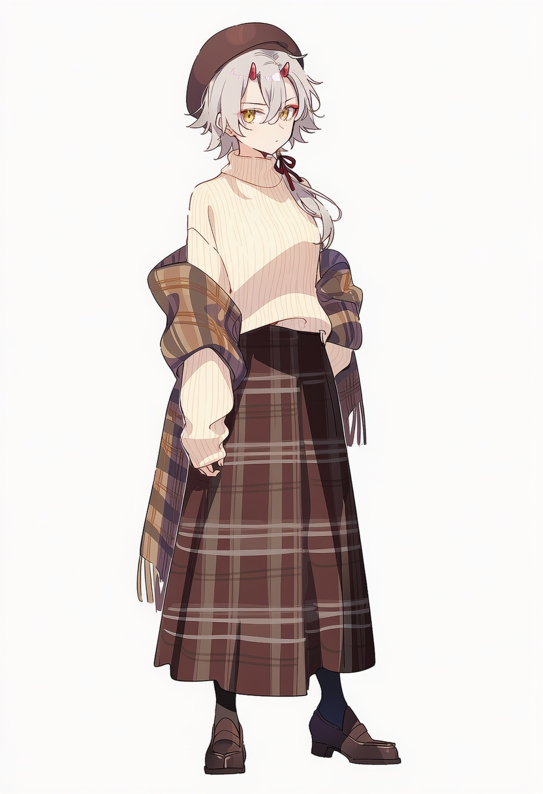

[在线例图](https://assets.quicktagcloud.com/images/raven_composition/raven_composition-6221.jpg?v=2aee08e060a4833e)

<a id="raven_composition-6222"></a>

## 能代

ID：`raven_composition-6222`；分类：角色图鉴 / 碧蓝航线 / 重樱；来源标记：`safe`。

来源说明：

> 作品：碧蓝航线
> 角色英文名：Noshiro
> 首次登场时间（国服实装）：2019-12-26
> 阵营：重樱

正向提示词：

```text
noshiro_(azur_lane)
```

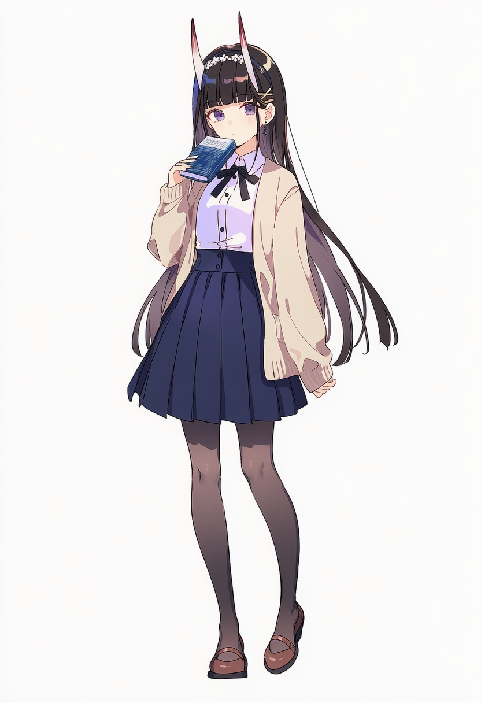

[在线例图](https://assets.quicktagcloud.com/images/raven_composition/raven_composition-6222.jpg?v=c5bcbb55a9d9c6e8)

<a id="raven_composition-6223"></a>

## 骏河

ID：`raven_composition-6223`；分类：角色图鉴 / 碧蓝航线 / 重樱；来源标记：`safe`。

来源说明：

> 作品：碧蓝航线
> 角色英文名：Suruga
> 首次登场时间（国服实装）：2019-12-26
> 阵营：重樱

正向提示词：

```text
suruga_(azur_lane)
```


[在线例图](https://assets.quicktagcloud.com/images/raven_composition/raven_composition-6223.jpg?v=fb6d64d59c6b7471)

<a id="raven_composition-6224"></a>

## 龙凤

ID：`raven_composition-6224`；分类：角色图鉴 / 碧蓝航线 / 重樱；来源标记：`safe`。

来源说明：

> 作品：碧蓝航线
> 角色英文名：Ryuuhou
> 首次登场时间（国服实装）：2019-12-26
> 阵营：重樱

正向提示词：

```text
ryuuhou_(azur_lane)
```

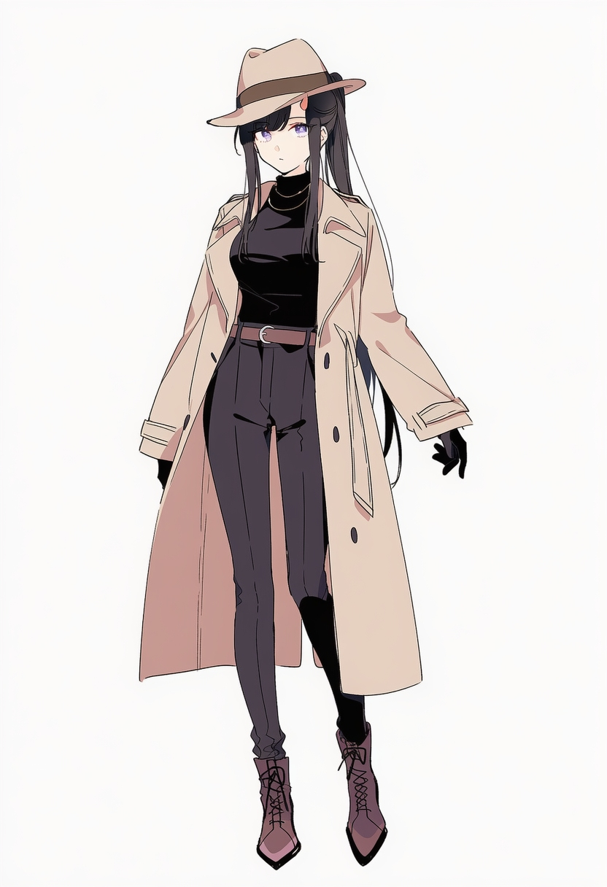

[在线例图](https://assets.quicktagcloud.com/images/raven_composition/raven_composition-6224.jpg?v=d0a2d653d5c26a89)

<a id="raven_composition-6226"></a>

## 浦波

ID：`raven_composition-6226`；分类：角色图鉴 / 碧蓝航线 / 重樱；来源标记：`safe`。

来源说明：

> 作品：碧蓝航线
> 角色英文名：Uranami
> 首次登场时间（国服实装）：2020-01-21
> 阵营：重樱

正向提示词：

```text
uranami_(azur_lane)
```

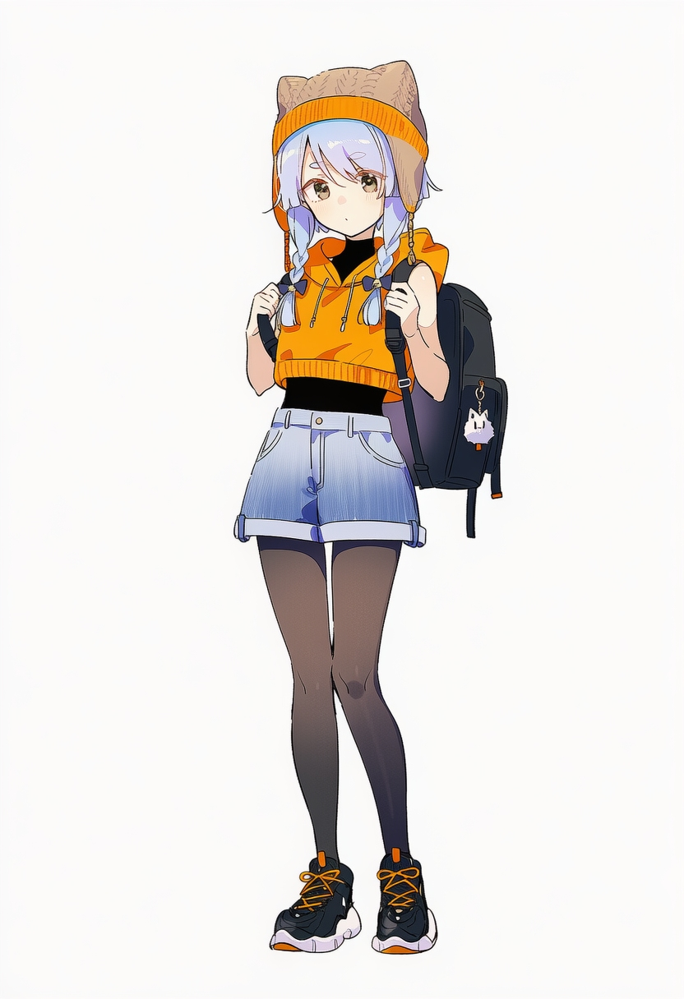

[在线例图](https://assets.quicktagcloud.com/images/raven_composition/raven_composition-6226.jpg?v=fb56d22cef295f9e)

<a id="raven_composition-6244"></a>

## 花月

ID：`raven_composition-6244`；分类：角色图鉴 / 碧蓝航线 / 重樱；来源标记：`safe`。

来源说明：

> 作品：碧蓝航线
> 角色英文名：Hanazuki
> 首次登场时间（国服实装）：2020-04-23
> 阵营：重樱

正向提示词：

```text
hanazuki_(azur_lane)
```

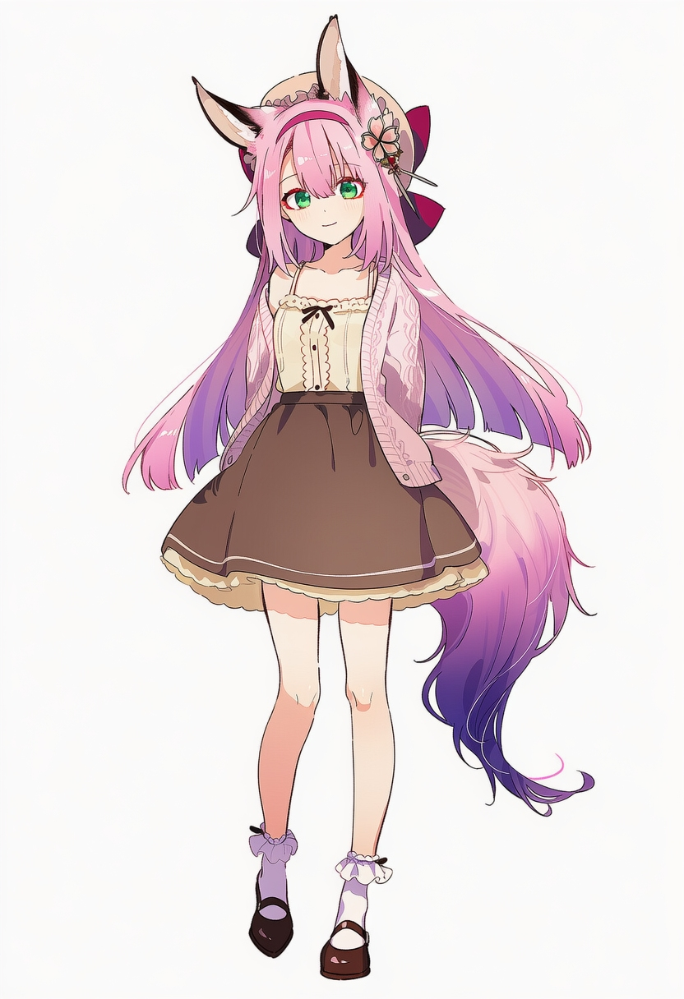

[在线例图](https://assets.quicktagcloud.com/images/raven_composition/raven_composition-6244.jpg?v=0d90cb91a950842e)

<a id="raven_composition-6245"></a>

## 长波

ID：`raven_composition-6245`；分类：角色图鉴 / 碧蓝航线 / 重樱；来源标记：`safe`。

来源说明：

> 作品：碧蓝航线
> 角色英文名：Naganami
> 首次登场时间（国服实装）：2020-04-23
> 阵营：重樱

正向提示词：

```text
naganami_(azur_lane)
```


[在线例图](https://assets.quicktagcloud.com/images/raven_composition/raven_composition-6245.jpg?v=4c4a43c6f28a121d)

<a id="raven_composition-6247"></a>

## 土佐

ID：`raven_composition-6247`；分类：角色图鉴 / 碧蓝航线 / 重樱；来源标记：`safe`。

来源说明：

> 作品：碧蓝航线
> 角色英文名：Tosa
> 首次登场时间（国服实装）：2020-04-23
> 阵营：重樱

正向提示词：

```text
tosa_(azur_lane)
```

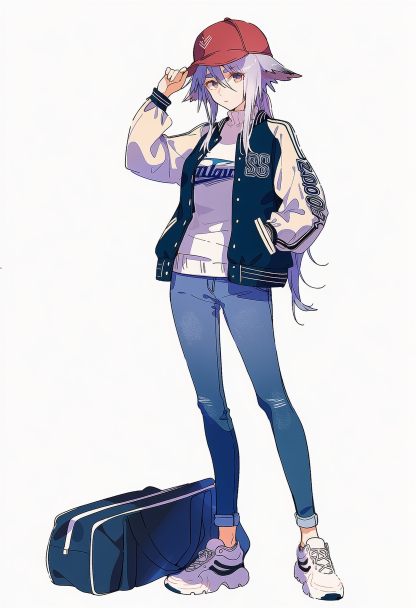

[在线例图](https://assets.quicktagcloud.com/images/raven_composition/raven_composition-6247.jpg?v=1cbedbf7c2f4b279)

<a id="raven_composition-6270"></a>

## 凉月

ID：`raven_composition-6270`；分类：角色图鉴 / 碧蓝航线 / 重樱；来源标记：`safe`。

来源说明：

> 作品：碧蓝航线
> 角色英文名：Suzutsuki
> 首次登场时间（国服实装）：2020-09-17
> 阵营：重樱

正向提示词：

```text
suzutsuki_(azur_lane)
```

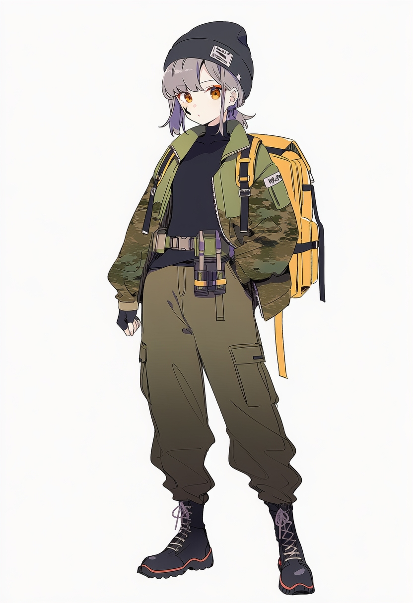

[在线例图](https://assets.quicktagcloud.com/images/raven_composition/raven_composition-6270.jpg?v=047ade88eef53efb)

<a id="raven_composition-6271"></a>

## 熊野

ID：`raven_composition-6271`；分类：角色图鉴 / 碧蓝航线 / 重樱；来源标记：`safe`。

来源说明：

> 作品：碧蓝航线
> 角色英文名：Kumano
> 首次登场时间（国服实装）：2020-09-17
> 阵营：重樱

正向提示词：

```text
kumano_(azur_lane)
```

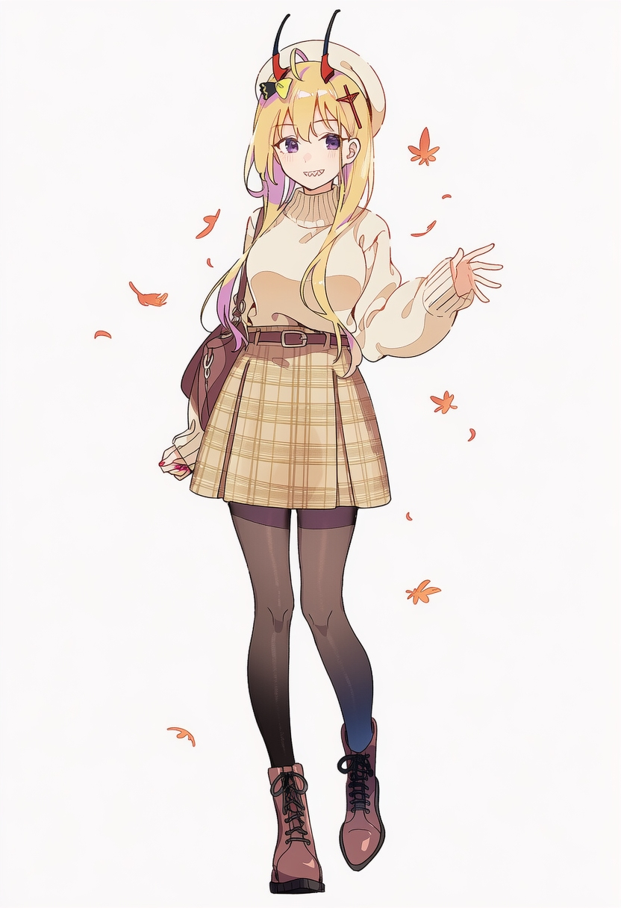

[在线例图](https://assets.quicktagcloud.com/images/raven_composition/raven_composition-6271.jpg?v=db7927f3b96d91ad)

<a id="raven_composition-6272"></a>

## 纪伊

ID：`raven_composition-6272`；分类：角色图鉴 / 碧蓝航线 / 重樱；来源标记：`safe`。

来源说明：

> 作品：碧蓝航线
> 角色英文名：Kii
> 首次登场时间（国服实装）：2020-09-17
> 阵营：重樱

正向提示词：

```text
kii_(azur_lane)
```

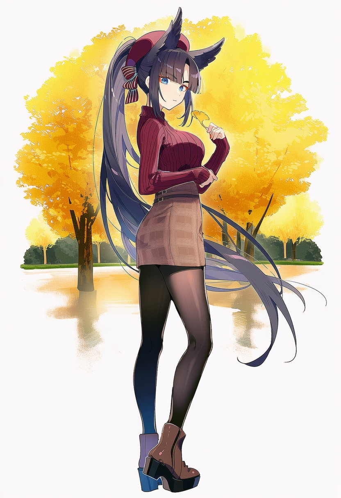

[在线例图](https://assets.quicktagcloud.com/images/raven_composition/raven_composition-6272.jpg?v=292157b61813f66f)

<a id="raven_composition-6273"></a>

## 千岁

ID：`raven_composition-6273`；分类：角色图鉴 / 碧蓝航线 / 重樱；来源标记：`safe`。

来源说明：

> 作品：碧蓝航线
> 角色英文名：Chitose
> 首次登场时间（国服实装）：2020-09-17
> 阵营：重樱

正向提示词：

```text
chitose_(azur_lane)
```

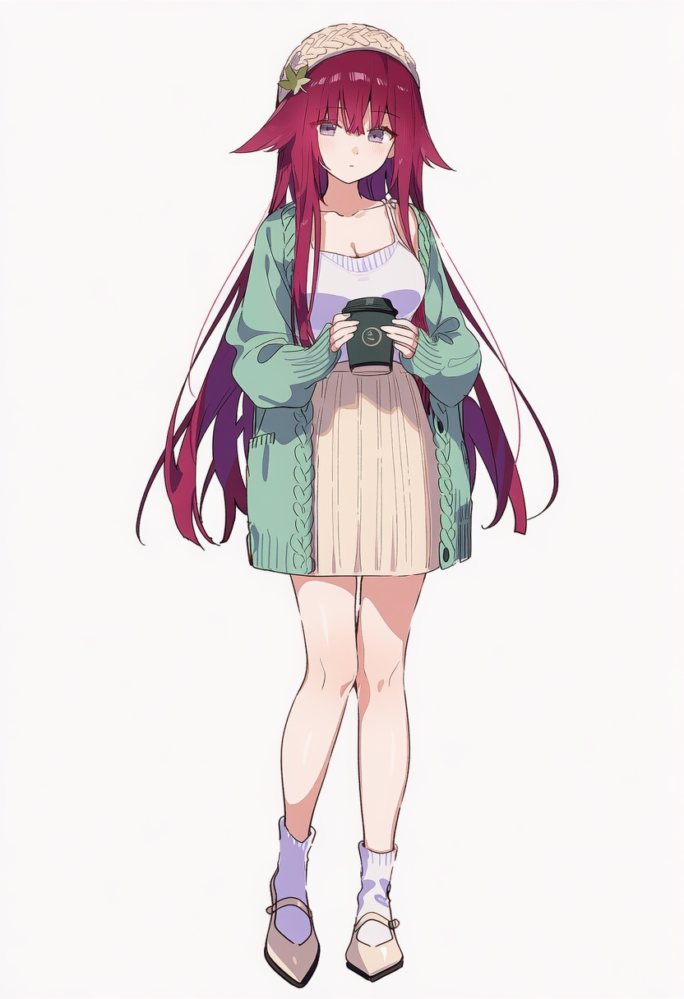

[在线例图](https://assets.quicktagcloud.com/images/raven_composition/raven_composition-6273.jpg?v=7ad8185db60d057b)

<a id="raven_composition-6274"></a>

## 千代田

ID：`raven_composition-6274`；分类：角色图鉴 / 碧蓝航线 / 重樱；来源标记：`safe`。

来源说明：

> 作品：碧蓝航线
> 角色英文名：Chiyoda
> 首次登场时间（国服实装）：2020-09-17
> 阵营：重樱

正向提示词：

```text
chiyoda_(azur_lane)
```

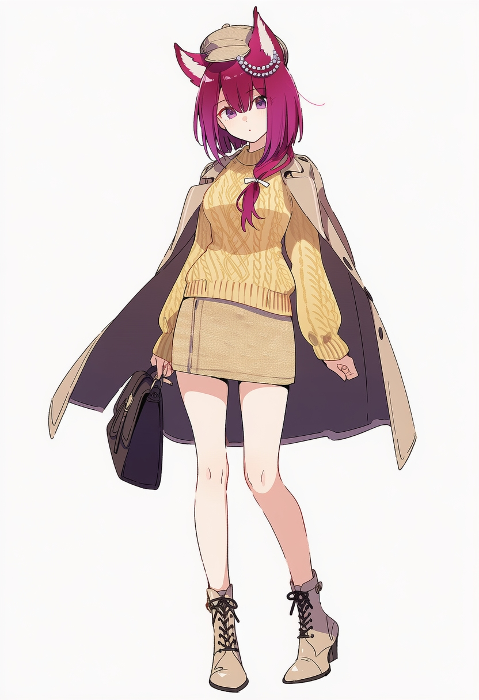

[在线例图](https://assets.quicktagcloud.com/images/raven_composition/raven_composition-6274.jpg?v=ec677f318c3c99b5)

<a id="raven_composition-6275"></a>

## 信浓

ID：`raven_composition-6275`；分类：角色图鉴 / 碧蓝航线 / 重樱；来源标记：`safe`。

来源说明：

> 作品：碧蓝航线
> 角色英文名：Shinano
> 首次登场时间（国服实装）：2020-09-17
> 阵营：重樱

正向提示词：

```text
shinano_(azur_lane)
```

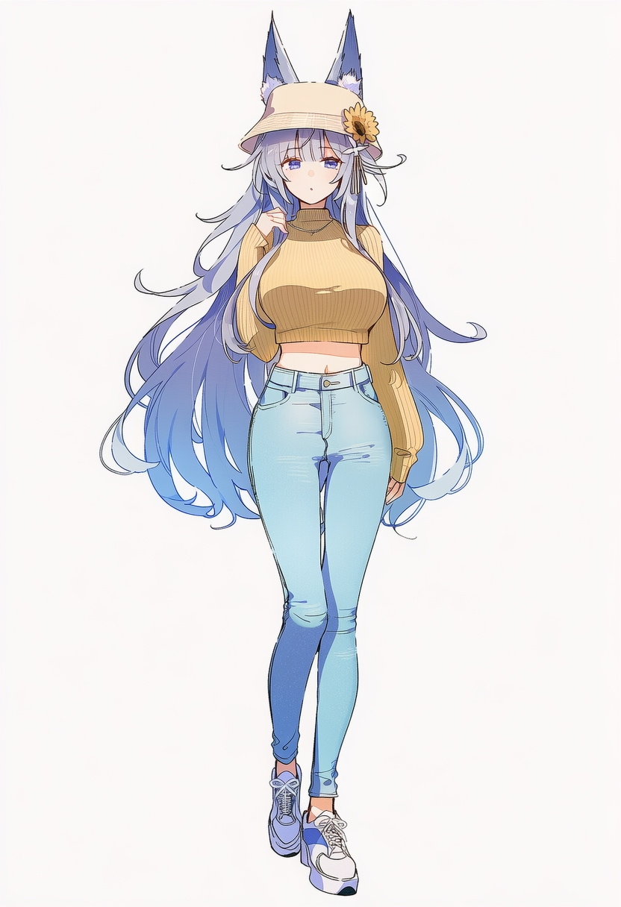

[在线例图](https://assets.quicktagcloud.com/images/raven_composition/raven_composition-6275.jpg?v=984604c15fcd00a0)

<a id="raven_composition-6276"></a>

## 樫野

ID：`raven_composition-6276`；分类：角色图鉴 / 碧蓝航线 / 重樱；来源标记：`safe`。

来源说明：

> 作品：碧蓝航线
> 角色英文名：Kashino
> 首次登场时间（国服实装）：2020-09-17
> 阵营：重樱

正向提示词：

```text
kashino_(azur_lane)
```


[在线例图](https://assets.quicktagcloud.com/images/raven_composition/raven_composition-6276.jpg?v=5c090161d6f1d2e1)

<a id="raven_composition-6284"></a>

## 大凤μ

ID：`raven_composition-6284`；分类：角色图鉴 / 碧蓝航线 / 重樱；来源标记：`safe`。

来源说明：

> 作品：碧蓝航线
> 角色英文名：Taihou µ
> 首次登场时间（国服实装）：2020-10-29
> 阵营：重樱

正向提示词：

```text
taihou_(muse)_(azur_lane)
```

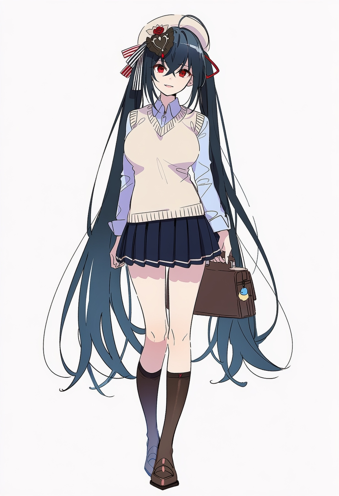

[在线例图](https://assets.quicktagcloud.com/images/raven_composition/raven_composition-6284.jpg?v=24c96c75e48a10e7)

<a id="raven_composition-6311"></a>

## 追风

ID：`raven_composition-6311`；分类：角色图鉴 / 碧蓝航线 / 重樱；来源标记：`safe`。

来源说明：

> 作品：碧蓝航线
> 角色英文名：Oite
> 首次登场时间（国服实装）：2021-04
> 阵营：重樱

正向提示词：

```text
oite_(azur_lane)
```

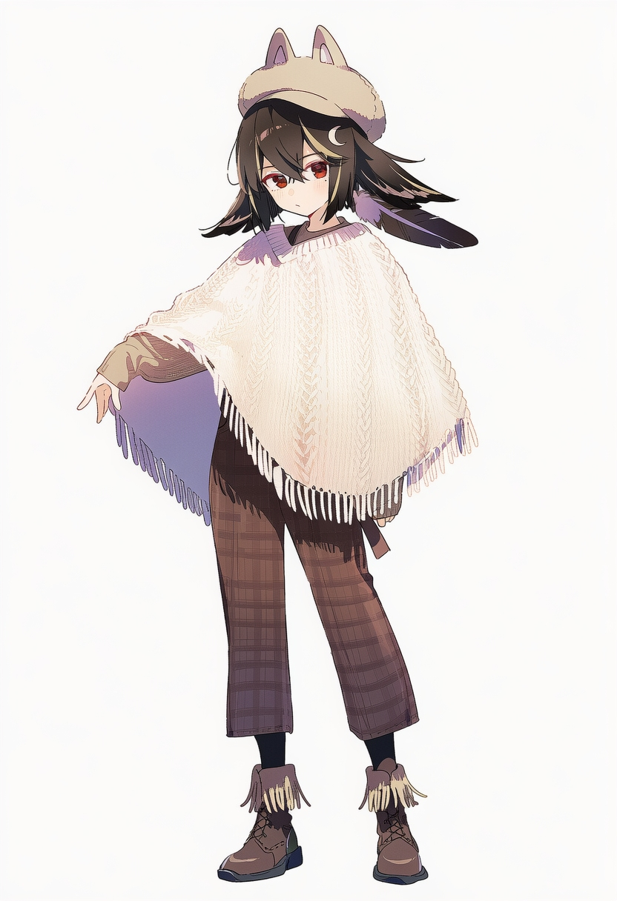

[在线例图](https://assets.quicktagcloud.com/images/raven_composition/raven_composition-6311.jpg?v=e038127ed81c07a5)

<a id="raven_composition-6316"></a>

## 小天城

ID：`raven_composition-6316`；分类：角色图鉴 / 碧蓝航线 / 重樱；来源标记：`safe`。

来源说明：

> 作品：碧蓝航线
> 角色英文名：Amagi-chan
> 首次登场时间（国服实装）：2021-04-22
> 阵营：重樱

正向提示词：

```text
amagi-chan_(azur_lane)
```

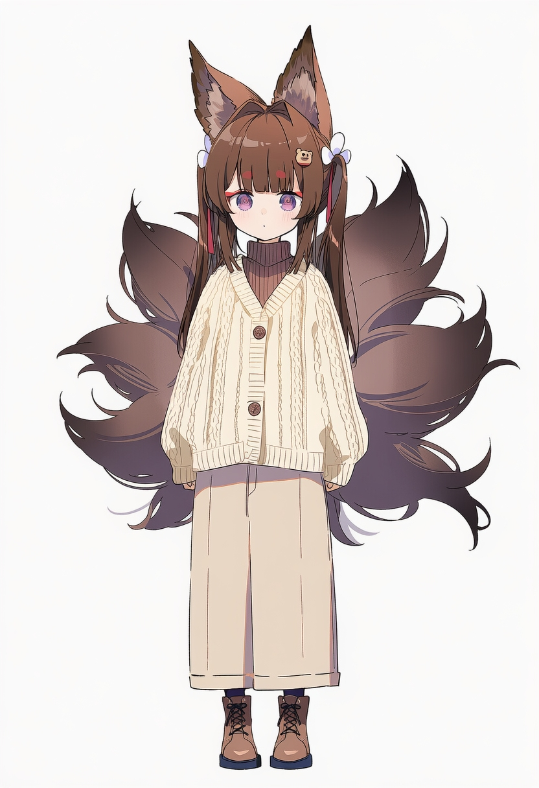

[在线例图](https://assets.quicktagcloud.com/images/raven_composition/raven_composition-6316.jpg?v=6d1638d55498ff87)

<a id="raven_composition-6328"></a>

## 白雪

ID：`raven_composition-6328`；分类：角色图鉴 / 碧蓝航线 / 重樱；来源标记：`safe`。

来源说明：

> 作品：碧蓝航线
> 角色英文名：Shirayuki
> 首次登场时间（国服实装）：2021-06-24
> 阵营：重樱

正向提示词：

```text
shirayuki_(azur_lane)
```

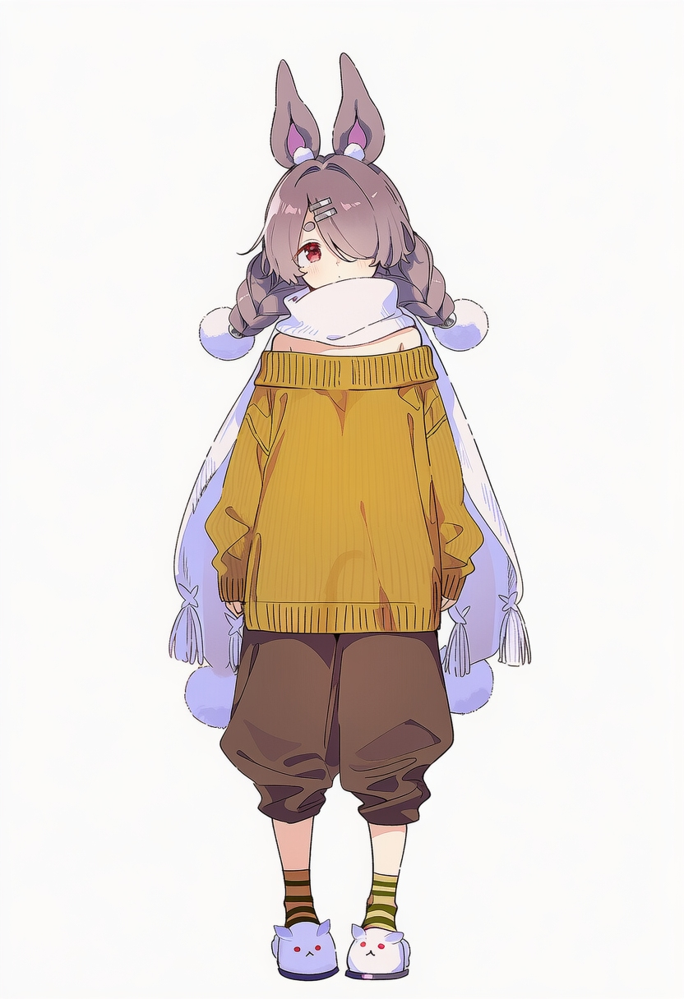

[在线例图](https://assets.quicktagcloud.com/images/raven_composition/raven_composition-6328.jpg?v=b5f29ae79e6fe233)

<a id="raven_composition-6329"></a>

## 风云

ID：`raven_composition-6329`；分类：角色图鉴 / 碧蓝航线 / 重樱；来源标记：`safe`。

来源说明：

> 作品：碧蓝航线
> 角色英文名：Kazagumo
> 首次登场时间（国服实装）：2021-06-24
> 阵营：重樱

正向提示词：

```text
kazagumo_(azur_lane)
```

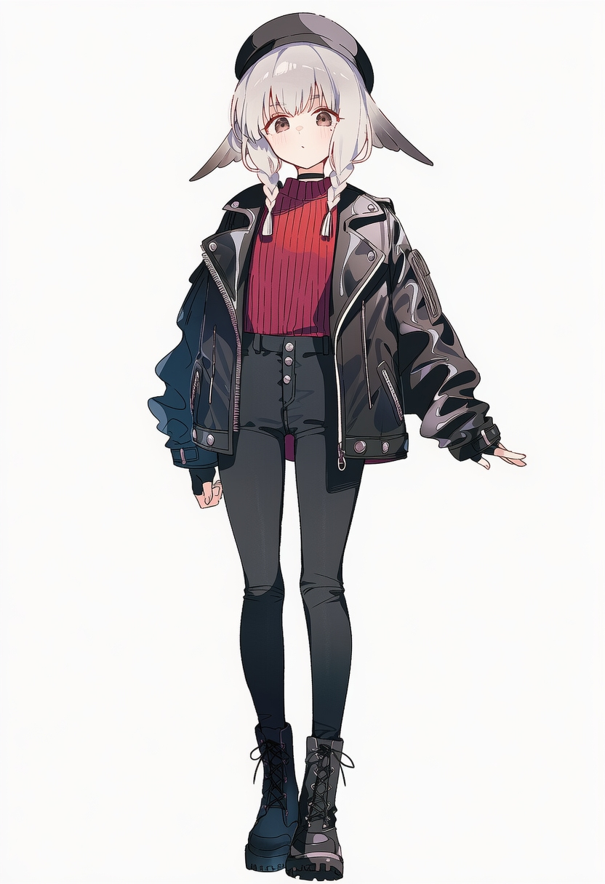

[在线例图](https://assets.quicktagcloud.com/images/raven_composition/raven_composition-6329.jpg?v=d5d03f08c047991e)

<a id="raven_composition-6334"></a>

## 白龙

ID：`raven_composition-6334`；分类：角色图鉴 / 碧蓝航线 / 重樱；来源标记：`safe`。

来源说明：

> 作品：碧蓝航线
> 角色英文名：Hakuryuu
> 首次登场时间（国服实装）：2021-07-08
> 阵营：重樱

正向提示词：

```text
hakuryuu_(azur_lane)
```

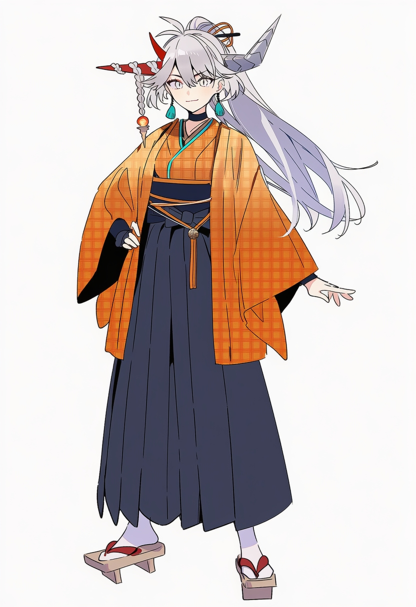

[在线例图](https://assets.quicktagcloud.com/images/raven_composition/raven_composition-6334.jpg?v=ea17a83b6bd49b9f)

<a id="raven_composition-6338"></a>

## 海风

ID：`raven_composition-6338`；分类：角色图鉴 / 碧蓝航线 / 重樱；来源标记：`safe`。

来源说明：

> 作品：碧蓝航线
> 角色英文名：Umikaze
> 首次登场时间（国服实装）：2021-09-16
> 阵营：重樱

正向提示词：

```text
umikaze_(azur_lane)
```

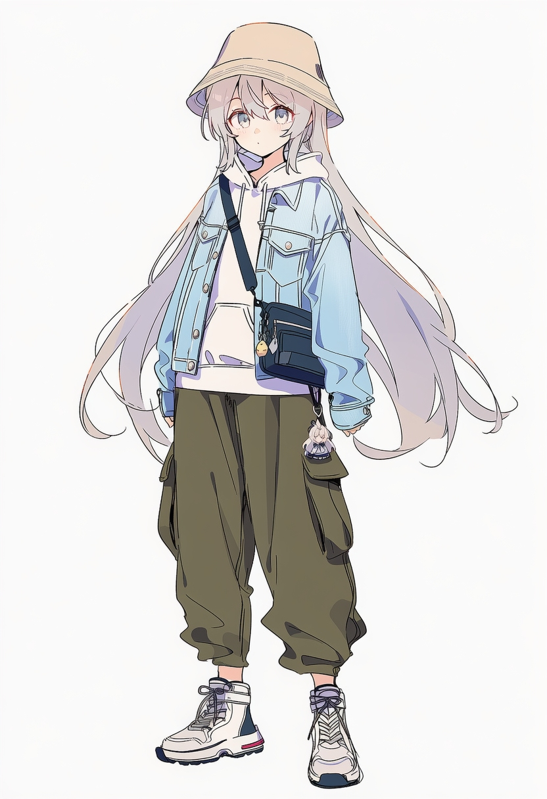

[在线例图](https://assets.quicktagcloud.com/images/raven_composition/raven_composition-6338.jpg?v=eb1193d507c253fe)

<a id="raven_composition-6339"></a>

## 山风

ID：`raven_composition-6339`；分类：角色图鉴 / 碧蓝航线 / 重樱；来源标记：`safe`。

来源说明：

> 作品：碧蓝航线
> 角色英文名：Yamakaze
> 首次登场时间（国服实装）：2021-09-16
> 阵营：重樱

正向提示词：

```text
yamakaze_(azur_lane)
```


[在线例图](https://assets.quicktagcloud.com/images/raven_composition/raven_composition-6339.jpg?v=de3b8d56d306de07)

<a id="raven_composition-6340"></a>

## 岛风

ID：`raven_composition-6340`；分类：角色图鉴 / 碧蓝航线 / 重樱；来源标记：`safe`。

来源说明：

> 作品：碧蓝航线
> 角色英文名：Shimakaze
> 首次登场时间（国服实装）：2021-09-16
> 阵营：重樱

正向提示词：

```text
shimakaze_(azur_lane)
```

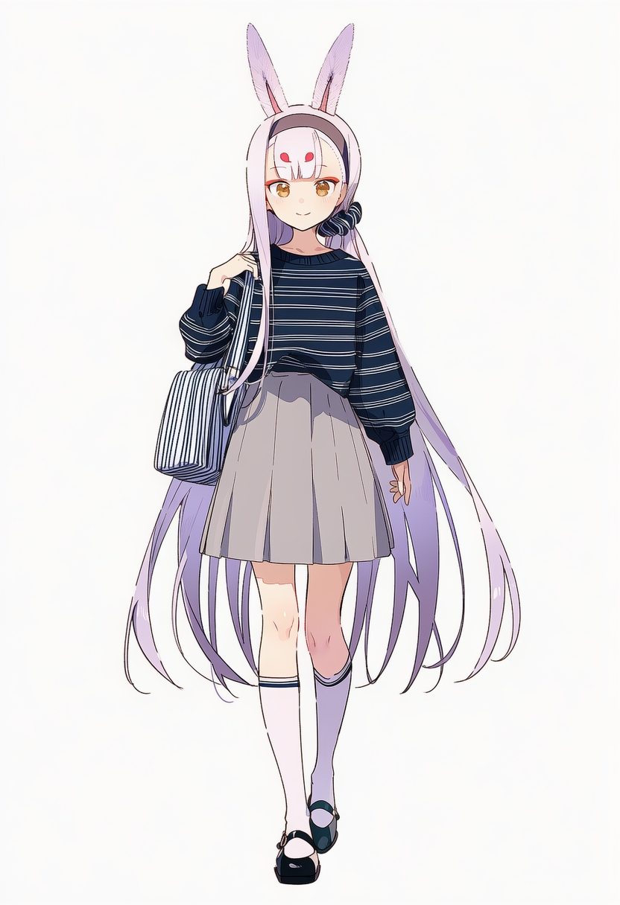

[在线例图](https://assets.quicktagcloud.com/images/raven_composition/raven_composition-6340.jpg?v=e2863f0cd14b3558)

<a id="raven_composition-6341"></a>

## 由良

ID：`raven_composition-6341`；分类：角色图鉴 / 碧蓝航线 / 重樱；来源标记：`safe`。

来源说明：

> 作品：碧蓝航线
> 角色英文名：Yura
> 首次登场时间（国服实装）：2021-09-16
> 阵营：重樱

正向提示词：

```text
yura_(azur_lane)
```

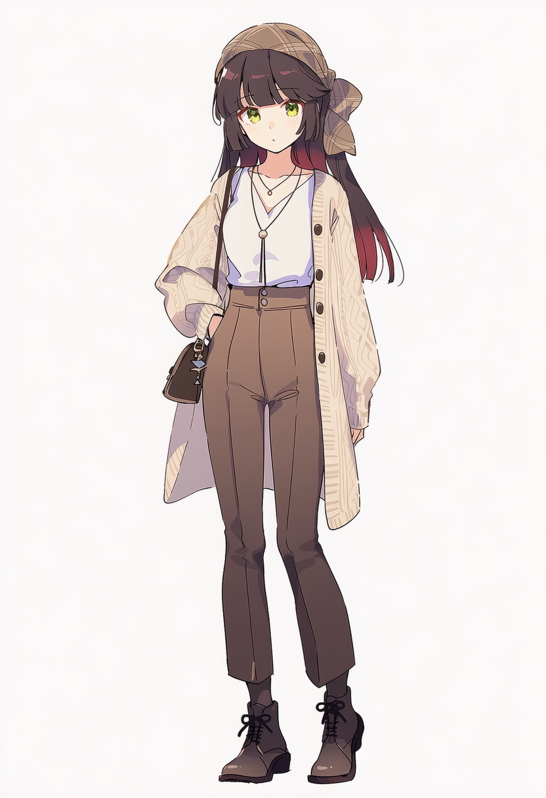

[在线例图](https://assets.quicktagcloud.com/images/raven_composition/raven_composition-6341.jpg?v=12731f90a1da138e)

<a id="raven_composition-6342"></a>

## 筑摩

ID：`raven_composition-6342`；分类：角色图鉴 / 碧蓝航线 / 重樱；来源标记：`safe`。

来源说明：

> 作品：碧蓝航线
> 角色英文名：Chikuma
> 首次登场时间（国服实装）：2021-09-16
> 阵营：重樱

正向提示词：

```text
chikuma_(azur_lane)
```

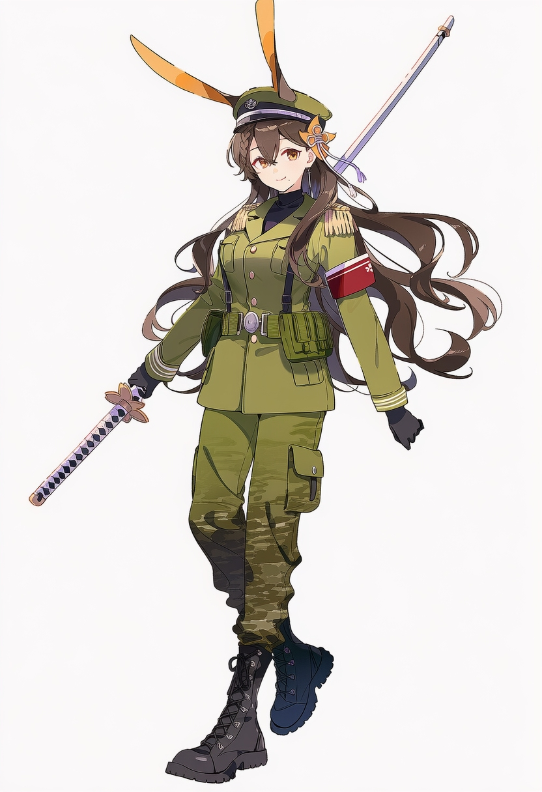

[在线例图](https://assets.quicktagcloud.com/images/raven_composition/raven_composition-6342.jpg?v=b33ef293472e82dc)

<a id="raven_composition-6343"></a>

## 葛城

ID：`raven_composition-6343`；分类：角色图鉴 / 碧蓝航线 / 重樱；来源标记：`safe`。

来源说明：

> 作品：碧蓝航线
> 角色英文名：Katsuragi
> 首次登场时间（国服实装）：2021-09-16
> 阵营：重樱

正向提示词：

```text
katsuragi_(azur_lane)
```

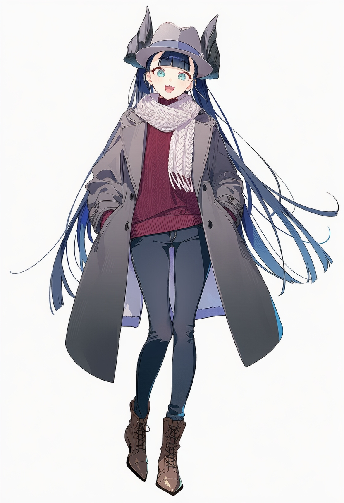

[在线例图](https://assets.quicktagcloud.com/images/raven_composition/raven_composition-6343.jpg?v=18d5cadd68cc3cad)

<a id="raven_composition-6406"></a>

## 深雪

ID：`raven_composition-6406`；分类：角色图鉴 / 碧蓝航线 / 重樱；来源标记：`safe`。

来源说明：

> 作品：碧蓝航线
> 角色英文名：Miyuki
> 首次登场时间（国服实装）：2022-09-15
> 阵营：重樱

正向提示词：

```text
miyuki_(azur_lane)
```

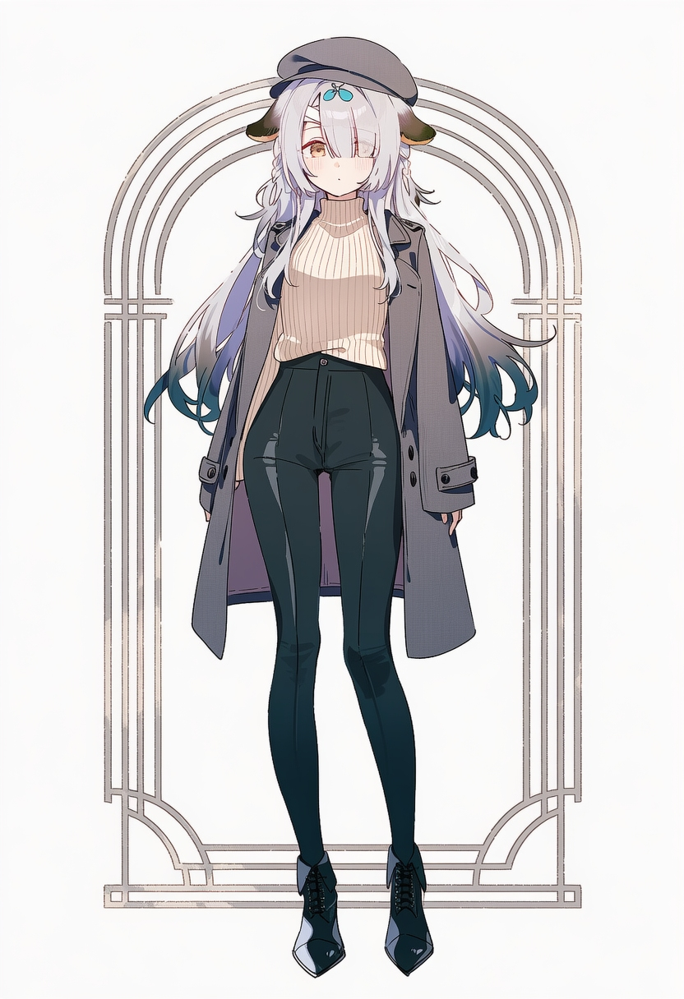

[在线例图](https://assets.quicktagcloud.com/images/raven_composition/raven_composition-6406.jpg?v=32a1f9f5696ecc3d)

<a id="raven_composition-6407"></a>

## 若月

ID：`raven_composition-6407`；分类：角色图鉴 / 碧蓝航线 / 重樱；来源标记：`safe`。

来源说明：

> 作品：碧蓝航线
> 角色英文名：Wakatsuki
> 首次登场时间（国服实装）：2022-09-15
> 阵营：重樱

正向提示词：

```text
wakatsuki_(azur_lane)
```

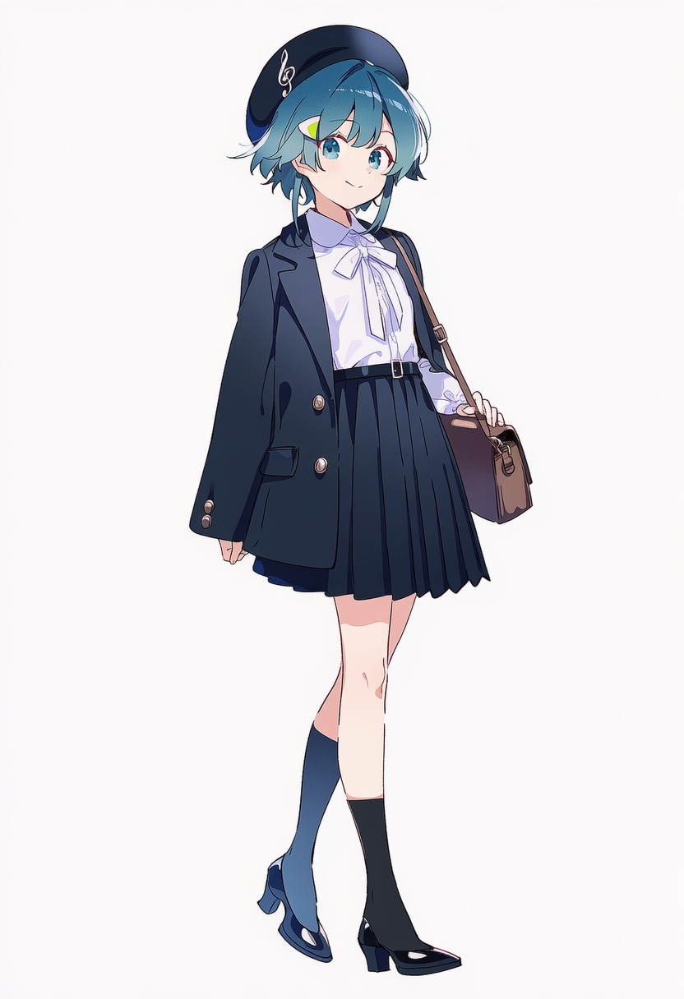

[在线例图](https://assets.quicktagcloud.com/images/raven_composition/raven_composition-6407.jpg?v=0b6b794f26d5340e)

<a id="raven_composition-6408"></a>

## 酒匂

ID：`raven_composition-6408`；分类：角色图鉴 / 碧蓝航线 / 重樱；来源标记：`safe`。

来源说明：

> 作品：碧蓝航线
> 角色英文名：Sakawa
> 首次登场时间（国服实装）：2022-09-15
> 阵营：重樱

正向提示词：

```text
sakawa_(azur_lane)
```

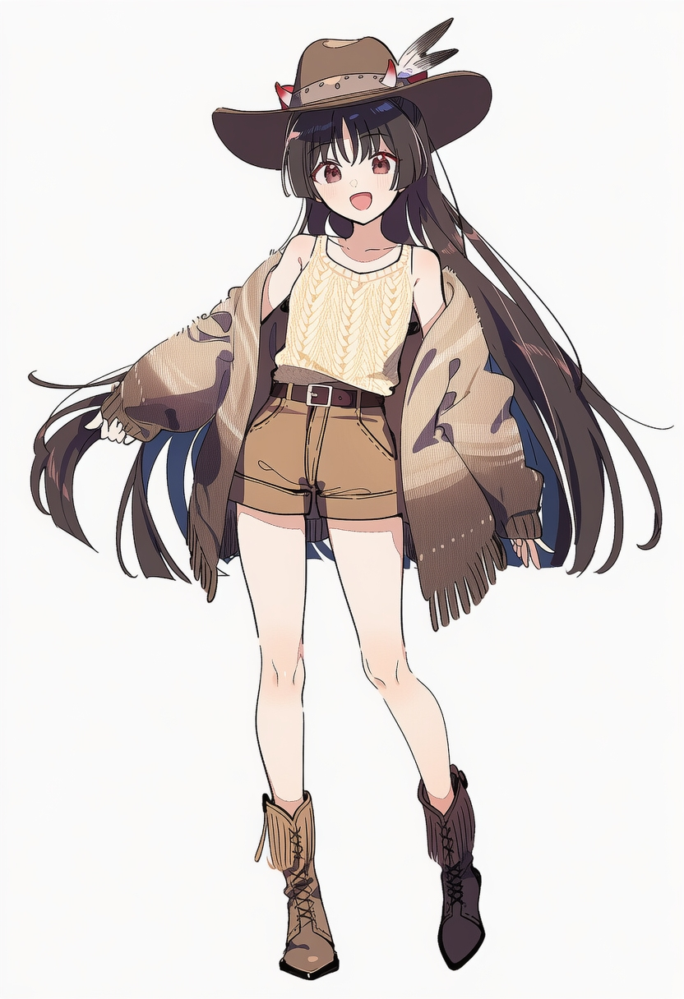

[在线例图](https://assets.quicktagcloud.com/images/raven_composition/raven_composition-6408.jpg?v=172e5419c3066aed)

<a id="raven_composition-6409"></a>

## 羽黑

ID：`raven_composition-6409`；分类：角色图鉴 / 碧蓝航线 / 重樱；来源标记：`safe`。

来源说明：

> 作品：碧蓝航线
> 角色英文名：Haguro
> 首次登场时间（国服实装）：2022-09-15
> 阵营：重樱

正向提示词：

```text
haguro_(azur_lane)
```

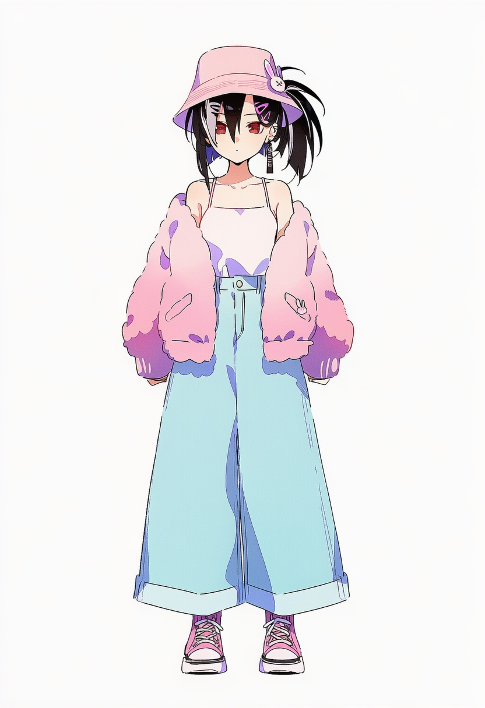

[在线例图](https://assets.quicktagcloud.com/images/raven_composition/raven_composition-6409.jpg?v=7f5ecd0534b672ea)

<a id="raven_composition-6410"></a>

## 武藏

ID：`raven_composition-6410`；分类：角色图鉴 / 碧蓝航线 / 重樱；来源标记：`safe`。

来源说明：

> 作品：碧蓝航线
> 角色英文名：Musashi
> 首次登场时间（国服实装）：2022-09-15
> 阵营：重樱

正向提示词：

```text
musashi_(azur_lane)
```

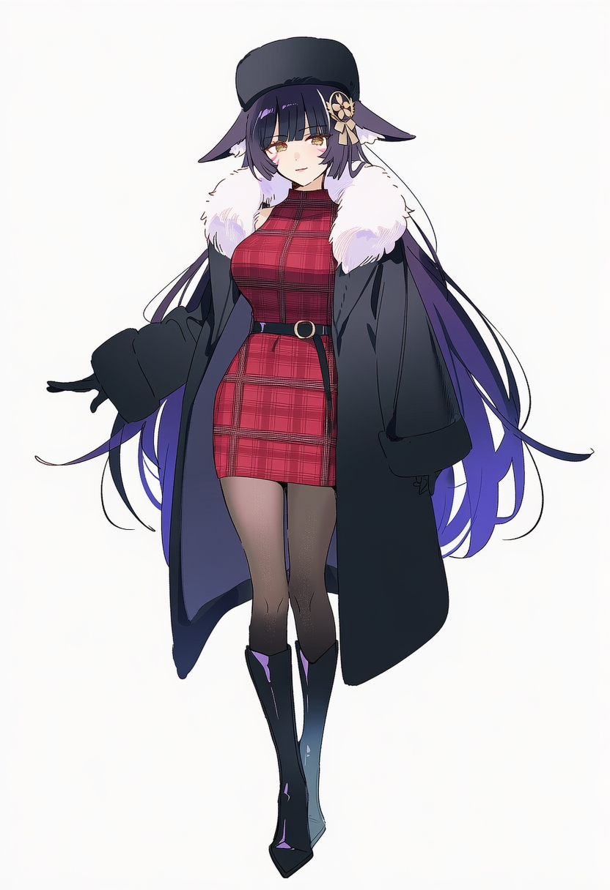

[在线例图](https://assets.quicktagcloud.com/images/raven_composition/raven_composition-6410.jpg?v=7fa8bb2fe6ebbcc4)

<a id="raven_composition-6442"></a>

## 小大凤

ID：`raven_composition-6442`；分类：角色图鉴 / 碧蓝航线 / 重樱；来源标记：`safe`。

来源说明：

> 作品：碧蓝航线
> 角色英文名：Taihou-chan
> 首次登场时间（国服实装）：2023-06-01
> 阵营：重樱

正向提示词：

```text
taihou-chan_(azur_lane)
```

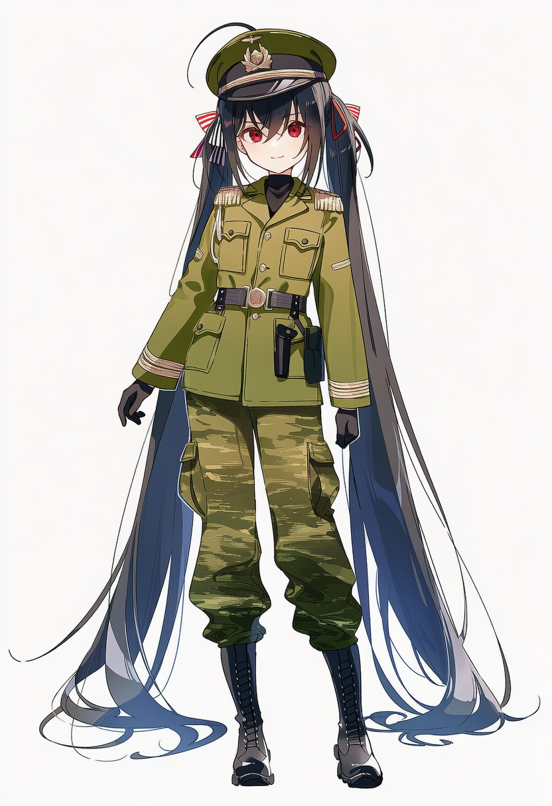

[在线例图](https://assets.quicktagcloud.com/images/raven_composition/raven_composition-6442.jpg?v=8f1dbc3fa45052dd)

<a id="raven_composition-6450"></a>

## 四万十

ID：`raven_composition-6450`；分类：角色图鉴 / 碧蓝航线 / 重樱；来源标记：`safe`。

来源说明：

> 作品：碧蓝航线
> 角色英文名：Shimanto
> 首次登场时间（国服实装）：2023-07-13
> 阵营：重樱

正向提示词：

```text
shimanto_(azur_lane)
```

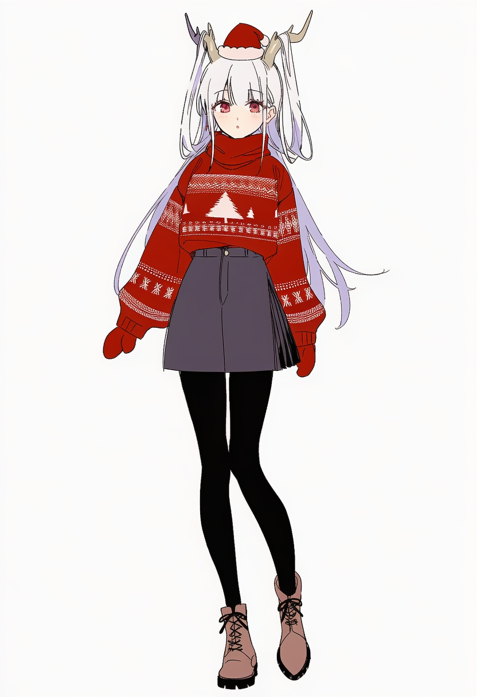

[在线例图](https://assets.quicktagcloud.com/images/raven_composition/raven_composition-6450.jpg?v=dcfd4dded8a4bd69)

<a id="raven_composition-6461"></a>

## 朝凪

ID：`raven_composition-6461`；分类：角色图鉴 / 碧蓝航线 / 重樱；来源标记：`safe`。

来源说明：

> 作品：碧蓝航线
> 角色英文名：Asanagi
> 首次登场时间（国服实装）：2023-09-14
> 阵营：重樱

正向提示词：

```text
asanagi_(azur_lane)
```

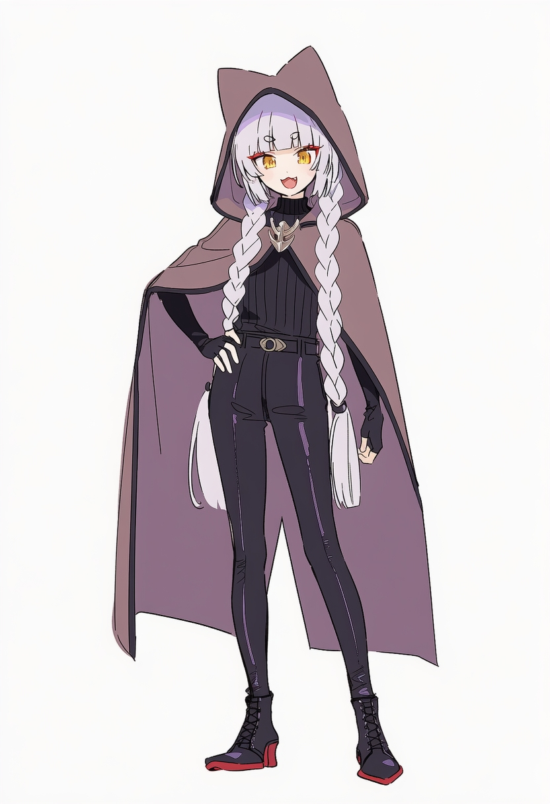

[在线例图](https://assets.quicktagcloud.com/images/raven_composition/raven_composition-6461.jpg?v=e97fcae94abcb990)

<a id="raven_composition-6462"></a>

## 初月

ID：`raven_composition-6462`；分类：角色图鉴 / 碧蓝航线 / 重樱；来源标记：`safe`。

来源说明：

> 作品：碧蓝航线
> 角色英文名：Hatsuzuki
> 首次登场时间（国服实装）：2023-09-14
> 阵营：重樱

正向提示词：

```text
hatsuzuki_(azur_lane)
```

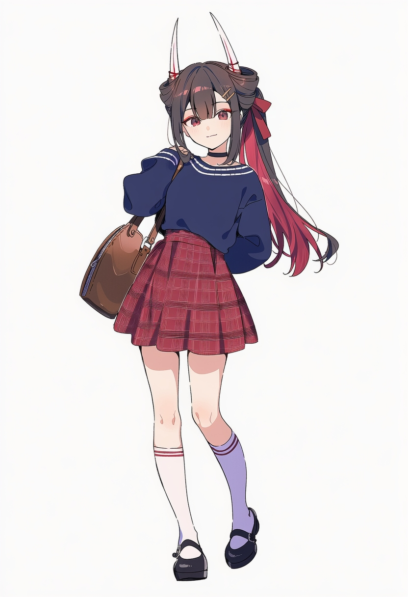

[在线例图](https://assets.quicktagcloud.com/images/raven_composition/raven_composition-6462.jpg?v=cdc1c9f6a83a7998)

<a id="raven_composition-6463"></a>

## 名取

ID：`raven_composition-6463`；分类：角色图鉴 / 碧蓝航线 / 重樱；来源标记：`safe`。

来源说明：

> 作品：碧蓝航线
> 角色英文名：Natori
> 首次登场时间（国服实装）：2023-09-14
> 阵营：重樱

正向提示词：

```text
natori_(azur_lane)
```

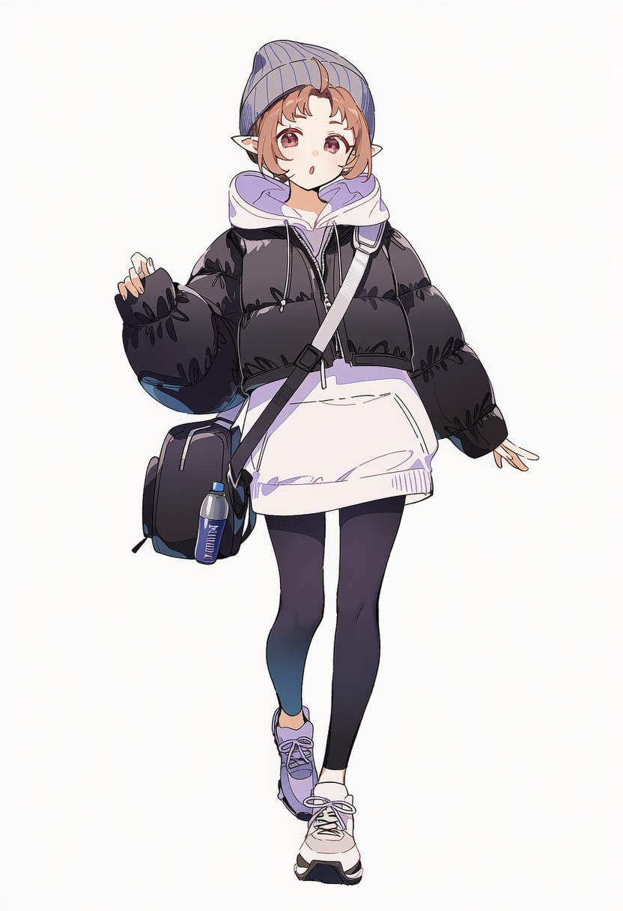

[在线例图](https://assets.quicktagcloud.com/images/raven_composition/raven_composition-6463.jpg?v=cde7517f2d304d7a)

<a id="raven_composition-6464"></a>

## 云仙

ID：`raven_composition-6464`；分类：角色图鉴 / 碧蓝航线 / 重樱；来源标记：`safe`。

来源说明：

> 作品：碧蓝航线
> 角色英文名：Unzen
> 首次登场时间（国服实装）：2023-09-14
> 阵营：重樱

正向提示词：

```text
unzen_(azur_lane)
```


[在线例图](https://assets.quicktagcloud.com/images/raven_composition/raven_composition-6464.jpg?v=b16a930fcd3b521e)

<a id="raven_composition-6465"></a>

## 尾张

ID：`raven_composition-6465`；分类：角色图鉴 / 碧蓝航线 / 重樱；来源标记：`safe`。

来源说明：

> 作品：碧蓝航线
> 角色英文名：Owari
> 首次登场时间（国服实装）：2023-09-14
> 阵营：重樱

正向提示词：

```text
owari_(azur_lane)
```


[在线例图](https://assets.quicktagcloud.com/images/raven_composition/raven_composition-6465.jpg?v=7fd52aa3878066bc)

<a id="raven_composition-6499"></a>

## 能代μ

ID：`raven_composition-6499`；分类：角色图鉴 / 碧蓝航线 / 重樱；来源标记：`safe`。

来源说明：

> 作品：碧蓝航线
> 角色英文名：Noshiro µ
> 首次登场时间（国服实装）：2024-04-25
> 阵营：重樱

正向提示词：

```text
noshiro_(muse)_(azur_lane)
```


[在线例图](https://assets.quicktagcloud.com/images/raven_composition/raven_composition-6499.jpg?v=4416b74c4a417ef2)

<a id="raven_composition-6501"></a>

## 金刚(μ兵装)

ID：`raven_composition-6501`；分类：角色图鉴 / 碧蓝航线 / 重樱；来源标记：`safe`。

来源说明：

> 作品：碧蓝航线
> 角色英文名：Kongou µ
> 首次登场时间（国服实装）：2024-04-25
> 阵营：重樱

正向提示词：

```text
kongou_(muse)_(azur_lane)
```


[在线例图](https://assets.quicktagcloud.com/images/raven_composition/raven_composition-6501.jpg?v=85bba0f6bc079478)

<a id="raven_composition-6503"></a>

## 小信浓

ID：`raven_composition-6503`；分类：角色图鉴 / 碧蓝航线 / 重樱；来源标记：`safe`。

来源说明：

> 作品：碧蓝航线
> 角色英文名：Shinano-chan
> 首次登场时间（国服实装）：2024-04-25
> 阵营：重樱

正向提示词：

```text
shinano-chan_(azur_lane)
```


[在线例图](https://assets.quicktagcloud.com/images/raven_composition/raven_composition-6503.jpg?v=930efdc85598d733)

<a id="raven_composition-6518"></a>

## 大山

ID：`raven_composition-6518`；分类：角色图鉴 / 碧蓝航线 / 重樱；来源标记：`safe`。

来源说明：

> 作品：碧蓝航线
> 角色英文名：Daisen
> 首次登场时间（国服实装）：2024-07-11
> 阵营：重樱

正向提示词：

```text
daisen_(azur_lane)
```


[在线例图](https://assets.quicktagcloud.com/images/raven_composition/raven_composition-6518.jpg?v=c7ab5bb5d088e797)

<a id="raven_composition-6532"></a>

## 瑞凤

ID：`raven_composition-6532`；分类：角色图鉴 / 碧蓝航线 / 重樱；来源标记：`safe`。

来源说明：

> 作品：碧蓝航线
> 角色英文名：Zuihou
> 首次登场时间（国服实装）：2024-08-29
> 阵营：重樱

正向提示词：

```text
zuihou_(azur_lane)
```


[在线例图](https://assets.quicktagcloud.com/images/raven_composition/raven_composition-6532.jpg?v=42f589d2711d2b29)

<a id="raven_composition-6534"></a>

## 凉波

ID：`raven_composition-6534`；分类：角色图鉴 / 碧蓝航线 / 重樱；来源标记：`safe`。

来源说明：

> 作品：碧蓝航线
> 角色英文名：Suzunami
> 首次登场时间（国服实装）：2024-09-12
> 阵营：重樱

正向提示词：

```text
suzunami_(azur_lane)
```


[在线例图](https://assets.quicktagcloud.com/images/raven_composition/raven_composition-6534.jpg?v=bcd3cf443735e8e0)

<a id="raven_composition-6535"></a>

## 绫濑

ID：`raven_composition-6535`；分类：角色图鉴 / 碧蓝航线 / 重樱；来源标记：`safe`。

来源说明：

> 作品：碧蓝航线
> 角色英文名：Ayase
> 首次登场时间（国服实装）：2024-09-12
> 阵营：重樱

正向提示词：

```text
ayase_(azur_lane)
```


[在线例图](https://assets.quicktagcloud.com/images/raven_composition/raven_composition-6535.jpg?v=7354bd6f4bee4759)

<a id="raven_composition-6536"></a>

## 渡良濑

ID：`raven_composition-6536`；分类：角色图鉴 / 碧蓝航线 / 重樱；来源标记：`safe`。

来源说明：

> 作品：碧蓝航线
> 角色英文名：Watarase
> 首次登场时间（国服实装）：2024-09-12
> 阵营：重樱

正向提示词：

```text
watarase_(azur_lane)
```


[在线例图](https://assets.quicktagcloud.com/images/raven_composition/raven_composition-6536.jpg?v=165400491a881f2e)

<a id="raven_composition-6538"></a>

## 天城(CV)

ID：`raven_composition-6538`；分类：角色图鉴 / 碧蓝航线 / 重樱；来源标记：`safe`。

来源说明：

> 作品：碧蓝航线
> 角色英文名：Amagi (CV)
> 首次登场时间（国服实装）：2024-09-12
> 阵营：重樱

正向提示词：

```text
amagi_(cv)_(azur_lane)
```


[在线例图](https://assets.quicktagcloud.com/images/raven_composition/raven_composition-6538.jpg?v=ef0681656274d2ca)

<a id="raven_composition-6594"></a>

## 妙风

ID：`raven_composition-6594`；分类：角色图鉴 / 碧蓝航线 / 重樱；来源标记：`safe`。

来源说明：

> 作品：碧蓝航线
> 角色英文名：Taekaze
> 首次登场时间（国服实装）：2025-09-12
> 阵营：重樱

正向提示词：

```text
taekaze_(azur_lane)
```


[在线例图](https://assets.quicktagcloud.com/images/raven_composition/raven_composition-6594.jpg?v=9da76b23a2a9f124)

<a id="raven_composition-6595"></a>

## 水无濑

ID：`raven_composition-6595`；分类：角色图鉴 / 碧蓝航线 / 重樱；来源标记：`safe`。

来源说明：

> 作品：碧蓝航线
> 角色英文名：Minase
> 首次登场时间（国服实装）：2025-09-12
> 阵营：重樱

正向提示词：

```text
minase_(azur_lane)
```


[在线例图](https://assets.quicktagcloud.com/images/raven_composition/raven_composition-6595.jpg?v=e25163a7ae115bb7)

<a id="raven_composition-6597"></a>

## 近江

ID：`raven_composition-6597`；分类：角色图鉴 / 碧蓝航线 / 重樱；来源标记：`safe`。

来源说明：

> 作品：碧蓝航线
> 角色英文名：Oumi
> 首次登场时间（国服实装）：2025-09-12
> 阵营：重樱

正向提示词：

```text
oumi_(azur_lane)
```


[在线例图](https://assets.quicktagcloud.com/images/raven_composition/raven_composition-6597.jpg?v=75e0b38570cc21e1)

<a id="raven_composition-6598"></a>

## 白凤

ID：`raven_composition-6598`；分类：角色图鉴 / 碧蓝航线 / 重樱；来源标记：`safe`。

来源说明：

> 作品：碧蓝航线
> 角色英文名：Hakuhou
> 首次登场时间（国服实装）：2025-09-12
> 阵营：重樱

正向提示词：

```text
hakuhou_(azur_lane)
```


[在线例图](https://assets.quicktagcloud.com/images/raven_composition/raven_composition-6598.jpg?v=f50a4cb0b7ead7c8)

<a id="raven_composition-6599"></a>

## 伊404

ID：`raven_composition-6599`；分类：角色图鉴 / 碧蓝航线 / 重樱；来源标记：`safe`。

来源说明：

> 作品：碧蓝航线
> 角色英文名：I-404
> 首次登场时间（国服实装）：2025-09-12
> 阵营：重樱

正向提示词：

```text
i-404_(azur_lane)
```


[在线例图](https://assets.quicktagcloud.com/images/raven_composition/raven_composition-6599.jpg?v=714927a652977cec)

<a id="raven_composition-6612"></a>

## 藤波

ID：`raven_composition-6612`；分类：角色图鉴 / 碧蓝航线 / 重樱；来源标记：`safe`。

来源说明：

> 作品：碧蓝航线
> 角色英文名：Fujinami
> 首次登场时间（国服实装）：2026-01-08
> 阵营：重樱

正向提示词：

```text
fujinami_(azur_lane)
```


[在线例图](https://assets.quicktagcloud.com/images/raven_composition/raven_composition-6612.jpg?v=941555293199a7e0)

<a id="raven_composition-6622"></a>

## 木津

ID：`raven_composition-6622`；分类：角色图鉴 / 碧蓝航线 / 重樱；来源标记：`safe`。

来源说明：

> 作品：碧蓝航线
> 角色英文名：Kizu
> 首次登场时间（国服实装）：2026-03-26
> 阵营：重樱

正向提示词：

```text
kizu_(azur_lane)
```


[在线例图](https://assets.quicktagcloud.com/images/raven_composition/raven_composition-6622.jpg?v=96e4854dd70fc8da)

<a id="raven_composition-6623"></a>

## 名寄

ID：`raven_composition-6623`；分类：角色图鉴 / 碧蓝航线 / 重樱；来源标记：`safe`。

来源说明：

> 作品：碧蓝航线
> 角色英文名：Nayoro
> 首次登场时间（国服实装）：2026-03-26
> 阵营：重樱

正向提示词：

```text
nayoro_(azur_lane)
```


[在线例图](https://assets.quicktagcloud.com/images/raven_composition/raven_composition-6623.jpg?v=aa3385f5c0d763d6)

<a id="raven_composition-6624"></a>

## 云龙

ID：`raven_composition-6624`；分类：角色图鉴 / 碧蓝航线 / 重樱；来源标记：`safe`。

来源说明：

> 作品：碧蓝航线
> 角色英文名：Unryuu
> 首次登场时间（国服实装）：2026-03-26
> 阵营：重樱

正向提示词：

```text
unryuu_(azur_lane)
```


[在线例图](https://assets.quicktagcloud.com/images/raven_composition/raven_composition-6624.jpg?v=000940de513fbe94)
