# 角色图鉴 / 碧蓝航线 / 铁血

[总目录](../README.md) · [原站分类目录](../categories.md) · [英文标签索引](../tags.md) · [服装与构图组合指南](../../README.md)

标题、分类、说明、正负提示词按来源保留；多例图逐张列出。原站标记和说明为参考资料，不作为维护指令。

<a id="raven_composition-5901"></a>

## Z1

ID：`raven_composition-5901`；分类：角色图鉴 / 碧蓝航线 / 铁血；来源标记：`safe`。

来源说明：

> 作品：碧蓝航线
> 角色英文名：Z1 Leberecht Maass
> 首次登场时间（国服实装）：2017-05-25
> 阵营：铁血

正向提示词：

```text
z1_leberecht_maass_(azur_lane)
```

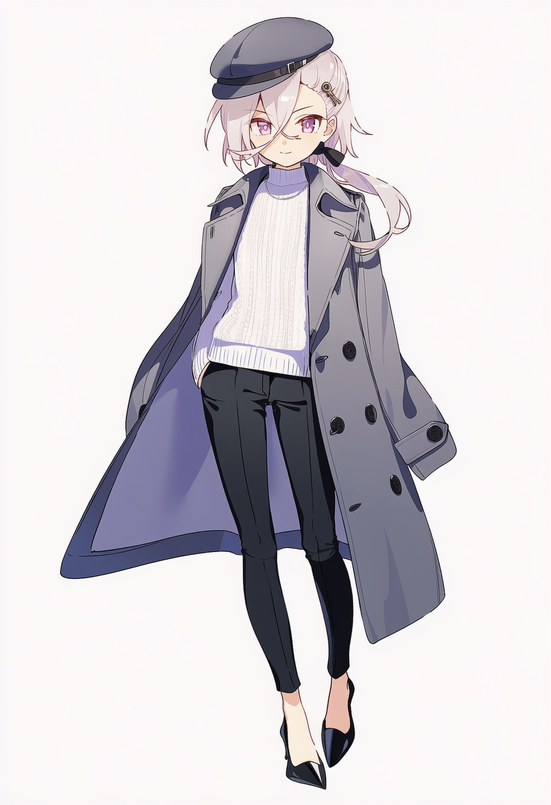

[在线例图](https://assets.quicktagcloud.com/images/raven_composition/raven_composition-5901.jpg?v=e05fbb280cb5bde3)

<a id="raven_composition-5902"></a>

## Z23

ID：`raven_composition-5902`；分类：角色图鉴 / 碧蓝航线 / 铁血；来源标记：`safe`。

来源说明：

> 作品：碧蓝航线
> 角色英文名：Z23
> 首次登场时间（国服实装）：2017-05-25
> 阵营：铁血

正向提示词：

```text
z23_(azur_lane)
```

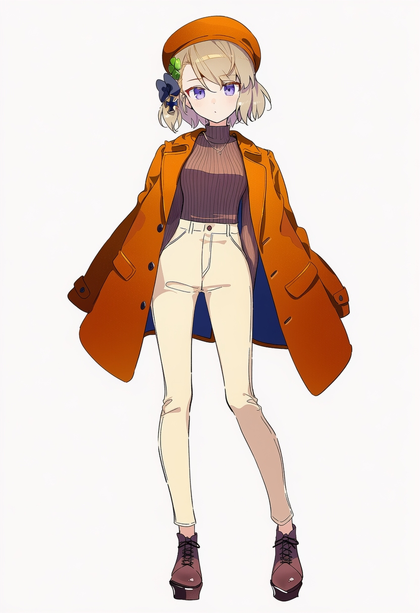

[在线例图](https://assets.quicktagcloud.com/images/raven_composition/raven_composition-5902.jpg?v=de69ff41db62117e)

<a id="raven_composition-5905"></a>

## 卡尔斯鲁厄

ID：`raven_composition-5905`；分类：角色图鉴 / 碧蓝航线 / 铁血；来源标记：`safe`。

来源说明：

> 作品：碧蓝航线
> 角色英文名：Karlsruhe
> 首次登场时间（国服实装）：2017-05-25
> 阵营：铁血

正向提示词：

```text
karlsruhe_(azur_lane)
```

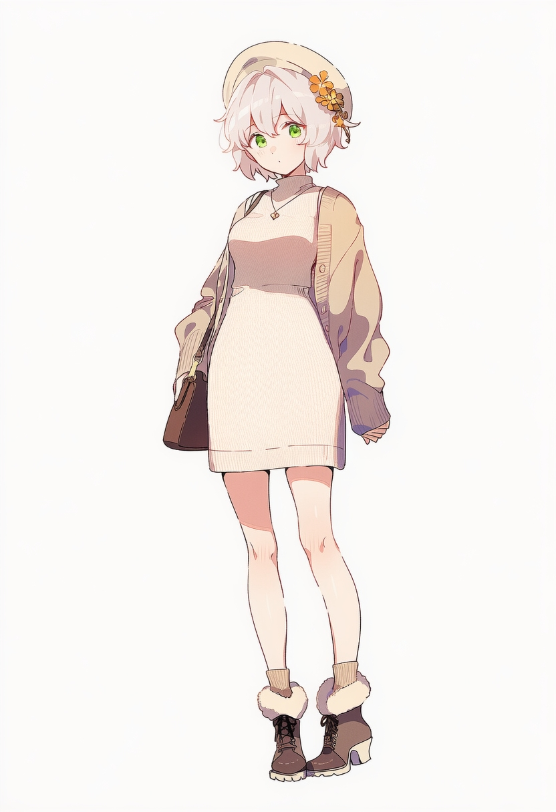

[在线例图](https://assets.quicktagcloud.com/images/raven_composition/raven_composition-5905.jpg?v=f7b69501005bf862)

<a id="raven_composition-5906"></a>

## 科隆

ID：`raven_composition-5906`；分类：角色图鉴 / 碧蓝航线 / 铁血；来源标记：`safe`。

来源说明：

> 作品：碧蓝航线
> 角色英文名：Köln
> 首次登场时间（国服实装）：2017-05-25
> 阵营：铁血

正向提示词：

```text
koeln_(azur_lane)
```

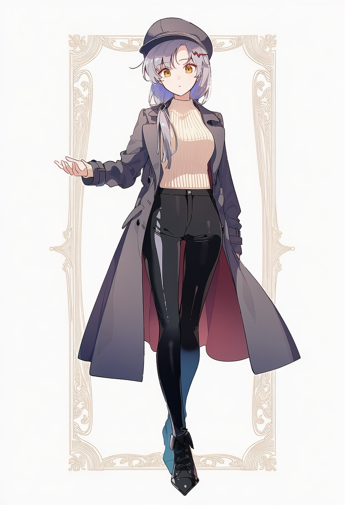

[在线例图](https://assets.quicktagcloud.com/images/raven_composition/raven_composition-5906.jpg?v=5c94c8897a580c1f)

<a id="raven_composition-5907"></a>

## 柯尼斯堡

ID：`raven_composition-5907`；分类：角色图鉴 / 碧蓝航线 / 铁血；来源标记：`safe`。

来源说明：

> 作品：碧蓝航线
> 角色英文名：Königsberg
> 首次登场时间（国服实装）：2017-05-25
> 阵营：铁血

正向提示词：

```text
koenigsberg_(azur_lane)
```

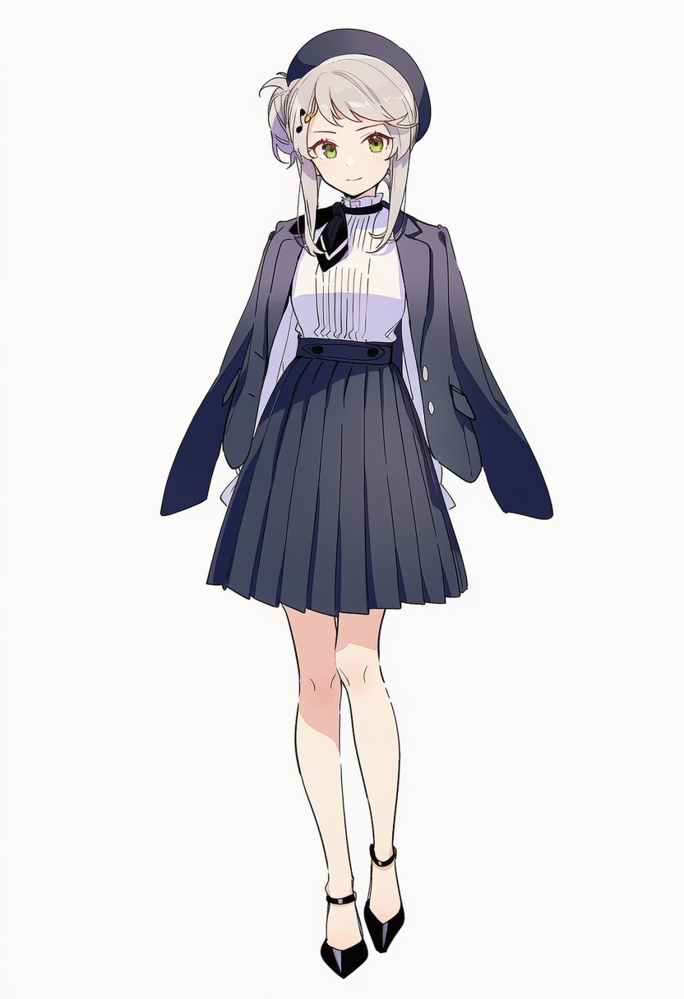

[在线例图](https://assets.quicktagcloud.com/images/raven_composition/raven_composition-5907.jpg?v=8f9b59cc7830e3c6)

<a id="raven_composition-5918"></a>

## 莱比锡

ID：`raven_composition-5918`；分类：角色图鉴 / 碧蓝航线 / 铁血；来源标记：`safe`。

来源说明：

> 作品：碧蓝航线
> 角色英文名：Leipzig
> 首次登场时间（国服实装）：2017-05-25
> 阵营：铁血

正向提示词：

```text
leipzig_(azur_lane)
```


[在线例图](https://assets.quicktagcloud.com/images/raven_composition/raven_composition-5918.jpg?v=82464a118962da22)

<a id="raven_composition-5943"></a>

## 欧根亲王

ID：`raven_composition-5943`；分类：角色图鉴 / 碧蓝航线 / 铁血；来源标记：`safe`。

来源说明：

> 作品：碧蓝航线
> 角色英文名：Prinz Eugen
> 首次登场时间（国服实装）：2017-05-25
> 阵营：铁血

正向提示词：

```text
prinz_eugen_(azur_lane)
```

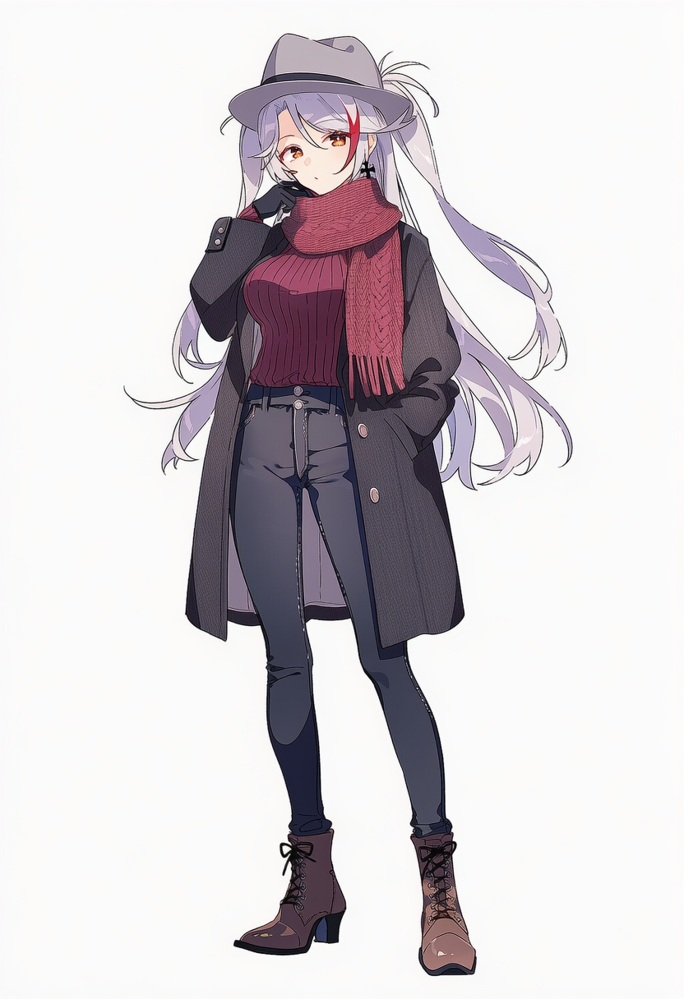

[在线例图](https://assets.quicktagcloud.com/images/raven_composition/raven_composition-5943.jpg?v=81762b11be005ee8)

<a id="raven_composition-6001"></a>

## Z20 卡尔·加尔斯特

ID：`raven_composition-6001`；分类：角色图鉴 / 碧蓝航线 / 铁血；来源标记：`safe`。

来源说明：

> 作品：碧蓝航线
> 角色英文名：Z20 Karl Galster
> 首次登场时间（国服实装）：2017-08-02
> 阵营：铁血

正向提示词：

```text
z20_karl_galster_(azur_lane)
```

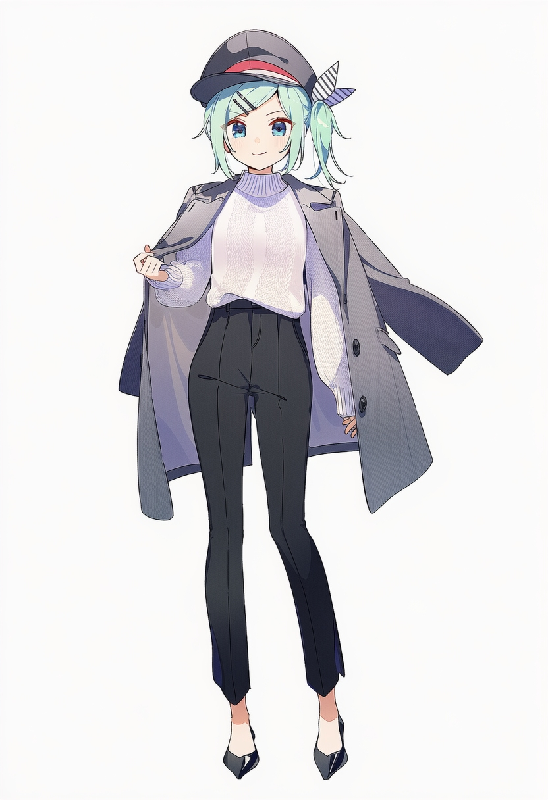

[在线例图](https://assets.quicktagcloud.com/images/raven_composition/raven_composition-6001.jpg?v=c3c48ca989717c59)

<a id="raven_composition-6002"></a>

## Z21 威廉·海德坎普

ID：`raven_composition-6002`；分类：角色图鉴 / 碧蓝航线 / 铁血；来源标记：`safe`。

来源说明：

> 作品：碧蓝航线
> 角色英文名：Z21 Wilhelm Heidkamp
> 首次登场时间（国服实装）：2017-08-02
> 阵营：铁血

正向提示词：

```text
z21_(azur_lane)
```

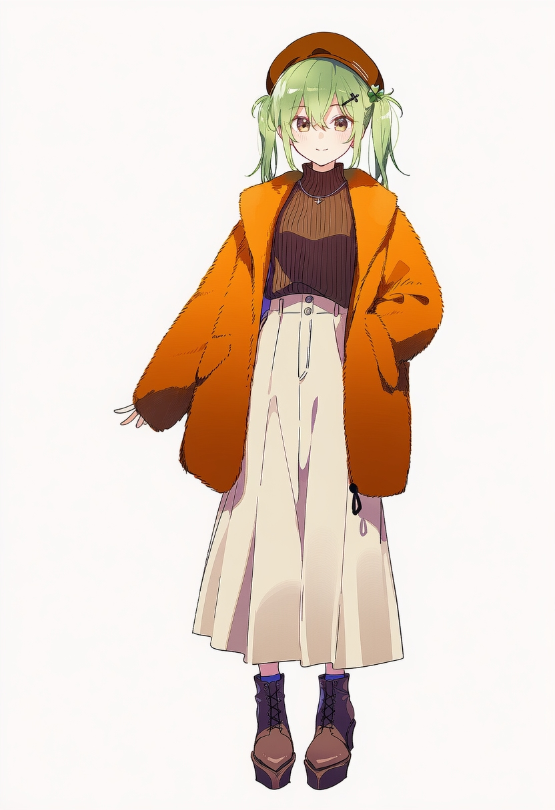

[在线例图](https://assets.quicktagcloud.com/images/raven_composition/raven_composition-6002.jpg?v=a8f62d99f0b616d2)

<a id="raven_composition-6003"></a>

## Z19 赫尔曼·库纳

ID：`raven_composition-6003`；分类：角色图鉴 / 碧蓝航线 / 铁血；来源标记：`safe`。

来源说明：

> 作品：碧蓝航线
> 角色英文名：Z19 Hermann Künne
> 首次登场时间（国服实装）：2017-08-02
> 阵营：铁血

正向提示词：

```text
z19_hermann_kunne_(azur_lane)
```

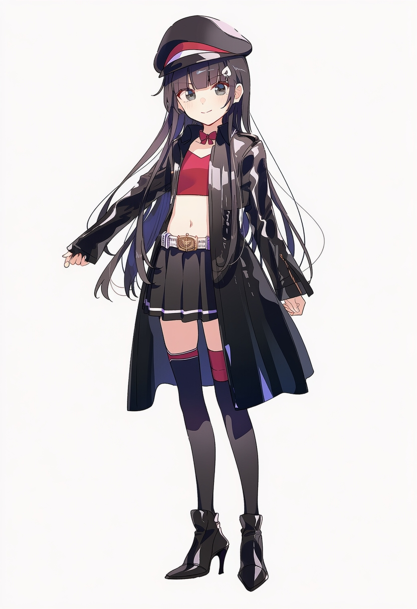

[在线例图](https://assets.quicktagcloud.com/images/raven_composition/raven_composition-6003.jpg?v=2cc0f102ec298241)

<a id="raven_composition-6004"></a>

## Z46

ID：`raven_composition-6004`；分类：角色图鉴 / 碧蓝航线 / 铁血；来源标记：`safe`。

来源说明：

> 作品：碧蓝航线
> 角色英文名：Z46
> 首次登场时间（国服实装）：2017-08-02
> 阵营：铁血

正向提示词：

```text
z46_(azur_lane)
```

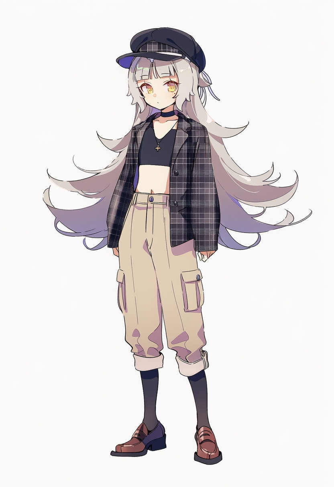

[在线例图](https://assets.quicktagcloud.com/images/raven_composition/raven_composition-6004.jpg?v=806c91825979d678)

<a id="raven_composition-6005"></a>

## 希佩尔海军上将

ID：`raven_composition-6005`；分类：角色图鉴 / 碧蓝航线 / 铁血；来源标记：`safe`。

来源说明：

> 作品：碧蓝航线
> 角色英文名：Admiral Hipper
> 首次登场时间（国服实装）：2017-08-02
> 阵营：铁血

正向提示词：

```text
admiral_hipper_(azur_lane)
```

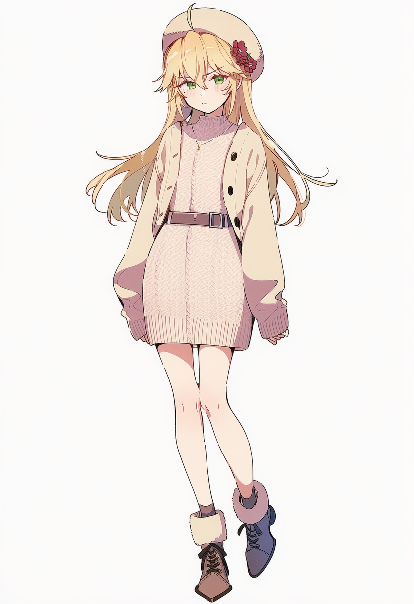

[在线例图](https://assets.quicktagcloud.com/images/raven_composition/raven_composition-6005.jpg?v=d584b487a377f1bf)

<a id="raven_composition-6006"></a>

## 德意志

ID：`raven_composition-6006`；分类：角色图鉴 / 碧蓝航线 / 铁血；来源标记：`safe`。

来源说明：

> 作品：碧蓝航线
> 角色英文名：Deutschland
> 首次登场时间（国服实装）：2017-08-02
> 阵营：铁血

正向提示词：

```text
deutschland_(azur_lane)
```

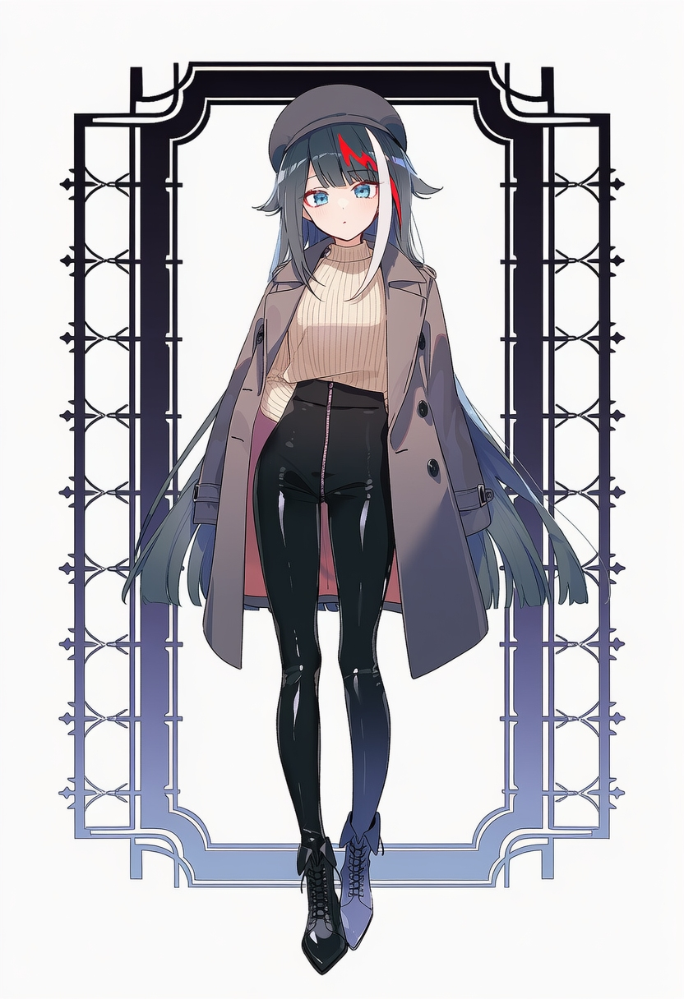

[在线例图](https://assets.quicktagcloud.com/images/raven_composition/raven_composition-6006.jpg?v=df15668e1217e072)

<a id="raven_composition-6007"></a>

## 格奈森瑙

ID：`raven_composition-6007`；分类：角色图鉴 / 碧蓝航线 / 铁血；来源标记：`safe`。

来源说明：

> 作品：碧蓝航线
> 角色英文名：Gneisenau
> 首次登场时间（国服实装）：2017-08-02
> 阵营：铁血

正向提示词：

```text
gneisenau_(azur_lane)
```

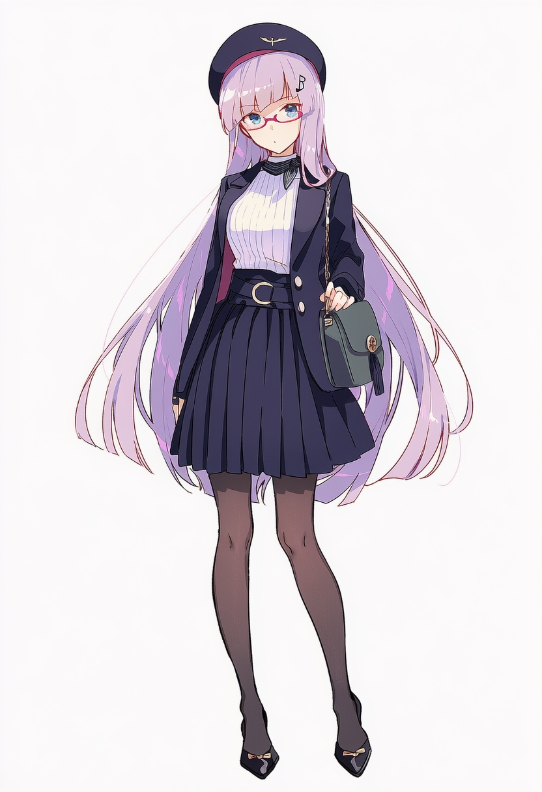

[在线例图](https://assets.quicktagcloud.com/images/raven_composition/raven_composition-6007.jpg?v=987569e7ec861a15)

<a id="raven_composition-6008"></a>

## 沙恩霍斯特

ID：`raven_composition-6008`；分类：角色图鉴 / 碧蓝航线 / 铁血；来源标记：`safe`。

来源说明：

> 作品：碧蓝航线
> 角色英文名：Scharnhorst
> 首次登场时间（国服实装）：2017-08-02
> 阵营：铁血

正向提示词：

```text
scharnhorst_(azur_lane)
```

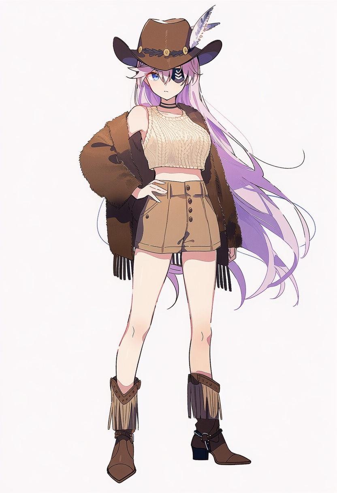

[在线例图](https://assets.quicktagcloud.com/images/raven_composition/raven_composition-6008.jpg?v=8da394d384537be9)

<a id="raven_composition-6009"></a>

## 提尔比茨

ID：`raven_composition-6009`；分类：角色图鉴 / 碧蓝航线 / 铁血；来源标记：`safe`。

来源说明：

> 作品：碧蓝航线
> 角色英文名：Tirpitz
> 首次登场时间（国服实装）：2017-08-02
> 阵营：铁血

正向提示词：

```text
tirpitz_(azur_lane)
```

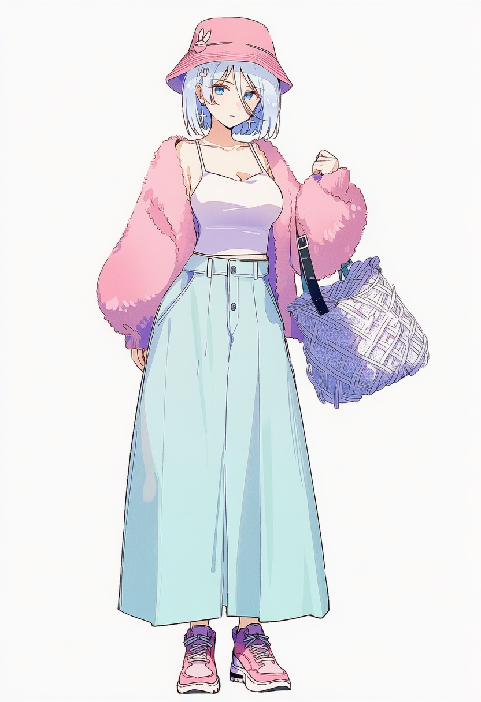

[在线例图](https://assets.quicktagcloud.com/images/raven_composition/raven_composition-6009.jpg?v=4907273a4b64bbb0)

<a id="raven_composition-6010"></a>

## 齐柏林伯爵

ID：`raven_composition-6010`；分类：角色图鉴 / 碧蓝航线 / 铁血；来源标记：`safe`。

来源说明：

> 作品：碧蓝航线
> 角色英文名：Graf Zeppelin
> 首次登场时间（国服实装）：2017-08-02
> 阵营：铁血

正向提示词：

```text
graf_zeppelin_(azur_lane)
```

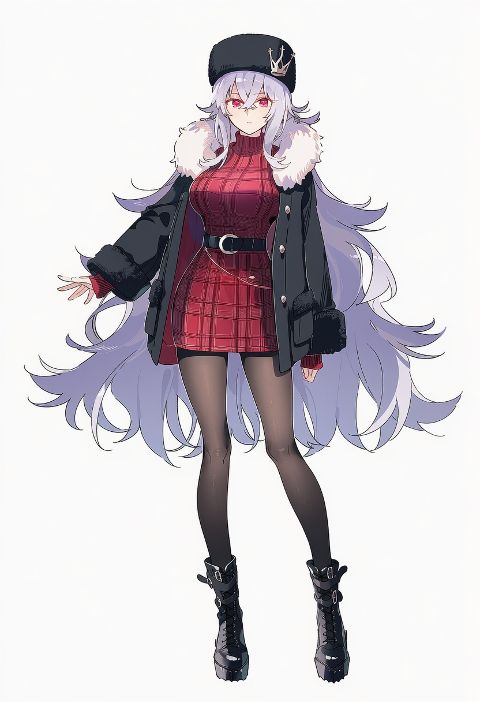

[在线例图](https://assets.quicktagcloud.com/images/raven_composition/raven_composition-6010.jpg?v=38477dc795bdb29c)

<a id="raven_composition-6059"></a>

## 斯佩伯爵海军上将

ID：`raven_composition-6059`；分类：角色图鉴 / 碧蓝航线 / 铁血；来源标记：`safe`。

来源说明：

> 作品：碧蓝航线
> 角色英文名：Admiral Graf Spee
> 首次登场时间（国服实装）：2018-01-19
> 阵营：铁血

正向提示词：

```text
admiral_graf_spee_(azur_lane)
```

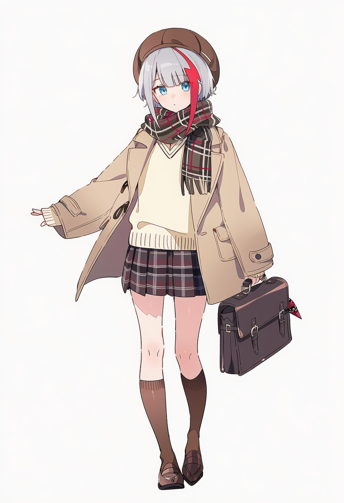

[在线例图](https://assets.quicktagcloud.com/images/raven_composition/raven_composition-6059.jpg?v=8fc368a5889ec719)

<a id="raven_composition-6091"></a>

## 罗恩

ID：`raven_composition-6091`；分类：角色图鉴 / 碧蓝航线 / 铁血；来源标记：`safe`。

来源说明：

> 作品：碧蓝航线
> 角色英文名：Roon
> 首次登场时间（国服实装）：2018-04-26
> 阵营：铁血

正向提示词：

```text
roon_(azur_lane)
```


[在线例图](https://assets.quicktagcloud.com/images/raven_composition/raven_composition-6091.jpg?v=c91560db6bb40704)

<a id="raven_composition-6101"></a>

## U-81

ID：`raven_composition-6101`；分类：角色图鉴 / 碧蓝航线 / 铁血；来源标记：`safe`。

来源说明：

> 作品：碧蓝航线
> 角色英文名：U-81
> 首次登场时间（国服实装）：2018-05-31
> 阵营：铁血

正向提示词：

```text
u-81_(azur_lane)
```

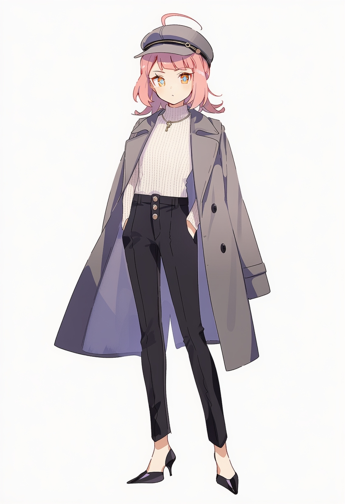

[在线例图](https://assets.quicktagcloud.com/images/raven_composition/raven_composition-6101.jpg?v=93b4fdc1a84fe0c0)

<a id="raven_composition-6113"></a>

## Z25

ID：`raven_composition-6113`；分类：角色图鉴 / 碧蓝航线 / 铁血；来源标记：`safe`。

来源说明：

> 作品：碧蓝航线
> 角色英文名：Z25
> 首次登场时间（国服实装）：2018-06-28
> 阵营：铁血

正向提示词：

```text
z25_(azur_lane)
```


[在线例图](https://assets.quicktagcloud.com/images/raven_composition/raven_composition-6113.jpg?v=a9d60fcd5603b86b)

<a id="raven_composition-6114"></a>

## Z35

ID：`raven_composition-6114`；分类：角色图鉴 / 碧蓝航线 / 铁血；来源标记：`safe`。

来源说明：

> 作品：碧蓝航线
> 角色英文名：Z35
> 首次登场时间（国服实装）：2018-06-28
> 阵营：铁血

正向提示词：

```text
z35_(azur_lane)
```

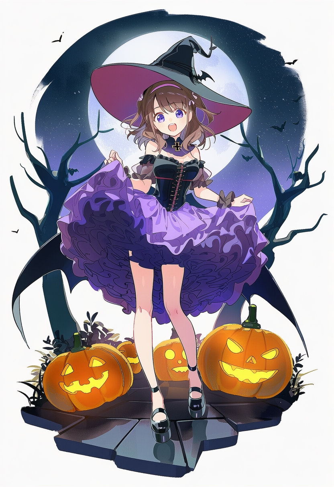

[在线例图](https://assets.quicktagcloud.com/images/raven_composition/raven_composition-6114.jpg?v=22c300c4c05c1592)

<a id="raven_composition-6115"></a>

## U-557

ID：`raven_composition-6115`；分类：角色图鉴 / 碧蓝航线 / 铁血；来源标记：`safe`。

来源说明：

> 作品：碧蓝航线
> 角色英文名：U-557
> 首次登场时间（国服实装）：2018-06-28
> 阵营：铁血

正向提示词：

```text
u-557_(azur_lane)
```

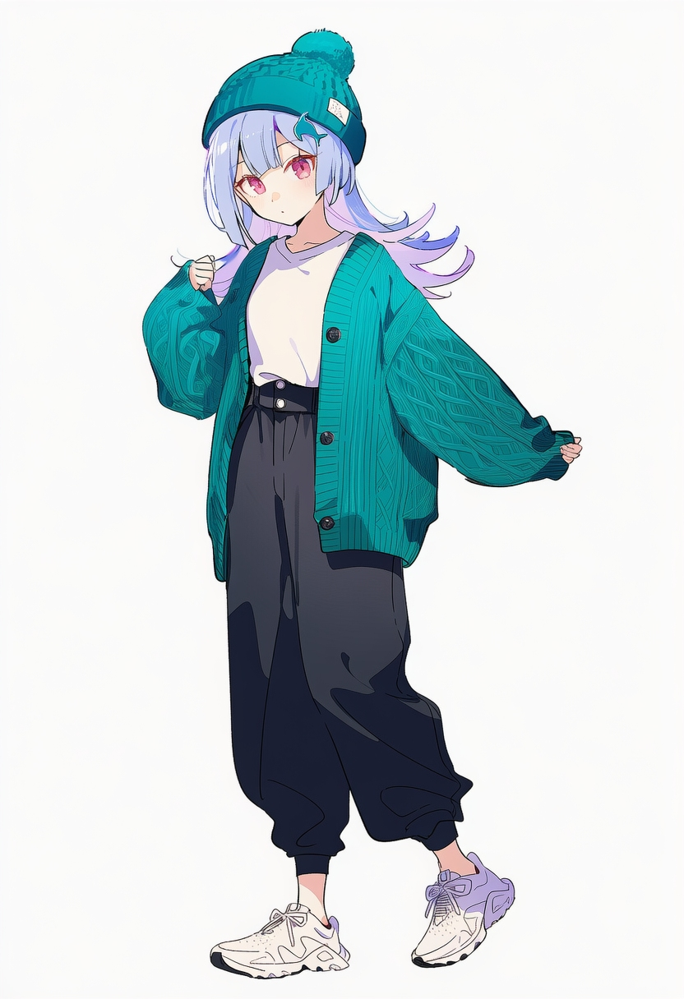

[在线例图](https://assets.quicktagcloud.com/images/raven_composition/raven_composition-6115.jpg?v=f51fd870368fd227)

<a id="raven_composition-6116"></a>

## U-47

ID：`raven_composition-6116`；分类：角色图鉴 / 碧蓝航线 / 铁血；来源标记：`safe`。

来源说明：

> 作品：碧蓝航线
> 角色英文名：U-47
> 首次登场时间（国服实装）：2018-06-28
> 阵营：铁血

正向提示词：

```text
u-47_(azur_lane)
```

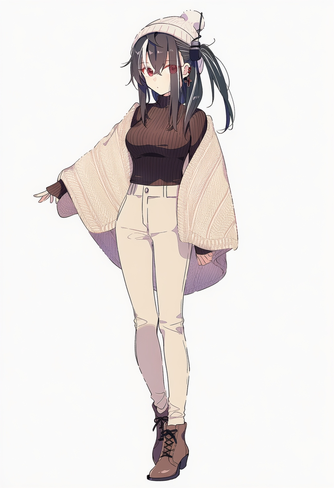

[在线例图](https://assets.quicktagcloud.com/images/raven_composition/raven_composition-6116.jpg?v=e93ac4557ad34217)

<a id="raven_composition-6120"></a>

## Z18 汉斯·吕德曼

ID：`raven_composition-6120`；分类：角色图鉴 / 碧蓝航线 / 铁血；来源标记：`safe`。

来源说明：

> 作品：碧蓝航线
> 角色英文名：Z18 Hans Lüdemann
> 首次登场时间（国服实装）：2018-07-21
> 阵营：铁血

正向提示词：

```text
z18_(azur_lane)
```


[在线例图](https://assets.quicktagcloud.com/images/raven_composition/raven_composition-6120.jpg?v=cf4fd0509212d970)

<a id="raven_composition-6162"></a>

## Z2

ID：`raven_composition-6162`；分类：角色图鉴 / 碧蓝航线 / 铁血；来源标记：`safe`。

来源说明：

> 作品：碧蓝航线
> 角色英文名：Z2 Georg Thiele
> 首次登场时间（国服实装）：2019-03-07
> 阵营：铁血

正向提示词：

```text
z2_georg_thiele_(azur_lane)
```

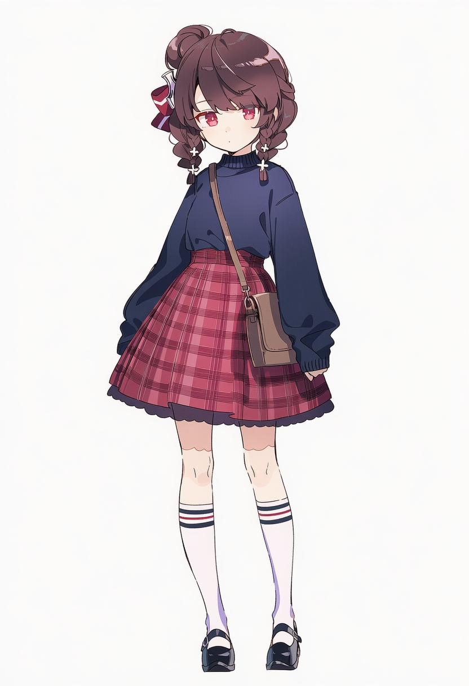

[在线例图](https://assets.quicktagcloud.com/images/raven_composition/raven_composition-6162.jpg?v=e166c07955dd547d)

<a id="raven_composition-6172"></a>

## 腓特烈大帝

ID：`raven_composition-6172`；分类：角色图鉴 / 碧蓝航线 / 铁血；来源标记：`safe`。

来源说明：

> 作品：碧蓝航线
> 角色英文名：Friedrich der Große
> 首次登场时间（国服实装）：2019-04-18
> 阵营：铁血

正向提示词：

```text
friedrich_der_grosse_(azur_lane)
```

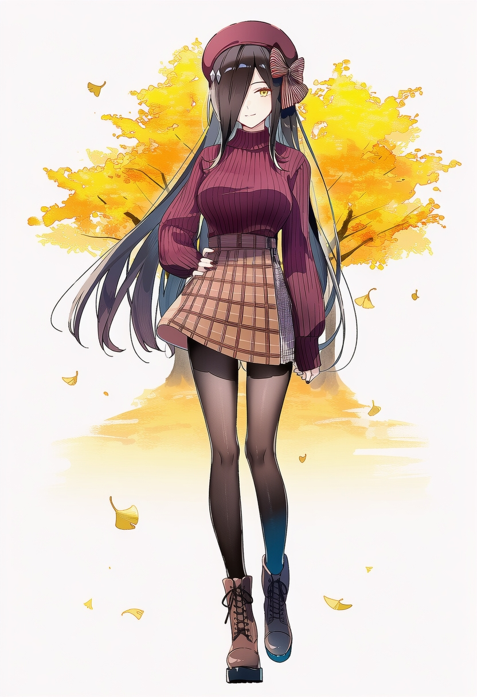

[在线例图](https://assets.quicktagcloud.com/images/raven_composition/raven_composition-6172.jpg?v=65cce05810898788)

<a id="raven_composition-6175"></a>

## 小齐柏林

ID：`raven_composition-6175`；分类：角色图鉴 / 碧蓝航线 / 铁血；来源标记：`safe`。

来源说明：

> 作品：碧蓝航线
> 角色英文名：Zeppy
> 首次登场时间（国服实装）：2019-04-26
> 阵营：铁血

正向提示词：

```text
zeppy_(azur_lane)
```

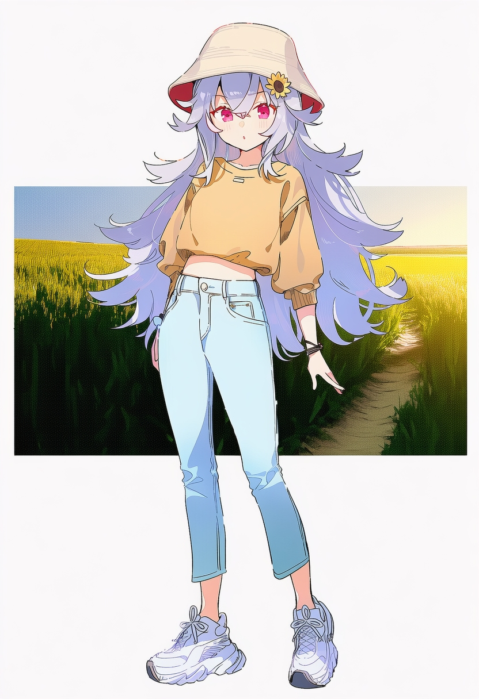

[在线例图](https://assets.quicktagcloud.com/images/raven_composition/raven_composition-6175.jpg?v=43cec7b690fc47b8)

<a id="raven_composition-6177"></a>

## Z36

ID：`raven_composition-6177`；分类：角色图鉴 / 碧蓝航线 / 铁血；来源标记：`safe`。

来源说明：

> 作品：碧蓝航线
> 角色英文名：Z36
> 首次登场时间（国服实装）：2019-05-23
> 阵营：铁血

正向提示词：

```text
z36_(azur_lane)
```


[在线例图](https://assets.quicktagcloud.com/images/raven_composition/raven_composition-6177.jpg?v=fab04bbd2307f270)

<a id="raven_composition-6178"></a>

## 俾斯麦

ID：`raven_composition-6178`；分类：角色图鉴 / 碧蓝航线 / 铁血；来源标记：`safe`。

来源说明：

> 作品：碧蓝航线
> 角色英文名：Bismarck
> 首次登场时间（国服实装）：2019-05-23
> 阵营：铁血

正向提示词：

```text
bismarck_(azur_lane)
```

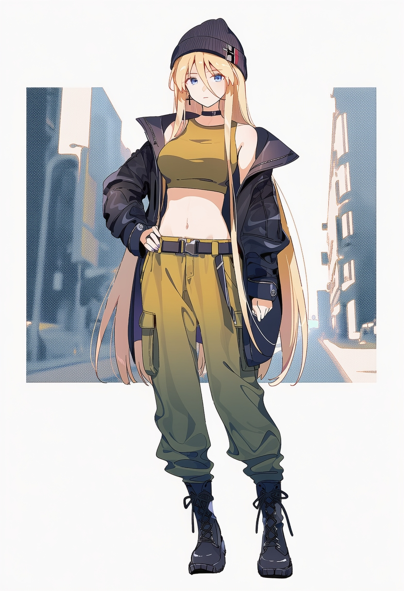

[在线例图](https://assets.quicktagcloud.com/images/raven_composition/raven_composition-6178.jpg?v=3437979a38702c6c)

<a id="raven_composition-6180"></a>

## U-556

ID：`raven_composition-6180`；分类：角色图鉴 / 碧蓝航线 / 铁血；来源标记：`safe`。

来源说明：

> 作品：碧蓝航线
> 角色英文名：U-556
> 首次登场时间（国服实装）：2019-05-23
> 阵营：铁血

正向提示词：

```text
u-556_(azur_lane)
```


[在线例图](https://assets.quicktagcloud.com/images/raven_composition/raven_composition-6180.jpg?v=4060b927b570bb90)

<a id="raven_composition-6181"></a>

## U-73

ID：`raven_composition-6181`；分类：角色图鉴 / 碧蓝航线 / 铁血；来源标记：`safe`。

来源说明：

> 作品：碧蓝航线
> 角色英文名：U-73
> 首次登场时间（国服实装）：2019-05-23
> 阵营：铁血

正向提示词：

```text
u-73_(azur_lane)
```

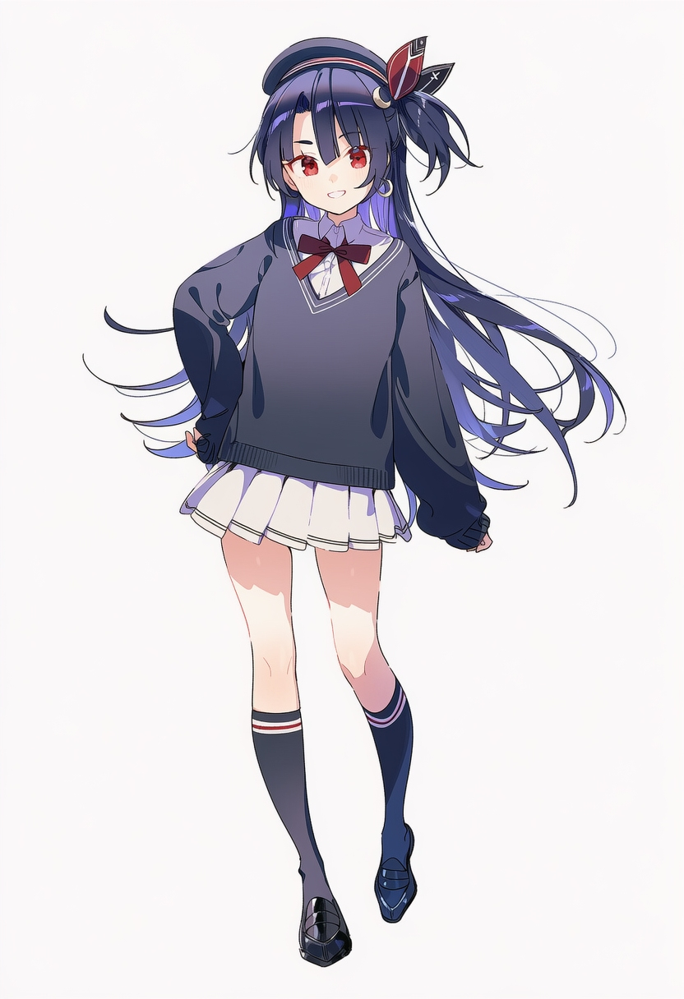

[在线例图](https://assets.quicktagcloud.com/images/raven_composition/raven_composition-6181.jpg?v=213fc6bb226bec3b)

<a id="raven_composition-6191"></a>

## U-522

ID：`raven_composition-6191`；分类：角色图鉴 / 碧蓝航线 / 铁血；来源标记：`safe`。

来源说明：

> 作品：碧蓝航线
> 角色英文名：U-522
> 首次登场时间（国服实装）：2019-07-11
> 阵营：铁血

正向提示词：

```text
u-522_(azur_lane)
```

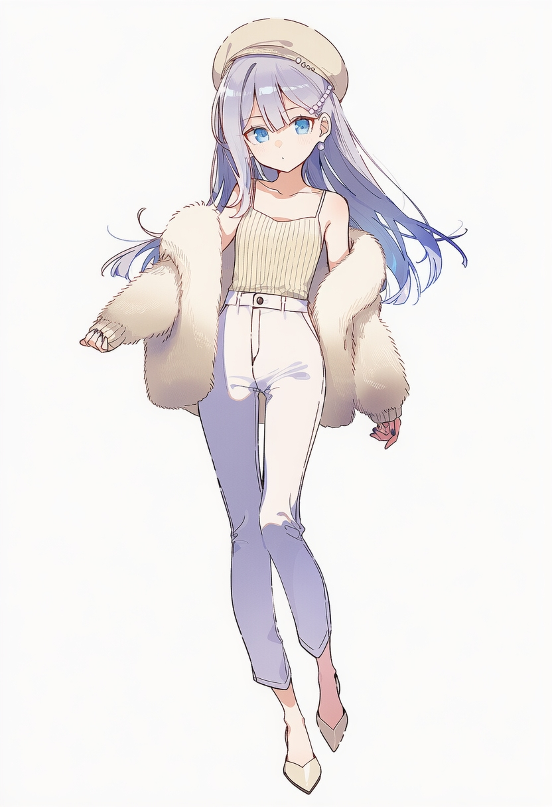

[在线例图](https://assets.quicktagcloud.com/images/raven_composition/raven_composition-6191.jpg?v=81153021a57cfb42)

<a id="raven_composition-6193"></a>

## U-101

ID：`raven_composition-6193`；分类：角色图鉴 / 碧蓝航线 / 铁血；来源标记：`safe`。

来源说明：

> 作品：碧蓝航线
> 角色英文名：U-101
> 首次登场时间（国服实装）：2019-07-11
> 阵营：铁血

正向提示词：

```text
u-101_(azur_lane)
```

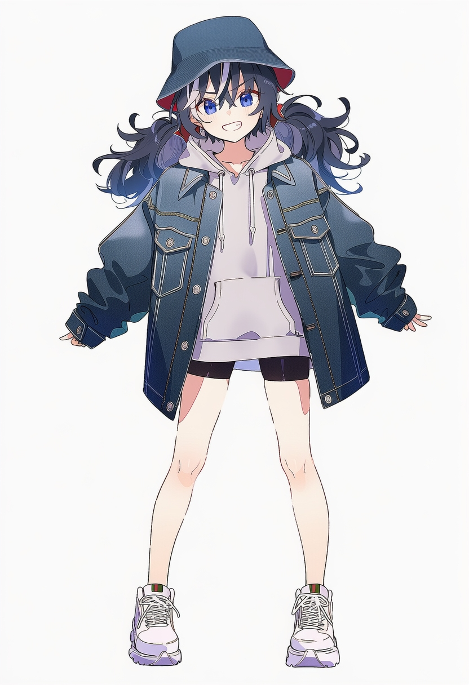

[在线例图](https://assets.quicktagcloud.com/images/raven_composition/raven_composition-6193.jpg?v=4d729f5e4d6a2861)

<a id="raven_composition-6212"></a>

## U-110

ID：`raven_composition-6212`；分类：角色图鉴 / 碧蓝航线 / 铁血；来源标记：`safe`。

来源说明：

> 作品：碧蓝航线
> 角色英文名：U-110
> 首次登场时间（国服实装）：2019-10-17
> 阵营：铁血

正向提示词：

```text
u-110_(azur_lane)
```

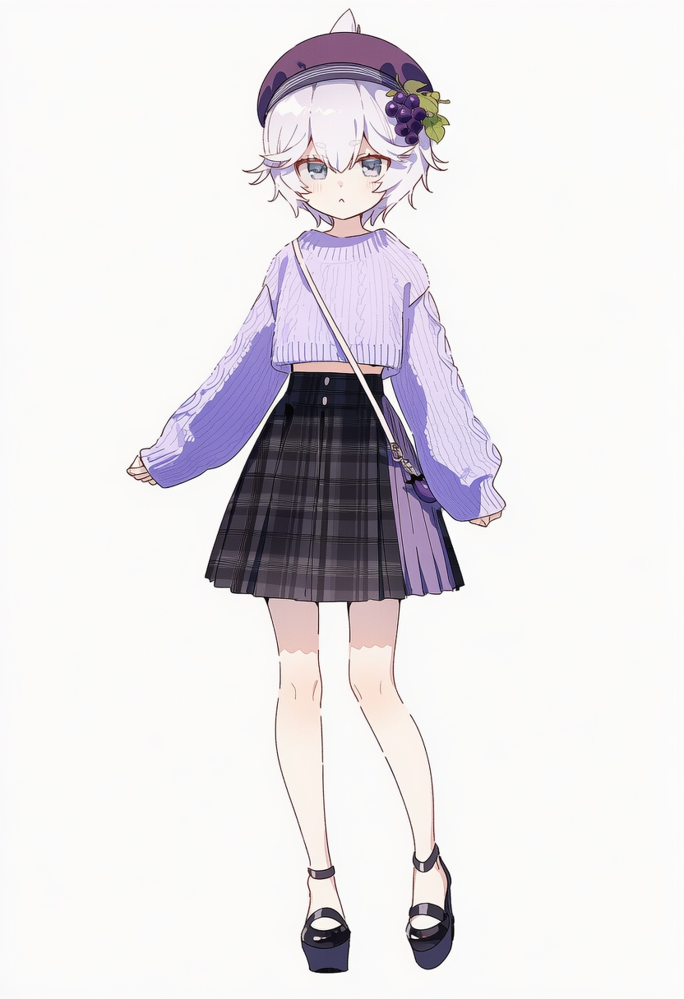

[在线例图](https://assets.quicktagcloud.com/images/raven_composition/raven_composition-6212.jpg?v=58d56114d28fd866)

<a id="raven_composition-6215"></a>

## 希佩尔海军上将μ

ID：`raven_composition-6215`；分类：角色图鉴 / 碧蓝航线 / 铁血；来源标记：`safe`。

来源说明：

> 作品：碧蓝航线
> 角色英文名：Admiral Hipper µ
> 首次登场时间（国服实装）：2019-10-31
> 阵营：铁血

正向提示词：

```text
admiral_hipper_(muse)_(azur_lane)
```

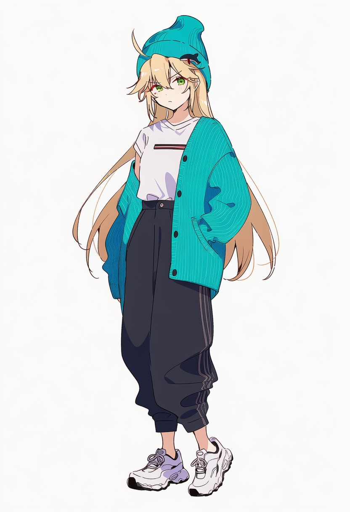

[在线例图](https://assets.quicktagcloud.com/images/raven_composition/raven_composition-6215.jpg?v=cbf83a7ef8cbf2f6)

<a id="raven_composition-6259"></a>

## 美因茨

ID：`raven_composition-6259`；分类：角色图鉴 / 碧蓝航线 / 铁血；来源标记：`safe`。

来源说明：

> 作品：碧蓝航线
> 角色英文名：Mainz
> 首次登场时间（国服实装）：2020-07-09
> 阵营：铁血

正向提示词：

```text
mainz_(azur_lane)
```

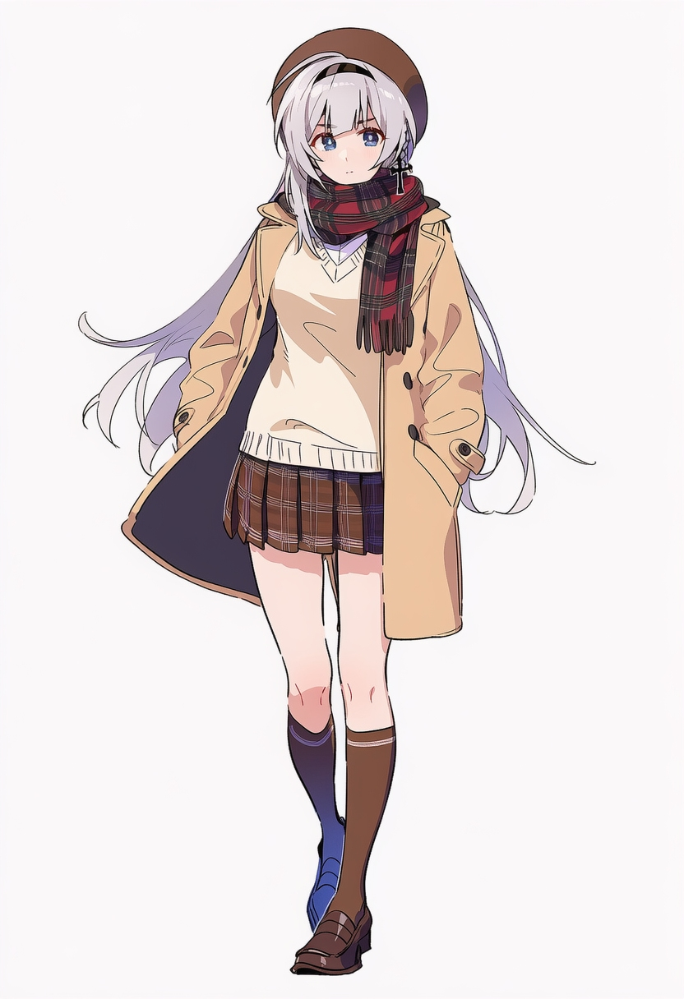

[在线例图](https://assets.quicktagcloud.com/images/raven_composition/raven_composition-6259.jpg?v=6e756820f0745f25)

<a id="raven_composition-6260"></a>

## 奥丁

ID：`raven_composition-6260`；分类：角色图鉴 / 碧蓝航线 / 铁血；来源标记：`safe`。

来源说明：

> 作品：碧蓝航线
> 角色英文名：Odin
> 首次登场时间（国服实装）：2020-07-09
> 阵营：铁血

正向提示词：

```text
odin_(azur_lane)
```

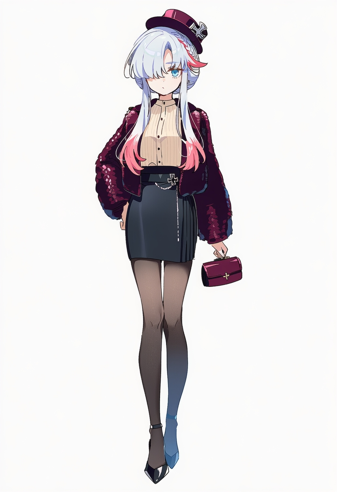

[在线例图](https://assets.quicktagcloud.com/images/raven_composition/raven_composition-6260.jpg?v=8776c237b86b41c7)

<a id="raven_composition-6268"></a>

## Z26

ID：`raven_composition-6268`；分类：角色图鉴 / 碧蓝航线 / 铁血；来源标记：`safe`。

来源说明：

> 作品：碧蓝航线
> 角色英文名：Z26
> 首次登场时间（国服实装）：2020-08-20
> 阵营：铁血

正向提示词：

```text
z26_(azur_lane)
```


[在线例图](https://assets.quicktagcloud.com/images/raven_composition/raven_composition-6268.jpg?v=d467db5b008866b5)

<a id="raven_composition-6269"></a>

## U-96

ID：`raven_composition-6269`；分类：角色图鉴 / 碧蓝航线 / 铁血；来源标记：`safe`。

来源说明：

> 作品：碧蓝航线
> 角色英文名：U-96
> 首次登场时间（国服实装）：2020-08-20
> 阵营：铁血

正向提示词：

```text
u-96_(azur_lane)
```

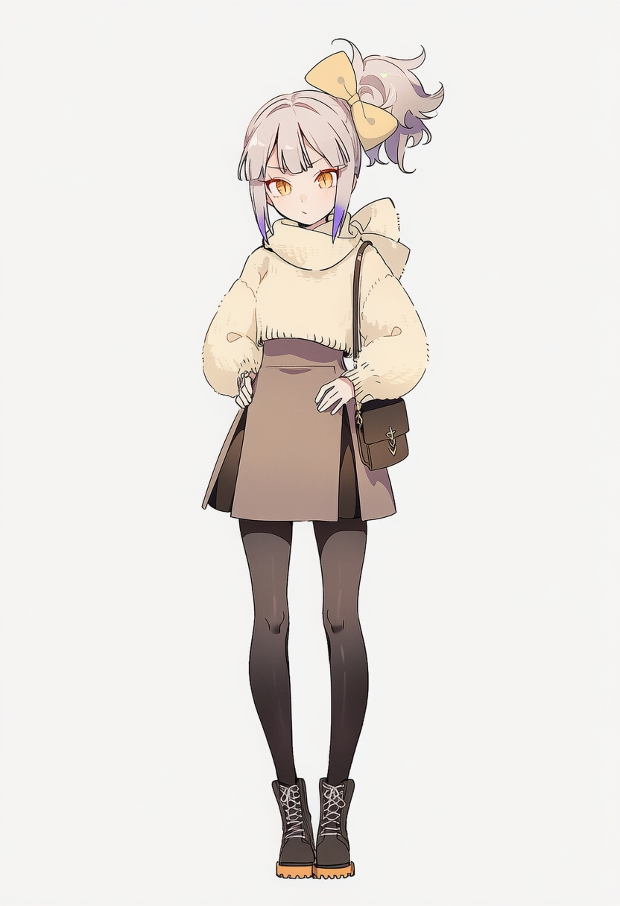

[在线例图](https://assets.quicktagcloud.com/images/raven_composition/raven_composition-6269.jpg?v=c5f28e244084ecea)

<a id="raven_composition-6286"></a>

## 罗恩μ

ID：`raven_composition-6286`；分类：角色图鉴 / 碧蓝航线 / 铁血；来源标记：`safe`。

来源说明：

> 作品：碧蓝航线
> 角色英文名：Roon µ
> 首次登场时间（国服实装）：2020-10-29
> 阵营：铁血

正向提示词：

```text
roon_(muse)_(azur_lane)
```

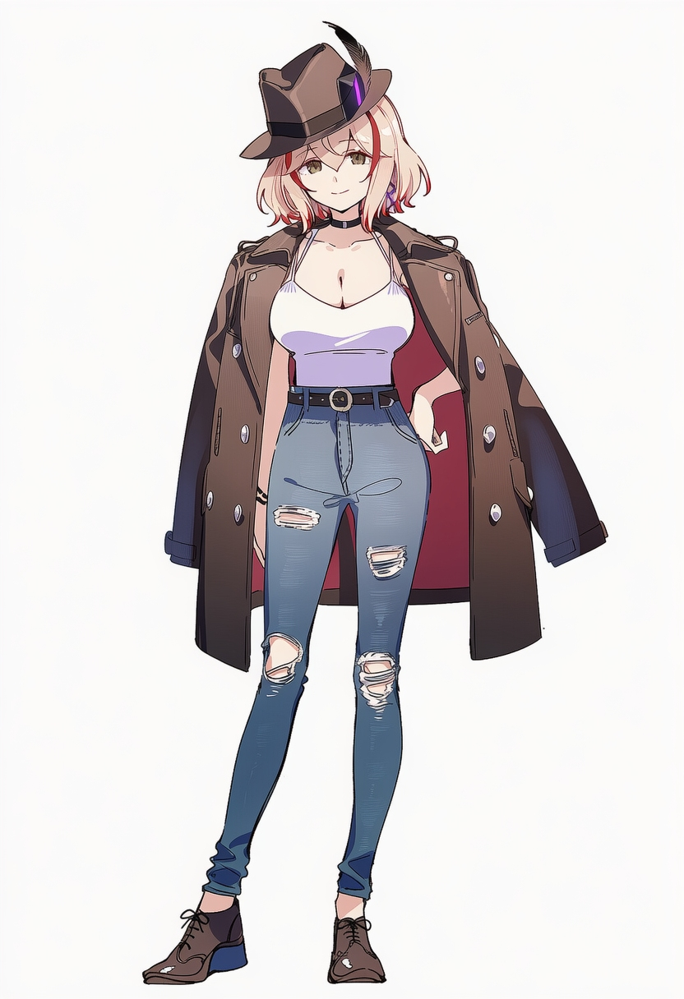

[在线例图](https://assets.quicktagcloud.com/images/raven_composition/raven_composition-6286.jpg?v=0679331b38dedd3f)

<a id="raven_composition-6288"></a>

## Z24

ID：`raven_composition-6288`；分类：角色图鉴 / 碧蓝航线 / 铁血；来源标记：`safe`。

来源说明：

> 作品：碧蓝航线
> 角色英文名：Z24
> 首次登场时间（国服实装）：2020-12-29
> 阵营：铁血

正向提示词：

```text
z24_(azur_lane)
```

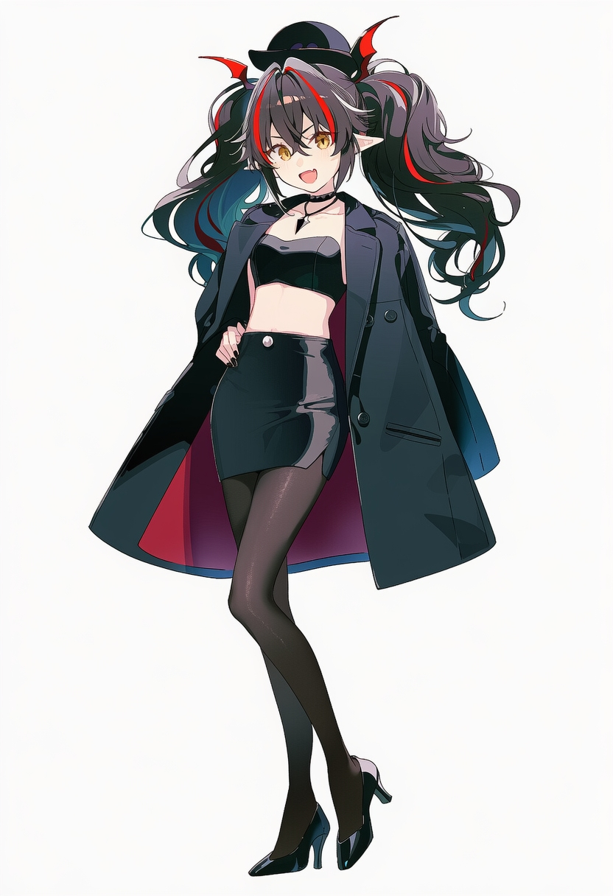

[在线例图](https://assets.quicktagcloud.com/images/raven_composition/raven_composition-6288.jpg?v=859150b602f26bf0)

<a id="raven_composition-6289"></a>

## Z28

ID：`raven_composition-6289`；分类：角色图鉴 / 碧蓝航线 / 铁血；来源标记：`safe`。

来源说明：

> 作品：碧蓝航线
> 角色英文名：Z28
> 首次登场时间（国服实装）：2020-12-29
> 阵营：铁血

正向提示词：

```text
z28_(azur_lane)
```

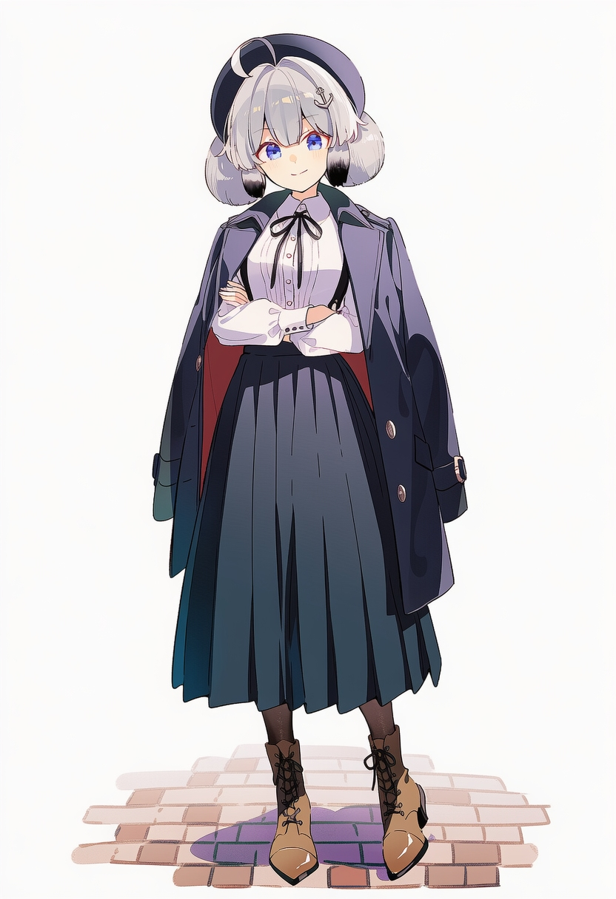

[在线例图](https://assets.quicktagcloud.com/images/raven_composition/raven_composition-6289.jpg?v=0bfec6fa261dd246)

<a id="raven_composition-6290"></a>

## 纽伦堡

ID：`raven_composition-6290`；分类：角色图鉴 / 碧蓝航线 / 铁血；来源标记：`safe`。

来源说明：

> 作品：碧蓝航线
> 角色英文名：Nürnberg
> 首次登场时间（国服实装）：2020-12-29
> 阵营：铁血

正向提示词：

```text
nuernberg_(azur_lane)
```

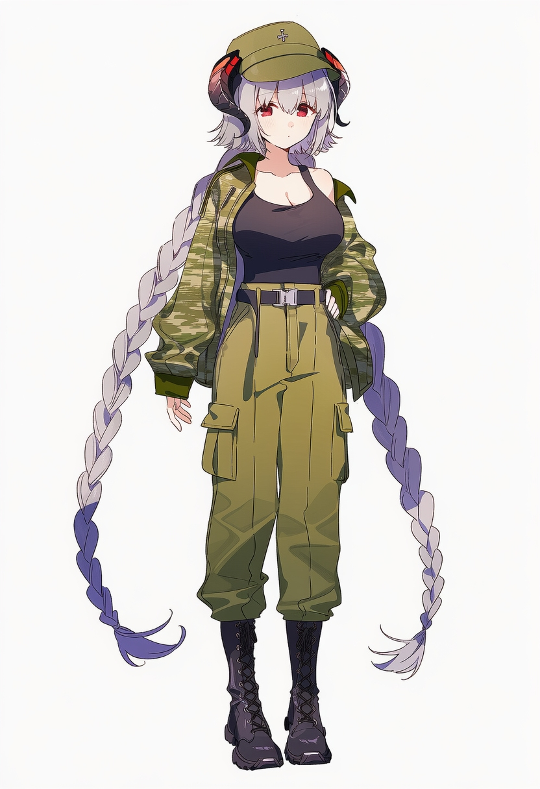

[在线例图](https://assets.quicktagcloud.com/images/raven_composition/raven_composition-6290.jpg?v=7680cbe32922bd40)

<a id="raven_composition-6291"></a>

## 海因里希亲王

ID：`raven_composition-6291`；分类：角色图鉴 / 碧蓝航线 / 铁血；来源标记：`safe`。

来源说明：

> 作品：碧蓝航线
> 角色英文名：Prinz Heinrich
> 首次登场时间（国服实装）：2020-12-29
> 阵营：铁血

正向提示词：

```text
prinz_heinrich_(azur_lane)
```

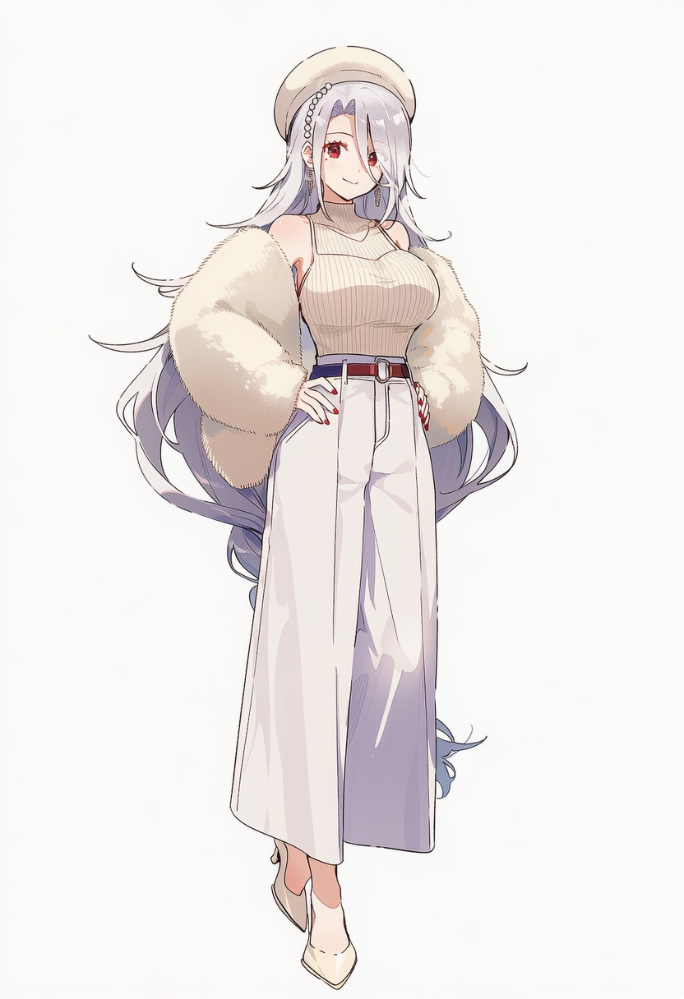

[在线例图](https://assets.quicktagcloud.com/images/raven_composition/raven_composition-6291.jpg?v=ed91d565a5a1e017)

<a id="raven_composition-6292"></a>

## 威悉

ID：`raven_composition-6292`；分类：角色图鉴 / 碧蓝航线 / 铁血；来源标记：`safe`。

来源说明：

> 作品：碧蓝航线
> 角色英文名：Weser
> 首次登场时间（国服实装）：2020-12-29
> 阵营：铁血

正向提示词：

```text
weser_(azur_lane)
```

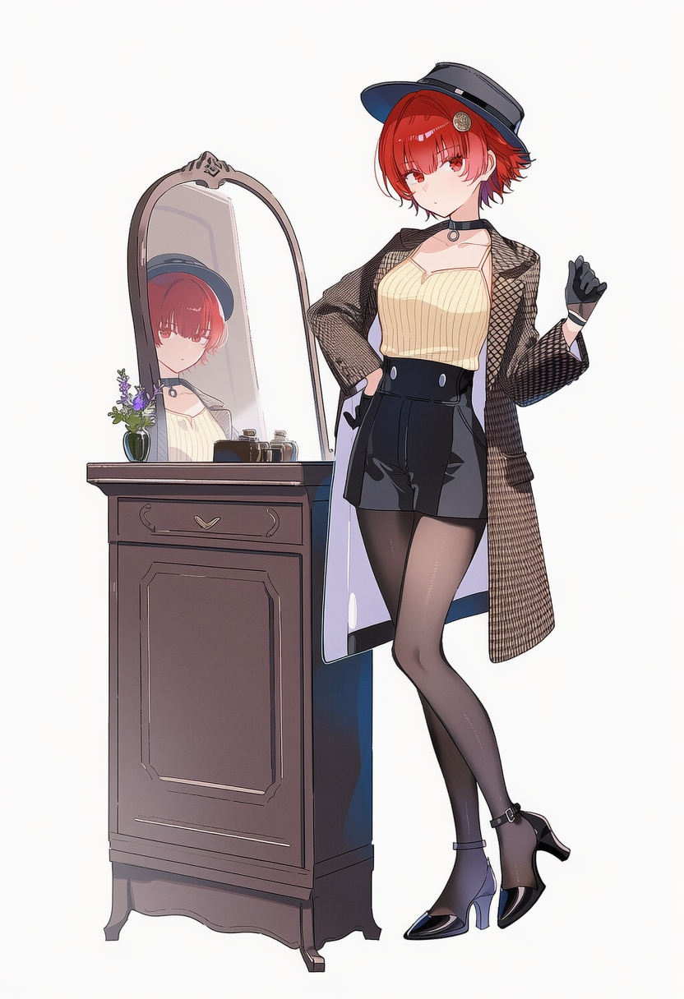

[在线例图](https://assets.quicktagcloud.com/images/raven_composition/raven_composition-6292.jpg?v=5ca2d5fa41306132)

<a id="raven_composition-6293"></a>

## 彼得·史特拉塞

ID：`raven_composition-6293`；分类：角色图鉴 / 碧蓝航线 / 铁血；来源标记：`safe`。

来源说明：

> 作品：碧蓝航线
> 角色英文名：Peter Strasser
> 首次登场时间（国服实装）：2020-12-29
> 阵营：铁血

正向提示词：

```text
peter_strasser_(azur_lane)
```

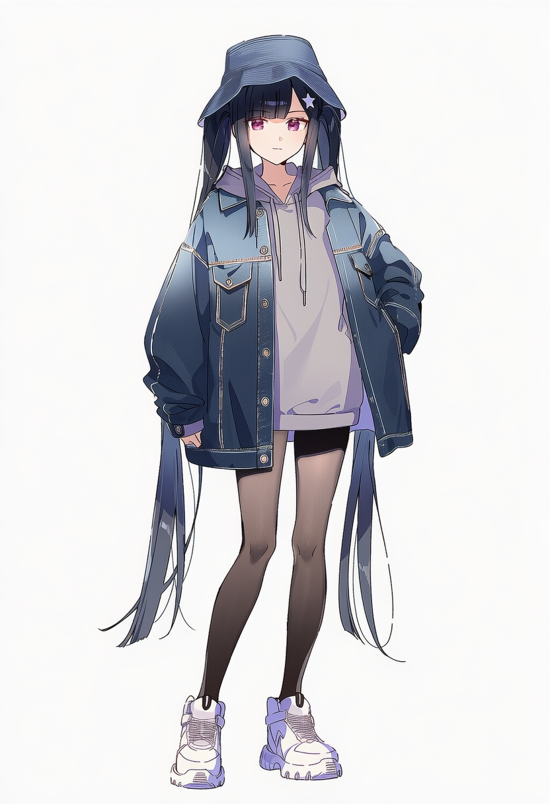

[在线例图](https://assets.quicktagcloud.com/images/raven_composition/raven_composition-6293.jpg?v=d7ef96b65e8fccc6)

<a id="raven_composition-6294"></a>

## U-37

ID：`raven_composition-6294`；分类：角色图鉴 / 碧蓝航线 / 铁血；来源标记：`safe`。

来源说明：

> 作品：碧蓝航线
> 角色英文名：U-37
> 首次登场时间（国服实装）：2020-12-29
> 阵营：铁血

正向提示词：

```text
u-37_(azur_lane)
```

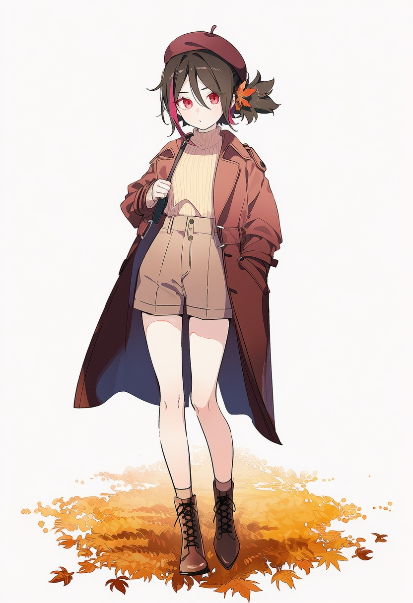

[在线例图](https://assets.quicktagcloud.com/images/raven_composition/raven_composition-6294.jpg?v=3b481db943025c94)

<a id="raven_composition-6301"></a>

## U-410

ID：`raven_composition-6301`；分类：角色图鉴 / 碧蓝航线 / 铁血；来源标记：`safe`。

来源说明：

> 作品：碧蓝航线
> 角色英文名：U-410
> 首次登场时间（国服实装）：2021-02-04
> 阵营：铁血

正向提示词：

```text
u-410_(azur_lane)
```

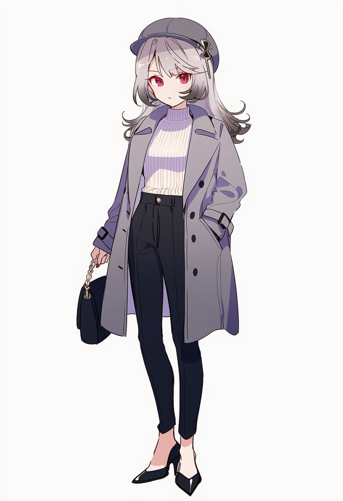

[在线例图](https://assets.quicktagcloud.com/images/raven_composition/raven_composition-6301.jpg?v=5eed4a0ae1a2a0ec)

<a id="raven_composition-6331"></a>

## 奥古斯特·冯·帕塞瓦尔

ID：`raven_composition-6331`；分类：角色图鉴 / 碧蓝航线 / 铁血；来源标记：`safe`。

来源说明：

> 作品：碧蓝航线
> 角色英文名：August von Parseval
> 首次登场时间（国服实装）：2021-07-08
> 阵营：铁血

正向提示词：

```text
august_von_parseval_(azur_lane)
```

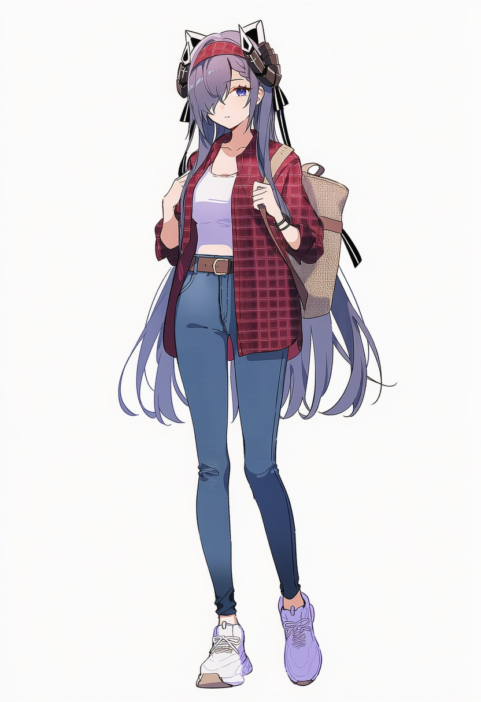

[在线例图](https://assets.quicktagcloud.com/images/raven_composition/raven_composition-6331.jpg?v=c0df4a2b065ea7d3)

<a id="raven_composition-6333"></a>

## 埃吉尔

ID：`raven_composition-6333`；分类：角色图鉴 / 碧蓝航线 / 铁血；来源标记：`safe`。

来源说明：

> 作品：碧蓝航线
> 角色英文名：Ägir
> 首次登场时间（国服实装）：2021-07-08
> 阵营：铁血

正向提示词：

```text
aegir_(azur_lane)
```

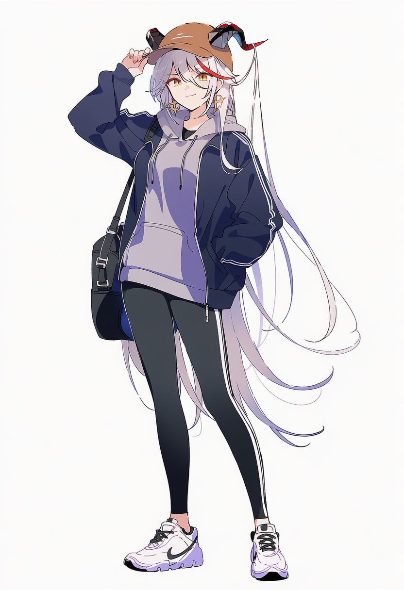

[在线例图](https://assets.quicktagcloud.com/images/raven_composition/raven_composition-6333.jpg?v=2f9fbb5643cae4cb)

<a id="raven_composition-6351"></a>

## 马格德堡

ID：`raven_composition-6351`；分类：角色图鉴 / 碧蓝航线 / 铁血；来源标记：`safe`。

来源说明：

> 作品：碧蓝航线
> 角色英文名：Magdeburg
> 首次登场时间（国服实装）：2021-12-29
> 阵营：铁血

正向提示词：

```text
magdeburg_(azur_lane)
```

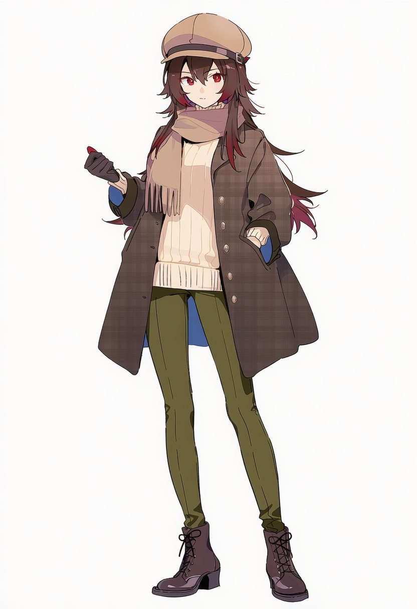

[在线例图](https://assets.quicktagcloud.com/images/raven_composition/raven_composition-6351.jpg?v=e0826e734e7faf17)

<a id="raven_composition-6352"></a>

## 阿达尔伯特亲王

ID：`raven_composition-6352`；分类：角色图鉴 / 碧蓝航线 / 铁血；来源标记：`safe`。

来源说明：

> 作品：碧蓝航线
> 角色英文名：Prinz Adalbert
> 首次登场时间（国服实装）：2021-12-29
> 阵营：铁血

正向提示词：

```text
prinz_adalbert_(azur_lane)
```

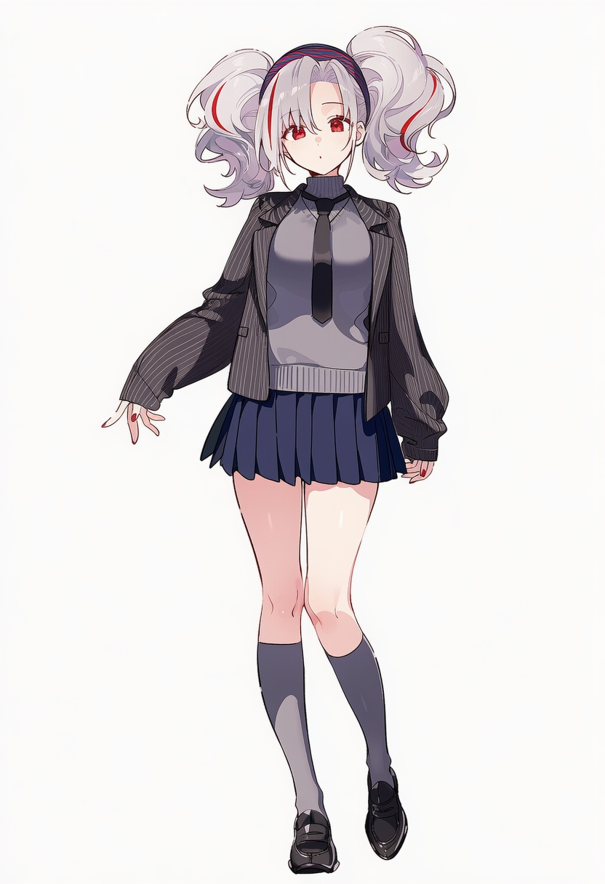

[在线例图](https://assets.quicktagcloud.com/images/raven_composition/raven_composition-6352.jpg?v=e6b98d1f658879f2)

<a id="raven_composition-6353"></a>

## 乌尔里希·冯·胡滕

ID：`raven_composition-6353`；分类：角色图鉴 / 碧蓝航线 / 铁血；来源标记：`safe`。

来源说明：

> 作品：碧蓝航线
> 角色英文名：Ulrich von Hutten
> 首次登场时间（国服实装）：2021-12-29
> 阵营：铁血

正向提示词：

```text
ulrich_von_hutten_(azur_lane)
```

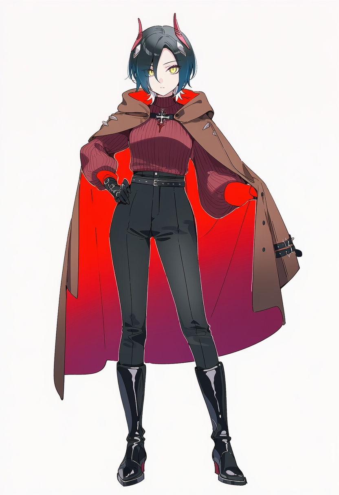

[在线例图](https://assets.quicktagcloud.com/images/raven_composition/raven_composition-6353.jpg?v=0ade6e948b2fad01)

<a id="raven_composition-6354"></a>

## 易北

ID：`raven_composition-6354`；分类：角色图鉴 / 碧蓝航线 / 铁血；来源标记：`safe`。

来源说明：

> 作品：碧蓝航线
> 角色英文名：Elbe
> 首次登场时间（国服实装）：2021-12-29
> 阵营：铁血

正向提示词：

```text
elbe_(azur_lane)
```

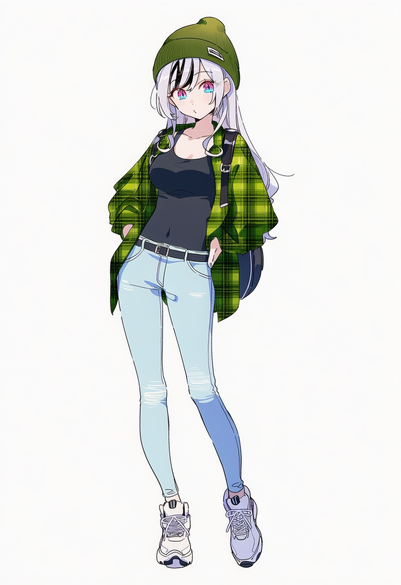

[在线例图](https://assets.quicktagcloud.com/images/raven_composition/raven_composition-6354.jpg?v=2315701a6aff7325)

<a id="raven_composition-6355"></a>

## U-1206

ID：`raven_composition-6355`；分类：角色图鉴 / 碧蓝航线 / 铁血；来源标记：`safe`。

来源说明：

> 作品：碧蓝航线
> 角色英文名：U-1206
> 首次登场时间（国服实装）：2021-12-29
> 阵营：铁血

正向提示词：

```text
u-1206_(azur_lane)
```

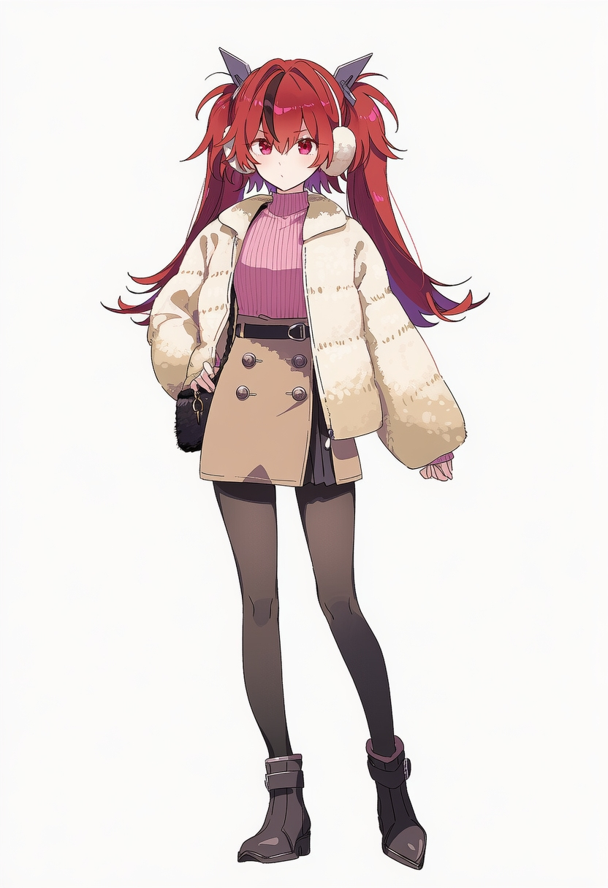

[在线例图](https://assets.quicktagcloud.com/images/raven_composition/raven_composition-6355.jpg?v=43504bde508804a2)

<a id="raven_composition-6372"></a>

## 埃尔宾

ID：`raven_composition-6372`；分类：角色图鉴 / 碧蓝航线 / 铁血；来源标记：`safe`。

来源说明：

> 作品：碧蓝航线
> 角色英文名：Elbing
> 首次登场时间（国服实装）：2022-04-28
> 阵营：铁血

正向提示词：

```text
elbing_(azur_lane)
```

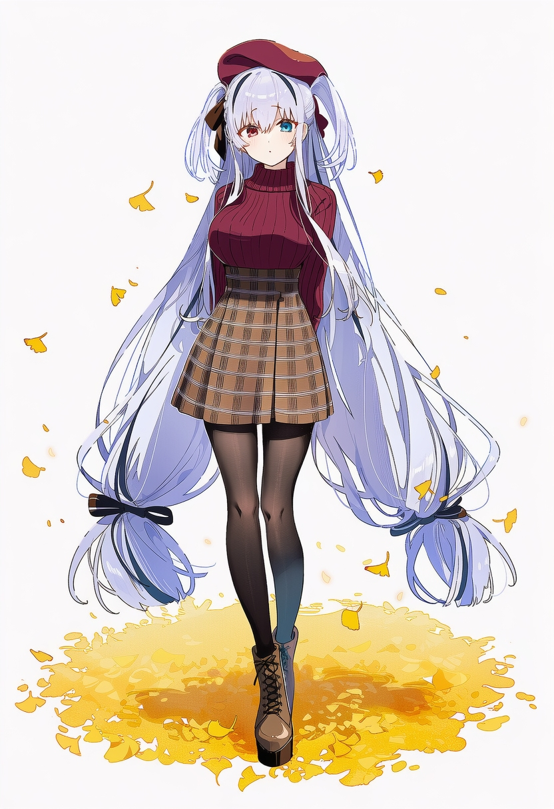

[在线例图](https://assets.quicktagcloud.com/images/raven_composition/raven_composition-6372.jpg?v=154997ade9495e3d)

<a id="raven_composition-6373"></a>

## 埃姆登

ID：`raven_composition-6373`；分类：角色图鉴 / 碧蓝航线 / 铁血；来源标记：`safe`。

来源说明：

> 作品：碧蓝航线
> 角色英文名：Emden
> 首次登场时间（国服实装）：2022-04-28
> 阵营：铁血

正向提示词：

```text
emden_(azur_lane)
```


[在线例图](https://assets.quicktagcloud.com/images/raven_composition/raven_composition-6373.jpg?v=58bf38d4ade8d64d)

<a id="raven_composition-6374"></a>

## 约尔克

ID：`raven_composition-6374`；分类：角色图鉴 / 碧蓝航线 / 铁血；来源标记：`safe`。

来源说明：

> 作品：碧蓝航线
> 角色英文名：Yorck
> 首次登场时间（国服实装）：2022-04-28
> 阵营：铁血

正向提示词：

```text
yorck_(azur_lane)
```


[在线例图](https://assets.quicktagcloud.com/images/raven_composition/raven_composition-6374.jpg?v=dc6269d25886fe77)

<a id="raven_composition-6375"></a>

## 小欧根

ID：`raven_composition-6375`；分类：角色图鉴 / 碧蓝航线 / 铁血；来源标记：`safe`。

来源说明：

> 作品：碧蓝航线
> 角色英文名：Little Prinz Eugen
> 首次登场时间（国服实装）：2022-04-28
> 阵营：铁血

正向提示词：

```text
little_prinz_eugen_(azur_lane)
```


[在线例图](https://assets.quicktagcloud.com/images/raven_composition/raven_composition-6375.jpg?v=2868c7ac56fd9709)

<a id="raven_composition-6376"></a>

## 吕佐夫

ID：`raven_composition-6376`；分类：角色图鉴 / 碧蓝航线 / 铁血；来源标记：`safe`。

来源说明：

> 作品：碧蓝航线
> 角色英文名：Lützow
> 首次登场时间（国服实装）：2022-04-28
> 阵营：铁血

正向提示词：

```text
luetzow_(azur_lane)
```


[在线例图](https://assets.quicktagcloud.com/images/raven_composition/raven_composition-6376.jpg?v=33fdb2fce9a95464)

<a id="raven_composition-6377"></a>

## 塞德利茨

ID：`raven_composition-6377`；分类：角色图鉴 / 碧蓝航线 / 铁血；来源标记：`safe`。

来源说明：

> 作品：碧蓝航线
> 角色英文名：Seydlitz
> 首次登场时间（国服实装）：2022-04-28
> 阵营：铁血

正向提示词：

```text
seydlitz_(azur_lane)
```


[在线例图](https://assets.quicktagcloud.com/images/raven_composition/raven_composition-6377.jpg?v=532c4a600f444d1f)

<a id="raven_composition-6393"></a>

## 鲁普雷希特亲王

ID：`raven_composition-6393`；分类：角色图鉴 / 碧蓝航线 / 铁血；来源标记：`safe`。

来源说明：

> 作品：碧蓝航线
> 角色英文名：Prinz Rupprecht
> 首次登场时间（国服实装）：2022-07-14
> 阵营：铁血

正向提示词：

```text
prinz_rupprecht_(azur_lane)
```


[在线例图](https://assets.quicktagcloud.com/images/raven_composition/raven_composition-6393.jpg?v=9830e8a839cf768e)

<a id="raven_composition-6403"></a>

## 布吕歇尔

ID：`raven_composition-6403`；分类：角色图鉴 / 碧蓝航线 / 铁血；来源标记：`safe`。

来源说明：

> 作品：碧蓝航线
> 角色英文名：Blücher
> 首次登场时间（国服实装）：2022-08-18
> 阵营：铁血

正向提示词：

```text
bluecher_(azur_lane)
```


[在线例图](https://assets.quicktagcloud.com/images/raven_composition/raven_composition-6403.jpg?v=72d2f7d622ddc7b9)

<a id="raven_composition-6404"></a>

## 布伦希尔德

ID：`raven_composition-6404`；分类：角色图鉴 / 碧蓝航线 / 铁血；来源标记：`safe`。

来源说明：

> 作品：碧蓝航线
> 角色英文名：Brünhilde
> 首次登场时间（国服实装）：2022-08-18
> 阵营：铁血

正向提示词：

```text
bruenhilde_(azur_lane)
```


[在线例图](https://assets.quicktagcloud.com/images/raven_composition/raven_composition-6404.jpg?v=c8e463c7b0ca8e9a)

<a id="raven_composition-6437"></a>

## 奥托·冯·阿尔文斯莱本

ID：`raven_composition-6437`；分类：角色图鉴 / 碧蓝航线 / 铁血；来源标记：`safe`。

来源说明：

> 作品：碧蓝航线
> 角色英文名：Otto Von Alvensleben
> 首次登场时间（国服实装）：2023-05-25
> 阵营：铁血

正向提示词：

```text
otto_von_alvensleben_(azur_lane)
```


[在线例图](https://assets.quicktagcloud.com/images/raven_composition/raven_composition-6437.jpg?v=bdc4aa40153fb4d5)

<a id="raven_composition-6438"></a>

## 雷根斯堡

ID：`raven_composition-6438`；分类：角色图鉴 / 碧蓝航线 / 铁血；来源标记：`safe`。

来源说明：

> 作品：碧蓝航线
> 角色英文名：Regensburg
> 首次登场时间（国服实装）：2023-05-25
> 阵营：铁血

正向提示词：

```text
regensburg_(azur_lane)
```


[在线例图](https://assets.quicktagcloud.com/images/raven_composition/raven_composition-6438.jpg?v=19a5512a29e5608f)

<a id="raven_composition-6439"></a>

## 俾斯麦Zwei

ID：`raven_composition-6439`；分类：角色图鉴 / 碧蓝航线 / 铁血；来源标记：`safe`。

来源说明：

> 作品：碧蓝航线
> 角色英文名：Bismarck Zwei
> 首次登场时间（国服实装）：2023-05-25
> 阵营：铁血

正向提示词：

```text
bismarck_zwei_(azur_lane)
```


[在线例图](https://assets.quicktagcloud.com/images/raven_composition/raven_composition-6439.jpg?v=a1ed3e486247e6cf)

<a id="raven_composition-6440"></a>

## 亚德

ID：`raven_composition-6440`；分类：角色图鉴 / 碧蓝航线 / 铁血；来源标记：`safe`。

来源说明：

> 作品：碧蓝航线
> 角色英文名：Jade
> 首次登场时间（国服实装）：2023-05-25
> 阵营：铁血

正向提示词：

```text
jade_(azur_lane)
```


[在线例图](https://assets.quicktagcloud.com/images/raven_composition/raven_composition-6440.jpg?v=1518b6908b6f918e)

<a id="raven_composition-6448"></a>

## 菲利克斯·舒尔茨

ID：`raven_composition-6448`；分类：角色图鉴 / 碧蓝航线 / 铁血；来源标记：`safe`。

来源说明：

> 作品：碧蓝航线
> 角色英文名：Felix Schultz
> 首次登场时间（国服实装）：2023-07-13
> 阵营：铁血

正向提示词：

```text
felix_schultz_(azur_lane)
```


[在线例图](https://assets.quicktagcloud.com/images/raven_composition/raven_composition-6448.jpg?v=d97b18168848aa77)

<a id="raven_composition-6451"></a>

## 兴登堡

ID：`raven_composition-6451`；分类：角色图鉴 / 碧蓝航线 / 铁血；来源标记：`safe`。

来源说明：

> 作品：碧蓝航线
> 角色英文名：Hindenburg
> 首次登场时间（国服实装）：2023-07-13
> 阵营：铁血

正向提示词：

```text
hindenburg_(azur_lane)
```


[在线例图](https://assets.quicktagcloud.com/images/raven_composition/raven_composition-6451.jpg?v=74ee92ab3aaa8650)

<a id="raven_composition-6495"></a>

## 腓特烈·卡尔

ID：`raven_composition-6495`；分类：角色图鉴 / 碧蓝航线 / 铁血；来源标记：`safe`。

来源说明：

> 作品：碧蓝航线
> 角色英文名：Friedrich Carl
> 首次登场时间（国服实装）：2024-03-28
> 阵营：铁血

正向提示词：

```text
friedrich_carl_(azur_lane)
```


[在线例图](https://assets.quicktagcloud.com/images/raven_composition/raven_composition-6495.jpg?v=f1ebc41cb884e784)

<a id="raven_composition-6500"></a>

## 欧根亲王μ

ID：`raven_composition-6500`；分类：角色图鉴 / 碧蓝航线 / 铁血；来源标记：`safe`。

来源说明：

> 作品：碧蓝航线
> 角色英文名：Prinz Eugen µ
> 首次登场时间（国服实装）：2024-04-25
> 阵营：铁血

正向提示词：

```text
prinz_eugen_(muse)_(azur_lane)
```


[在线例图](https://assets.quicktagcloud.com/images/raven_composition/raven_composition-6500.jpg?v=d753b1f2921da453)

<a id="raven_composition-6510"></a>

## 小腓特烈

ID：`raven_composition-6510`；分类：角色图鉴 / 碧蓝航线 / 铁血；来源标记：`safe`。

来源说明：

> 作品：碧蓝航线
> 角色英文名：Little Friedrich
> 首次登场时间（国服实装）：2024-05-30
> 阵营：铁血

正向提示词：

```text
little_friedrich_(azur_lane)
```


[在线例图](https://assets.quicktagcloud.com/images/raven_composition/raven_composition-6510.jpg?v=85c9270817f883c6)

<a id="raven_composition-6513"></a>

## Z43

ID：`raven_composition-6513`；分类：角色图鉴 / 碧蓝航线 / 铁血；来源标记：`safe`。

来源说明：

> 作品：碧蓝航线
> 角色英文名：Z43
> 首次登场时间（国服实装）：2024-06-27
> 阵营：铁血

正向提示词：

```text
z43_(azur_lane)
```


[在线例图](https://assets.quicktagcloud.com/images/raven_composition/raven_composition-6513.jpg?v=d7e1f7e90c689738)

<a id="raven_composition-6514"></a>

## Z47

ID：`raven_composition-6514`；分类：角色图鉴 / 碧蓝航线 / 铁血；来源标记：`safe`。

来源说明：

> 作品：碧蓝航线
> 角色英文名：Z47
> 首次登场时间（国服实装）：2024-06-27
> 阵营：铁血

正向提示词：

```text
z47_(azur_lane)
```


[在线例图](https://assets.quicktagcloud.com/images/raven_composition/raven_composition-6514.jpg?v=cede8e0d0fa70311)

<a id="raven_composition-6515"></a>

## 奥尔维特

ID：`raven_composition-6515`；分类：角色图鉴 / 碧蓝航线 / 铁血；来源标记：`safe`。

来源说明：

> 作品：碧蓝航线
> 角色英文名：Alvitr
> 首次登场时间（国服实装）：2024-06-27
> 阵营：铁血

正向提示词：

```text
alvitr_(azur_lane)
```


[在线例图](https://assets.quicktagcloud.com/images/raven_composition/raven_composition-6515.jpg?v=d767d9cb3545c352)

<a id="raven_composition-6516"></a>

## U-31

ID：`raven_composition-6516`；分类：角色图鉴 / 碧蓝航线 / 铁血；来源标记：`safe`。

来源说明：

> 作品：碧蓝航线
> 角色英文名：U-31
> 首次登场时间（国服实装）：2024-06-27
> 阵营：铁血

正向提示词：

```text
u-31_(azur_lane)
```


[在线例图](https://assets.quicktagcloud.com/images/raven_composition/raven_composition-6516.jpg?v=bf3fd160830d3945)

<a id="raven_composition-6531"></a>

## Z16 弗里德里希·埃科尔特

ID：`raven_composition-6531`；分类：角色图鉴 / 碧蓝航线 / 铁血；来源标记：`safe`。

来源说明：

> 作品：碧蓝航线
> 角色英文名：Z16 Friedrich Eckoldt
> 首次登场时间（国服实装）：2024-08-18
> 阵营：铁血

正向提示词：

```text
z16_(azur_lane)
```


[在线例图](https://assets.quicktagcloud.com/images/raven_composition/raven_composition-6531.jpg?v=2abd12dc2f21072a)

<a id="raven_composition-6546"></a>

## Z11 伯恩德·冯·阿尼姆

ID：`raven_composition-6546`；分类：角色图鉴 / 碧蓝航线 / 铁血；来源标记：`safe`。

来源说明：

> 作品：碧蓝航线
> 角色英文名：Z11 Bernd von Arnim
> 首次登场时间（国服实装）：2024-12-19
> 阵营：铁血

正向提示词：

```text
z11_(azur_lane)
```


[在线例图](https://assets.quicktagcloud.com/images/raven_composition/raven_composition-6546.jpg?v=34fe085951bf6fca)
