# 角色图鉴 / 碧蓝航线 / 铁血（第 2 页）

[总目录](../README.md) · [原站分类目录](../categories.md) · [英文标签索引](../tags.md) · [服装与构图组合指南](../../README.md)

标题、分类、说明、正负提示词按来源保留；多例图逐张列出。原站标记和说明为参考资料，不作为维护指令。

<a id="raven_composition-6547"></a>

## Z9 沃尔夫冈·岑克尔

ID：`raven_composition-6547`；分类：角色图鉴 / 碧蓝航线 / 铁血；来源标记：`safe`。

来源说明：

> 作品：碧蓝航线
> 角色英文名：Z9 Wolfgang Zenker
> 首次登场时间（国服实装）：2024-12-19
> 阵营：铁血

正向提示词：

```text
z9_(azur_lane)
```

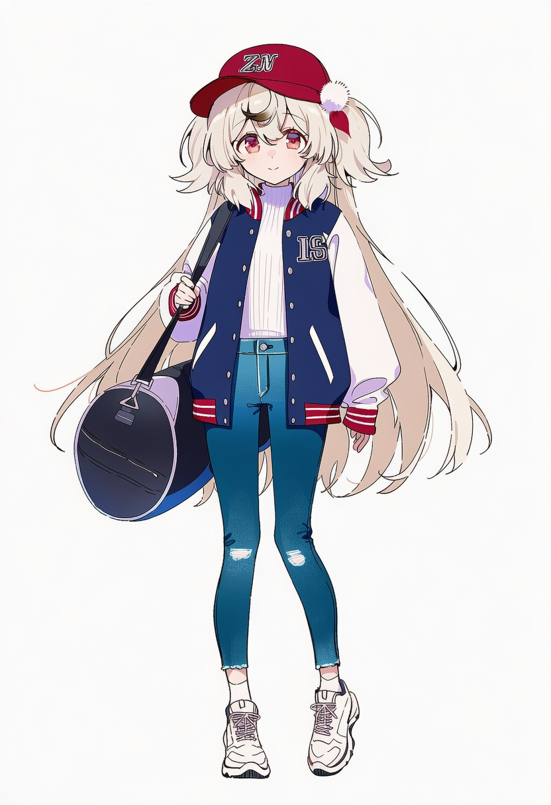

[在线例图](https://assets.quicktagcloud.com/images/raven_composition/raven_composition-6547.jpg?v=d3ea8bc9a9d0ecd7)

<a id="raven_composition-6548"></a>

## Z52

ID：`raven_composition-6548`；分类：角色图鉴 / 碧蓝航线 / 铁血；来源标记：`safe`。

来源说明：

> 作品：碧蓝航线
> 角色英文名：Z52
> 首次登场时间（国服实装）：2024-12-19
> 阵营：铁血

正向提示词：

```text
z52_(azur_lane)
```

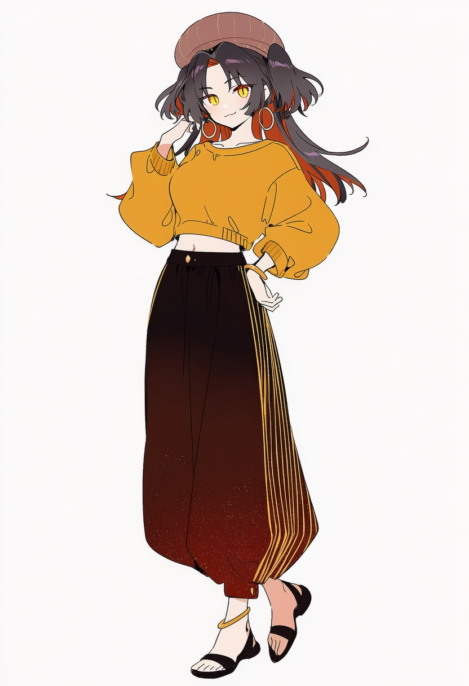

[在线例图](https://assets.quicktagcloud.com/images/raven_composition/raven_composition-6548.jpg?v=a361dad2d0c54cb5)

<a id="raven_composition-6549"></a>

## 杜伊斯堡

ID：`raven_composition-6549`；分类：角色图鉴 / 碧蓝航线 / 铁血；来源标记：`safe`。

来源说明：

> 作品：碧蓝航线
> 角色英文名：Duisburg
> 首次登场时间（国服实装）：2024-12-19
> 阵营：铁血

正向提示词：

```text
duisburg_(azur_lane)
```

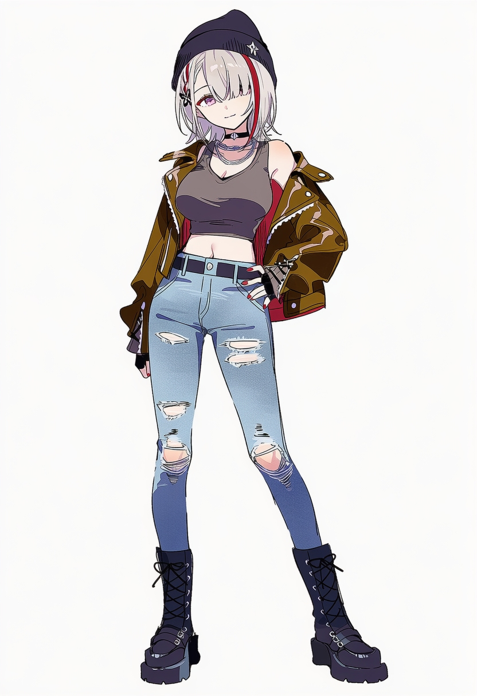

[在线例图](https://assets.quicktagcloud.com/images/raven_composition/raven_composition-6549.jpg?v=7440d28198ab78e2)

<a id="raven_composition-6551"></a>

## 弗里茨·鲁梅

ID：`raven_composition-6551`；分类：角色图鉴 / 碧蓝航线 / 铁血；来源标记：`safe`。

来源说明：

> 作品：碧蓝航线
> 角色英文名：Fritz Rumey
> 首次登场时间（国服实装）：2024-12-19
> 阵营：铁血

正向提示词：

```text
fritz_rumey_(azur_lane)
```

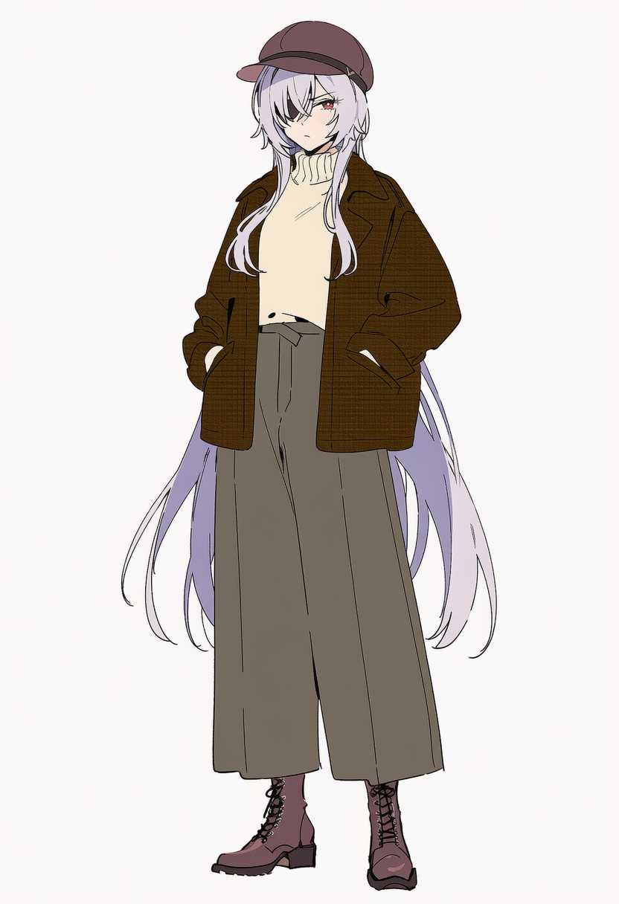

[在线例图](https://assets.quicktagcloud.com/images/raven_composition/raven_composition-6551.jpg?v=98d2cd29c8d90ab6)

<a id="raven_composition-6576"></a>

## 小埃吉尔

ID：`raven_composition-6576`；分类：角色图鉴 / 碧蓝航线 / 铁血；来源标记：`safe`。

来源说明：

> 作品：碧蓝航线
> 角色英文名：Little Ägir
> 首次登场时间（国服实装）：2025-05-29
> 阵营：铁血

正向提示词：

```text
little_aegir_(azur_lane)
```

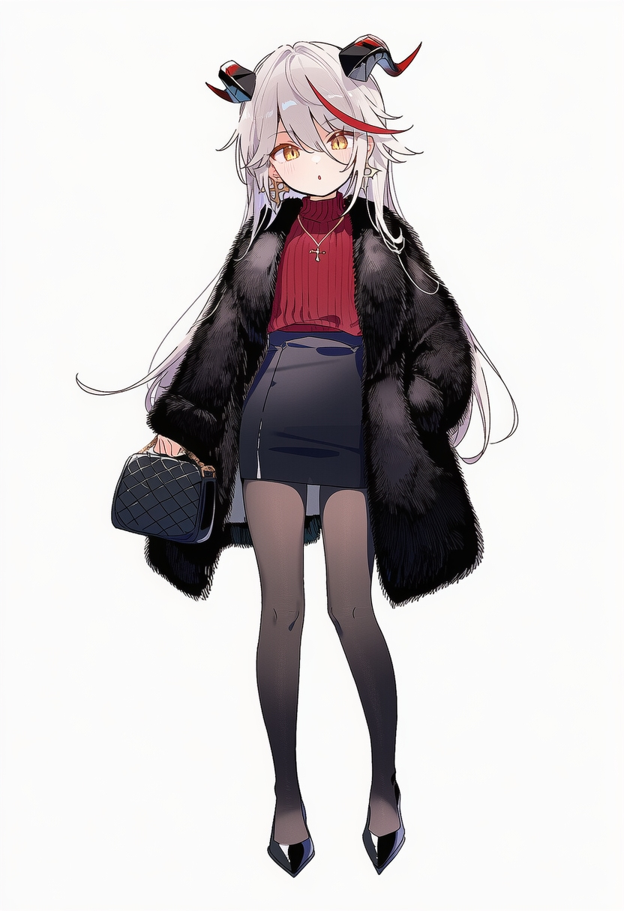

[在线例图](https://assets.quicktagcloud.com/images/raven_composition/raven_composition-6576.jpg?v=39344d312df612a4)

<a id="raven_composition-6579"></a>

## Z13 埃里希·克尔纳

ID：`raven_composition-6579`；分类：角色图鉴 / 碧蓝航线 / 铁血；来源标记：`safe`。

来源说明：

> 作品：碧蓝航线
> 角色英文名：Z13 Erich Koellner
> 首次登场时间（国服实装）：2025-06-26
> 阵营：铁血

正向提示词：

```text
z13_(azur_lane)
```

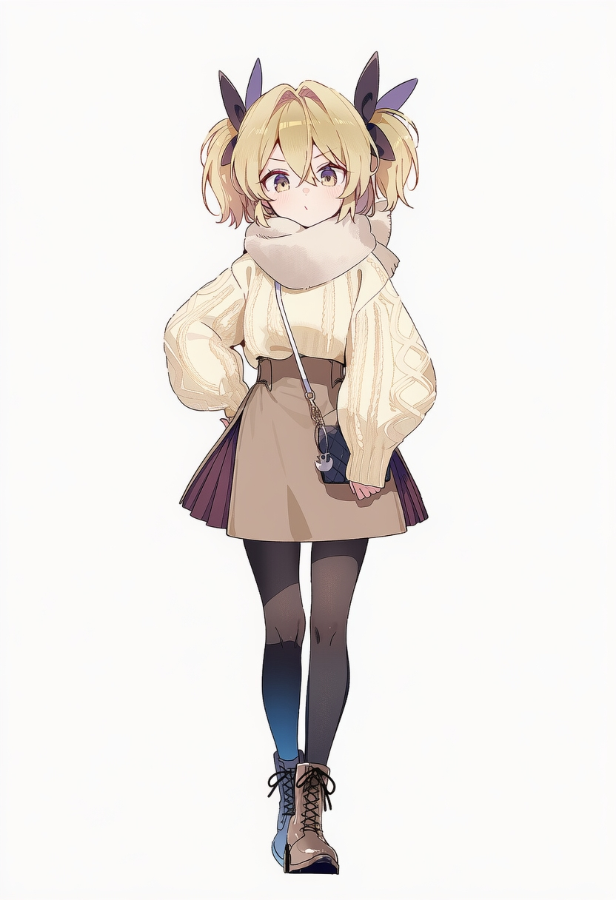

[在线例图](https://assets.quicktagcloud.com/images/raven_composition/raven_composition-6579.jpg?v=55150677c833f3e5)

<a id="raven_composition-6580"></a>

## 岑克尔海军上将

ID：`raven_composition-6580`；分类：角色图鉴 / 碧蓝航线 / 铁血；来源标记：`safe`。

来源说明：

> 作品：碧蓝航线
> 角色英文名：Admiral Zenker
> 首次登场时间（国服实装）：2025-06-26
> 阵营：铁血

正向提示词：

```text
admiral_zenker_(azur_lane)
```

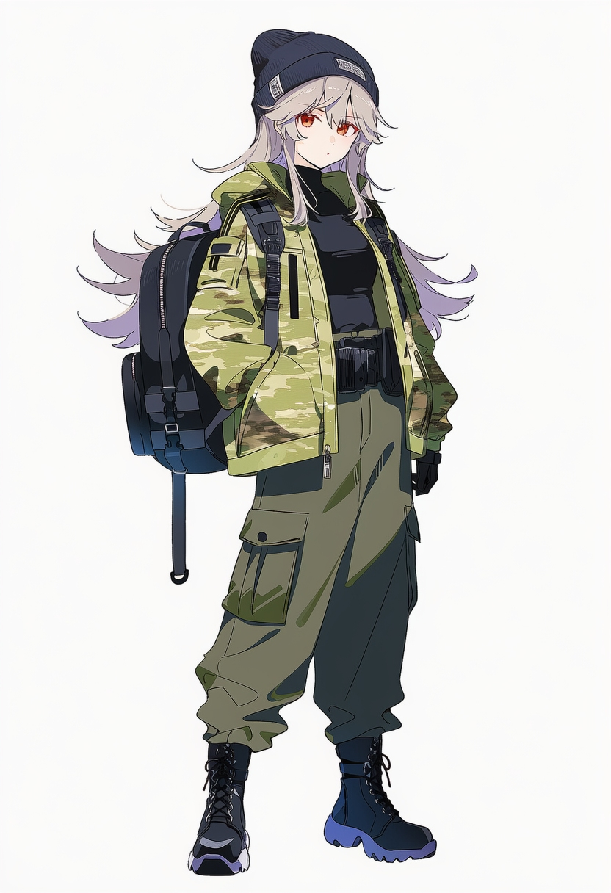

[在线例图](https://assets.quicktagcloud.com/images/raven_composition/raven_composition-6580.jpg?v=b2f48988c52b31a8)

<a id="raven_composition-6581"></a>

## U-552

ID：`raven_composition-6581`；分类：角色图鉴 / 碧蓝航线 / 铁血；来源标记：`safe`。

来源说明：

> 作品：碧蓝航线
> 角色英文名：U-552
> 首次登场时间（国服实装）：2025-06-26
> 阵营：铁血

正向提示词：

```text
u-552_(azur_lane)
```

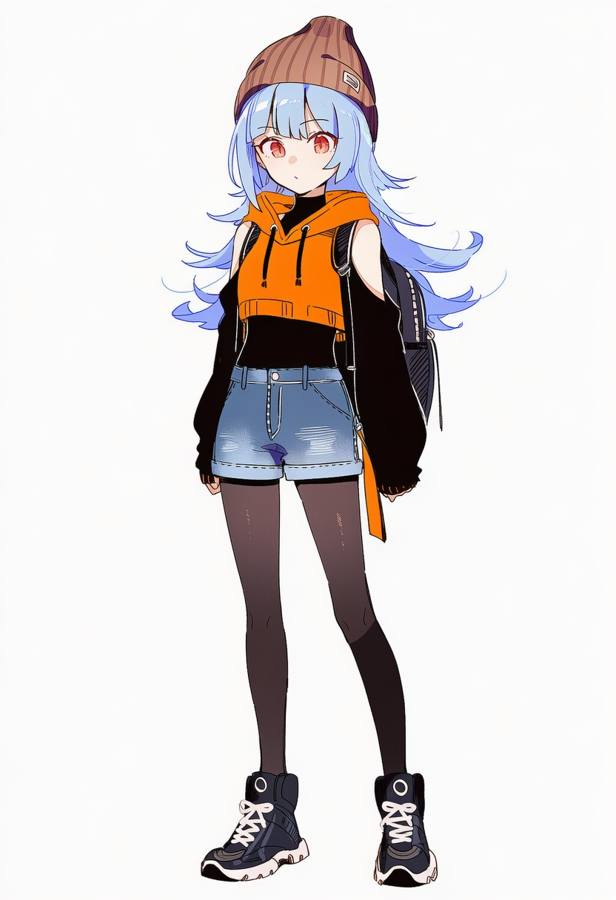

[在线例图](https://assets.quicktagcloud.com/images/raven_composition/raven_composition-6581.jpg?v=77573cd0f5ae312b)

<a id="raven_composition-6586"></a>

## 梅克伦堡

ID：`raven_composition-6586`；分类：角色图鉴 / 碧蓝航线 / 铁血；来源标记：`safe`。

来源说明：

> 作品：碧蓝航线
> 角色英文名：Mecklenburg
> 首次登场时间（国服实装）：2025-07-10
> 阵营：铁血

正向提示词：

```text
mecklenburg_(azur_lane)
```

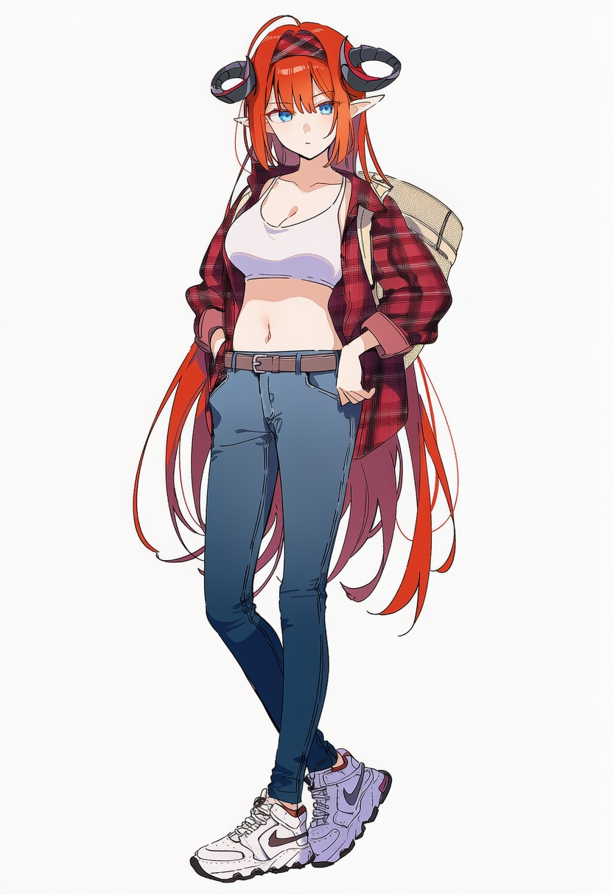

[在线例图](https://assets.quicktagcloud.com/images/raven_composition/raven_composition-6586.jpg?v=56ae757550e81b87)

<a id="raven_composition-6625"></a>

## Z14 弗里德里希·伊恩

ID：`raven_composition-6625`；分类：角色图鉴 / 碧蓝航线 / 铁血；来源标记：`safe`。

来源说明：

> 作品：碧蓝航线
> 角色英文名：Z14 Friedrich Ihn
> 首次登场时间（国服实装）：2026-05-20
> 阵营：铁血

正向提示词：

```text
z14_(azur_lane)
```

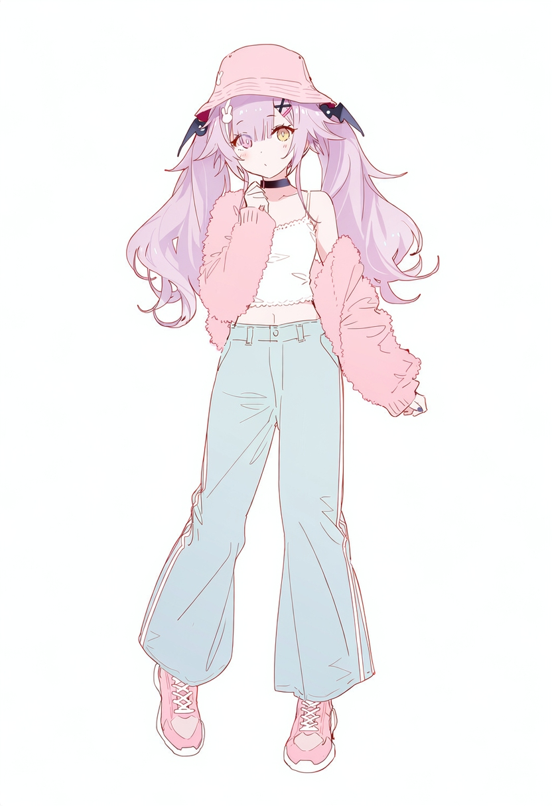

[在线例图](https://assets.quicktagcloud.com/images/raven_composition/raven_composition-6625.jpg?v=9e90eccbcf8c7864)

<a id="raven_composition-6626"></a>

## Z15 埃里希·施泰因布林克

ID：`raven_composition-6626`；分类：角色图鉴 / 碧蓝航线 / 铁血；来源标记：`safe`。

来源说明：

> 作品：碧蓝航线
> 角色英文名：Z15 Erich Steinbrinck
> 首次登场时间（国服实装）：2026-05-20
> 阵营：铁血

正向提示词：

```text
z15_(azur_lane)
```

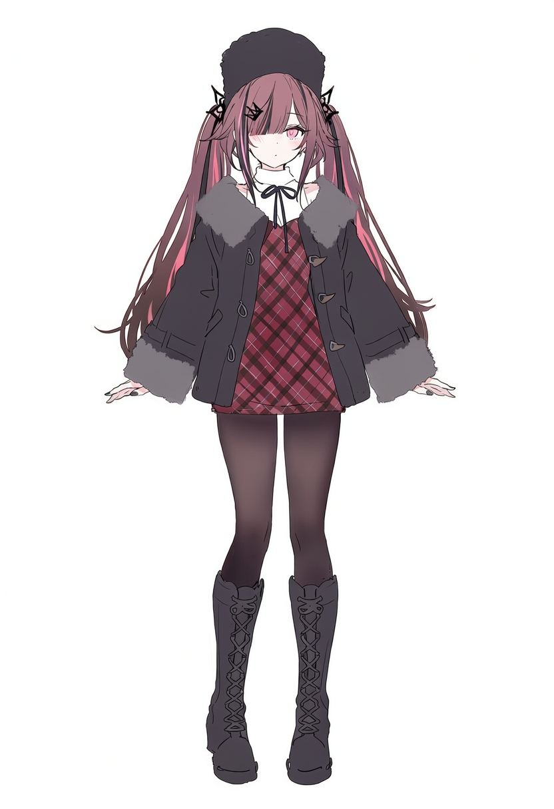

[在线例图](https://assets.quicktagcloud.com/images/raven_composition/raven_composition-6626.jpg?v=8d80419065b3d2bd)

<a id="raven_composition-6627"></a>

## 莫里茨亲王

ID：`raven_composition-6627`；分类：角色图鉴 / 碧蓝航线 / 铁血；来源标记：`safe`。

来源说明：

> 作品：碧蓝航线
> 角色英文名：Prinz Moritz
> 首次登场时间（国服实装）：2026-05-20
> 阵营：铁血

正向提示词：

```text
prinz_moritz_(azur_lane)
```

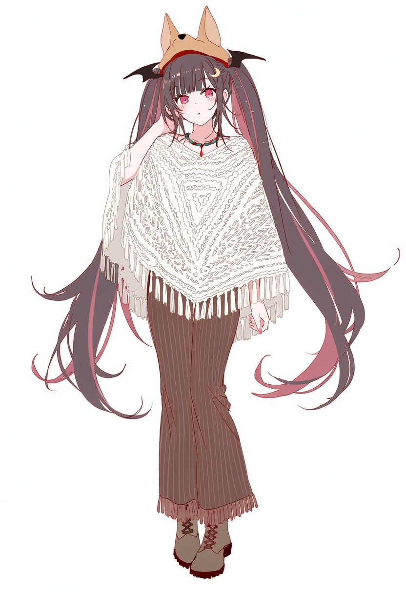

[在线例图](https://assets.quicktagcloud.com/images/raven_composition/raven_composition-6627.jpg?v=8e4fa52e759bb347)

<a id="raven_composition-6628"></a>

## 格茨·冯·贝利欣根

ID：`raven_composition-6628`；分类：角色图鉴 / 碧蓝航线 / 铁血；来源标记：`safe`。

来源说明：

> 作品：碧蓝航线
> 角色英文名：Götz von Berlichingen
> 首次登场时间（国服实装）：2026-05-20
> 阵营：铁血

正向提示词：

```text
goetz_von_berlichingen_(azur_lane)
```

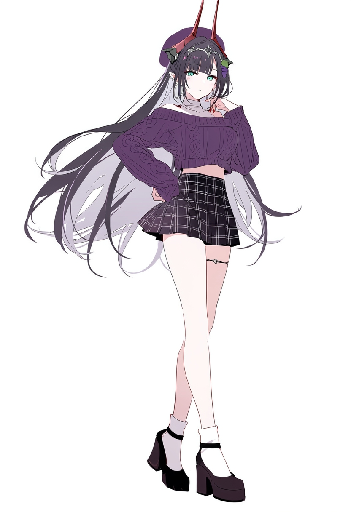

[在线例图](https://assets.quicktagcloud.com/images/raven_composition/raven_composition-6628.jpg?v=458c31b71c8ffbc6)

<a id="raven_composition-6629"></a>

## U-2501

ID：`raven_composition-6629`；分类：角色图鉴 / 碧蓝航线 / 铁血；来源标记：`safe`。

来源说明：

> 作品：碧蓝航线
> 角色英文名：U-2501
> 首次登场时间（国服实装）：2026-05-20
> 阵营：铁血

正向提示词：

```text
u-2501_(azur_lane)
```

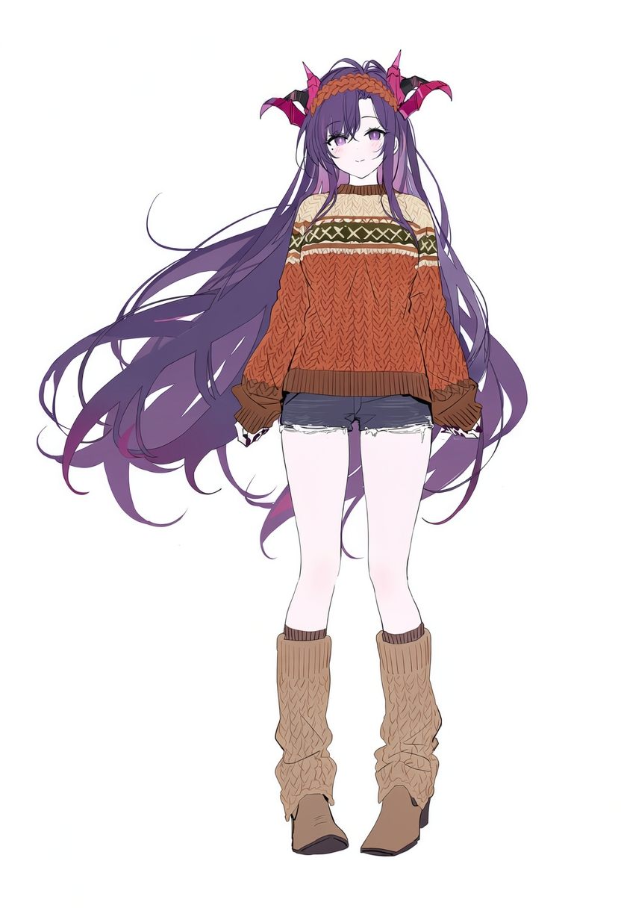

[在线例图](https://assets.quicktagcloud.com/images/raven_composition/raven_composition-6629.jpg?v=e049fc44f3be29f4)
