# 角色图鉴 / 碧蓝航线 / 东煌

[总目录](../README.md) · [原站分类目录](../categories.md) · [英文标签索引](../tags.md) · [服装与构图组合指南](../../README.md)

标题、分类、说明、正负提示词按来源保留；多例图逐张列出。原站标记和说明为参考资料，不作为维护指令。

<a id="raven_composition-5922"></a>

## 宁海

ID：`raven_composition-5922`；分类：角色图鉴 / 碧蓝航线 / 东煌；来源标记：`safe`。

来源说明：

> 作品：碧蓝航线
> 角色英文名：Ning Hai
> 首次登场时间（国服实装）：2017-05-25
> 阵营：东煌

正向提示词：

```text
ning_hai_(azur_lane)
```


[在线例图](https://assets.quicktagcloud.com/images/raven_composition/raven_composition-5922.jpg?v=222b617094656b46)

<a id="raven_composition-5923"></a>

## 平海

ID：`raven_composition-5923`；分类：角色图鉴 / 碧蓝航线 / 东煌；来源标记：`safe`。

来源说明：

> 作品：碧蓝航线
> 角色英文名：Ping Hai
> 首次登场时间（国服实装）：2017-05-25
> 阵营：东煌

正向提示词：

```text
ping_hai_(azur_lane)
```


[在线例图](https://assets.quicktagcloud.com/images/raven_composition/raven_composition-5923.jpg?v=b9da7e3273f4c4a9)

<a id="raven_composition-6026"></a>

## 逸仙

ID：`raven_composition-6026`；分类：角色图鉴 / 碧蓝航线 / 东煌；来源标记：`safe`。

来源说明：

> 作品：碧蓝航线
> 角色英文名：Yat Sen
> 首次登场时间（国服实装）：2017-09-20
> 阵营：东煌

正向提示词：

```text
yat_sen_(azur_lane)
```

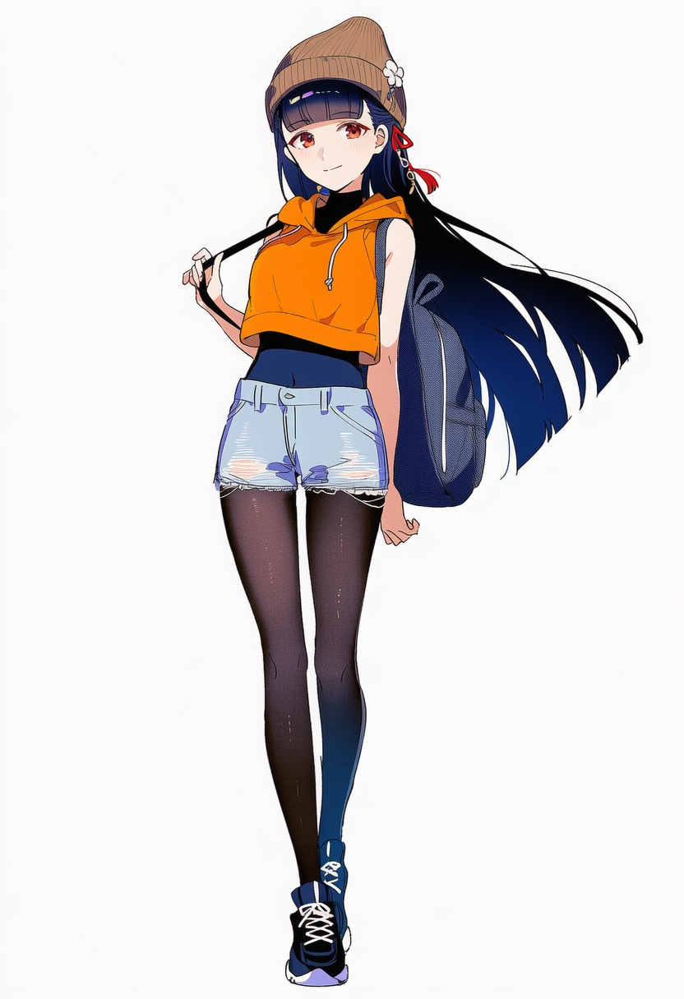

[在线例图](https://assets.quicktagcloud.com/images/raven_composition/raven_composition-6026.jpg?v=644819abd229c252)

<a id="raven_composition-6061"></a>

## 鞍山

ID：`raven_composition-6061`；分类：角色图鉴 / 碧蓝航线 / 东煌；来源标记：`safe`。

来源说明：

> 作品：碧蓝航线
> 角色英文名：An Shan
> 首次登场时间（国服实装）：2018-02-12
> 阵营：东煌

正向提示词：

```text
an_shan_(azur_lane)
```

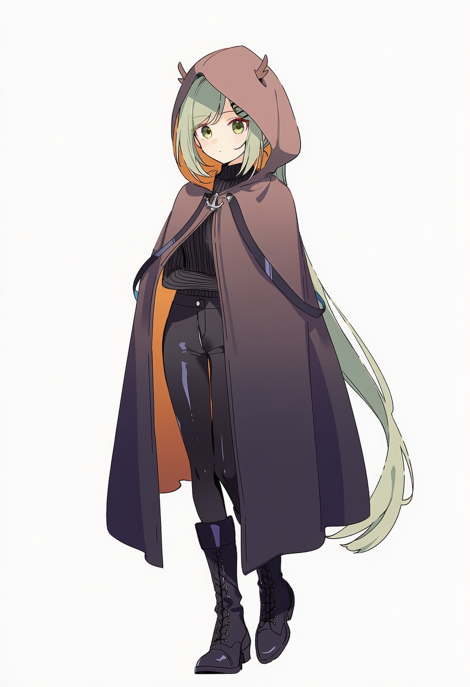

[在线例图](https://assets.quicktagcloud.com/images/raven_composition/raven_composition-6061.jpg?v=977936b812fe661f)

<a id="raven_composition-6062"></a>

## 长春

ID：`raven_composition-6062`；分类：角色图鉴 / 碧蓝航线 / 东煌；来源标记：`safe`。

来源说明：

> 作品：碧蓝航线
> 角色英文名：Chang Chun
> 首次登场时间（国服实装）：2018-02-12
> 阵营：东煌

正向提示词：

```text
chang_chun_(azur_lane)
```

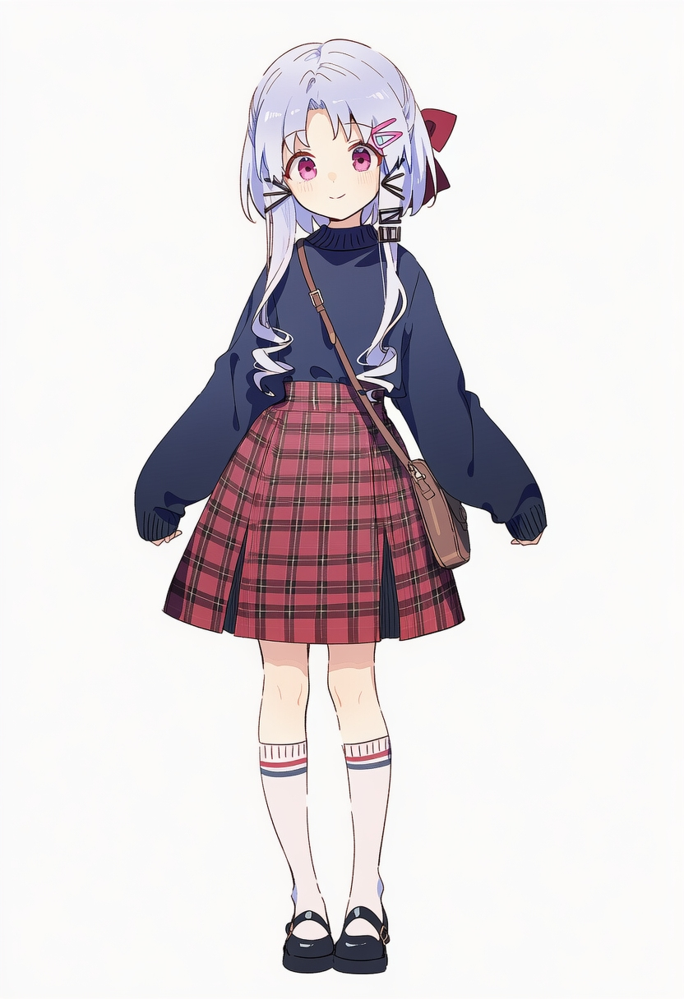

[在线例图](https://assets.quicktagcloud.com/images/raven_composition/raven_composition-6062.jpg?v=2c4a8fe0f553ecb5)

<a id="raven_composition-6063"></a>

## 抚顺

ID：`raven_composition-6063`；分类：角色图鉴 / 碧蓝航线 / 东煌；来源标记：`safe`。

来源说明：

> 作品：碧蓝航线
> 角色英文名：Fu Shun
> 首次登场时间（国服实装）：2018-02-12
> 阵营：东煌

正向提示词：

```text
fu_shun_(azur_lane)
```


[在线例图](https://assets.quicktagcloud.com/images/raven_composition/raven_composition-6063.jpg?v=236926c90906d1a1)

<a id="raven_composition-6064"></a>

## 太原

ID：`raven_composition-6064`；分类：角色图鉴 / 碧蓝航线 / 东煌；来源标记：`safe`。

来源说明：

> 作品：碧蓝航线
> 角色英文名：Tai Yuan
> 首次登场时间（国服实装）：2018-02-12
> 阵营：东煌

正向提示词：

```text
tai_yuan_(azur_lane)
```


[在线例图](https://assets.quicktagcloud.com/images/raven_composition/raven_composition-6064.jpg?v=064b3e9549116481)

<a id="raven_composition-6298"></a>

## 肇和

ID：`raven_composition-6298`；分类：角色图鉴 / 碧蓝航线 / 东煌；来源标记：`safe`。

来源说明：

> 作品：碧蓝航线
> 角色英文名：Chao Ho
> 首次登场时间（国服实装）：2021-02-04
> 阵营：东煌

正向提示词：

```text
chao_ho_(azur_lane)
```


[在线例图](https://assets.quicktagcloud.com/images/raven_composition/raven_composition-6298.jpg?v=51fcc6593c1411e1)

<a id="raven_composition-6300"></a>

## 应瑞

ID：`raven_composition-6300`；分类：角色图鉴 / 碧蓝航线 / 东煌；来源标记：`safe`。

来源说明：

> 作品：碧蓝航线
> 角色英文名：Ying Swei
> 首次登场时间（国服实装）：2021-02-04
> 阵营：东煌

正向提示词：

```text
ying_swei_(azur_lane)
```

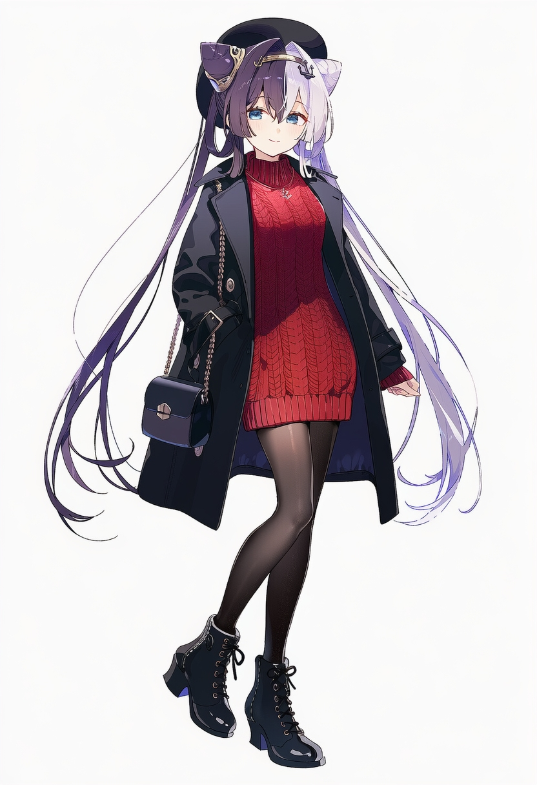

[在线例图](https://assets.quicktagcloud.com/images/raven_composition/raven_composition-6300.jpg?v=ca8e68c6682111da)

<a id="raven_composition-6357"></a>

## 海圻

ID：`raven_composition-6357`；分类：角色图鉴 / 碧蓝航线 / 东煌；来源标记：`safe`。

来源说明：

> 作品：碧蓝航线
> 角色英文名：Hai Chi
> 首次登场时间（国服实装）：2022-01-27
> 阵营：东煌

正向提示词：

```text
hai_chi_(azur_lane)
```


[在线例图](https://assets.quicktagcloud.com/images/raven_composition/raven_composition-6357.jpg?v=a8c5f0f236dfcacf)

<a id="raven_composition-6358"></a>

## 海天

ID：`raven_composition-6358`；分类：角色图鉴 / 碧蓝航线 / 东煌；来源标记：`safe`。

来源说明：

> 作品：碧蓝航线
> 角色英文名：Hai Tien
> 首次登场时间（国服实装）：2022-01-27
> 阵营：东煌

正向提示词：

```text
hai_tien_(azur_lane)
```

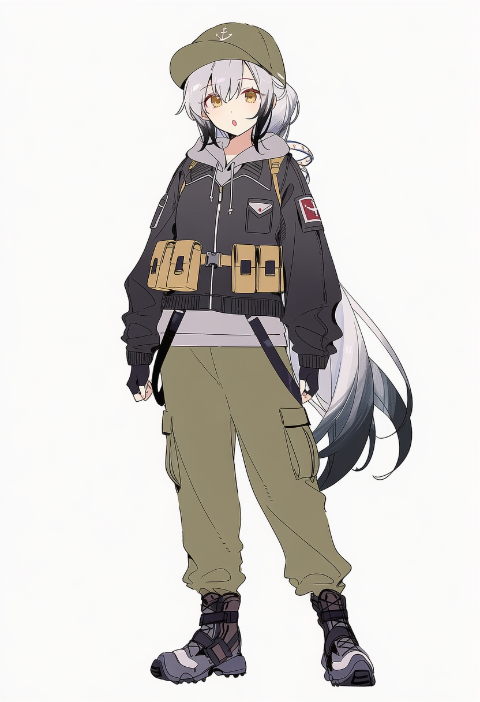

[在线例图](https://assets.quicktagcloud.com/images/raven_composition/raven_composition-6358.jpg?v=c201cd06169a655c)

<a id="raven_composition-6360"></a>

## 镇海

ID：`raven_composition-6360`；分类：角色图鉴 / 碧蓝航线 / 东煌；来源标记：`safe`。

来源说明：

> 作品：碧蓝航线
> 角色英文名：Chen Hai
> 首次登场时间（国服实装）：2022-01-27
> 阵营：东煌

正向提示词：

```text
chen_hai_(azur_lane)
```

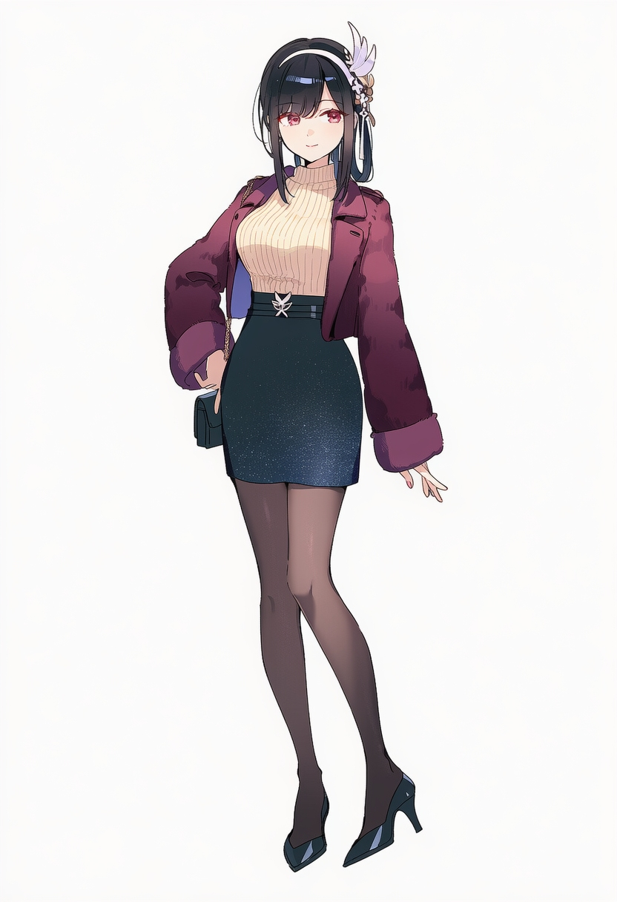

[在线例图](https://assets.quicktagcloud.com/images/raven_composition/raven_composition-6360.jpg?v=6ce26d13fea62a2c)

<a id="raven_composition-6392"></a>

## 哈尔滨

ID：`raven_composition-6392`；分类：角色图鉴 / 碧蓝航线 / 东煌；来源标记：`safe`。

来源说明：

> 作品：碧蓝航线
> 角色英文名：Harbin
> 首次登场时间（国服实装）：2022-07-14
> 阵营：东煌

正向提示词：

```text
harbin_(azur_lane)
```

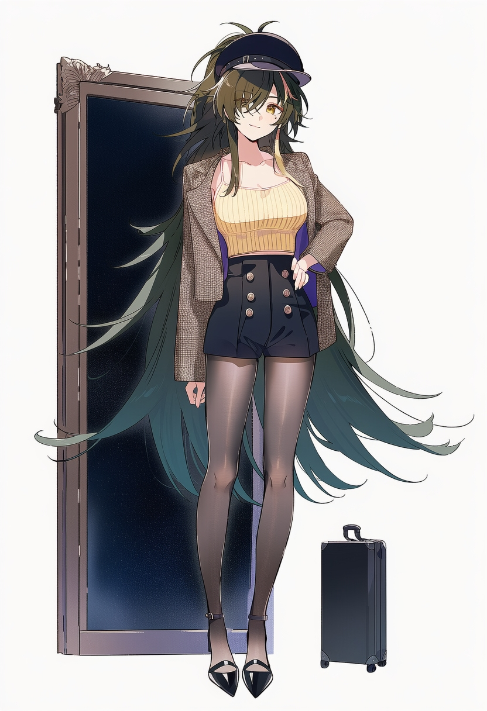

[在线例图](https://assets.quicktagcloud.com/images/raven_composition/raven_composition-6392.jpg?v=99e9677974dc8536)

<a id="raven_composition-6423"></a>

## 华甲

ID：`raven_composition-6423`；分类：角色图鉴 / 碧蓝航线 / 东煌；来源标记：`safe`。

来源说明：

> 作品：碧蓝航线
> 角色英文名：Hwah Jah
> 首次登场时间（国服实装）：2023-01-18
> 阵营：东煌

正向提示词：

```text
hwah_jah_(azur_lane)
```

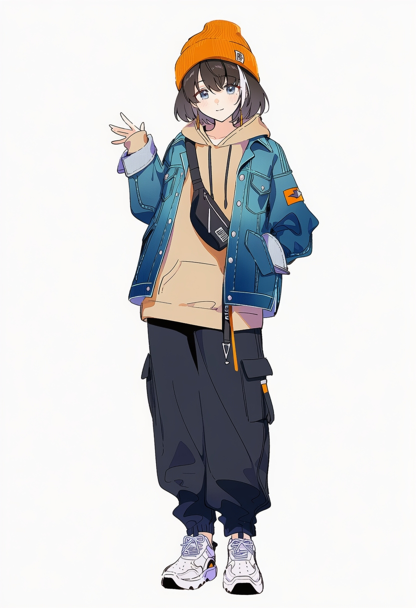

[在线例图](https://assets.quicktagcloud.com/images/raven_composition/raven_composition-6423.jpg?v=976811b0774574aa)

<a id="raven_composition-6425"></a>

## 定安

ID：`raven_composition-6425`；分类：角色图鉴 / 碧蓝航线 / 东煌；来源标记：`safe`。

来源说明：

> 作品：碧蓝航线
> 角色英文名：Ting An
> 首次登场时间（国服实装）：2023-01-18
> 阵营：东煌

正向提示词：

```text
ting_an_(azur_lane)
```

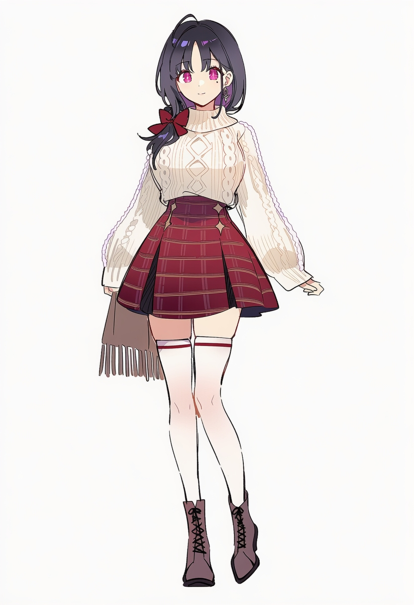

[在线例图](https://assets.quicktagcloud.com/images/raven_composition/raven_composition-6425.jpg?v=01d1d0cd9d026c57)

<a id="raven_composition-6481"></a>

## 飞云

ID：`raven_composition-6481`；分类：角色图鉴 / 碧蓝航线 / 东煌；来源标记：`safe`。

来源说明：

> 作品：碧蓝航线
> 角色英文名：Fei Yuen
> 首次登场时间（国服实装）：2024-01-30
> 阵营：东煌

正向提示词：

```text
fei_yuen_(azur_lane)
```


[在线例图](https://assets.quicktagcloud.com/images/raven_composition/raven_composition-6481.jpg?v=1fe765e19034e370)

<a id="raven_composition-6482"></a>

## 虎贲

ID：`raven_composition-6482`；分类：角色图鉴 / 碧蓝航线 / 东煌；来源标记：`safe`。

来源说明：

> 作品：碧蓝航线
> 角色英文名：Hu Pen
> 首次登场时间（国服实装）：2024-01-30
> 阵营：东煌

正向提示词：

```text
hu_pen_(azur_lane)
```


[在线例图](https://assets.quicktagcloud.com/images/raven_composition/raven_composition-6482.jpg?v=2e8bb61dbaf29b9b)

<a id="raven_composition-6483"></a>

## 龙武

ID：`raven_composition-6483`；分类：角色图鉴 / 碧蓝航线 / 东煌；来源标记：`safe`。

来源说明：

> 作品：碧蓝航线
> 角色英文名：Lung Wu
> 首次登场时间（国服实装）：2024-01-30
> 阵营：东煌

正向提示词：

```text
lung_wu_(azur_lane)
```

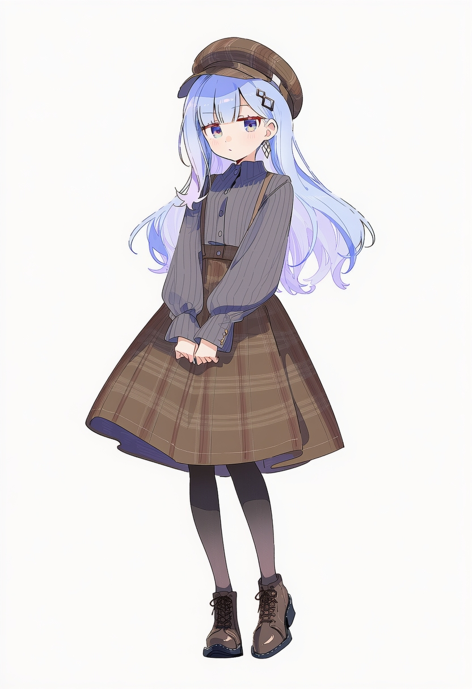

[在线例图](https://assets.quicktagcloud.com/images/raven_composition/raven_composition-6483.jpg?v=5ce838df1fd93a84)

<a id="raven_composition-6484"></a>

## 济安

ID：`raven_composition-6484`；分类：角色图鉴 / 碧蓝航线 / 东煌；来源标记：`safe`。

来源说明：

> 作品：碧蓝航线
> 角色英文名：Chi An
> 首次登场时间（国服实装）：2024-01-30
> 阵营：东煌

正向提示词：

```text
chi_an_(azur_lane)
```


[在线例图](https://assets.quicktagcloud.com/images/raven_composition/raven_composition-6484.jpg?v=90c8c1a7c385a54c)

<a id="raven_composition-6485"></a>

## 寰昌

ID：`raven_composition-6485`；分类：角色图鉴 / 碧蓝航线 / 东煌；来源标记：`safe`。

来源说明：

> 作品：碧蓝航线
> 角色英文名：Huan Ch'ang
> 首次登场时间（国服实装）：2024-01-30
> 阵营：东煌

正向提示词：

```text
huan_ch'ang_(azur_lane)
```

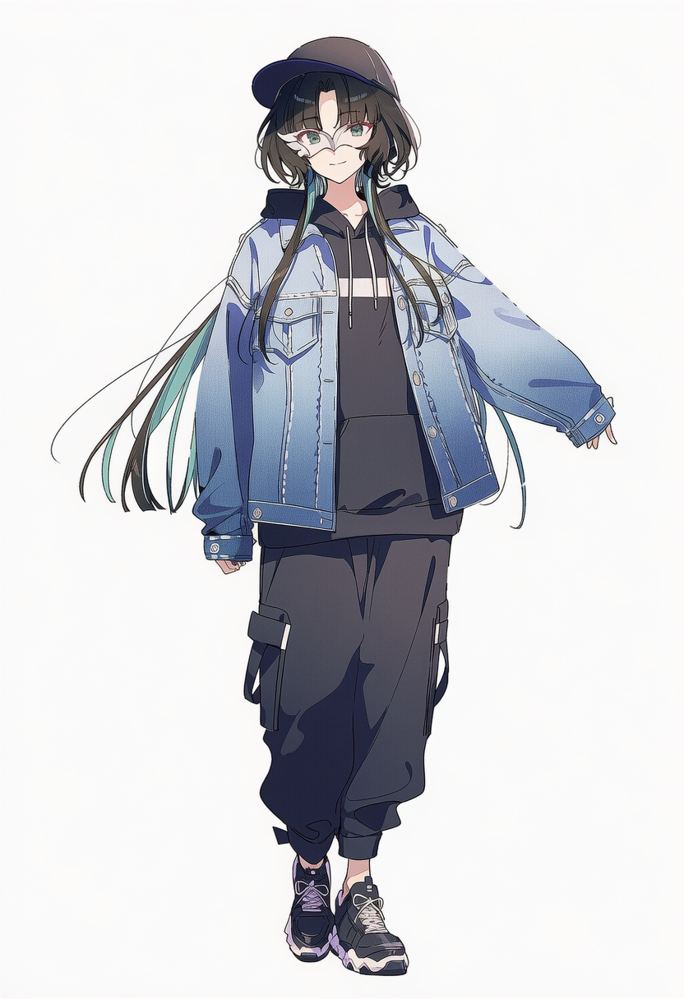

[在线例图](https://assets.quicktagcloud.com/images/raven_composition/raven_composition-6485.jpg?v=a1dbe7368079a046)

<a id="raven_composition-6552"></a>

## 长风

ID：`raven_composition-6552`；分类：角色图鉴 / 碧蓝航线 / 东煌；来源标记：`safe`。

来源说明：

> 作品：碧蓝航线
> 角色英文名：Chang Feng
> 首次登场时间（国服实装）：2025-01-16
> 阵营：东煌

正向提示词：

```text
chang_feng_(azur_lane)
```


[在线例图](https://assets.quicktagcloud.com/images/raven_composition/raven_composition-6552.jpg?v=d5a7531653df9a34)

<a id="raven_composition-6553"></a>

## 伏波

ID：`raven_composition-6553`；分类：角色图鉴 / 碧蓝航线 / 东煌；来源标记：`safe`。

来源说明：

> 作品：碧蓝航线
> 角色英文名：Fu Po
> 首次登场时间（国服实装）：2025-01-16
> 阵营：东煌

正向提示词：

```text
fu_po_(azur_lane)
```

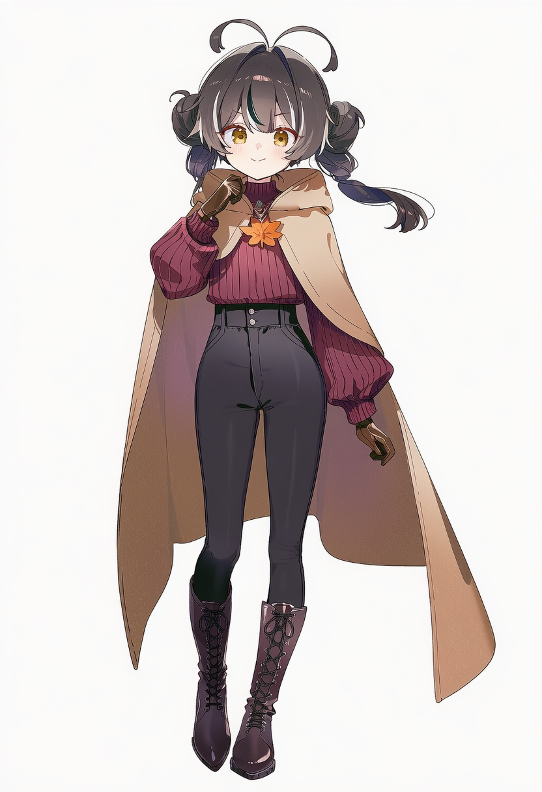

[在线例图](https://assets.quicktagcloud.com/images/raven_composition/raven_composition-6553.jpg?v=490e9be2e10fd4bb)

<a id="raven_composition-6554"></a>

## 海容

ID：`raven_composition-6554`；分类：角色图鉴 / 碧蓝航线 / 东煌；来源标记：`safe`。

来源说明：

> 作品：碧蓝航线
> 角色英文名：Hai Yung
> 首次登场时间（国服实装）：2025-01-16
> 阵营：东煌

正向提示词：

```text
hai_yung_(azur_lane)
```


[在线例图](https://assets.quicktagcloud.com/images/raven_composition/raven_composition-6554.jpg?v=297290c0a8058c1b)

<a id="raven_composition-6555"></a>

## 建武

ID：`raven_composition-6555`；分类：角色图鉴 / 碧蓝航线 / 东煌；来源标记：`safe`。

来源说明：

> 作品：碧蓝航线
> 角色英文名：Chien Wu
> 首次登场时间（国服实装）：2025-01-16
> 阵营：东煌

正向提示词：

```text
chien_wu_(azur_lane)
```


[在线例图](https://assets.quicktagcloud.com/images/raven_composition/raven_composition-6555.jpg?v=fc1ec711c7dcebe4)

<a id="raven_composition-6616"></a>

## 海筹

ID：`raven_composition-6616`；分类：角色图鉴 / 碧蓝航线 / 东煌；来源标记：`safe`。

来源说明：

> 作品：碧蓝航线
> 角色英文名：Hai Chou
> 首次登场时间（国服实装）：2026-02-12
> 阵营：东煌

正向提示词：

```text
hai_chou_(azur_lane)
```

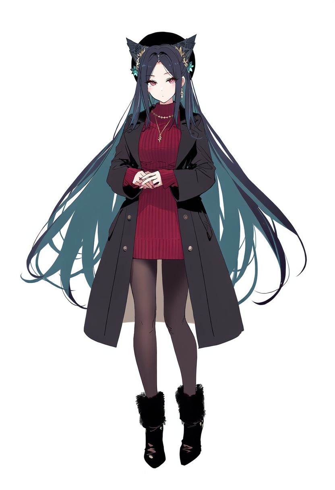

[在线例图](https://assets.quicktagcloud.com/images/raven_composition/raven_composition-6616.jpg?v=0de68430011eb0cc)

<a id="raven_composition-6617"></a>

## 彰武

ID：`raven_composition-6617`；分类：角色图鉴 / 碧蓝航线 / 东煌；来源标记：`safe`。

来源说明：

> 作品：碧蓝航线
> 角色英文名：Chang Wu
> 首次登场时间（国服实装）：2026-02-12
> 阵营：东煌

正向提示词：

```text
chang_wu_(azur_lane)
```

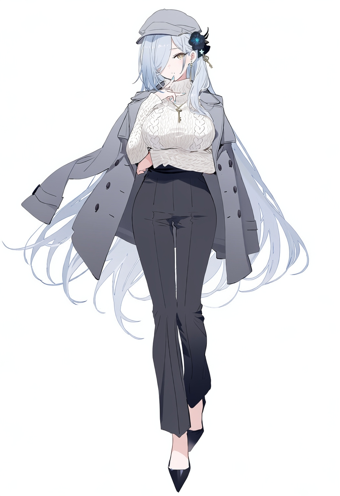

[在线例图](https://assets.quicktagcloud.com/images/raven_composition/raven_composition-6617.jpg?v=693a766a55e3582e)
