# 角色图鉴 / 碧蓝航线 / 北方联合

[总目录](../README.md) · [原站分类目录](../categories.md) · [英文标签索引](../tags.md) · [服装与构图组合指南](../../README.md)

标题、分类、说明、正负提示词按来源保留；多例图逐张列出。原站标记和说明为参考资料，不作为维护指令。

<a id="raven_composition-5924"></a>

## 阿芙乐尔

ID：`raven_composition-5924`；分类：角色图鉴 / 碧蓝航线 / 北方联合；来源标记：`safe`。

来源说明：

> 作品：碧蓝航线
> 角色英文名：Avrora
> 首次登场时间（国服实装）：2017-05-25
> 阵营：北方联合

正向提示词：

```text
avrora_(azur_lane)
```

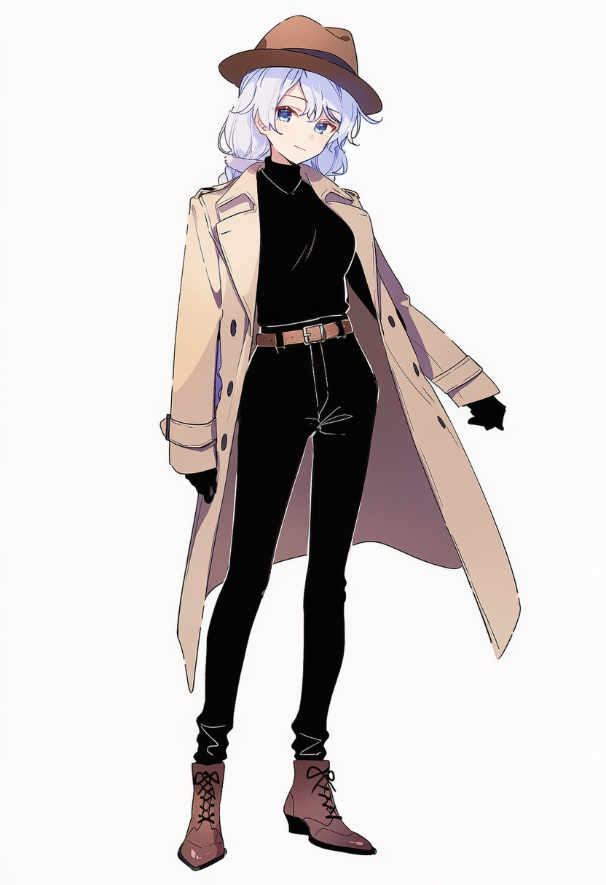

[在线例图](https://assets.quicktagcloud.com/images/raven_composition/raven_composition-5924.jpg?v=29f335f27c548554)

<a id="raven_composition-6230"></a>

## 威严

ID：`raven_composition-6230`；分类：角色图鉴 / 碧蓝航线 / 北方联合；来源标记：`safe`。

来源说明：

> 作品：碧蓝航线
> 角色英文名：Grozny
> 首次登场时间（国服实装）：2020-02-27
> 阵营：北方联合

正向提示词：

```text
grozny_(azur_lane)
```

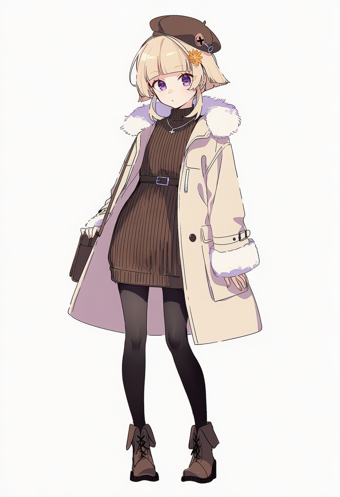

[在线例图](https://assets.quicktagcloud.com/images/raven_composition/raven_composition-6230.jpg?v=a5005f63be60a86f)

<a id="raven_composition-6231"></a>

## 明斯克

ID：`raven_composition-6231`；分类：角色图鉴 / 碧蓝航线 / 北方联合；来源标记：`safe`。

来源说明：

> 作品：碧蓝航线
> 角色英文名：Minsk
> 首次登场时间（国服实装）：2020-02-27
> 阵营：北方联合

正向提示词：

```text
minsk_(azur_lane)
```

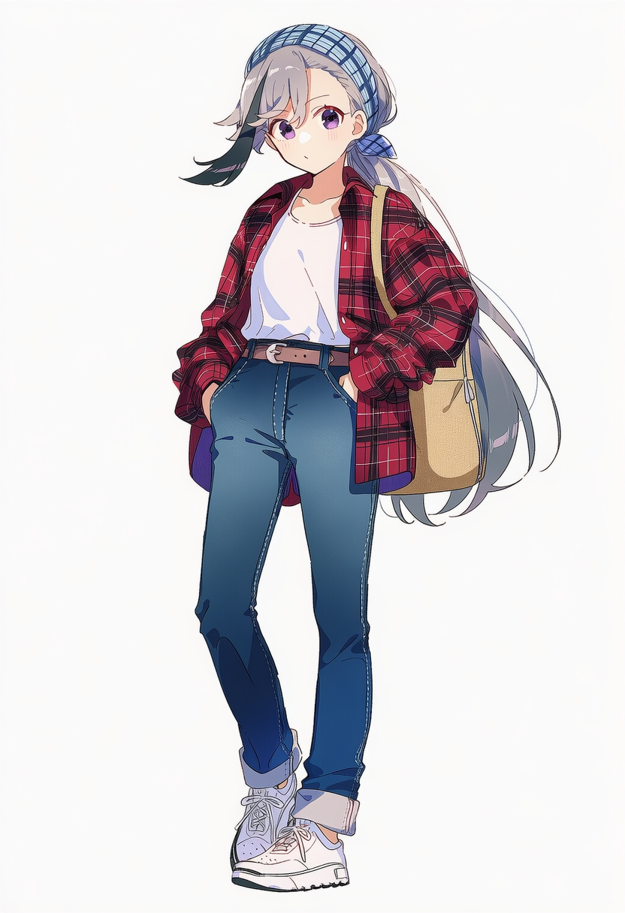

[在线例图](https://assets.quicktagcloud.com/images/raven_composition/raven_composition-6231.jpg?v=a22c3b8f54ce05f2)

<a id="raven_composition-6232"></a>

## 塔什干

ID：`raven_composition-6232`；分类：角色图鉴 / 碧蓝航线 / 北方联合；来源标记：`safe`。

来源说明：

> 作品：碧蓝航线
> 角色英文名：Tashkent
> 首次登场时间（国服实装）：2020-02-27
> 阵营：北方联合

正向提示词：

```text
tashkent_(azur_lane)
```

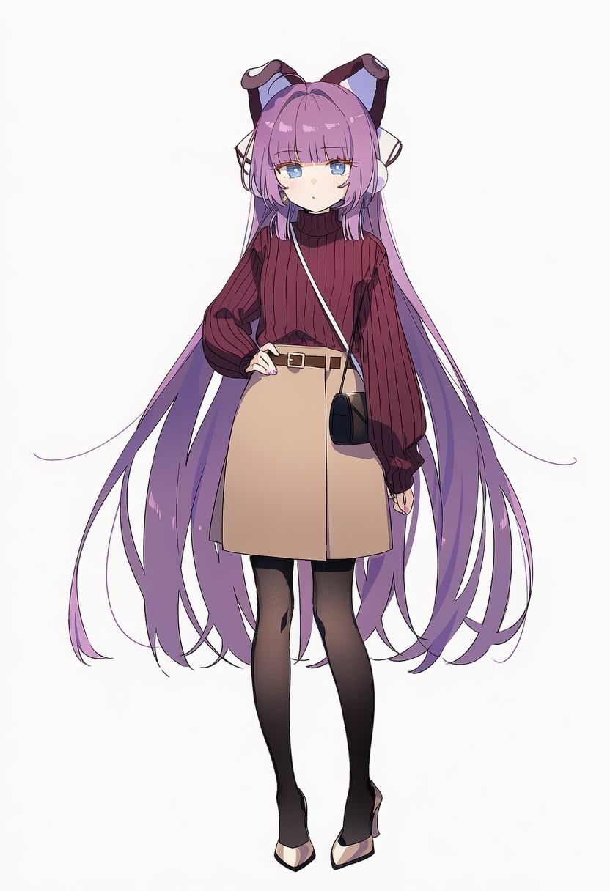

[在线例图](https://assets.quicktagcloud.com/images/raven_composition/raven_composition-6232.jpg?v=231877581b0ecf68)

<a id="raven_composition-6233"></a>

## 水星纪念

ID：`raven_composition-6233`；分类：角色图鉴 / 碧蓝航线 / 北方联合；来源标记：`safe`。

来源说明：

> 作品：碧蓝航线
> 角色英文名：Pamiat' Merkuria
> 首次登场时间（国服实装）：2020-02-27
> 阵营：北方联合

正向提示词：

```text
pamiat_merkuria_(azur_lane)
```

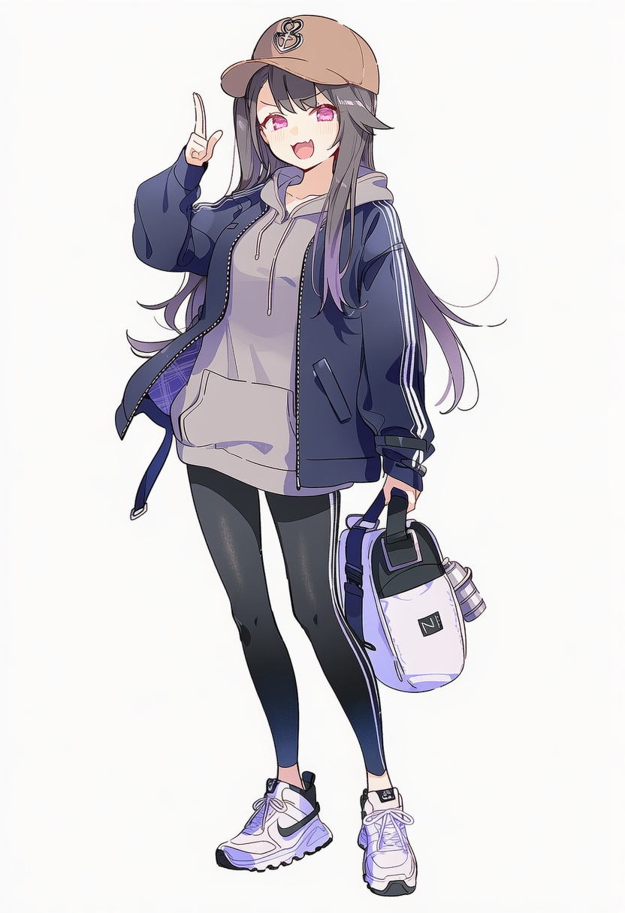

[在线例图](https://assets.quicktagcloud.com/images/raven_composition/raven_composition-6233.jpg?v=bd8dfecd7e922f6e)

<a id="raven_composition-6234"></a>

## 恰巴耶夫

ID：`raven_composition-6234`；分类：角色图鉴 / 碧蓝航线 / 北方联合；来源标记：`safe`。

来源说明：

> 作品：碧蓝航线
> 角色英文名：Chapayev
> 首次登场时间（国服实装）：2020-02-27
> 阵营：北方联合

正向提示词：

```text
chapayev_(azur_lane)
```


[在线例图](https://assets.quicktagcloud.com/images/raven_composition/raven_composition-6234.jpg?v=0db69117c63ef401)

<a id="raven_composition-6235"></a>

## 甘古特

ID：`raven_composition-6235`；分类：角色图鉴 / 碧蓝航线 / 北方联合；来源标记：`safe`。

来源说明：

> 作品：碧蓝航线
> 角色英文名：Gangut
> 首次登场时间（国服实装）：2020-02-27
> 阵营：北方联合

正向提示词：

```text
gangut_(azur_lane)
```

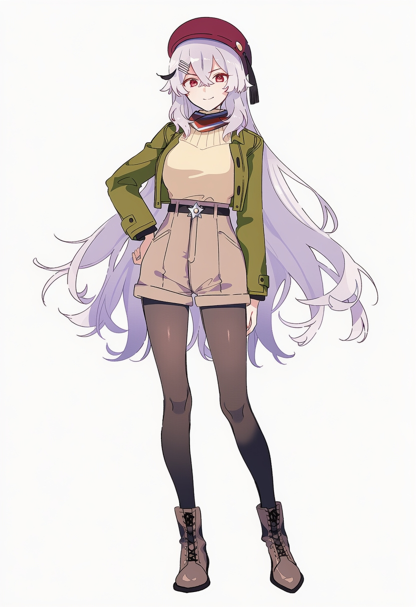

[在线例图](https://assets.quicktagcloud.com/images/raven_composition/raven_composition-6235.jpg?v=7d6ede3bd31b5737)

<a id="raven_composition-6236"></a>

## 苏维埃罗西亚

ID：`raven_composition-6236`；分类：角色图鉴 / 碧蓝航线 / 北方联合；来源标记：`safe`。

来源说明：

> 作品：碧蓝航线
> 角色英文名：Sovetskaya Rossiya
> 首次登场时间（国服实装）：2020-02-27
> 阵营：北方联合

正向提示词：

```text
sovetskaya_rossiya_(azur_lane)
```

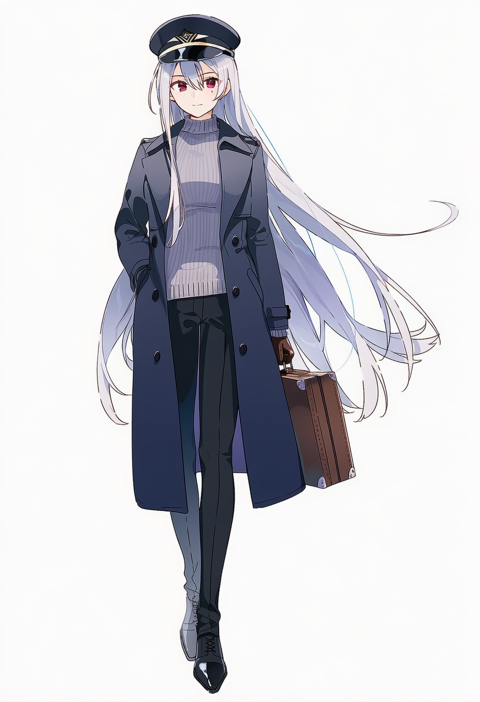

[在线例图](https://assets.quicktagcloud.com/images/raven_composition/raven_composition-6236.jpg?v=bd40e13f99c1a1da)

<a id="raven_composition-6280"></a>

## 塔什干μ

ID：`raven_composition-6280`；分类：角色图鉴 / 碧蓝航线 / 北方联合；来源标记：`safe`。

来源说明：

> 作品：碧蓝航线
> 角色英文名：Tashkent µ
> 首次登场时间（国服实装）：2020-10-29
> 阵营：北方联合

正向提示词：

```text
tashkent_(muse)_(azur_lane)
```


[在线例图](https://assets.quicktagcloud.com/images/raven_composition/raven_composition-6280.jpg?v=f5dc7e50c29cc49a)

<a id="raven_composition-6297"></a>

## 神速

ID：`raven_composition-6297`；分类：角色图鉴 / 碧蓝航线 / 北方联合；来源标记：`safe`。

来源说明：

> 作品：碧蓝航线
> 角色英文名：Stremitelny
> 首次登场时间（国服实装）：2021-02
> 阵营：北方联合

正向提示词：

```text
stremitelny_(azur_lane)
```

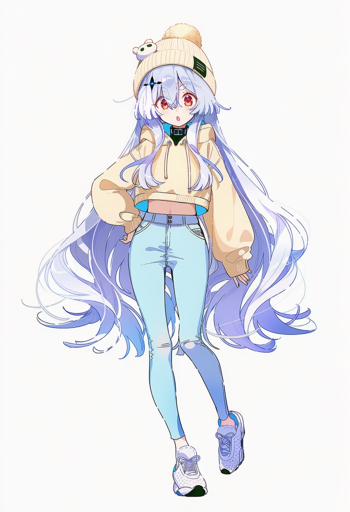

[在线例图](https://assets.quicktagcloud.com/images/raven_composition/raven_composition-6297.jpg?v=6943613d29487491)

<a id="raven_composition-6302"></a>

## 雷鸣

ID：`raven_composition-6302`；分类：角色图鉴 / 碧蓝航线 / 北方联合；来源标记：`safe`。

来源说明：

> 作品：碧蓝航线
> 角色英文名：Gremyashchy
> 首次登场时间（国服实装）：2021-02-25
> 阵营：北方联合

正向提示词：

```text
gremyashchy_(azur_lane)
```

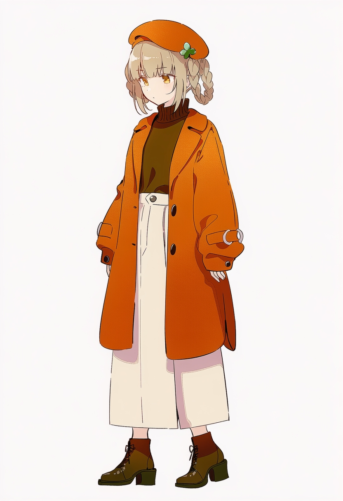

[在线例图](https://assets.quicktagcloud.com/images/raven_composition/raven_composition-6302.jpg?v=281c41947c6f89e3)

<a id="raven_composition-6303"></a>

## 洪亮

ID：`raven_composition-6303`；分类：角色图鉴 / 碧蓝航线 / 北方联合；来源标记：`safe`。

来源说明：

> 作品：碧蓝航线
> 角色英文名：Gromky
> 首次登场时间（国服实装）：2021-02-25
> 阵营：北方联合

正向提示词：

```text
gromky_(azur_lane)
```

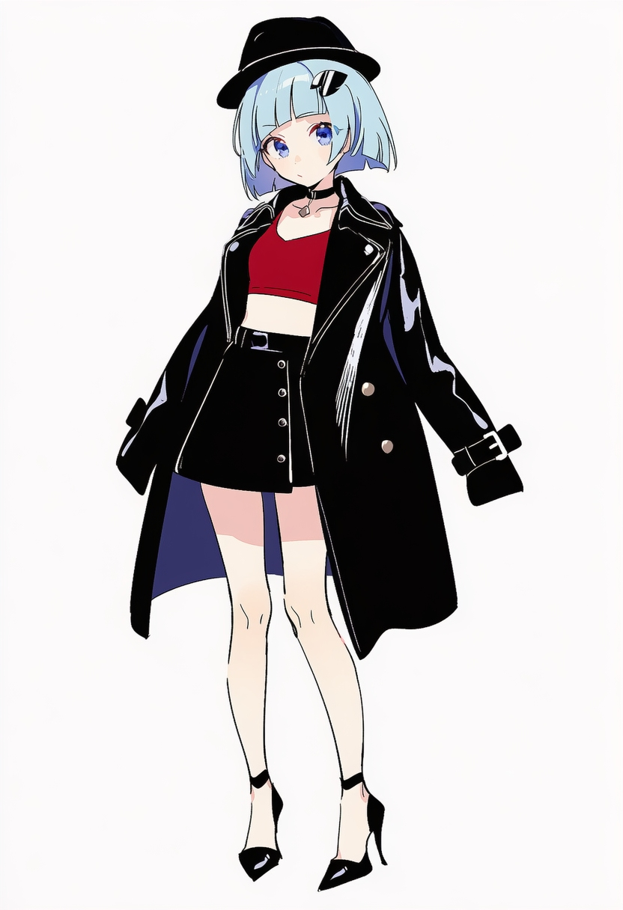

[在线例图](https://assets.quicktagcloud.com/images/raven_composition/raven_composition-6303.jpg?v=83c83f92bd91ff97)

<a id="raven_composition-6304"></a>

## 摩尔曼斯克

ID：`raven_composition-6304`；分类：角色图鉴 / 碧蓝航线 / 北方联合；来源标记：`safe`。

来源说明：

> 作品：碧蓝航线
> 角色英文名：Murmansk
> 首次登场时间（国服实装）：2021-02-25
> 阵营：北方联合

正向提示词：

```text
murmansk_(azur_lane)
```

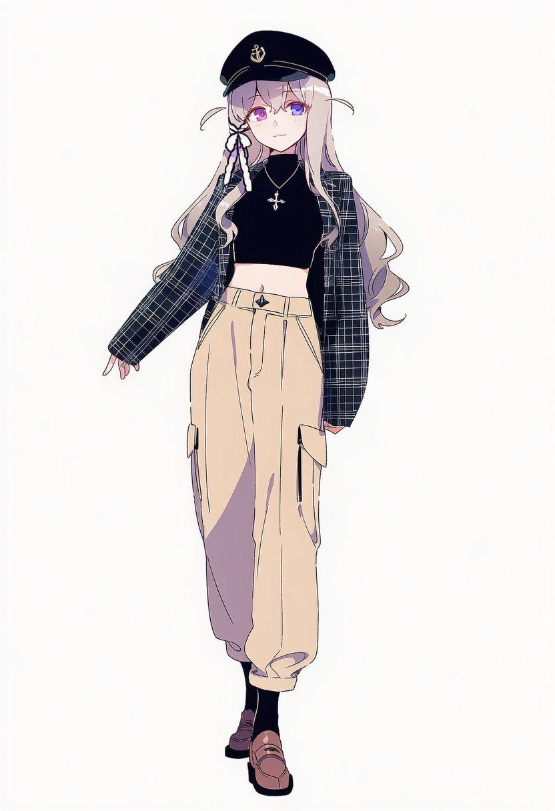

[在线例图](https://assets.quicktagcloud.com/images/raven_composition/raven_composition-6304.jpg?v=a4ef8dce25ff30e5)

<a id="raven_composition-6305"></a>

## 基洛夫

ID：`raven_composition-6305`；分类：角色图鉴 / 碧蓝航线 / 北方联合；来源标记：`safe`。

来源说明：

> 作品：碧蓝航线
> 角色英文名：Kirov
> 首次登场时间（国服实装）：2021-02-25
> 阵营：北方联合

正向提示词：

```text
kirov_(azur_lane)
```

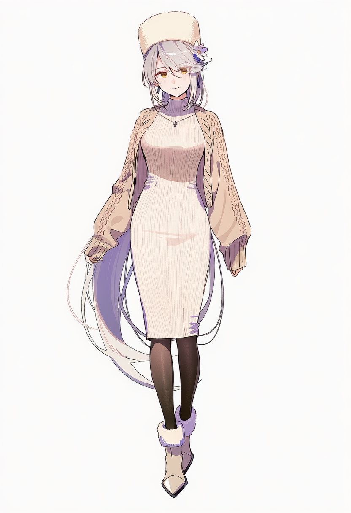

[在线例图](https://assets.quicktagcloud.com/images/raven_composition/raven_composition-6305.jpg?v=b414943951299830)

<a id="raven_composition-6306"></a>

## 塔林

ID：`raven_composition-6306`；分类：角色图鉴 / 碧蓝航线 / 北方联合；来源标记：`safe`。

来源说明：

> 作品：碧蓝航线
> 角色英文名：Tallinn
> 首次登场时间（国服实装）：2021-02-25
> 阵营：北方联合

正向提示词：

```text
tallinn_(azur_lane)
```

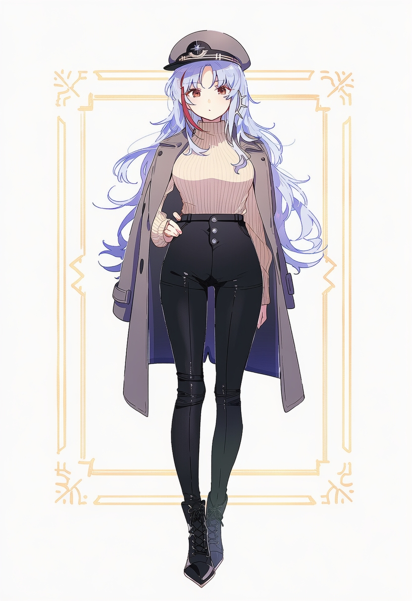

[在线例图](https://assets.quicktagcloud.com/images/raven_composition/raven_composition-6306.jpg?v=b8a5207a500c716d)

<a id="raven_composition-6307"></a>

## 苏维埃贝拉罗斯

ID：`raven_composition-6307`；分类：角色图鉴 / 碧蓝航线 / 北方联合；来源标记：`safe`。

来源说明：

> 作品：碧蓝航线
> 角色英文名：Sovetskaya Belorussiya
> 首次登场时间（国服实装）：2021-02-25
> 阵营：北方联合

正向提示词：

```text
sovetskaya_belorussiya_(azur_lane)
```

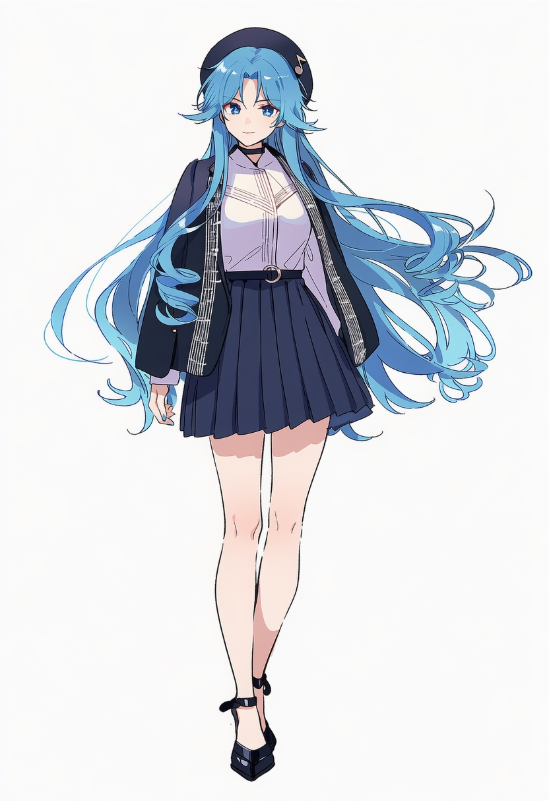

[在线例图](https://assets.quicktagcloud.com/images/raven_composition/raven_composition-6307.jpg?v=c42c947cd22f22b7)

<a id="raven_composition-6362"></a>

## 灵敏

ID：`raven_composition-6362`；分类：角色图鉴 / 碧蓝航线 / 北方联合；来源标记：`safe`。

来源说明：

> 作品：碧蓝航线
> 角色英文名：Soobrazitelny
> 首次登场时间（国服实装）：2022-02-24
> 阵营：北方联合

正向提示词：

```text
soobrazitelny_(azur_lane)
```

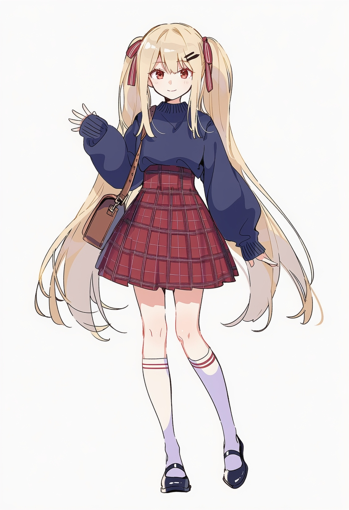

[在线例图](https://assets.quicktagcloud.com/images/raven_composition/raven_composition-6362.jpg?v=fe2e1eb7a2fafb39)

<a id="raven_composition-6363"></a>

## 基辅

ID：`raven_composition-6363`；分类：角色图鉴 / 碧蓝航线 / 北方联合；来源标记：`safe`。

来源说明：

> 作品：碧蓝航线
> 角色英文名：Kiev
> 首次登场时间（国服实装）：2022-02-24
> 阵营：北方联合

正向提示词：

```text
kiev_(azur_lane)
```

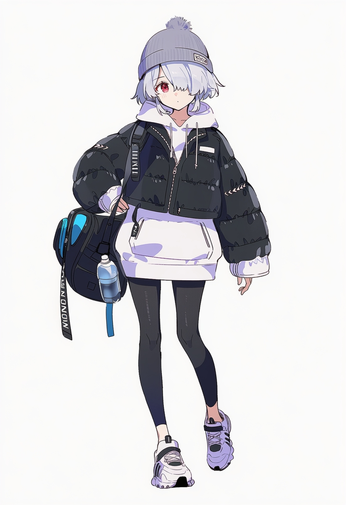

[在线例图](https://assets.quicktagcloud.com/images/raven_composition/raven_composition-6363.jpg?v=244727133bb21afb)

<a id="raven_composition-6364"></a>

## 喀琅施塔得

ID：`raven_composition-6364`；分类：角色图鉴 / 碧蓝航线 / 北方联合；来源标记：`safe`。

来源说明：

> 作品：碧蓝航线
> 角色英文名：Kronshtadt
> 首次登场时间（国服实装）：2022-02-24
> 阵营：北方联合

正向提示词：

```text
kronshtadt_(azur_lane)
```

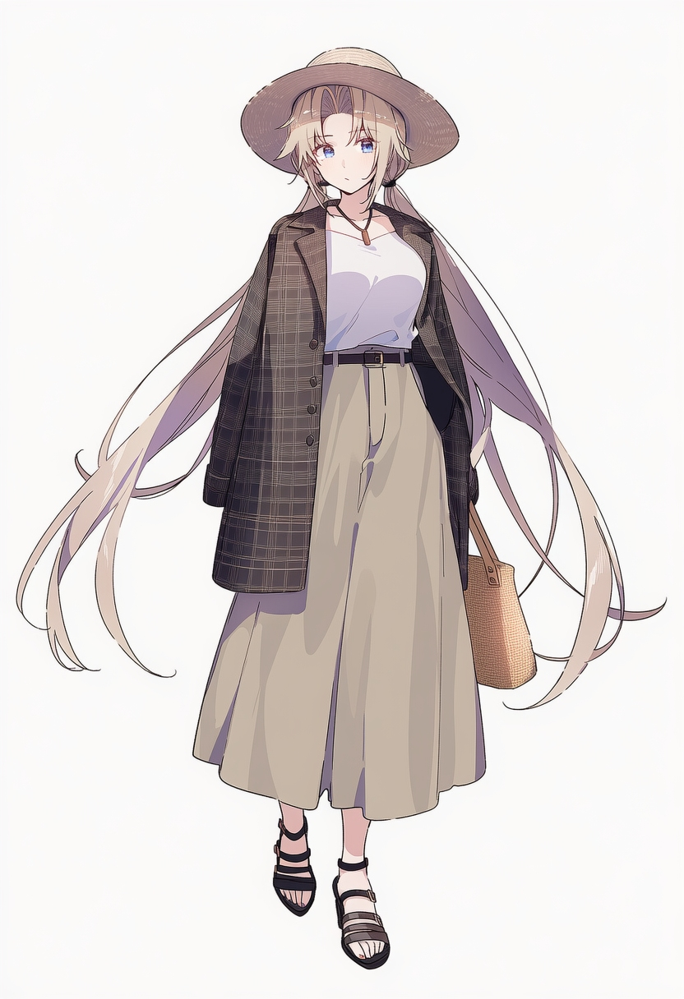

[在线例图](https://assets.quicktagcloud.com/images/raven_composition/raven_composition-6364.jpg?v=80e4d2d933385ca1)

<a id="raven_composition-6365"></a>

## 阿尔汉格尔斯克

ID：`raven_composition-6365`；分类：角色图鉴 / 碧蓝航线 / 北方联合；来源标记：`safe`。

来源说明：

> 作品：碧蓝航线
> 角色英文名：Arkhangelsk
> 首次登场时间（国服实装）：2022-02-24
> 阵营：北方联合

正向提示词：

```text
arkhangelsk_(azur_lane)
```

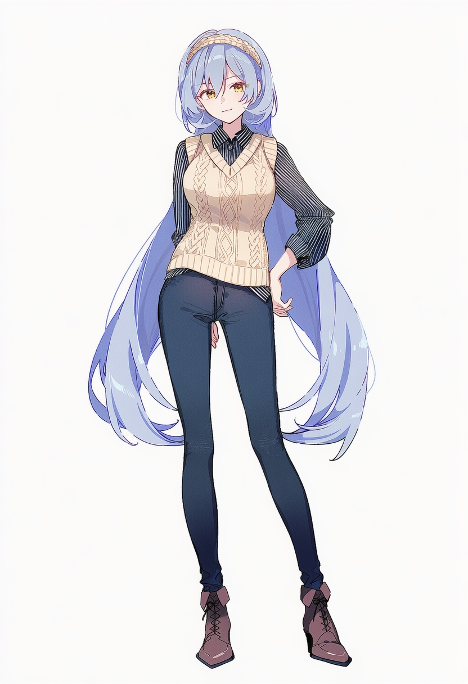

[在线例图](https://assets.quicktagcloud.com/images/raven_composition/raven_composition-6365.jpg?v=aaeffa4120721b9f)

<a id="raven_composition-6366"></a>

## 伏尔加

ID：`raven_composition-6366`；分类：角色图鉴 / 碧蓝航线 / 北方联合；来源标记：`safe`。

来源说明：

> 作品：碧蓝航线
> 角色英文名：Volga
> 首次登场时间（国服实装）：2022-02-24
> 阵营：北方联合

正向提示词：

```text
volga_(azur_lane)
```

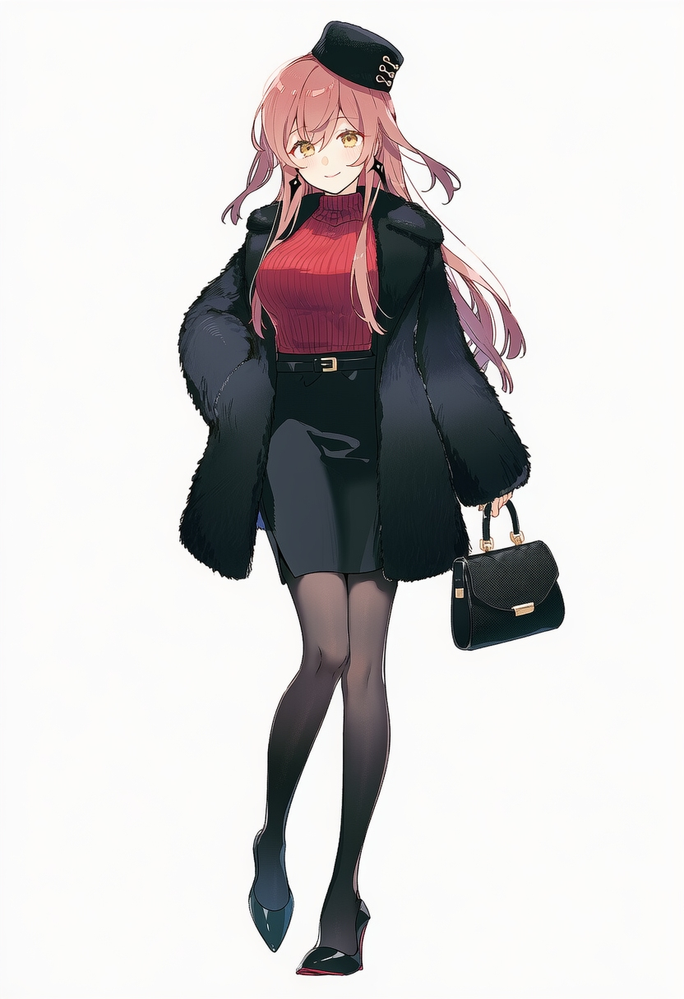

[在线例图](https://assets.quicktagcloud.com/images/raven_composition/raven_composition-6366.jpg?v=fde2603a7eb2c00f)

<a id="raven_composition-6391"></a>

## 契卡洛夫

ID：`raven_composition-6391`；分类：角色图鉴 / 碧蓝航线 / 北方联合；来源标记：`safe`。

来源说明：

> 作品：碧蓝航线
> 角色英文名：Chkalov
> 首次登场时间（国服实装）：2022-07-14
> 阵营：北方联合

正向提示词：

```text
chkalov_(azur_lane)
```

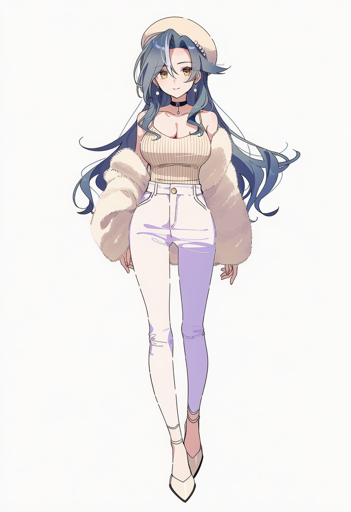

[在线例图](https://assets.quicktagcloud.com/images/raven_composition/raven_composition-6391.jpg?v=76f44a3141cac953)

<a id="raven_composition-6422"></a>

## 古比雪夫

ID：`raven_composition-6422`；分类：角色图鉴 / 碧蓝航线 / 北方联合；来源标记：`safe`。

来源说明：

> 作品：碧蓝航线
> 角色英文名：Kuybyshev
> 首次登场时间（国服实装）：2023-01-18
> 阵营：北方联合

正向提示词：

```text
kuybyshev_(azur_lane)
```

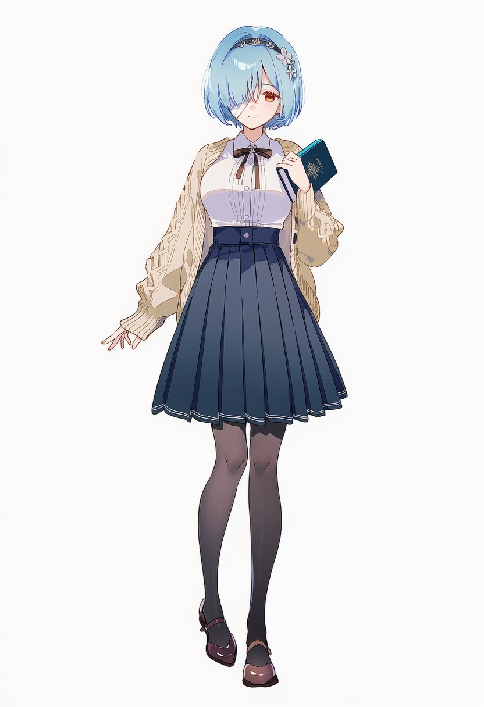

[在线例图](https://assets.quicktagcloud.com/images/raven_composition/raven_composition-6422.jpg?v=988b4b5358849ceb)

<a id="raven_composition-6432"></a>

## 伏罗希洛夫

ID：`raven_composition-6432`；分类：角色图鉴 / 碧蓝航线 / 北方联合；来源标记：`safe`。

来源说明：

> 作品：碧蓝航线
> 角色英文名：Voroshilov
> 首次登场时间（国服实装）：2023-03-23
> 阵营：北方联合

正向提示词：

```text
voroshilov_(azur_lane)
```

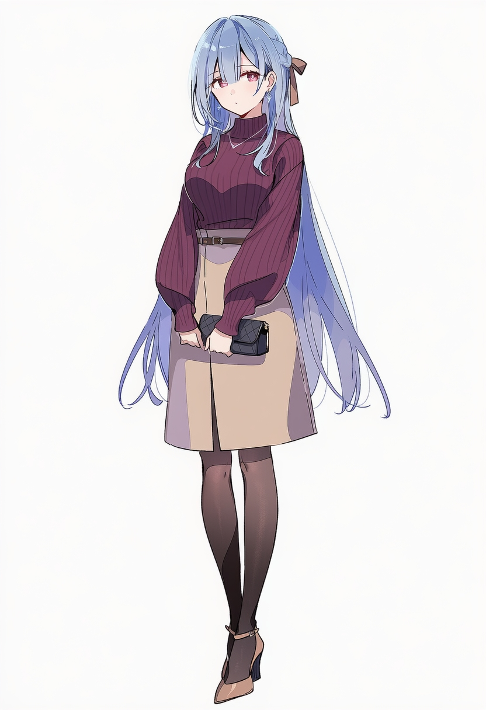

[在线例图](https://assets.quicktagcloud.com/images/raven_composition/raven_composition-6432.jpg?v=847442da166c4ba9)

<a id="raven_composition-6433"></a>

## 库尔斯克

ID：`raven_composition-6433`；分类：角色图鉴 / 碧蓝航线 / 北方联合；来源标记：`safe`。

来源说明：

> 作品：碧蓝航线
> 角色英文名：Kursk
> 首次登场时间（国服实装）：2023-03-23
> 阵营：北方联合

正向提示词：

```text
kursk_(azur_lane)
```

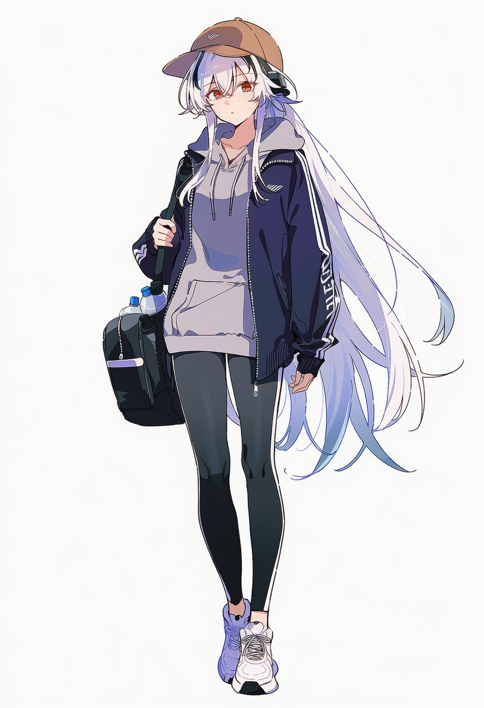

[在线例图](https://assets.quicktagcloud.com/images/raven_composition/raven_composition-6433.jpg?v=9b9e64aecdc5fd1a)

<a id="raven_composition-6434"></a>

## 塞瓦斯托波尔

ID：`raven_composition-6434`；分类：角色图鉴 / 碧蓝航线 / 北方联合；来源标记：`safe`。

来源说明：

> 作品：碧蓝航线
> 角色英文名：Sevastopol
> 首次登场时间（国服实装）：2023-03-23
> 阵营：北方联合

正向提示词：

```text
sevastopol_(azur_lane)
```

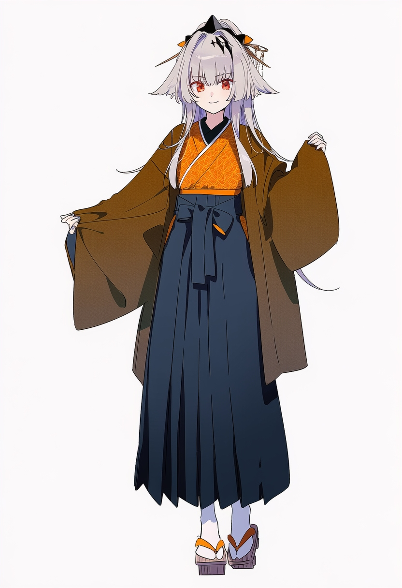

[在线例图](https://assets.quicktagcloud.com/images/raven_composition/raven_composition-6434.jpg?v=9c121bf5ecc22dca)

<a id="raven_composition-6486"></a>

## 凶猛

ID：`raven_composition-6486`；分类：角色图鉴 / 碧蓝航线 / 北方联合；来源标记：`safe`。

来源说明：

> 作品：碧蓝航线
> 角色英文名：Svirepy
> 首次登场时间（国服实装）：2024-02-29
> 阵营：北方联合

正向提示词：

```text
svirepy_(azur_lane)
```

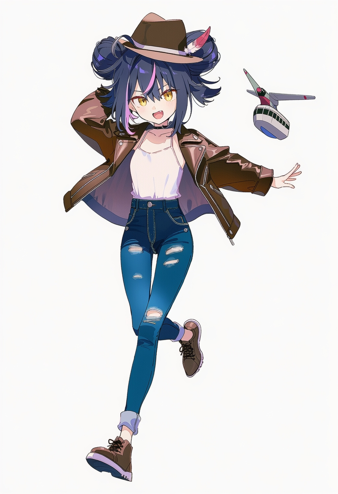

[在线例图](https://assets.quicktagcloud.com/images/raven_composition/raven_composition-6486.jpg?v=11012b86266a9817)

<a id="raven_composition-6487"></a>

## 火力

ID：`raven_composition-6487`；分类：角色图鉴 / 碧蓝航线 / 北方联合；来源标记：`safe`。

来源说明：

> 作品：碧蓝航线
> 角色英文名：Ognevoy
> 首次登场时间（国服实装）：2024-02-29
> 阵营：北方联合

正向提示词：

```text
ognevoy_(azur_lane)
```

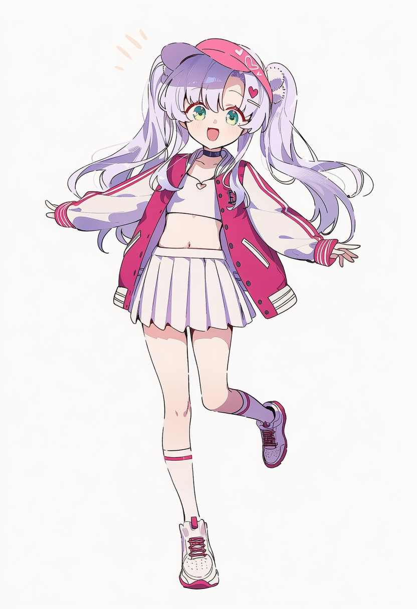

[在线例图](https://assets.quicktagcloud.com/images/raven_composition/raven_composition-6487.jpg?v=042ac865582fda19)

<a id="raven_composition-6489"></a>

## 波尔塔瓦

ID：`raven_composition-6489`；分类：角色图鉴 / 碧蓝航线 / 北方联合；来源标记：`safe`。

来源说明：

> 作品：碧蓝航线
> 角色英文名：Poltava
> 首次登场时间（国服实装）：2024-02-29
> 阵营：北方联合

正向提示词：

```text
poltava_(azur_lane)
```

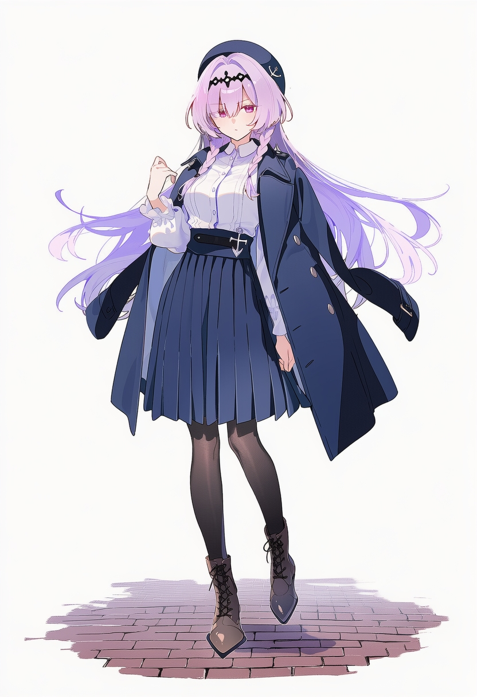

[在线例图](https://assets.quicktagcloud.com/images/raven_composition/raven_composition-6489.jpg?v=fbec38117ebbd5e4)

<a id="raven_composition-6490"></a>

## 苏维埃同盟

ID：`raven_composition-6490`；分类：角色图鉴 / 碧蓝航线 / 北方联合；来源标记：`safe`。

来源说明：

> 作品：碧蓝航线
> 角色英文名：Sovetsky Soyuz
> 首次登场时间（国服实装）：2024-02-29
> 阵营：北方联合

正向提示词：

```text
sovetsky_soyuz_(azur_lane)
```

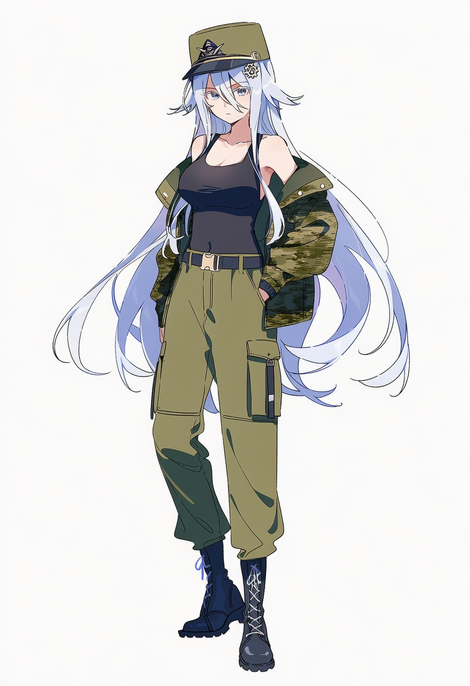

[在线例图](https://assets.quicktagcloud.com/images/raven_composition/raven_composition-6490.jpg?v=c7dbc69bd857a859)

<a id="raven_composition-6520"></a>

## 纳希莫夫海军上将

ID：`raven_composition-6520`；分类：角色图鉴 / 碧蓝航线 / 北方联合；来源标记：`safe`。

来源说明：

> 作品：碧蓝航线
> 角色英文名：Admiral Nakhimov
> 首次登场时间（国服实装）：2024-07-11
> 阵营：北方联合

正向提示词：

```text
admiral_nakhimov_(azur_lane)
```

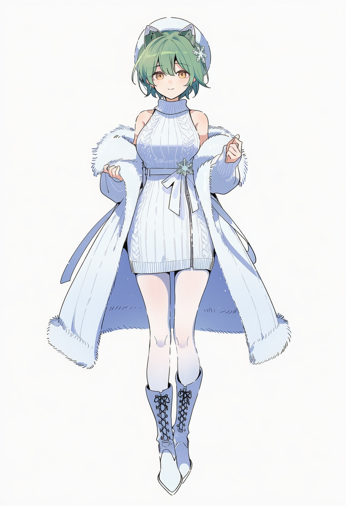

[在线例图](https://assets.quicktagcloud.com/images/raven_composition/raven_composition-6520.jpg?v=c96ddb5e88952574)

<a id="raven_composition-6567"></a>

## 奥列格

ID：`raven_composition-6567`；分类：角色图鉴 / 碧蓝航线 / 北方联合；来源标记：`safe`。

来源说明：

> 作品：碧蓝航线
> 角色英文名：Oleg
> 首次登场时间（国服实装）：2025-04-24
> 阵营：北方联合

正向提示词：

```text
oleg_(azur_lane)
```

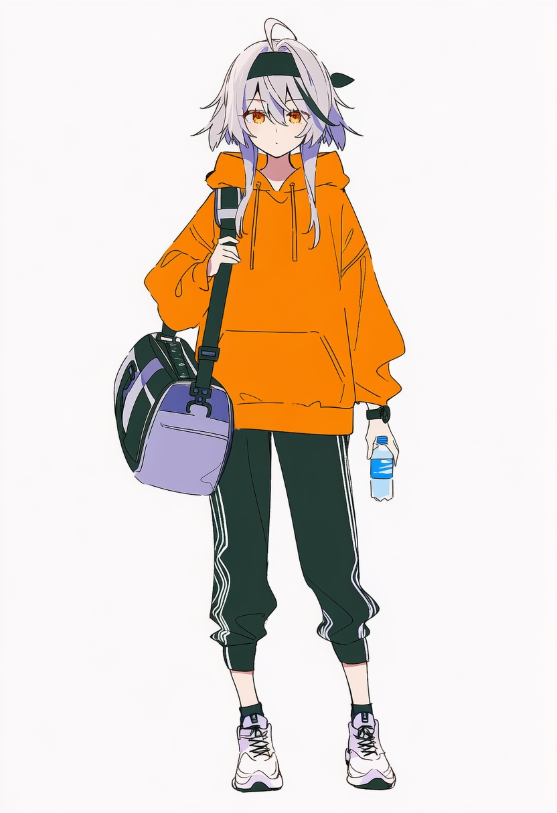

[在线例图](https://assets.quicktagcloud.com/images/raven_composition/raven_composition-6567.jpg?v=1b2d5a8a7c79e042)

<a id="raven_composition-6569"></a>

## 喀山

ID：`raven_composition-6569`；分类：角色图鉴 / 碧蓝航线 / 北方联合；来源标记：`safe`。

来源说明：

> 作品：碧蓝航线
> 角色英文名：Kazan
> 首次登场时间（国服实装）：2025-04-24
> 阵营：北方联合

正向提示词：

```text
kazan_(azur_lane)
```

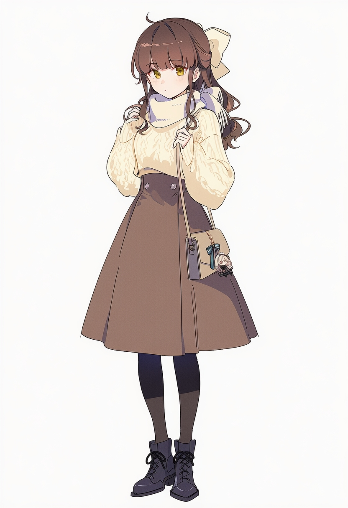

[在线例图](https://assets.quicktagcloud.com/images/raven_composition/raven_composition-6569.jpg?v=bc33f624c2ec75a7)

<a id="raven_composition-6582"></a>

## 迪米特里·顿斯科伊

ID：`raven_composition-6582`；分类：角色图鉴 / 碧蓝航线 / 北方联合；来源标记：`safe`。

来源说明：

> 作品：碧蓝航线
> 角色英文名：Dmitri Donskoi
> 首次登场时间（国服实装）：2025-07-10
> 阵营：北方联合

正向提示词：

```text
dmitri_donskoi_(azur_lane)
```


[在线例图](https://assets.quicktagcloud.com/images/raven_composition/raven_composition-6582.jpg?v=43f332d32f4d437e)

<a id="raven_composition-6618"></a>

## 顽皮

ID：`raven_composition-6618`；分类：角色图鉴 / 碧蓝航线 / 北方联合；来源标记：`safe`。

来源说明：

> 作品：碧蓝航线
> 角色英文名：Ozornoy
> 首次登场时间（国服实装）：2026-02-26
> 阵营：北方联合

正向提示词：

```text
ozornoy_(azur_lane)
```

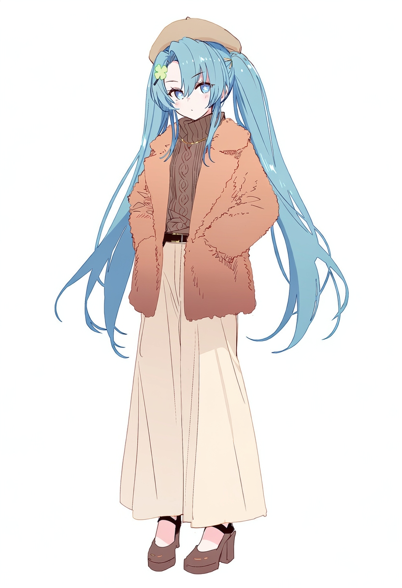

[在线例图](https://assets.quicktagcloud.com/images/raven_composition/raven_composition-6618.jpg?v=ecdcb8a363abcab5)

<a id="raven_composition-6619"></a>

## 博加特里

ID：`raven_composition-6619`；分类：角色图鉴 / 碧蓝航线 / 北方联合；来源标记：`safe`。

来源说明：

> 作品：碧蓝航线
> 角色英文名：Bogatyr
> 首次登场时间（国服实装）：2026-02-26
> 阵营：北方联合

正向提示词：

```text
bogatyr_(azur_lane)
```

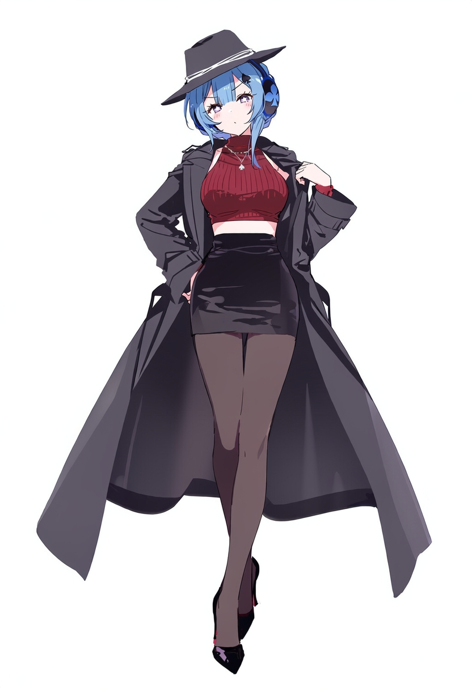

[在线例图](https://assets.quicktagcloud.com/images/raven_composition/raven_composition-6619.jpg?v=a5b6b9c7859f6564)

<a id="raven_composition-6620"></a>

## 红色山脉

ID：`raven_composition-6620`；分类：角色图鉴 / 碧蓝航线 / 北方联合；来源标记：`safe`。

来源说明：

> 作品：碧蓝航线
> 角色英文名：Krasny Kavkaz
> 首次登场时间（国服实装）：2026-02-26
> 阵营：北方联合

正向提示词：

```text
krasny_kavkaz_(azur_lane)
```

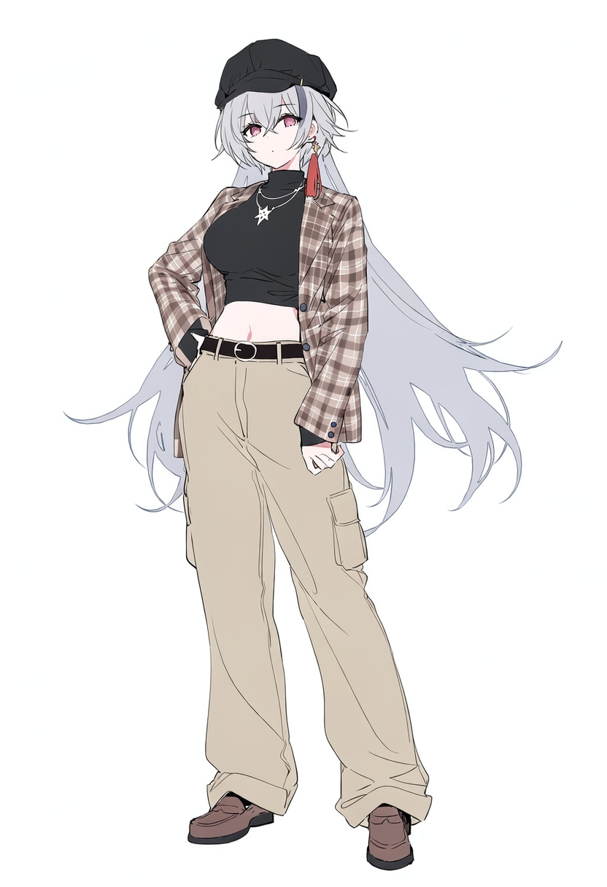

[在线例图](https://assets.quicktagcloud.com/images/raven_composition/raven_composition-6620.jpg?v=7b7cf758c2693db0)

<a id="raven_composition-6621"></a>

## 莫斯科

ID：`raven_composition-6621`；分类：角色图鉴 / 碧蓝航线 / 北方联合；来源标记：`safe`。

来源说明：

> 作品：碧蓝航线
> 角色英文名：Moskva
> 首次登场时间（国服实装）：2026-02-26
> 阵营：北方联合

正向提示词：

```text
moskva_(azur_lane)
```

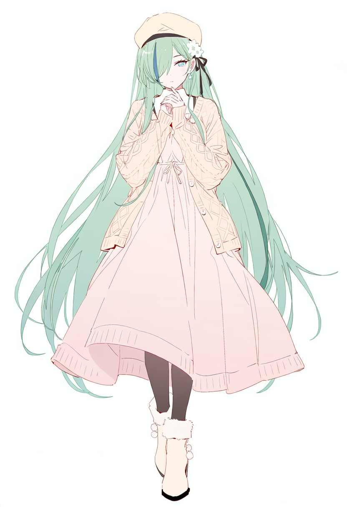

[在线例图](https://assets.quicktagcloud.com/images/raven_composition/raven_composition-6621.jpg?v=5487115bfc59706b)
