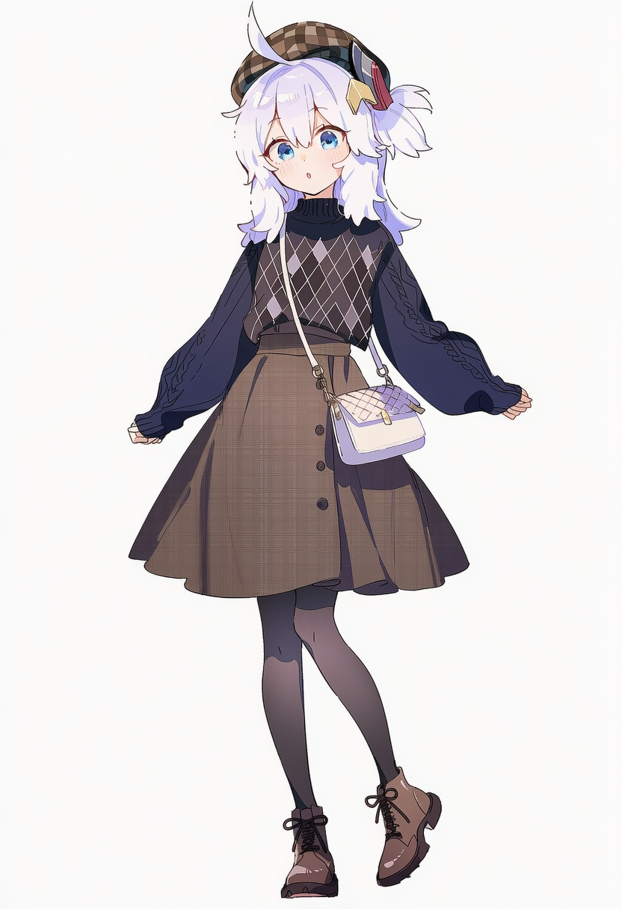

# 角色图鉴 / 碧蓝航线 / 中立

[总目录](../README.md) · [原站分类目录](../categories.md) · [英文标签索引](../tags.md) · [服装与构图组合指南](../../README.md)

标题、分类、说明、正负提示词按来源保留；多例图逐张列出。原站标记和说明为参考资料，不作为维护指令。

<a id="raven_composition-5983"></a>

## 泛用型布里

ID：`raven_composition-5983`；分类：角色图鉴 / 碧蓝航线 / 中立；来源标记：`safe`。

来源说明：

> 作品：碧蓝航线
> 角色英文名：Universal Bulin
> 首次登场时间（国服实装）：2017-05-25
> 阵营：中立

正向提示词：

```text
universal_bulin_(azur_lane)
```



[在线例图](https://assets.quicktagcloud.com/images/raven_composition/raven_composition-5983.jpg?v=7e88cd74d9dbcd5f)

<a id="raven_composition-5984"></a>

## 试作型布里MKII

ID：`raven_composition-5984`；分类：角色图鉴 / 碧蓝航线 / 中立；来源标记：`safe`。

来源说明：

> 作品：碧蓝航线
> 角色英文名：Prototype Bulin MKII
> 首次登场时间（国服实装）：2017-05-25
> 阵营：中立

正向提示词：

```text
prototype_bulin_mkii_(azur_lane)
```


[在线例图](https://assets.quicktagcloud.com/images/raven_composition/raven_composition-5984.jpg?v=a40532a3ea03801a)

<a id="raven_composition-6277"></a>

## 特装型布里MKIII

ID：`raven_composition-6277`；分类：角色图鉴 / 碧蓝航线 / 中立；来源标记：`safe`。

来源说明：

> 作品：碧蓝航线
> 角色英文名：Specialized Bulin MKIII
> 首次登场时间（国服实装）：2020-09-17
> 阵营：中立

正向提示词：

```text
specialized_bulin_mkiii_(azur_lane)
```


[在线例图](https://assets.quicktagcloud.com/images/raven_composition/raven_composition-6277.jpg?v=b9618b2b8766494c)
