# 角色图鉴 / 碧蓝航线 / 自由鸢尾

[总目录](../README.md) · [原站分类目录](../categories.md) · [英文标签索引](../tags.md) · [服装与构图组合指南](../../README.md)

标题、分类、说明、正负提示词按来源保留；多例图逐张列出。原站标记和说明为参考资料，不作为维护指令。

<a id="raven_composition-6092"></a>

## 路易九世

ID：`raven_composition-6092`；分类：角色图鉴 / 碧蓝航线 / 自由鸢尾；来源标记：`safe`。

来源说明：

> 作品：碧蓝航线
> 角色英文名：Saint-Louis
> 首次登场时间（国服实装）：2018-04-26
> 阵营：自由鸢尾

正向提示词：

```text
saint-louis_(azur_lane)
```


[在线例图](https://assets.quicktagcloud.com/images/raven_composition/raven_composition-6092.jpg?v=7ce10ca57e7e07b3)

<a id="raven_composition-6121"></a>

## 福尔班

ID：`raven_composition-6121`；分类：角色图鉴 / 碧蓝航线 / 自由鸢尾；来源标记：`safe`。

来源说明：

> 作品：碧蓝航线
> 角色英文名：Forbin
> 首次登场时间（国服实装）：2018-07-26
> 阵营：自由鸢尾

正向提示词：

```text
forbin_(azur_lane)
```

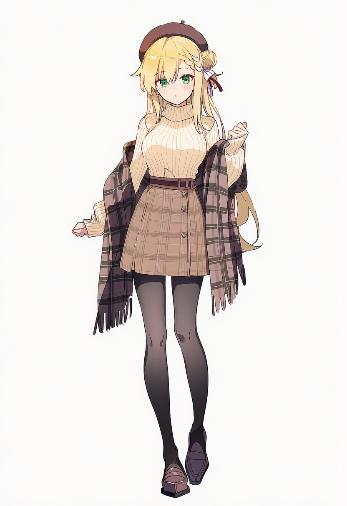

[在线例图](https://assets.quicktagcloud.com/images/raven_composition/raven_composition-6121.jpg?v=b7d7351a2ade1573)

<a id="raven_composition-6123"></a>

## 凯旋

ID：`raven_composition-6123`；分类：角色图鉴 / 碧蓝航线 / 自由鸢尾；来源标记：`safe`。

来源说明：

> 作品：碧蓝航线
> 角色英文名：Le Triomphant
> 首次登场时间（国服实装）：2018-07-26
> 阵营：自由鸢尾

正向提示词：

```text
le_triomphant_(azur_lane)
```

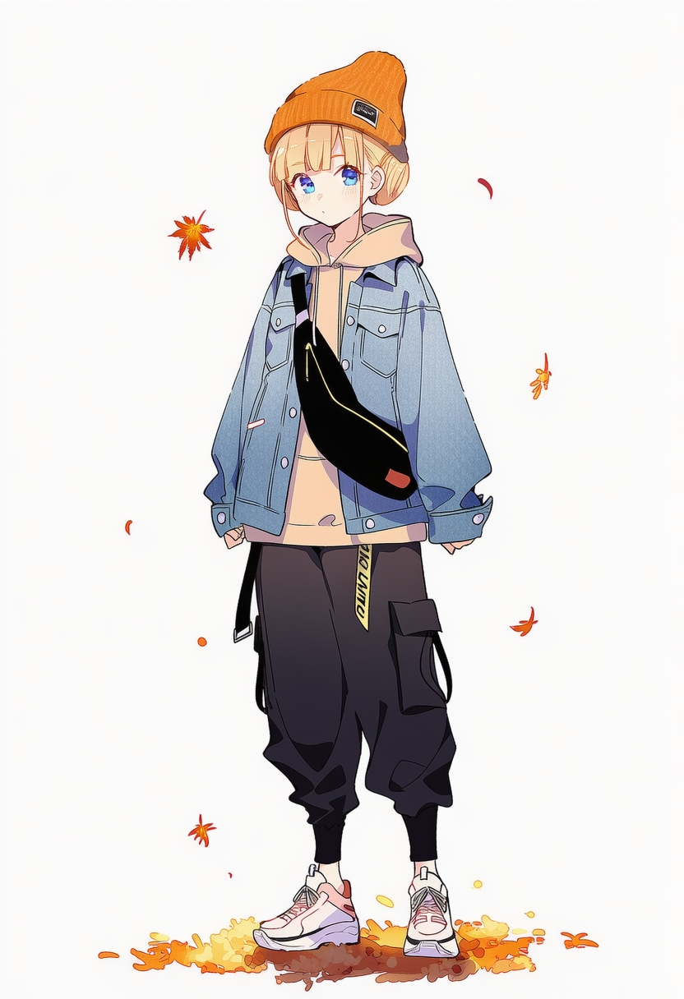

[在线例图](https://assets.quicktagcloud.com/images/raven_composition/raven_composition-6123.jpg?v=4ab3b5cb6292708a)

<a id="raven_composition-6124"></a>

## 埃米尔·贝尔汀

ID：`raven_composition-6124`；分类：角色图鉴 / 碧蓝航线 / 自由鸢尾；来源标记：`safe`。

来源说明：

> 作品：碧蓝航线
> 角色英文名：Émile Bertin
> 首次登场时间（国服实装）：2018-07-26
> 阵营：自由鸢尾

正向提示词：

```text
emile_bertin_(azur_lane)
```

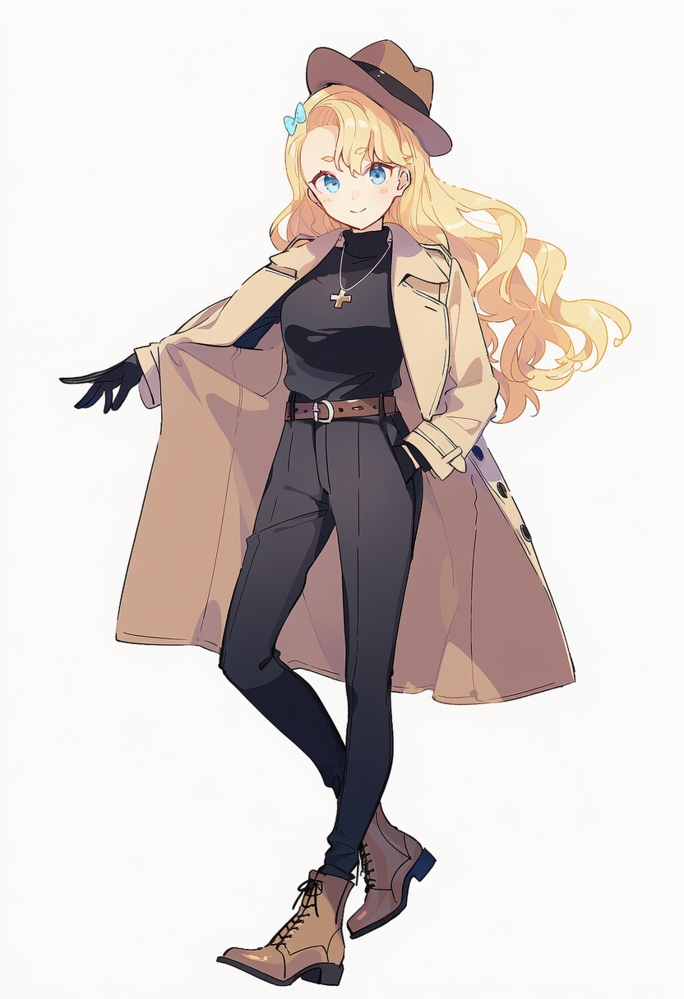

[在线例图](https://assets.quicktagcloud.com/images/raven_composition/raven_composition-6124.jpg?v=fef89ac38d157f78)

<a id="raven_composition-6132"></a>

## 鲁莽

ID：`raven_composition-6132`；分类：角色图鉴 / 碧蓝航线 / 自由鸢尾；来源标记：`safe`。

来源说明：

> 作品：碧蓝航线
> 角色英文名：Le Téméraire
> 首次登场时间（国服实装）：2018-09-14
> 阵营：自由鸢尾

正向提示词：

```text
le_temeraire_(azur_lane)
```

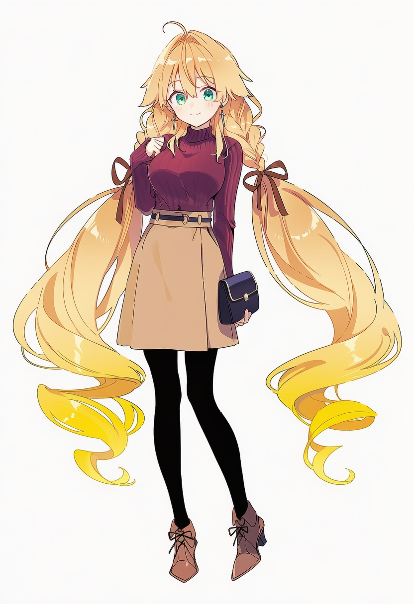

[在线例图](https://assets.quicktagcloud.com/images/raven_composition/raven_composition-6132.jpg?v=ec4c03dc0287d153)

<a id="raven_composition-6187"></a>

## 倔强

ID：`raven_composition-6187`；分类：角色图鉴 / 碧蓝航线 / 自由鸢尾；来源标记：`safe`。

来源说明：

> 作品：碧蓝航线
> 角色英文名：L'Opiniâtre
> 首次登场时间（国服实装）：2019-06-27
> 阵营：自由鸢尾

正向提示词：

```text
l'opiniatre_(azur_lane)
```


[在线例图](https://assets.quicktagcloud.com/images/raven_composition/raven_composition-6187.jpg?v=87f10e4a19ea6e82)

<a id="raven_composition-6251"></a>

## 圣女贞德

ID：`raven_composition-6251`；分类：角色图鉴 / 碧蓝航线 / 自由鸢尾；来源标记：`safe`。

来源说明：

> 作品：碧蓝航线
> 角色英文名：Jeanne d'Arc
> 首次登场时间（国服实装）：2020-05-21
> 阵营：自由鸢尾

正向提示词：

```text
jeanne_d'arc_(azur_lane)
```

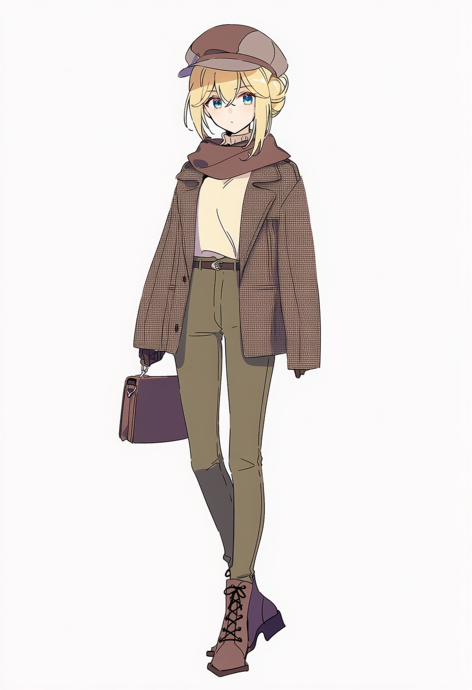

[在线例图](https://assets.quicktagcloud.com/images/raven_composition/raven_composition-6251.jpg?v=38fa7e637e353419)

<a id="raven_composition-6252"></a>

## 阿尔及利亚

ID：`raven_composition-6252`；分类：角色图鉴 / 碧蓝航线 / 自由鸢尾；来源标记：`safe`。

来源说明：

> 作品：碧蓝航线
> 角色英文名：Algérie
> 首次登场时间（国服实装）：2020-05-21
> 阵营：自由鸢尾

正向提示词：

```text
algerie_(azur_lane)
```


[在线例图](https://assets.quicktagcloud.com/images/raven_composition/raven_composition-6252.jpg?v=31297e3629788abd)

<a id="raven_composition-6253"></a>

## 黎塞留

ID：`raven_composition-6253`；分类：角色图鉴 / 碧蓝航线 / 自由鸢尾；来源标记：`safe`。

来源说明：

> 作品：碧蓝航线
> 角色英文名：Richelieu
> 首次登场时间（国服实装）：2020-05-21
> 阵营：自由鸢尾

正向提示词：

```text
richelieu_(azur_lane)
```

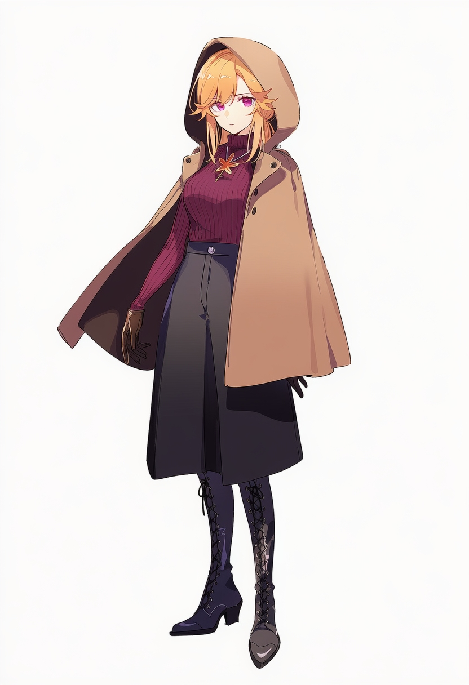

[在线例图](https://assets.quicktagcloud.com/images/raven_composition/raven_composition-6253.jpg?v=d5815dd99ee13382)

<a id="raven_composition-6257"></a>

## 香槟

ID：`raven_composition-6257`；分类：角色图鉴 / 碧蓝航线 / 自由鸢尾；来源标记：`safe`。

来源说明：

> 作品：碧蓝航线
> 角色英文名：Champagne
> 首次登场时间（国服实装）：2020-07-09
> 阵营：自由鸢尾

正向提示词：

```text
champagne_(azur_lane)
```

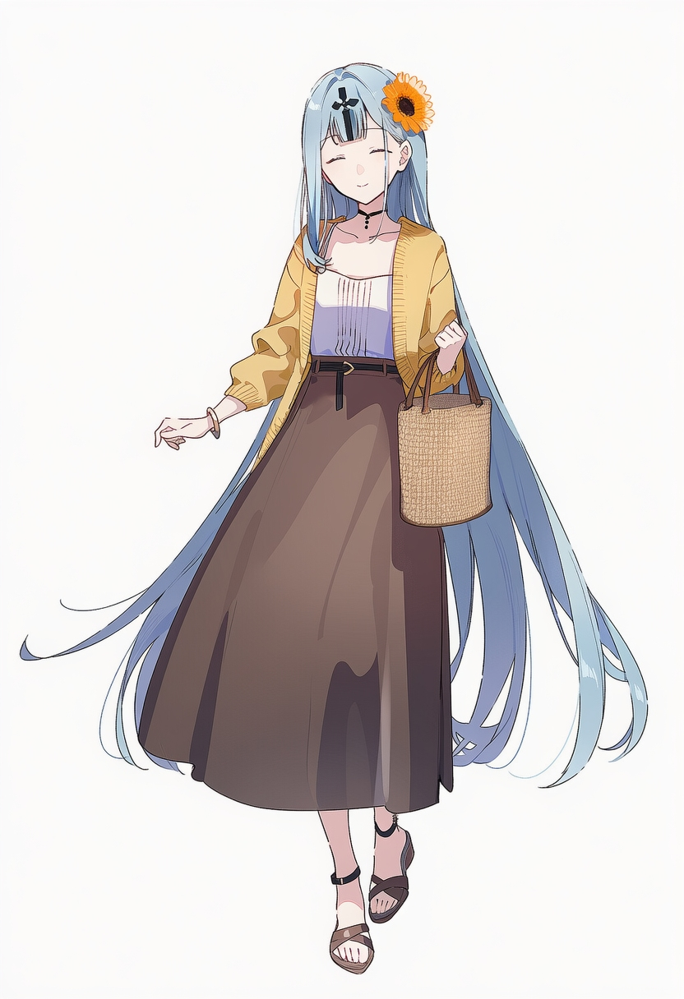

[在线例图](https://assets.quicktagcloud.com/images/raven_composition/raven_composition-6257.jpg?v=9bf0e8a00ac19aa1)

<a id="raven_composition-6346"></a>

## 马耶·布雷泽

ID：`raven_composition-6346`；分类：角色图鉴 / 碧蓝航线 / 自由鸢尾；来源标记：`safe`。

来源说明：

> 作品：碧蓝航线
> 角色英文名：Maillé-Brézé
> 首次登场时间（国服实装）：2021-10-28
> 阵营：自由鸢尾

正向提示词：

```text
maille-breze_(azur_lane)
```

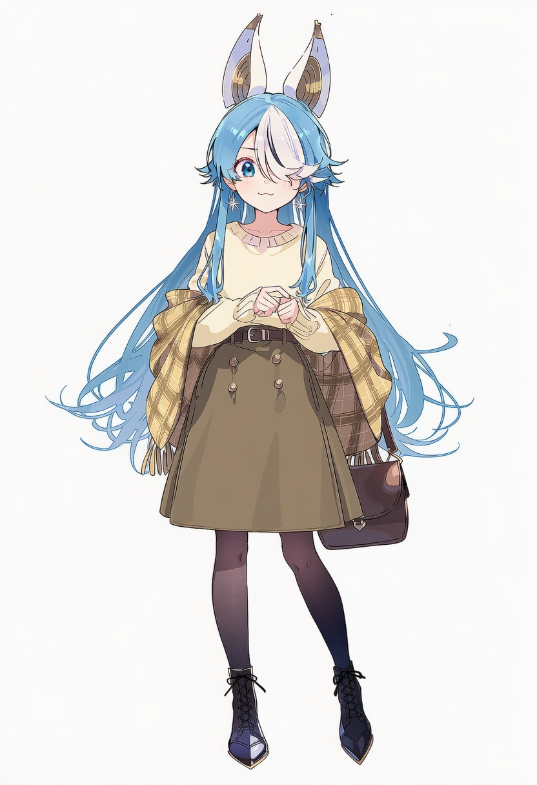

[在线例图](https://assets.quicktagcloud.com/images/raven_composition/raven_composition-6346.jpg?v=ee3f36947c4f9a0a)

<a id="raven_composition-6348"></a>

## 福煦

ID：`raven_composition-6348`；分类：角色图鉴 / 碧蓝航线 / 自由鸢尾；来源标记：`safe`。

来源说明：

> 作品：碧蓝航线
> 角色英文名：Foch
> 首次登场时间（国服实装）：2021-11-11
> 阵营：自由鸢尾

正向提示词：

```text
foch_(azur_lane)
```

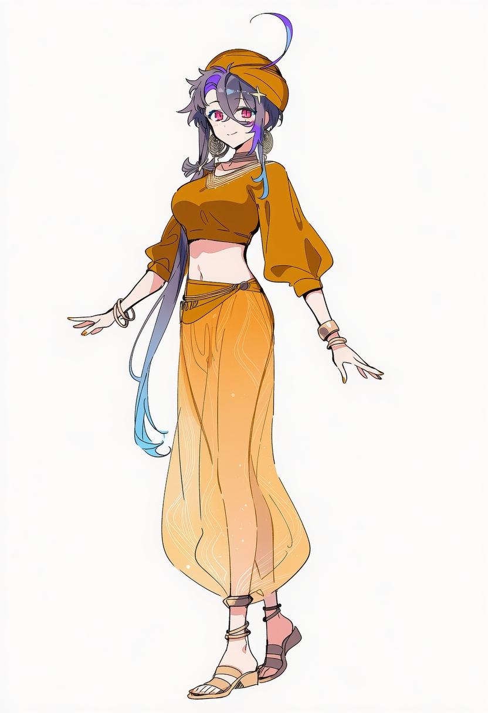

[在线例图](https://assets.quicktagcloud.com/images/raven_composition/raven_composition-6348.jpg?v=8d09bf02767b7d7b)

<a id="raven_composition-6394"></a>

## 布雷斯特

ID：`raven_composition-6394`；分类：角色图鉴 / 碧蓝航线 / 自由鸢尾；来源标记：`safe`。

来源说明：

> 作品：碧蓝航线
> 角色英文名：Brest
> 首次登场时间（国服实装）：2022-07-14
> 阵营：自由鸢尾

正向提示词：

```text
brest_(azur_lane)
```


[在线例图](https://assets.quicktagcloud.com/images/raven_composition/raven_composition-6394.jpg?v=3a67dca733358322)

<a id="raven_composition-6453"></a>

## 马赛曲

ID：`raven_composition-6453`；分类：角色图鉴 / 碧蓝航线 / 自由鸢尾；来源标记：`safe`。

来源说明：

> 作品：碧蓝航线
> 角色英文名：Marseillaise
> 首次登场时间（国服实装）：2023-08-03
> 阵营：自由鸢尾

正向提示词：

```text
marseillaise_(azur_lane)
```

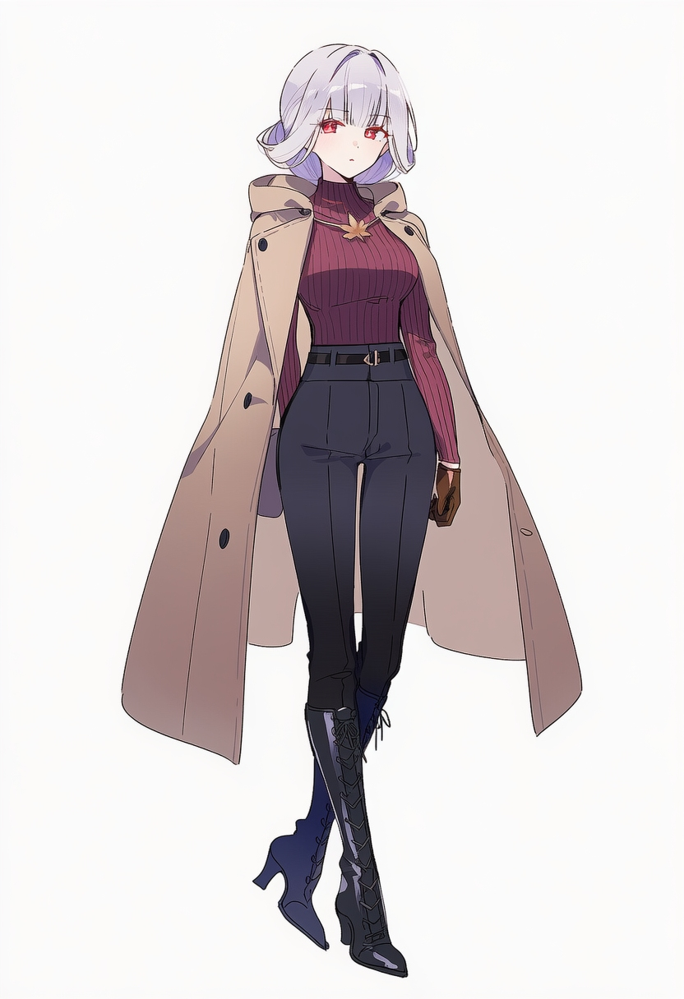

[在线例图](https://assets.quicktagcloud.com/images/raven_composition/raven_composition-6453.jpg?v=b217b0ddfc6e04dc)

<a id="raven_composition-6455"></a>

## 吉尚

ID：`raven_composition-6455`；分类：角色图鉴 / 碧蓝航线 / 自由鸢尾；来源标记：`safe`。

来源说明：

> 作品：碧蓝航线
> 角色英文名：Guichen
> 首次登场时间（国服实装）：2023-08-17
> 阵营：自由鸢尾

正向提示词：

```text
guichen_(azur_lane)
```


[在线例图](https://assets.quicktagcloud.com/images/raven_composition/raven_composition-6455.jpg?v=4d3bcd9e591e2175)

<a id="raven_composition-6456"></a>

## 叙弗朗

ID：`raven_composition-6456`；分类：角色图鉴 / 碧蓝航线 / 自由鸢尾；来源标记：`safe`。

来源说明：

> 作品：碧蓝航线
> 角色英文名：Suffren
> 首次登场时间（国服实装）：2023-08-17
> 阵营：自由鸢尾

正向提示词：

```text
suffren_(azur_lane)
```


[在线例图](https://assets.quicktagcloud.com/images/raven_composition/raven_composition-6456.jpg?v=3832262e7b20515e)

<a id="raven_composition-6457"></a>

## 里昂

ID：`raven_composition-6457`；分类：角色图鉴 / 碧蓝航线 / 自由鸢尾；来源标记：`safe`。

来源说明：

> 作品：碧蓝航线
> 角色英文名：Lyon
> 首次登场时间（国服实装）：2023-08-17
> 阵营：自由鸢尾

正向提示词：

```text
lyon_(azur_lane)
```

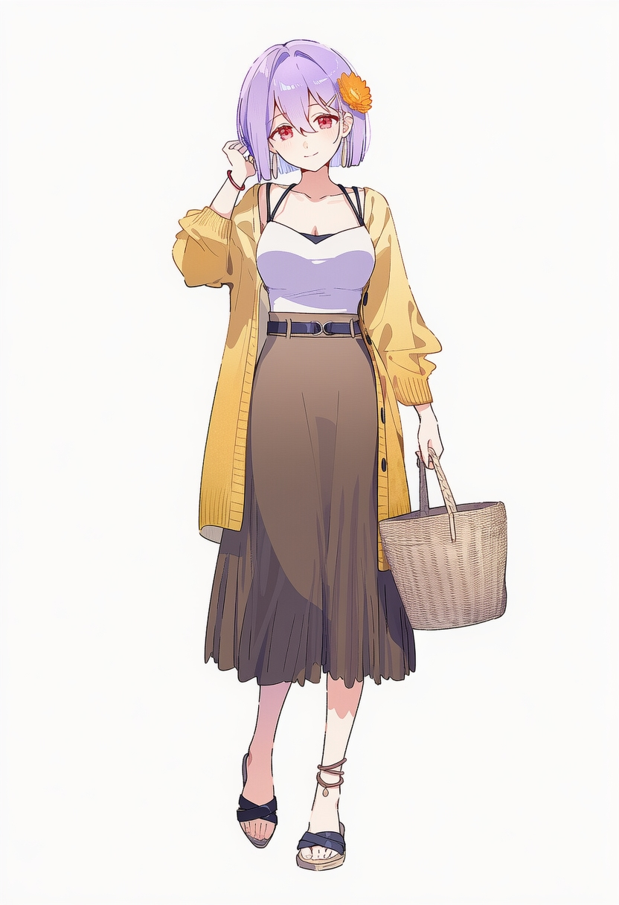

[在线例图](https://assets.quicktagcloud.com/images/raven_composition/raven_composition-6457.jpg?v=f98209bf9c1b65ce)

<a id="raven_composition-6504"></a>

## 重剑

ID：`raven_composition-6504`；分类：角色图鉴 / 碧蓝航线 / 自由鸢尾；来源标记：`safe`。

来源说明：

> 作品：碧蓝航线
> 角色英文名：Épée
> 首次登场时间（国服实装）：2024-05-21
> 阵营：自由鸢尾

正向提示词：

```text
epee_(azur_lane)
```

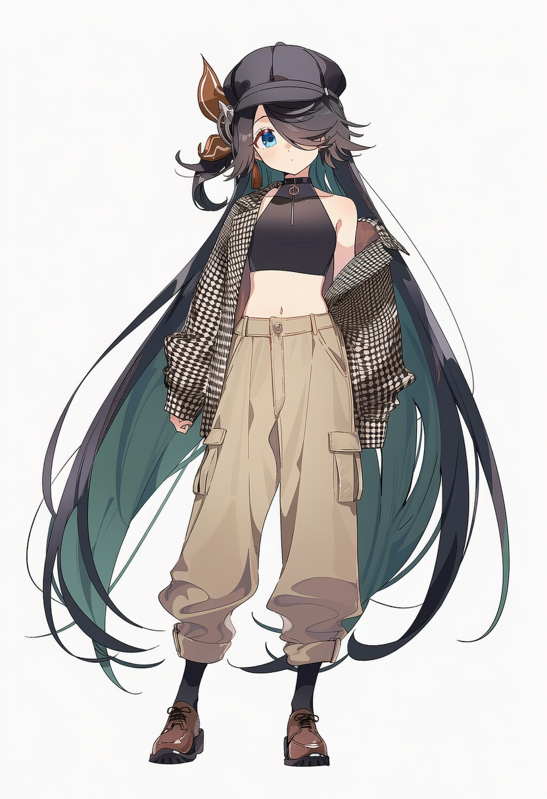

[在线例图](https://assets.quicktagcloud.com/images/raven_composition/raven_composition-6504.jpg?v=b6b7abede170d2aa)

<a id="raven_composition-6505"></a>

## 花剑

ID：`raven_composition-6505`；分类：角色图鉴 / 碧蓝航线 / 自由鸢尾；来源标记：`safe`。

来源说明：

> 作品：碧蓝航线
> 角色英文名：Fleuret
> 首次登场时间（国服实装）：2024-05-21
> 阵营：自由鸢尾

正向提示词：

```text
fleuret_(azur_lane)
```


[在线例图](https://assets.quicktagcloud.com/images/raven_composition/raven_composition-6505.jpg?v=5ba529c50b90d130)

<a id="raven_composition-6507"></a>

## 布伦努斯

ID：`raven_composition-6507`；分类：角色图鉴 / 碧蓝航线 / 自由鸢尾；来源标记：`safe`。

来源说明：

> 作品：碧蓝航线
> 角色英文名：Brennus
> 首次登场时间（国服实装）：2024-05-21
> 阵营：自由鸢尾

正向提示词：

```text
brennus_(azur_lane)
```

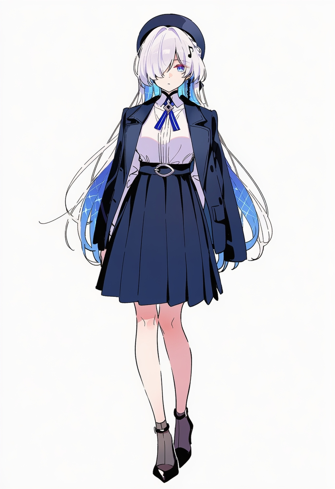

[在线例图](https://assets.quicktagcloud.com/images/raven_composition/raven_composition-6507.jpg?v=916b4fbcd2136812)

<a id="raven_composition-6508"></a>

## 阿尔萨斯

ID：`raven_composition-6508`；分类：角色图鉴 / 碧蓝航线 / 自由鸢尾；来源标记：`safe`。

来源说明：

> 作品：碧蓝航线
> 角色英文名：Alsace
> 首次登场时间（国服实装）：2024-05-21
> 阵营：自由鸢尾

正向提示词：

```text
alsace_(azur_lane)
```

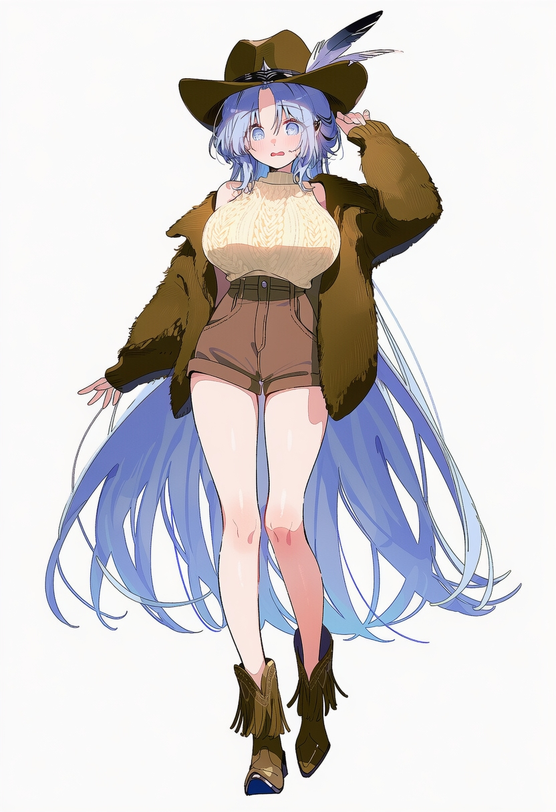

[在线例图](https://assets.quicktagcloud.com/images/raven_composition/raven_composition-6508.jpg?v=af81086955e2a697)

<a id="raven_composition-6517"></a>

## 贝亚德

ID：`raven_composition-6517`；分类：角色图鉴 / 碧蓝航线 / 自由鸢尾；来源标记：`safe`。

来源说明：

> 作品：碧蓝航线
> 角色英文名：Bayard
> 首次登场时间（国服实装）：2024-07-11
> 阵营：自由鸢尾

正向提示词：

```text
bayard_(azur_lane)
```

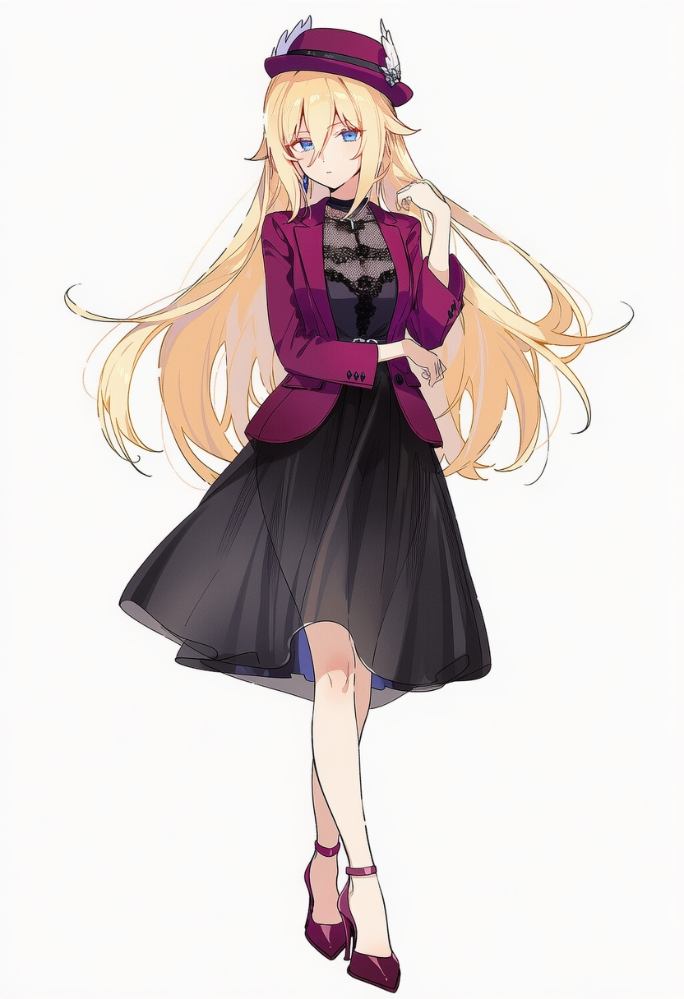

[在线例图](https://assets.quicktagcloud.com/images/raven_composition/raven_composition-6517.jpg?v=170cb8f98c5f8659)

<a id="raven_composition-6523"></a>

## 迪普莱克斯

ID：`raven_composition-6523`；分类：角色图鉴 / 碧蓝航线 / 自由鸢尾；来源标记：`safe`。

来源说明：

> 作品：碧蓝航线
> 角色英文名：Dupleix
> 首次登场时间（国服实装）：2024-07-25
> 阵营：自由鸢尾

正向提示词：

```text
dupleix_(azur_lane)
```

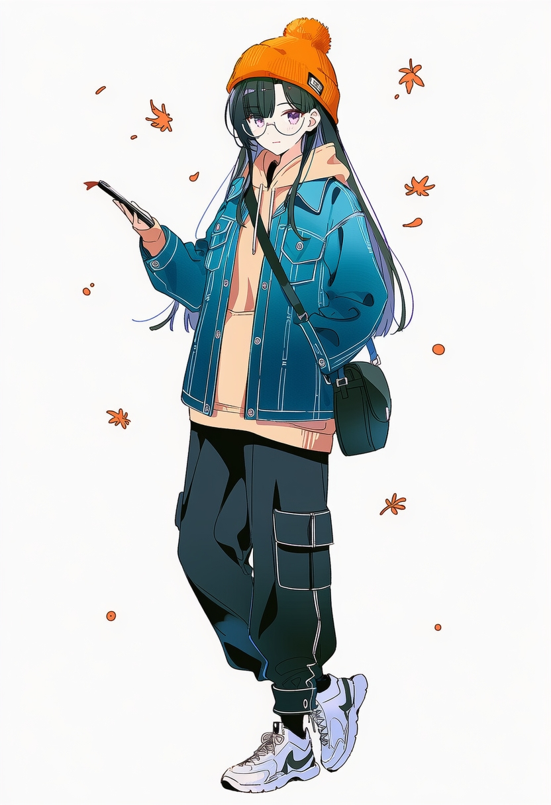

[在线例图](https://assets.quicktagcloud.com/images/raven_composition/raven_composition-6523.jpg?v=12a63edb4933e788)

<a id="raven_composition-6590"></a>

## 迪凯纳

ID：`raven_composition-6590`；分类：角色图鉴 / 碧蓝航线 / 自由鸢尾；来源标记：`safe`。

来源说明：

> 作品：碧蓝航线
> 角色英文名：Duquesne
> 首次登场时间（国服实装）：2025-08-14
> 阵营：自由鸢尾

正向提示词：

```text
duquesne_(azur_lane)
```


[在线例图](https://assets.quicktagcloud.com/images/raven_composition/raven_composition-6590.jpg?v=e3aedc48d2d6e4c1)

<a id="raven_composition-6591"></a>

## 马塞纳

ID：`raven_composition-6591`；分类：角色图鉴 / 碧蓝航线 / 自由鸢尾；来源标记：`safe`。

来源说明：

> 作品：碧蓝航线
> 角色英文名：Masséna
> 首次登场时间（国服实装）：2025-08-14
> 阵营：自由鸢尾

正向提示词：

```text
massena_(azur_lane)
```


[在线例图](https://assets.quicktagcloud.com/images/raven_composition/raven_composition-6591.jpg?v=2fbbd1ee1231f5f7)

<a id="raven_composition-6592"></a>

## 贝劳森林

ID：`raven_composition-6592`；分类：角色图鉴 / 碧蓝航线 / 自由鸢尾；来源标记：`safe`。

来源说明：

> 作品：碧蓝航线
> 角色英文名：Bois Belleau
> 首次登场时间（国服实装）：2025-08-14
> 阵营：自由鸢尾

正向提示词：

```text
bois_belleau_(azur_lane)
```

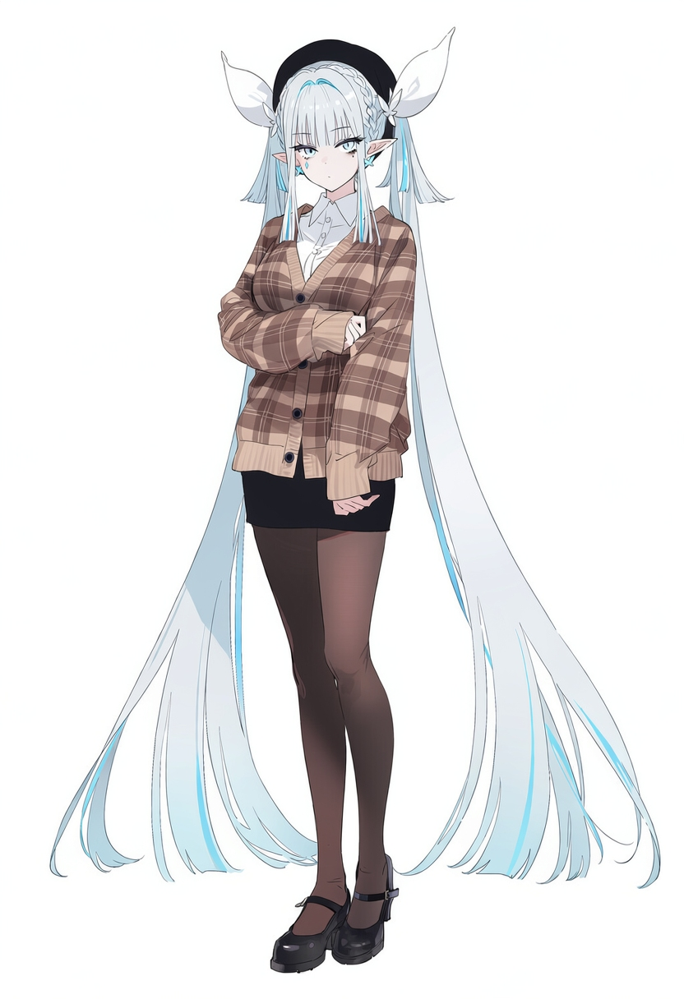

[在线例图](https://assets.quicktagcloud.com/images/raven_composition/raven_composition-6592.jpg?v=ca124e80c2ce131c)

<a id="raven_composition-6632"></a>

## 阿罗芒什

ID：`raven_composition-6632`；分类：角色图鉴 / 碧蓝航线 / 自由鸢尾；来源标记：`safe`。

来源说明：

> 作品：碧蓝航线
> 角色英文名：Arromanches
> 首次登场时间（国服实装）：2026-06-25
> 阵营：自由鸢尾

正向提示词：

```text
arromanches_(azur_lane)
```

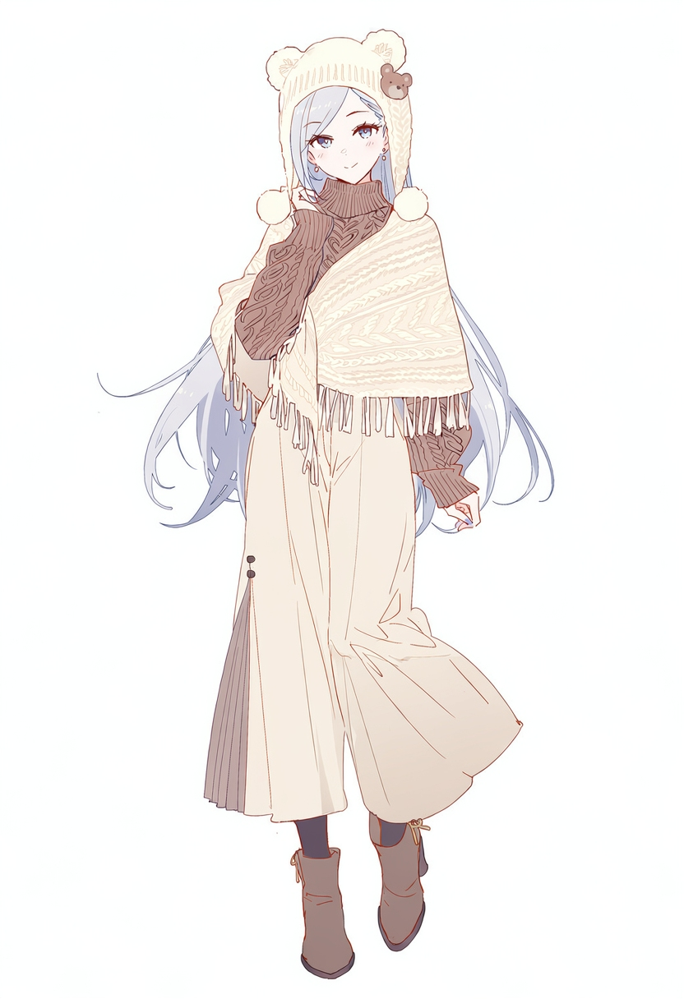

[在线例图](https://assets.quicktagcloud.com/images/raven_composition/raven_composition-6632.jpg?v=a54c7a5b0c9c2b1c)
