# 角色图鉴 / 碧蓝航线 / 维希教廷

[总目录](../README.md) · [原站分类目录](../categories.md) · [英文标签索引](../tags.md) · [服装与构图组合指南](../../README.md)

标题、分类、说明、正负提示词按来源保留；多例图逐张列出。原站标记和说明为参考资料，不作为维护指令。

<a id="raven_composition-6122"></a>

## 勒马尔

ID：`raven_composition-6122`；分类：角色图鉴 / 碧蓝航线 / 维希教廷；来源标记：`safe`。

来源说明：

> 作品：碧蓝航线
> 角色英文名：Le Mars
> 首次登场时间（国服实装）：2018-07-26
> 阵营：维希教廷

正向提示词：

```text
le_mars_(azur_lane)
```


[在线例图](https://assets.quicktagcloud.com/images/raven_composition/raven_composition-6122.jpg?v=944045d94aa71535)

<a id="raven_composition-6125"></a>

## 敦刻尔克

ID：`raven_composition-6125`；分类：角色图鉴 / 碧蓝航线 / 维希教廷；来源标记：`safe`。

来源说明：

> 作品：碧蓝航线
> 角色英文名：Dunkerque
> 首次登场时间（国服实装）：2018-07-26
> 阵营：维希教廷

正向提示词：

```text
dunkerque_(azur_lane)
```

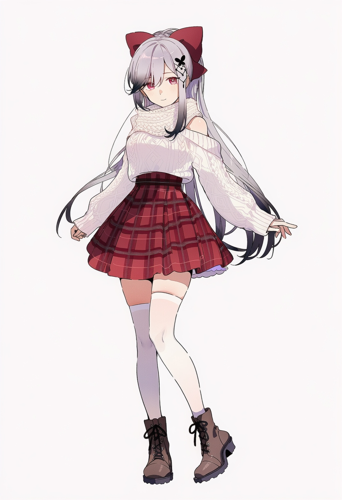

[在线例图](https://assets.quicktagcloud.com/images/raven_composition/raven_composition-6125.jpg?v=8486b554c43d8ad2)

<a id="raven_composition-6126"></a>

## 让·巴尔

ID：`raven_composition-6126`；分类：角色图鉴 / 碧蓝航线 / 维希教廷；来源标记：`safe`。

来源说明：

> 作品：碧蓝航线
> 角色英文名：Jean Bart
> 首次登场时间（国服实装）：2018-07-26
> 阵营：维希教廷

正向提示词：

```text
jean_bart_(azur_lane)
```

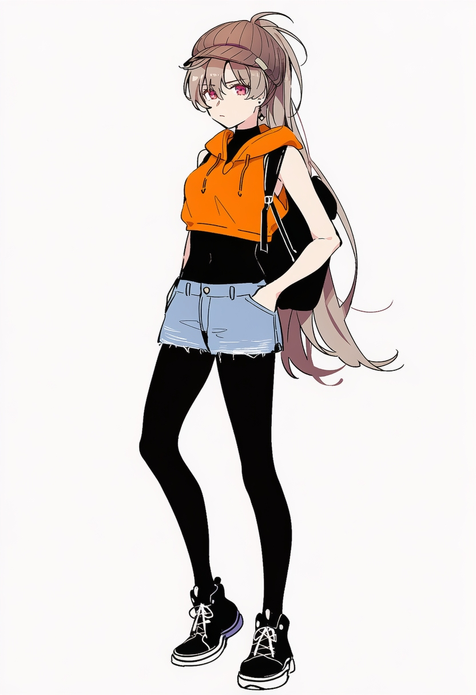

[在线例图](https://assets.quicktagcloud.com/images/raven_composition/raven_composition-6126.jpg?v=d0e7598e5cbea41c)

<a id="raven_composition-6167"></a>

## 加斯科涅

ID：`raven_composition-6167`；分类：角色图鉴 / 碧蓝航线 / 维希教廷；来源标记：`safe`。

来源说明：

> 作品：碧蓝航线
> 角色英文名：Gascogne
> 首次登场时间（国服实装）：2019-04-18
> 阵营：维希教廷

正向提示词：

```text
gascogne_(azur_lane)
```


[在线例图](https://assets.quicktagcloud.com/images/raven_composition/raven_composition-6167.jpg?v=1b17ffdabf4b1dc1)

<a id="raven_composition-6188"></a>

## 恶毒

ID：`raven_composition-6188`；分类：角色图鉴 / 碧蓝航线 / 维希教廷；来源标记：`safe`。

来源说明：

> 作品：碧蓝航线
> 角色英文名：Le Malin
> 首次登场时间（国服实装）：2019-06-27
> 阵营：维希教廷

正向提示词：

```text
le_malin_(azur_lane)
```

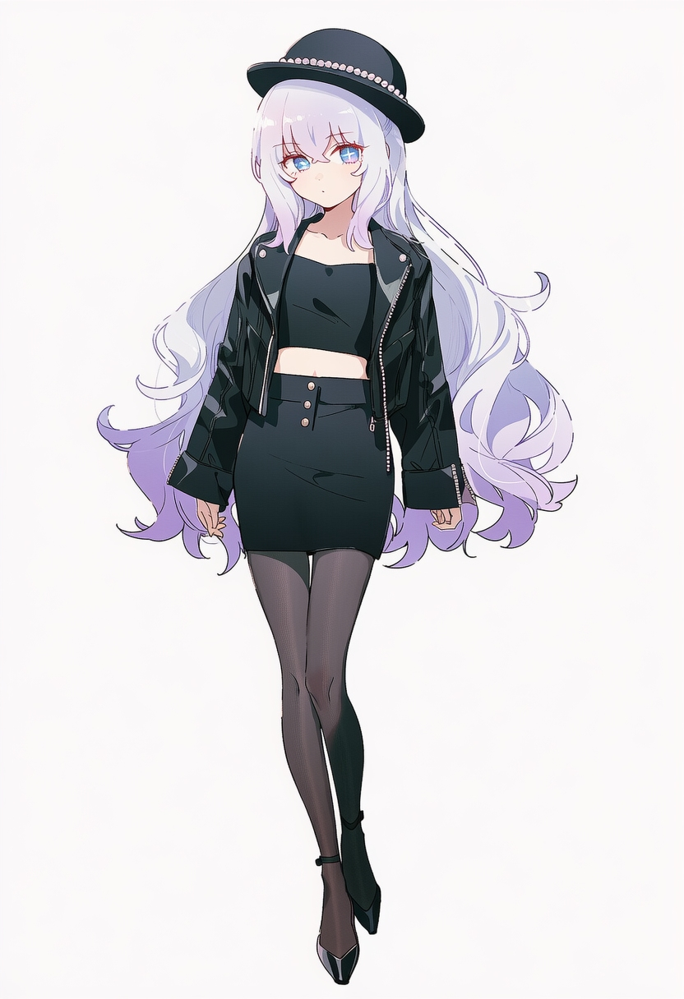

[在线例图](https://assets.quicktagcloud.com/images/raven_composition/raven_composition-6188.jpg?v=fb3ef29dcb6217b1)

<a id="raven_composition-6217"></a>

## 加斯科涅μ

ID：`raven_composition-6217`；分类：角色图鉴 / 碧蓝航线 / 维希教廷；来源标记：`safe`。

来源说明：

> 作品：碧蓝航线
> 角色英文名：Gascogne µ
> 首次登场时间（国服实装）：2019-10-31
> 阵营：维希教廷

正向提示词：

```text
gascogne_(muse)_(azur_lane)
```

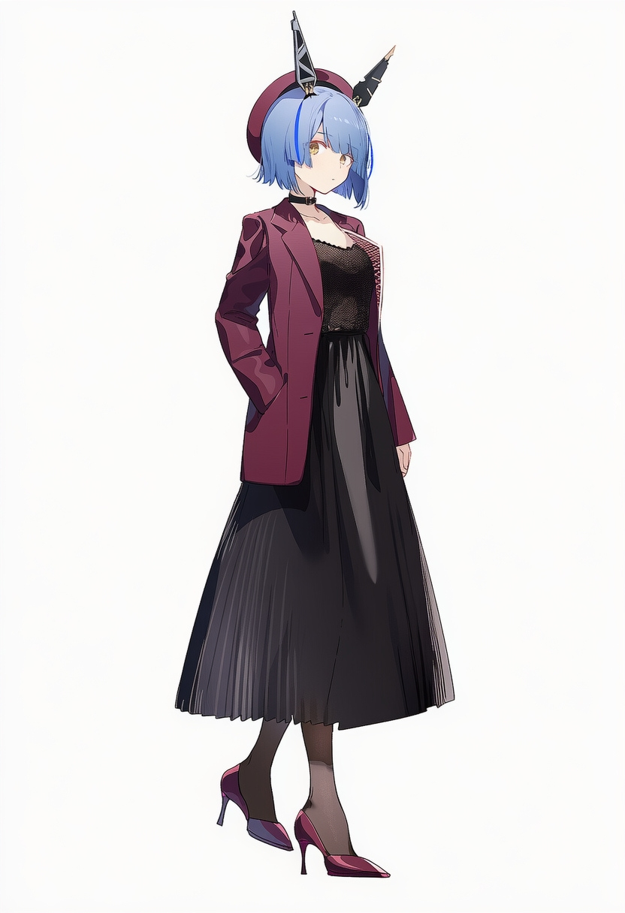

[在线例图](https://assets.quicktagcloud.com/images/raven_composition/raven_composition-6217.jpg?v=e802f82a3d30ba5c)

<a id="raven_composition-6248"></a>

## 塔尔图

ID：`raven_composition-6248`；分类：角色图鉴 / 碧蓝航线 / 维希教廷；来源标记：`safe`。

来源说明：

> 作品：碧蓝航线
> 角色英文名：Tartu
> 首次登场时间（国服实装）：2020-05-07
> 阵营：维希教廷

正向提示词：

```text
tartu_(azur_lane)
```

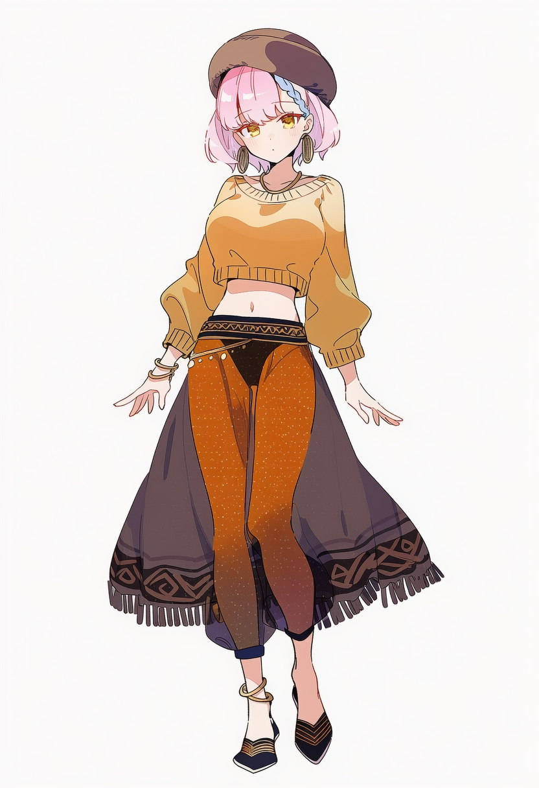

[在线例图](https://assets.quicktagcloud.com/images/raven_composition/raven_composition-6248.jpg?v=77a72c87268d5fcf)

<a id="raven_composition-6249"></a>

## 沃克兰

ID：`raven_composition-6249`；分类：角色图鉴 / 碧蓝航线 / 维希教廷；来源标记：`safe`。

来源说明：

> 作品：碧蓝航线
> 角色英文名：Vauquelin
> 首次登场时间（国服实装）：2020-05-21
> 阵营：维希教廷

正向提示词：

```text
vauquelin_(azur_lane)
```

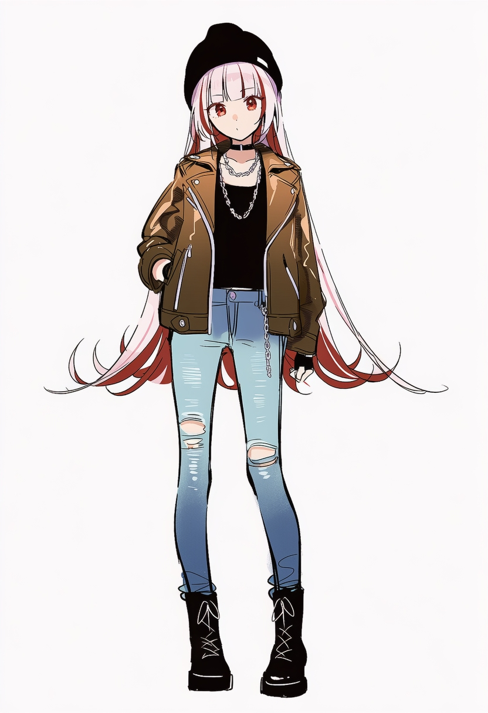

[在线例图](https://assets.quicktagcloud.com/images/raven_composition/raven_composition-6249.jpg?v=f45270d84b086ea8)

<a id="raven_composition-6254"></a>

## 贝亚恩

ID：`raven_composition-6254`；分类：角色图鉴 / 碧蓝航线 / 维希教廷；来源标记：`safe`。

来源说明：

> 作品：碧蓝航线
> 角色英文名：Béarn
> 首次登场时间（国服实装）：2020-05-21
> 阵营：维希教廷

正向提示词：

```text
bearn_(azur_lane)
```

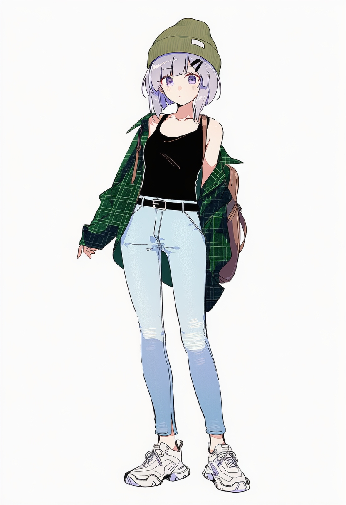

[在线例图](https://assets.quicktagcloud.com/images/raven_composition/raven_composition-6254.jpg?v=0ae794dee1c684b7)

<a id="raven_composition-6347"></a>

## 可怖

ID：`raven_composition-6347`；分类：角色图鉴 / 碧蓝航线 / 维希教廷；来源标记：`safe`。

来源说明：

> 作品：碧蓝航线
> 角色英文名：Le Terrible
> 首次登场时间（国服实装）：2021-10-28
> 阵营：维希教廷

正向提示词：

```text
le_terrible_(azur_lane)
```

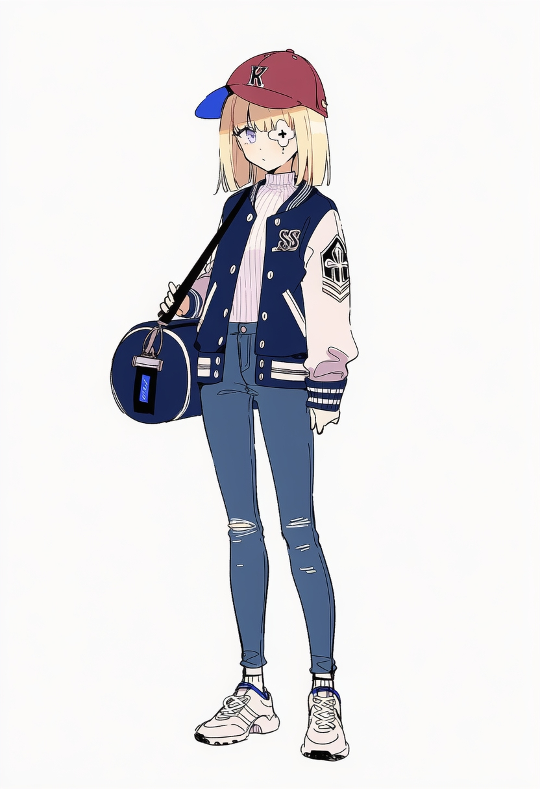

[在线例图](https://assets.quicktagcloud.com/images/raven_composition/raven_composition-6347.jpg?v=bb6a56415ca11407)

<a id="raven_composition-6388"></a>

## 不屈

ID：`raven_composition-6388`；分类：角色图鉴 / 碧蓝航线 / 维希教廷；来源标记：`safe`。

来源说明：

> 作品：碧蓝航线
> 角色英文名：L'Indomptable
> 首次登场时间（国服实装）：2022-06-30
> 阵营：维希教廷

正向提示词：

```text
l'indomptable_(azur_lane)
```

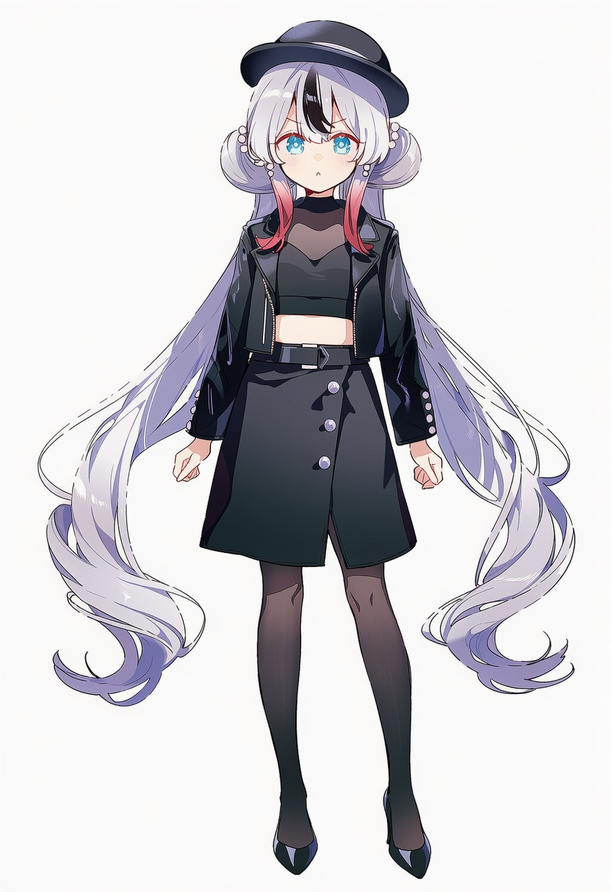

[在线例图](https://assets.quicktagcloud.com/images/raven_composition/raven_composition-6388.jpg?v=e0d273e4a7b97375)

<a id="raven_composition-6390"></a>

## 霞飞

ID：`raven_composition-6390`；分类：角色图鉴 / 碧蓝航线 / 维希教廷；来源标记：`safe`。

来源说明：

> 作品：碧蓝航线
> 角色英文名：Joffre
> 首次登场时间（国服实装）：2022-06-30
> 阵营：维希教廷

正向提示词：

```text
joffre_(azur_lane)
```

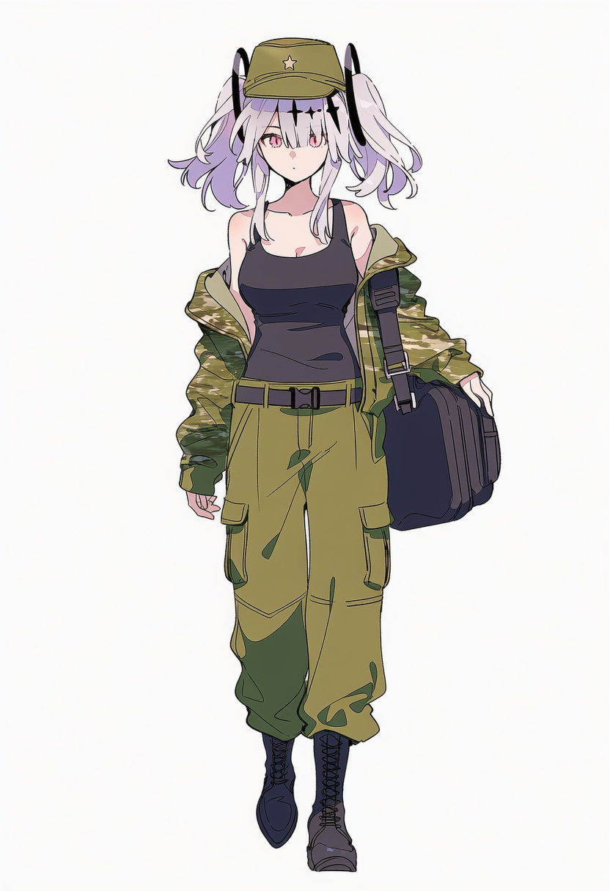

[在线例图](https://assets.quicktagcloud.com/images/raven_composition/raven_composition-6390.jpg?v=351fbcb36ea11502)

<a id="raven_composition-6454"></a>

## 凯尔圣

ID：`raven_composition-6454`；分类：角色图鉴 / 碧蓝航线 / 维希教廷；来源标记：`safe`。

来源说明：

> 作品：碧蓝航线
> 角色英文名：Kersaint
> 首次登场时间（国服实装）：2023-08-17
> 阵营：维希教廷

正向提示词：

```text
kersaint_(azur_lane)
```

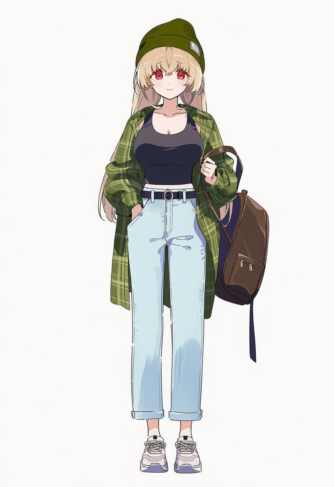

[在线例图](https://assets.quicktagcloud.com/images/raven_composition/raven_composition-6454.jpg?v=e8986e96db467ca5)

<a id="raven_composition-6458"></a>

## 克莱蒙梭

ID：`raven_composition-6458`；分类：角色图鉴 / 碧蓝航线 / 维希教廷；来源标记：`safe`。

来源说明：

> 作品：碧蓝航线
> 角色英文名：Clemenceau
> 首次登场时间（国服实装）：2023-08-17
> 阵营：维希教廷

正向提示词：

```text
clemenceau_(azur_lane)
```

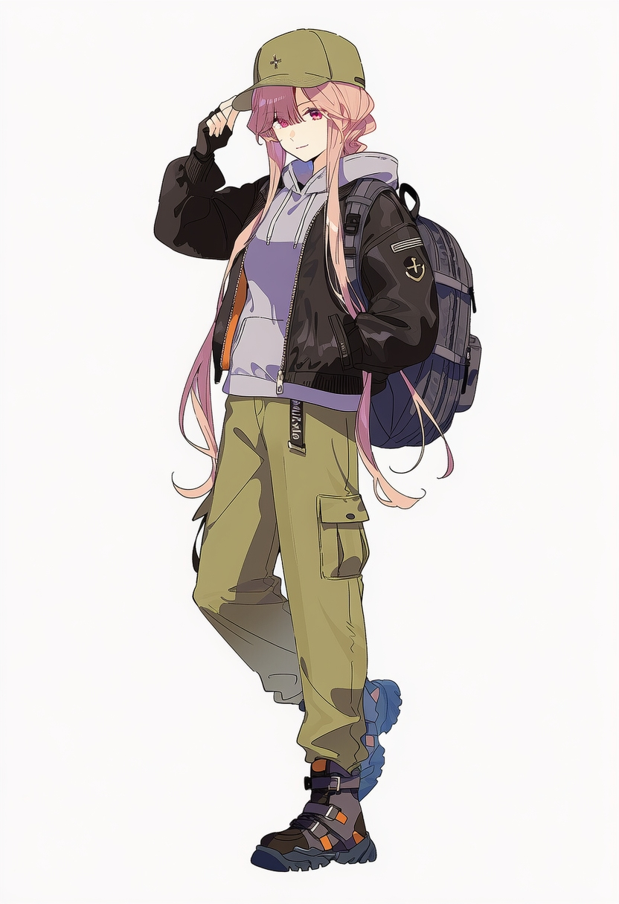

[在线例图](https://assets.quicktagcloud.com/images/raven_composition/raven_composition-6458.jpg?v=c843cfd0106a850a)

<a id="raven_composition-6459"></a>

## 伴尔维

ID：`raven_composition-6459`；分类：角色图鉴 / 碧蓝航线 / 维希教廷；来源标记：`safe`。

来源说明：

> 作品：碧蓝航线
> 角色英文名：Painlevé
> 首次登场时间（国服实装）：2023-08-17
> 阵营：维希教廷

正向提示词：

```text
painleve_(azur_lane)
```

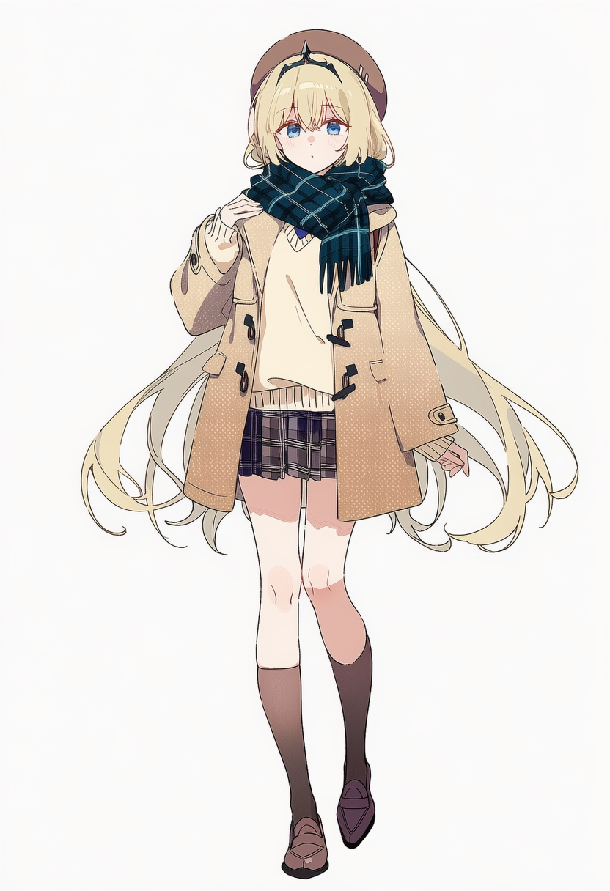

[在线例图](https://assets.quicktagcloud.com/images/raven_composition/raven_composition-6459.jpg?v=6348fa6d5aa273d5)

<a id="raven_composition-6506"></a>

## 莫加多尔

ID：`raven_composition-6506`；分类：角色图鉴 / 碧蓝航线 / 维希教廷；来源标记：`safe`。

来源说明：

> 作品：碧蓝航线
> 角色英文名：Mogador
> 首次登场时间（国服实装）：2024-05-21
> 阵营：维希教廷

正向提示词：

```text
mogador_(azur_lane)
```

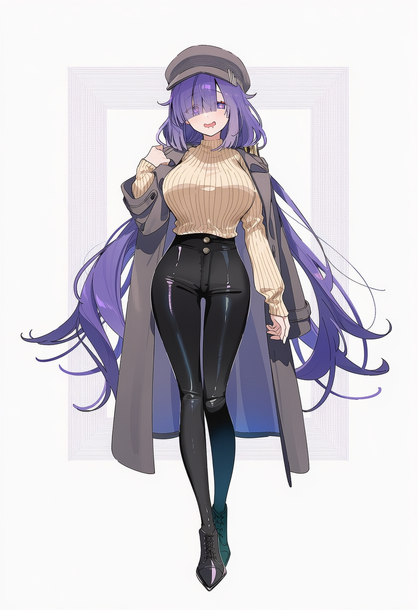

[在线例图](https://assets.quicktagcloud.com/images/raven_composition/raven_composition-6506.jpg?v=98b619daaace6500)

<a id="raven_composition-6522"></a>

## 果敢

ID：`raven_composition-6522`；分类：角色图鉴 / 碧蓝航线 / 维希教廷；来源标记：`safe`。

来源说明：

> 作品：碧蓝航线
> 角色英文名：L'Audacieux
> 首次登场时间（国服实装）：2024-07-25
> 阵营：维希教廷

正向提示词：

```text
l'audacieux_(azur_lane)
```


[在线例图](https://assets.quicktagcloud.com/images/raven_composition/raven_composition-6522.jpg?v=21db1350414a035d)

<a id="raven_composition-6524"></a>

## 斯特拉斯堡

ID：`raven_composition-6524`；分类：角色图鉴 / 碧蓝航线 / 维希教廷；来源标记：`safe`。

来源说明：

> 作品：碧蓝航线
> 角色英文名：Strasbourg
> 首次登场时间（国服实装）：2024-07-25
> 阵营：维希教廷

正向提示词：

```text
strasbourg_(azur_lane)
```

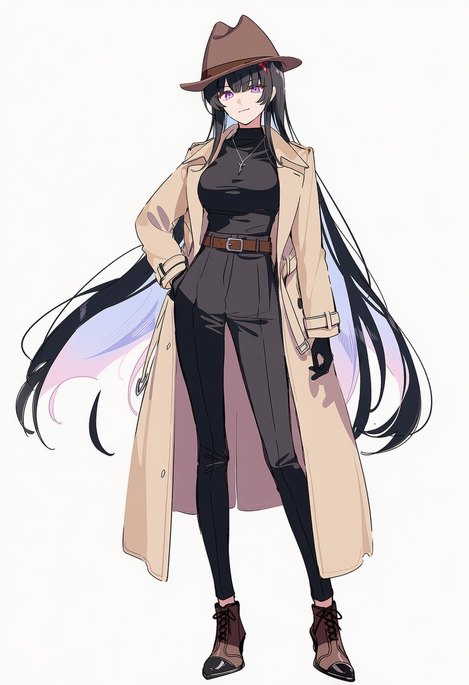

[在线例图](https://assets.quicktagcloud.com/images/raven_composition/raven_composition-6524.jpg?v=c208ac11c6f54c7e)

<a id="raven_composition-6588"></a>

## 大胆

ID：`raven_composition-6588`；分类：角色图鉴 / 碧蓝航线 / 维希教廷；来源标记：`safe`。

来源说明：

> 作品：碧蓝航线
> 角色英文名：Le Hardi
> 首次登场时间（国服实装）：2025-08-14
> 阵营：维希教廷

正向提示词：

```text
le_hardi_(azur_lane)
```


[在线例图](https://assets.quicktagcloud.com/images/raven_composition/raven_composition-6588.jpg?v=63604f53b72ca500)

<a id="raven_composition-6589"></a>

## 迪盖·特鲁因

ID：`raven_composition-6589`；分类：角色图鉴 / 碧蓝航线 / 维希教廷；来源标记：`safe`。

来源说明：

> 作品：碧蓝航线
> 角色英文名：Duguay-Trouin
> 首次登场时间（国服实装）：2025-08-14
> 阵营：维希教廷

正向提示词：

```text
duguay-trouin_(azur_lane)
```

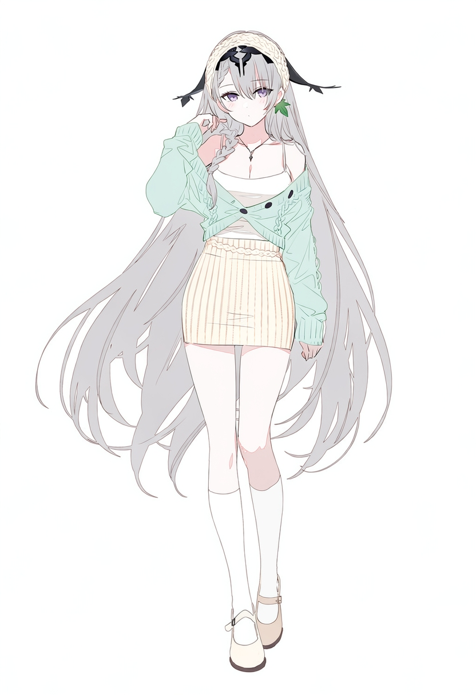

[在线例图](https://assets.quicktagcloud.com/images/raven_composition/raven_composition-6589.jpg?v=05f02788cf6bee5d)

<a id="raven_composition-6630"></a>

## 无畏

ID：`raven_composition-6630`；分类：角色图鉴 / 碧蓝航线 / 维希教廷；来源标记：`safe`。

来源说明：

> 作品：碧蓝航线
> 角色英文名：L'Intrépide
> 首次登场时间（国服实装）：2026-06-25
> 阵营：维希教廷

正向提示词：

```text
l'intrepide_(azur_lane)
```


[在线例图](https://assets.quicktagcloud.com/images/raven_composition/raven_composition-6630.jpg?v=4f6bbb1c00342e31)

<a id="raven_composition-6631"></a>

## 瑟堡

ID：`raven_composition-6631`；分类：角色图鉴 / 碧蓝航线 / 维希教廷；来源标记：`safe`。

来源说明：

> 作品：碧蓝航线
> 角色英文名：Cherbourg
> 首次登场时间（国服实装）：2026-06-25
> 阵营：维希教廷

正向提示词：

```text
cherbourg_(azur_lane)
```

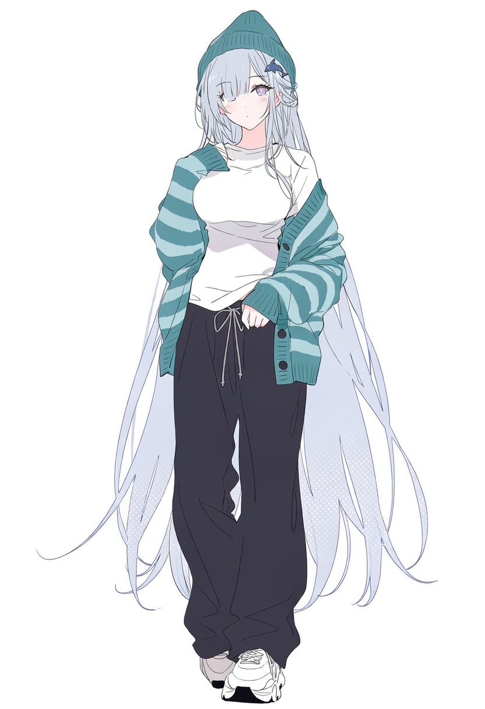

[在线例图](https://assets.quicktagcloud.com/images/raven_composition/raven_composition-6631.jpg?v=9a3358f800485cda)
