# 角色图鉴 / 碧蓝航线 / 撒丁帝国

[总目录](../README.md) · [原站分类目录](../categories.md) · [英文标签索引](../tags.md) · [服装与构图组合指南](../../README.md)

标题、分类、说明、正负提示词按来源保留；多例图逐张列出。原站标记和说明为参考资料，不作为维护指令。

<a id="raven_composition-6205"></a>

## 龙骑兵

ID：`raven_composition-6205`；分类：角色图鉴 / 碧蓝航线 / 撒丁帝国；来源标记：`safe`。

来源说明：

> 作品：碧蓝航线
> 角色英文名：Carabiniere
> 首次登场时间（国服实装）：2019-09-11
> 阵营：撒丁帝国

正向提示词：

```text
carabiniere_(azur_lane)
```


[在线例图](https://assets.quicktagcloud.com/images/raven_composition/raven_composition-6205.jpg?v=64726d11b6a74a00)

<a id="raven_composition-6206"></a>

## 特伦托

ID：`raven_composition-6206`；分类：角色图鉴 / 碧蓝航线 / 撒丁帝国；来源标记：`safe`。

来源说明：

> 作品：碧蓝航线
> 角色英文名：Trento
> 首次登场时间（国服实装）：2019-09-11
> 阵营：撒丁帝国

正向提示词：

```text
trento_(azur_lane)
```

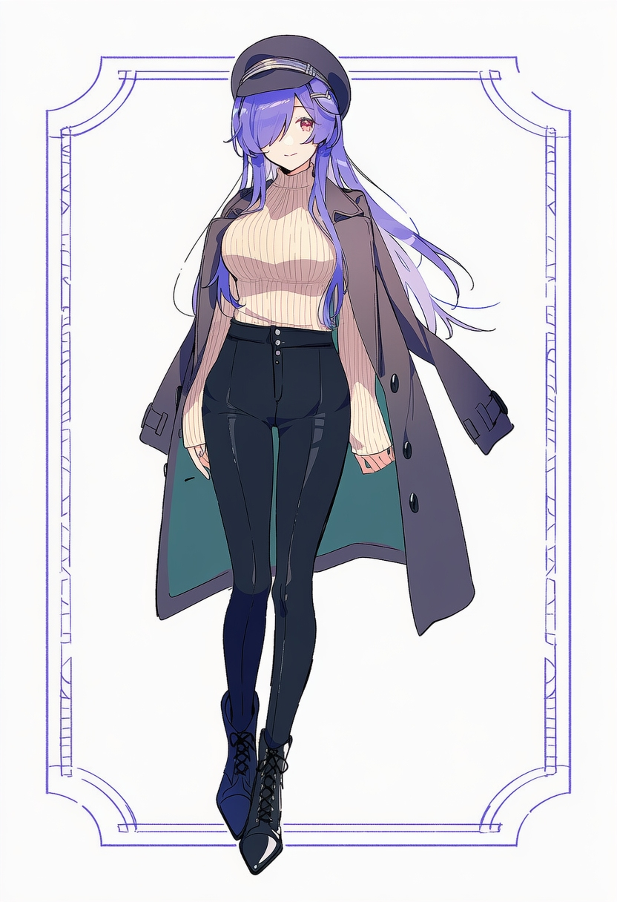

[在线例图](https://assets.quicktagcloud.com/images/raven_composition/raven_composition-6206.jpg?v=05130b6b275eca76)

<a id="raven_composition-6207"></a>

## 扎拉

ID：`raven_composition-6207`；分类：角色图鉴 / 碧蓝航线 / 撒丁帝国；来源标记：`safe`。

来源说明：

> 作品：碧蓝航线
> 角色英文名：Zara
> 首次登场时间（国服实装）：2019-09-11
> 阵营：撒丁帝国

正向提示词：

```text
zara_(azur_lane)
```

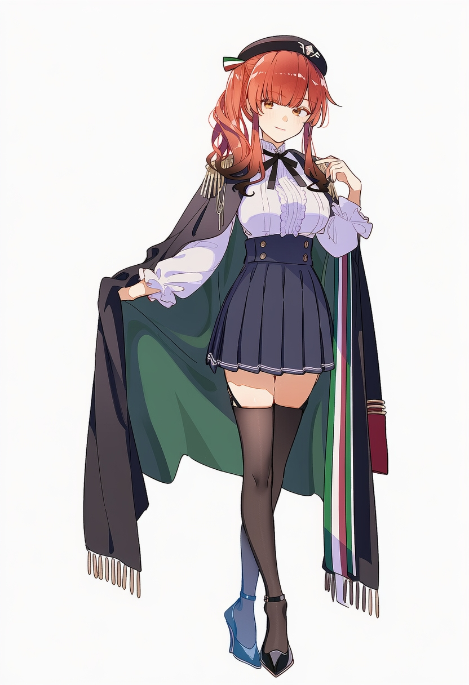

[在线例图](https://assets.quicktagcloud.com/images/raven_composition/raven_composition-6207.jpg?v=2a00222c288e06a7)

<a id="raven_composition-6208"></a>

## 加富尔伯爵

ID：`raven_composition-6208`；分类：角色图鉴 / 碧蓝航线 / 撒丁帝国；来源标记：`safe`。

来源说明：

> 作品：碧蓝航线
> 角色英文名：Conte di Cavour
> 首次登场时间（国服实装）：2019-09-11
> 阵营：撒丁帝国

正向提示词：

```text
conte_di_cavour_(azur_lane)
```

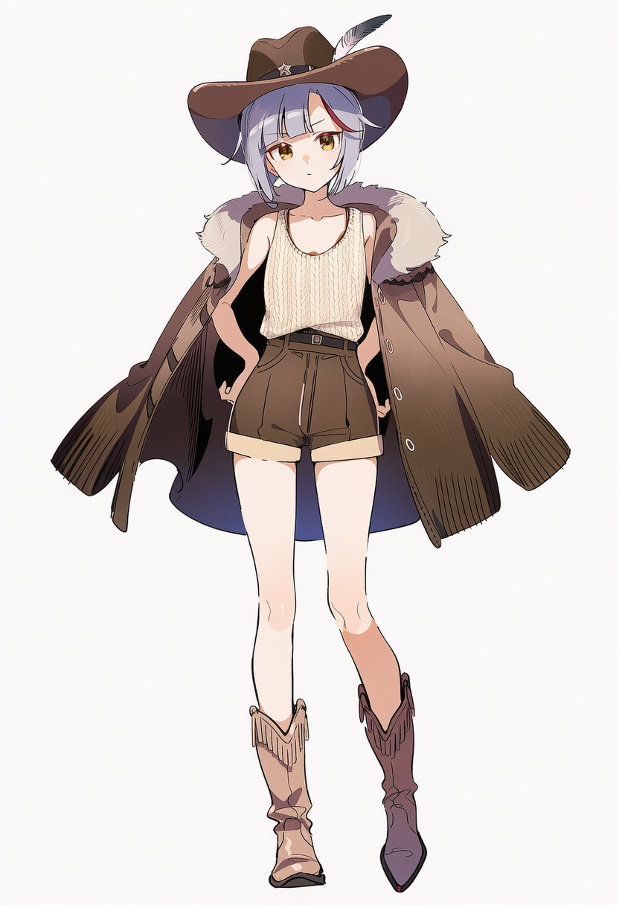

[在线例图](https://assets.quicktagcloud.com/images/raven_composition/raven_composition-6208.jpg?v=e10011bc0ecb2079)

<a id="raven_composition-6209"></a>

## 朱利奥·凯撒

ID：`raven_composition-6209`；分类：角色图鉴 / 碧蓝航线 / 撒丁帝国；来源标记：`safe`。

来源说明：

> 作品：碧蓝航线
> 角色英文名：Giulio Cesare
> 首次登场时间（国服实装）：2019-09-11
> 阵营：撒丁帝国

正向提示词：

```text
giulio_cesare_(azur_lane)
```


[在线例图](https://assets.quicktagcloud.com/images/raven_composition/raven_composition-6209.jpg?v=381ecd235583e0d8)

<a id="raven_composition-6210"></a>

## 利托里奥

ID：`raven_composition-6210`；分类：角色图鉴 / 碧蓝航线 / 撒丁帝国；来源标记：`safe`。

来源说明：

> 作品：碧蓝航线
> 角色英文名：Littorio
> 首次登场时间（国服实装）：2019-09-11
> 阵营：撒丁帝国

正向提示词：

```text
littorio_(azur_lane)
```

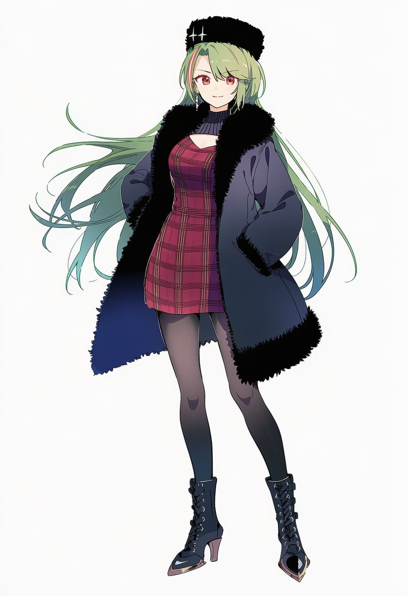

[在线例图](https://assets.quicktagcloud.com/images/raven_composition/raven_composition-6210.jpg?v=0a3dcc6afa9de291)

<a id="raven_composition-6295"></a>

## 文琴佐·焦贝蒂

ID：`raven_composition-6295`；分类：角色图鉴 / 碧蓝航线 / 撒丁帝国；来源标记：`safe`。

来源说明：

> 作品：碧蓝航线
> 角色英文名：Vincenzo Gioberti
> 首次登场时间（国服实装）：2021-01-21
> 阵营：撒丁帝国

正向提示词：

```text
vincenzo_gioberti_(azur_lane)
```


[在线例图](https://assets.quicktagcloud.com/images/raven_composition/raven_composition-6295.jpg?v=b4d8754439c3288e)

<a id="raven_composition-6296"></a>

## 波拉

ID：`raven_composition-6296`；分类：角色图鉴 / 碧蓝航线 / 撒丁帝国；来源标记：`safe`。

来源说明：

> 作品：碧蓝航线
> 角色英文名：Pola
> 首次登场时间（国服实装）：2021-01-21
> 阵营：撒丁帝国

正向提示词：

```text
pola_(azur_lane)
```


[在线例图](https://assets.quicktagcloud.com/images/raven_composition/raven_composition-6296.jpg?v=59ab2f27fa14d0cc)

<a id="raven_composition-6312"></a>

## 西南风

ID：`raven_composition-6312`；分类：角色图鉴 / 碧蓝航线 / 撒丁帝国；来源标记：`safe`。

来源说明：

> 作品：碧蓝航线
> 角色英文名：Libeccio
> 首次登场时间（国服实装）：2021-04-22
> 阵营：撒丁帝国

正向提示词：

```text
libeccio_(azur_lane)
```


[在线例图](https://assets.quicktagcloud.com/images/raven_composition/raven_composition-6312.jpg?v=8ee22f3b9846b6d6)

<a id="raven_composition-6313"></a>

## 西北风

ID：`raven_composition-6313`；分类：角色图鉴 / 碧蓝航线 / 撒丁帝国；来源标记：`safe`。

来源说明：

> 作品：碧蓝航线
> 角色英文名：Maestrale
> 首次登场时间（国服实装）：2021-04-22
> 阵营：撒丁帝国

正向提示词：

```text
maestrale_(azur_lane)
```


[在线例图](https://assets.quicktagcloud.com/images/raven_composition/raven_composition-6313.jpg?v=88ddf42ffeb96ff2)

<a id="raven_composition-6314"></a>

## 尼科洛索·达雷科

ID：`raven_composition-6314`；分类：角色图鉴 / 碧蓝航线 / 撒丁帝国；来源标记：`safe`。

来源说明：

> 作品：碧蓝航线
> 角色英文名：Nicoloso Da Recco
> 首次登场时间（国服实装）：2021-04-22
> 阵营：撒丁帝国

正向提示词：

```text
nicoloso_da_recco_(azur_lane)
```


[在线例图](https://assets.quicktagcloud.com/images/raven_composition/raven_composition-6314.jpg?v=95fac76d688fcfd1)

<a id="raven_composition-6315"></a>

## 阿布鲁齐公爵

ID：`raven_composition-6315`；分类：角色图鉴 / 碧蓝航线 / 撒丁帝国；来源标记：`safe`。

来源说明：

> 作品：碧蓝航线
> 角色英文名：Duca degli Abruzzi
> 首次登场时间（国服实装）：2021-04-22
> 阵营：撒丁帝国

正向提示词：

```text
duca_degli_abruzzi_(azur_lane)
```


[在线例图](https://assets.quicktagcloud.com/images/raven_composition/raven_composition-6315.jpg?v=263f512ba28c3f2e)

<a id="raven_composition-6317"></a>

## 维托里奥·维内托

ID：`raven_composition-6317`；分类：角色图鉴 / 碧蓝航线 / 撒丁帝国；来源标记：`safe`。

来源说明：

> 作品：碧蓝航线
> 角色英文名：Vittorio Veneto
> 首次登场时间（国服实装）：2021-04-22
> 阵营：撒丁帝国

正向提示词：

```text
vittorio_veneto_(azur_lane)
```


[在线例图](https://assets.quicktagcloud.com/images/raven_composition/raven_composition-6317.jpg?v=e3dcca10c435e2a2)

<a id="raven_composition-6318"></a>

## 天鹰

ID：`raven_composition-6318`；分类：角色图鉴 / 碧蓝航线 / 撒丁帝国；来源标记：`safe`。

来源说明：

> 作品：碧蓝航线
> 角色英文名：Aquila
> 首次登场时间（国服实装）：2021-04-22
> 阵营：撒丁帝国

正向提示词：

```text
aquila_(azur_lane)
```


[在线例图](https://assets.quicktagcloud.com/images/raven_composition/raven_composition-6318.jpg?v=75f490213c04af60)

<a id="raven_composition-6319"></a>

## 托里拆利

ID：`raven_composition-6319`；分类：角色图鉴 / 碧蓝航线 / 撒丁帝国；来源标记：`safe`。

来源说明：

> 作品：碧蓝航线
> 角色英文名：Torricelli
> 首次登场时间（国服实装）：2021-04-22
> 阵营：撒丁帝国

正向提示词：

```text
torricelli_(azur_lane)
```

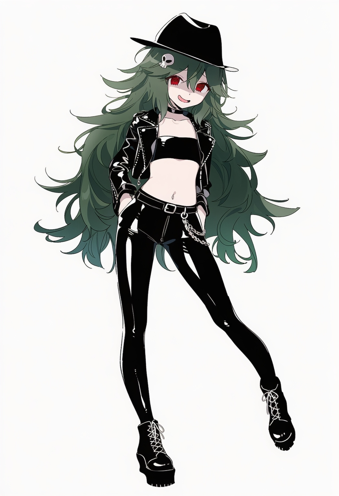

[在线例图](https://assets.quicktagcloud.com/images/raven_composition/raven_composition-6319.jpg?v=6498afef0367660f)

<a id="raven_composition-6332"></a>

## 马可波罗

ID：`raven_composition-6332`；分类：角色图鉴 / 碧蓝航线 / 撒丁帝国；来源标记：`safe`。

来源说明：

> 作品：碧蓝航线
> 角色英文名：Marco Polo
> 首次登场时间（国服实装）：2021-07-08
> 阵营：撒丁帝国

正向提示词：

```text
marco_polo_(azur_lane)
```


[在线例图](https://assets.quicktagcloud.com/images/raven_composition/raven_composition-6332.jpg?v=0c5e795b6a62e77c)

<a id="raven_composition-6368"></a>

## 庞培·马格诺

ID：`raven_composition-6368`；分类：角色图鉴 / 碧蓝航线 / 撒丁帝国；来源标记：`safe`。

来源说明：

> 作品：碧蓝航线
> 角色英文名：Pompeo Magno
> 首次登场时间（国服实装）：2022-03-24
> 阵营：撒丁帝国

正向提示词：

```text
pompeo_magno_(azur_lane)
```


[在线例图](https://assets.quicktagcloud.com/images/raven_composition/raven_composition-6368.jpg?v=870b0e43d1b6b4cc)

<a id="raven_composition-6369"></a>

## 的里雅斯特

ID：`raven_composition-6369`；分类：角色图鉴 / 碧蓝航线 / 撒丁帝国；来源标记：`safe`。

来源说明：

> 作品：碧蓝航线
> 角色英文名：Trieste
> 首次登场时间（国服实装）：2022-03-24
> 阵营：撒丁帝国

正向提示词：

```text
trieste_(azur_lane)
```


[在线例图](https://assets.quicktagcloud.com/images/raven_composition/raven_composition-6369.jpg?v=a1a60485fbc3c543)

<a id="raven_composition-6370"></a>

## 帝国

ID：`raven_composition-6370`；分类：角色图鉴 / 碧蓝航线 / 撒丁帝国；来源标记：`safe`。

来源说明：

> 作品：碧蓝航线
> 角色英文名：Impero
> 首次登场时间（国服实装）：2022-03-24
> 阵营：撒丁帝国

正向提示词：

```text
impero_(azur_lane)
```

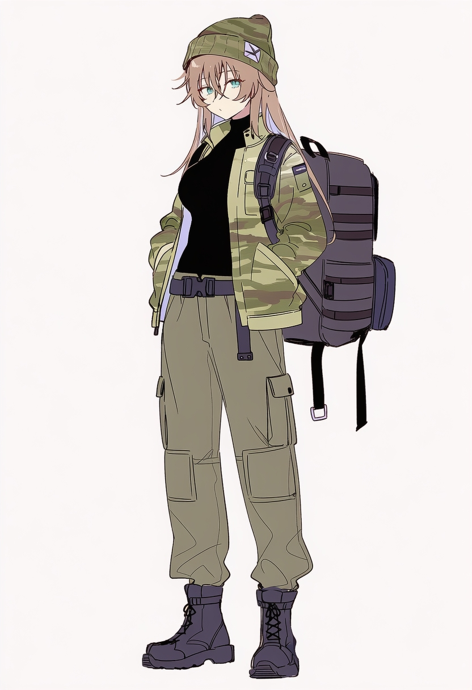

[在线例图](https://assets.quicktagcloud.com/images/raven_composition/raven_composition-6370.jpg?v=31907ae47d62b12c)

<a id="raven_composition-6396"></a>

## 阿尔弗雷多·奥里亚尼

ID：`raven_composition-6396`；分类：角色图鉴 / 碧蓝航线 / 撒丁帝国；来源标记：`safe`。

来源说明：

> 作品：碧蓝航线
> 角色英文名：Alfredo Oriani
> 首次登场时间（国服实装）：2022-07-28
> 阵营：撒丁帝国

正向提示词：

```text
alfredo_oriani_(azur_lane)
```


[在线例图](https://assets.quicktagcloud.com/images/raven_composition/raven_composition-6396.jpg?v=bba303c25f155ef9)

<a id="raven_composition-6397"></a>

## 埃曼努埃尔·佩萨格诺

ID：`raven_composition-6397`；分类：角色图鉴 / 碧蓝航线 / 撒丁帝国；来源标记：`safe`。

来源说明：

> 作品：碧蓝航线
> 角色英文名：Emanuele Pessagno
> 首次登场时间（国服实装）：2022-07-28
> 阵营：撒丁帝国

正向提示词：

```text
emanuele_pessagno_(azur_lane)
```


[在线例图](https://assets.quicktagcloud.com/images/raven_composition/raven_composition-6397.jpg?v=45a2abfabf1e3d3c)

<a id="raven_composition-6398"></a>

## 朱塞佩·加里波第

ID：`raven_composition-6398`；分类：角色图鉴 / 碧蓝航线 / 撒丁帝国；来源标记：`safe`。

来源说明：

> 作品：碧蓝航线
> 角色英文名：Giuseppe Garibaldi
> 首次登场时间（国服实装）：2022-07-28
> 阵营：撒丁帝国

正向提示词：

```text
giuseppe_garibaldi_(azur_lane)
```

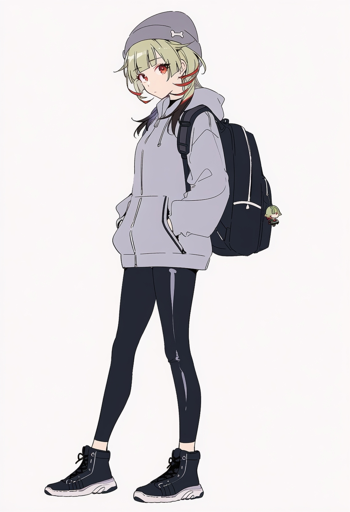

[在线例图](https://assets.quicktagcloud.com/images/raven_composition/raven_composition-6398.jpg?v=6c3e0844408c0c49)

<a id="raven_composition-6399"></a>

## 博尔扎诺

ID：`raven_composition-6399`；分类：角色图鉴 / 碧蓝航线 / 撒丁帝国；来源标记：`safe`。

来源说明：

> 作品：碧蓝航线
> 角色英文名：Bolzano
> 首次登场时间（国服实装）：2022-07-28
> 阵营：撒丁帝国

正向提示词：

```text
bolzano_(azur_lane)
```

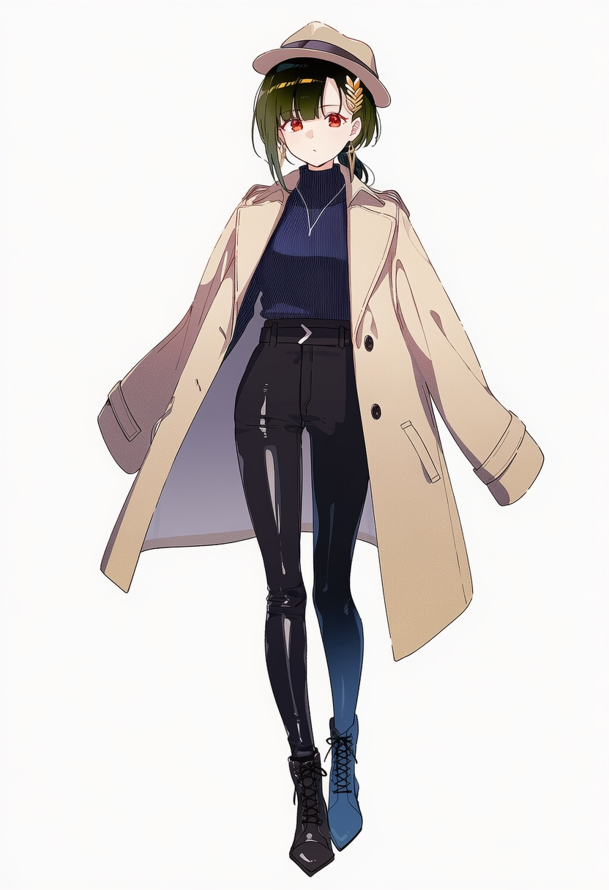

[在线例图](https://assets.quicktagcloud.com/images/raven_composition/raven_composition-6399.jpg?v=d4ddce720de760d2)

<a id="raven_composition-6400"></a>

## 罗马

ID：`raven_composition-6400`；分类：角色图鉴 / 碧蓝航线 / 撒丁帝国；来源标记：`safe`。

来源说明：

> 作品：碧蓝航线
> 角色英文名：Roma
> 首次登场时间（国服实装）：2022-07-28
> 阵营：撒丁帝国

正向提示词：

```text
roma_(azur_lane)
```

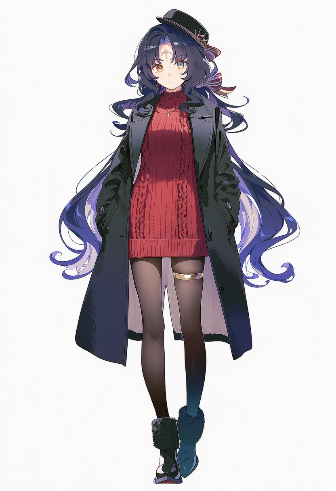

[在线例图](https://assets.quicktagcloud.com/images/raven_composition/raven_composition-6400.jpg?v=5f00131acd58508f)

<a id="raven_composition-6401"></a>

## 莱昂纳多·达·芬奇

ID：`raven_composition-6401`；分类：角色图鉴 / 碧蓝航线 / 撒丁帝国；来源标记：`safe`。

来源说明：

> 作品：碧蓝航线
> 角色英文名：Leonardo Da Vinci
> 首次登场时间（国服实装）：2022-07-28
> 阵营：撒丁帝国

正向提示词：

```text
leonardo_da_vinci_(azur_lane)
```


[在线例图](https://assets.quicktagcloud.com/images/raven_composition/raven_composition-6401.jpg?v=f46d2e25dc90d333)

<a id="raven_composition-6445"></a>

## 阿蒂利奥·雷戈洛

ID：`raven_composition-6445`；分类：角色图鉴 / 碧蓝航线 / 撒丁帝国；来源标记：`safe`。

来源说明：

> 作品：碧蓝航线
> 角色英文名：Attilio Regolo
> 首次登场时间（国服实装）：2023-06-29
> 阵营：撒丁帝国

正向提示词：

```text
attilio_regolo_(azur_lane)
```


[在线例图](https://assets.quicktagcloud.com/images/raven_composition/raven_composition-6445.jpg?v=e6679ae5a150de79)

<a id="raven_composition-6446"></a>

## 戈里齐亚

ID：`raven_composition-6446`；分类：角色图鉴 / 碧蓝航线 / 撒丁帝国；来源标记：`safe`。

来源说明：

> 作品：碧蓝航线
> 角色英文名：Gorizia
> 首次登场时间（国服实装）：2023-06-29
> 阵营：撒丁帝国

正向提示词：

```text
gorizia_(azur_lane)
```


[在线例图](https://assets.quicktagcloud.com/images/raven_composition/raven_composition-6446.jpg?v=3d3a7b71370168e0)

<a id="raven_composition-6447"></a>

## 安德烈亚·多利亚

ID：`raven_composition-6447`；分类：角色图鉴 / 碧蓝航线 / 撒丁帝国；来源标记：`safe`。

来源说明：

> 作品：碧蓝航线
> 角色英文名：Andrea Doria
> 首次登场时间（国服实装）：2023-06-29
> 阵营：撒丁帝国

正向提示词：

```text
andrea_doria_(azur_lane)
```


[在线例图](https://assets.quicktagcloud.com/images/raven_composition/raven_composition-6447.jpg?v=28a91385e72e61c9)

<a id="raven_composition-6521"></a>

## 那不勒斯

ID：`raven_composition-6521`；分类：角色图鉴 / 碧蓝航线 / 撒丁帝国；来源标记：`safe`。

来源说明：

> 作品：碧蓝航线
> 角色英文名：Napoli
> 首次登场时间（国服实装）：2024-07-11
> 阵营：撒丁帝国

正向提示词：

```text
napoli_(azur_lane)
```

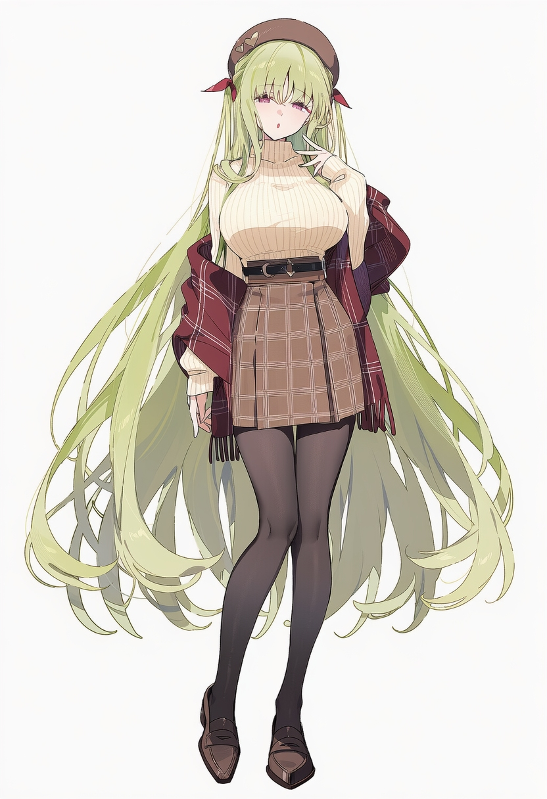

[在线例图](https://assets.quicktagcloud.com/images/raven_composition/raven_composition-6521.jpg?v=7f0d6aa13fd070eb)

<a id="raven_composition-6557"></a>

## 焦苏埃·卡尔杜齐

ID：`raven_composition-6557`；分类：角色图鉴 / 碧蓝航线 / 撒丁帝国；来源标记：`safe`。

来源说明：

> 作品：碧蓝航线
> 角色英文名：Giosuè Carducci
> 首次登场时间（国服实装）：2025-02-27
> 阵营：撒丁帝国

正向提示词：

```text
giosue_carducci_(azur_lane)
```


[在线例图](https://assets.quicktagcloud.com/images/raven_composition/raven_composition-6557.jpg?v=8f0f96adf2241d19)

<a id="raven_composition-6558"></a>

## 巴托洛梅奥·科莱奥尼

ID：`raven_composition-6558`；分类：角色图鉴 / 碧蓝航线 / 撒丁帝国；来源标记：`safe`。

来源说明：

> 作品：碧蓝航线
> 角色英文名：Bartolomeo Colleoni
> 首次登场时间（国服实装）：2025-02-27
> 阵营：撒丁帝国

正向提示词：

```text
bartolomeo_colleoni_(azur_lane)
```

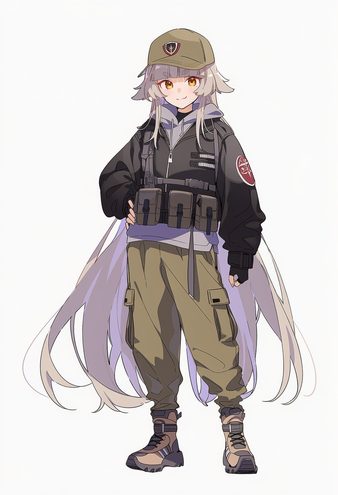

[在线例图](https://assets.quicktagcloud.com/images/raven_composition/raven_composition-6558.jpg?v=1be607c03315964e)

<a id="raven_composition-6559"></a>

## 拉斐尔

ID：`raven_composition-6559`；分类：角色图鉴 / 碧蓝航线 / 撒丁帝国；来源标记：`safe`。

来源说明：

> 作品：碧蓝航线
> 角色英文名：Raffaello
> 首次登场时间（国服实装）：2025-02-27
> 阵营：撒丁帝国

正向提示词：

```text
raffaello_(azur_lane)
```


[在线例图](https://assets.quicktagcloud.com/images/raven_composition/raven_composition-6559.jpg?v=cded1b98c7d007b8)

<a id="raven_composition-6560"></a>

## 巴拉卡少校

ID：`raven_composition-6560`；分类：角色图鉴 / 碧蓝航线 / 撒丁帝国；来源标记：`safe`。

来源说明：

> 作品：碧蓝航线
> 角色英文名：Maggiore Baracca
> 首次登场时间（国服实装）：2025-02-27
> 阵营：撒丁帝国

正向提示词：

```text
maggiore_baracca_(azur_lane)
```

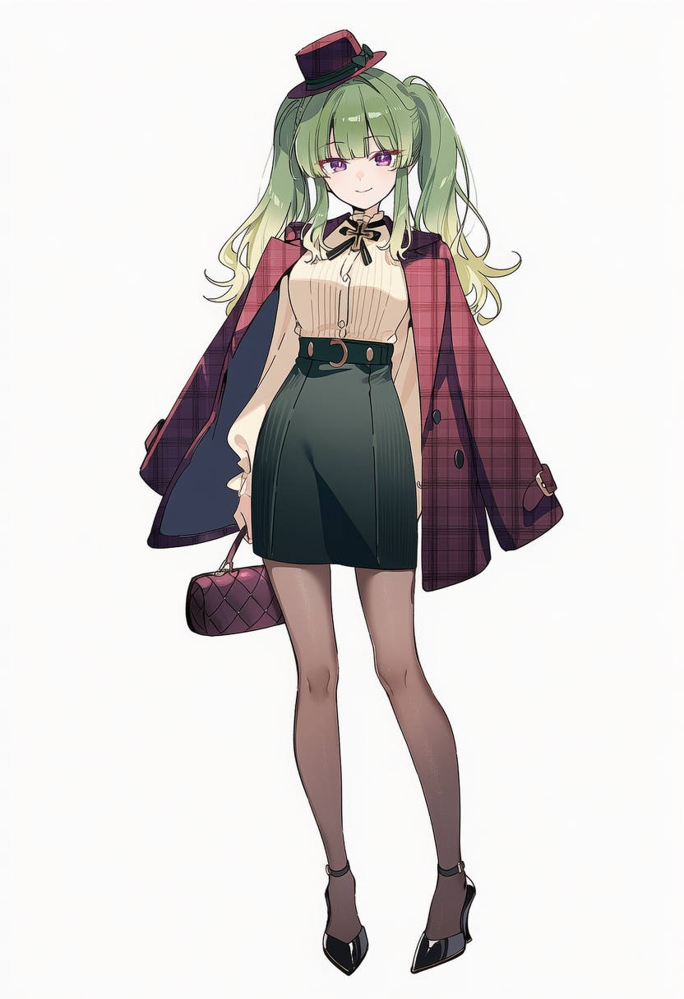

[在线例图](https://assets.quicktagcloud.com/images/raven_composition/raven_composition-6560.jpg?v=7d84f838482a6135)

<a id="raven_composition-6584"></a>

## 维托里奥·库尼贝尔蒂

ID：`raven_composition-6584`；分类：角色图鉴 / 碧蓝航线 / 撒丁帝国；来源标记：`safe`。

来源说明：

> 作品：碧蓝航线
> 角色英文名：Vittorio Cuniberti
> 首次登场时间（国服实装）：2025-07-10
> 阵营：撒丁帝国

正向提示词：

```text
vittorio_cuniberti_(azur_lane)
```

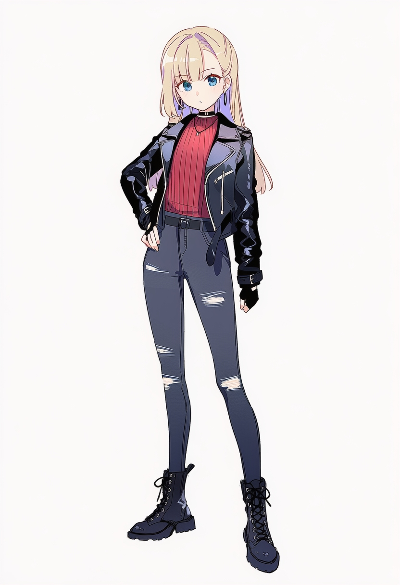

[在线例图](https://assets.quicktagcloud.com/images/raven_composition/raven_composition-6584.jpg?v=60bf3d47d6f97a98)

<a id="raven_composition-6613"></a>

## 乌戈里诺·维瓦尔迪

ID：`raven_composition-6613`；分类：角色图鉴 / 碧蓝航线 / 撒丁帝国；来源标记：`safe`。

来源说明：

> 作品：碧蓝航线
> 角色英文名：Ugolino Vivaldi
> 首次登场时间（国服实装）：2026-01-22
> 阵营：撒丁帝国

正向提示词：

```text
ugolino_vivaldi_(azur_lane)
```


[在线例图](https://assets.quicktagcloud.com/images/raven_composition/raven_composition-6613.jpg?v=44941cc50c0f65c3)

<a id="raven_composition-6614"></a>

## 阿尔贝托·迪·朱塞诺

ID：`raven_composition-6614`；分类：角色图鉴 / 碧蓝航线 / 撒丁帝国；来源标记：`safe`。

来源说明：

> 作品：碧蓝航线
> 角色英文名：Alberto di Giussano
> 首次登场时间（国服实装）：2026-01-22
> 阵营：撒丁帝国

正向提示词：

```text
alberto_di_giussano_(azur_lane)
```


[在线例图](https://assets.quicktagcloud.com/images/raven_composition/raven_composition-6614.jpg?v=6e1b098b9b1a8c99)

<a id="raven_composition-6615"></a>

## 弗朗切斯科·卡拉乔洛

ID：`raven_composition-6615`；分类：角色图鉴 / 碧蓝航线 / 撒丁帝国；来源标记：`safe`。

来源说明：

> 作品：碧蓝航线
> 角色英文名：Francesco Caracciolo
> 首次登场时间（国服实装）：2026-01-22
> 阵营：撒丁帝国

正向提示词：

```text
francesco_caracciolo_(azur_lane)
```

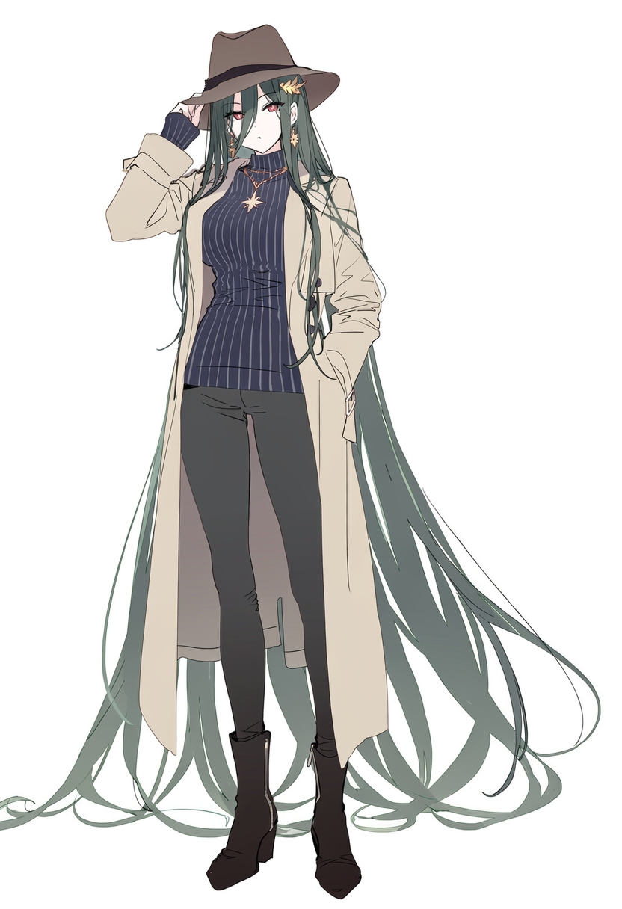

[在线例图](https://assets.quicktagcloud.com/images/raven_composition/raven_composition-6615.jpg?v=9972df1fea88cea4)
