# 角色图鉴 / 碧蓝航线 / META

[总目录](../README.md) · [原站分类目录](../categories.md) · [英文标签索引](../tags.md) · [服装与构图组合指南](../../README.md)

标题、分类、说明、正负提示词按来源保留；多例图逐张列出。原站标记和说明为参考资料，不作为维护指令。

<a id="raven_composition-6287"></a>

## 飞龙·META

ID：`raven_composition-6287`；分类：角色图鉴 / 碧蓝航线 / META；来源标记：`safe`。

来源说明：

> 作品：碧蓝航线
> 角色英文名：Hiryuu META
> 首次登场时间（国服实装）：2020-12-22
> 阵营：META

正向提示词：

```text
hiryuu_(meta)_(azur_lane)
```

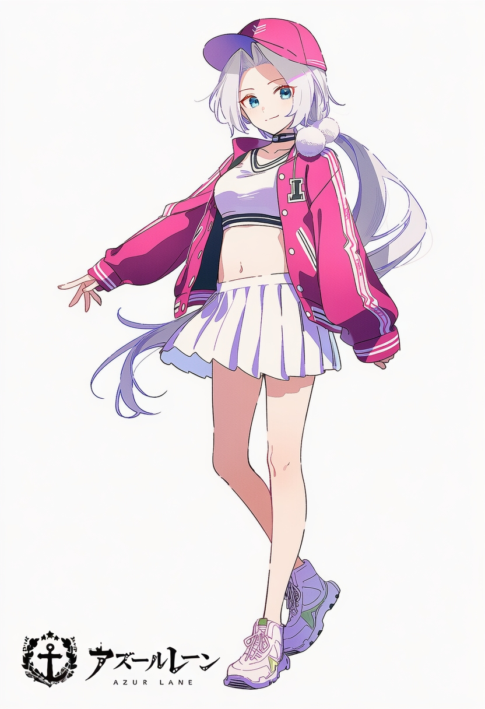

[在线例图](https://assets.quicktagcloud.com/images/raven_composition/raven_composition-6287.jpg?v=93df1c1e0ddd7e58)

<a id="raven_composition-6308"></a>

## 皇家方舟·META

ID：`raven_composition-6308`；分类：角色图鉴 / 碧蓝航线 / META；来源标记：`safe`。

来源说明：

> 作品：碧蓝航线
> 角色英文名：Ark Royal META
> 首次登场时间（国服实装）：2021-03-18
> 阵营：META

正向提示词：

```text
ark_royal_(meta)_(azur_lane)
```

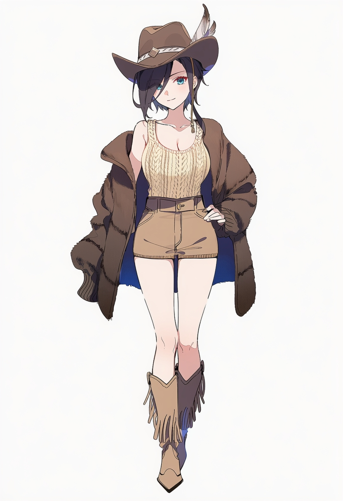

[在线例图](https://assets.quicktagcloud.com/images/raven_composition/raven_composition-6308.jpg?v=ce7d9d96182554ae)

<a id="raven_composition-6327"></a>

## 海伦娜·META

ID：`raven_composition-6327`；分类：角色图鉴 / 碧蓝航线 / META；来源标记：`safe`。

来源说明：

> 作品：碧蓝航线
> 角色英文名：Helena META
> 首次登场时间（国服实装）：2021-06-10
> 阵营：META

正向提示词：

```text
helena_(meta)_(azur_lane)
```

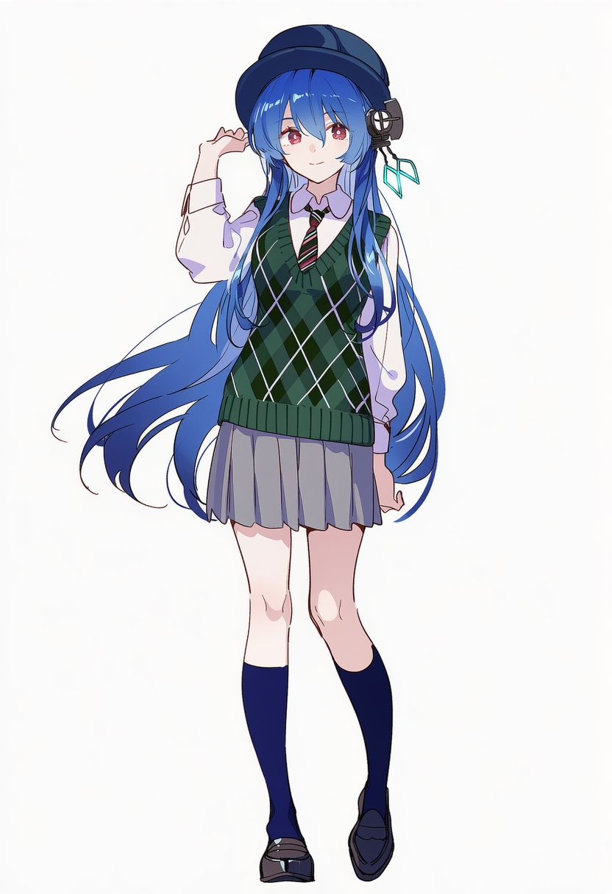

[在线例图](https://assets.quicktagcloud.com/images/raven_composition/raven_composition-6327.jpg?v=4fb5e614f612a21d)

<a id="raven_composition-6337"></a>

## 苍龙·META

ID：`raven_composition-6337`；分类：角色图鉴 / 碧蓝航线 / META；来源标记：`safe`。

来源说明：

> 作品：碧蓝航线
> 角色英文名：Souryuu META
> 首次登场时间（国服实装）：2021-09-09
> 阵营：META

正向提示词：

```text
souryuu_(meta)_(azur_lane)
```

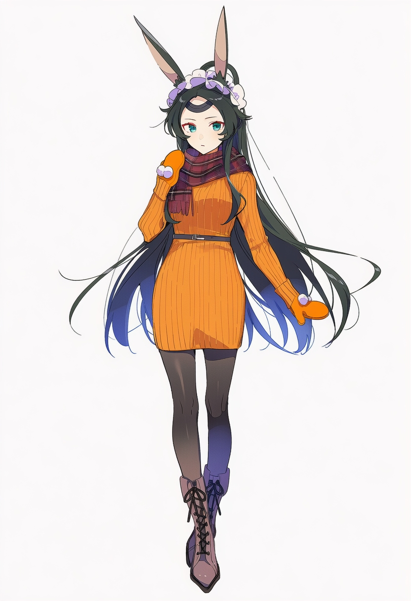

[在线例图](https://assets.quicktagcloud.com/images/raven_composition/raven_composition-6337.jpg?v=c43a8aaf0fb22f3e)

<a id="raven_composition-6344"></a>

## 扶桑·META

ID：`raven_composition-6344`；分类：角色图鉴 / 碧蓝航线 / META；来源标记：`safe`。

来源说明：

> 作品：碧蓝航线
> 角色英文名：Fusou META
> 首次登场时间（国服实装）：2021-10-01
> 阵营：META

正向提示词：

```text
fusou_(meta)_(azur_lane)
```

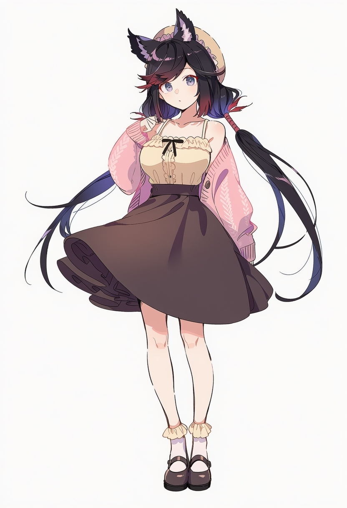

[在线例图](https://assets.quicktagcloud.com/images/raven_composition/raven_composition-6344.jpg?v=7c0dea4cb43631fa)

<a id="raven_composition-6349"></a>

## 飞鹰·META

ID：`raven_composition-6349`；分类：角色图鉴 / 碧蓝航线 / META；来源标记：`safe`。

来源说明：

> 作品：碧蓝航线
> 角色英文名：Hiyou META
> 首次登场时间（国服实装）：2021-12-01
> 阵营：META

正向提示词：

```text
hiyou_(meta)_(azur_lane)
```

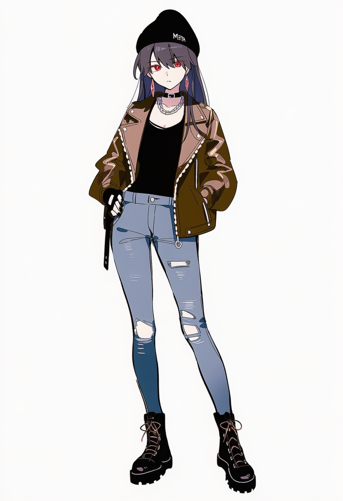

[在线例图](https://assets.quicktagcloud.com/images/raven_composition/raven_composition-6349.jpg?v=7c43784bd43f8fcf)

<a id="raven_composition-6350"></a>

## 格奈森瑙·META

ID：`raven_composition-6350`；分类：角色图鉴 / 碧蓝航线 / META；来源标记：`safe`。

来源说明：

> 作品：碧蓝航线
> 角色英文名：Gneisenau META
> 首次登场时间（国服实装）：2021-12-09
> 阵营：META

正向提示词：

```text
gneisenau_(meta)_(azur_lane)
```

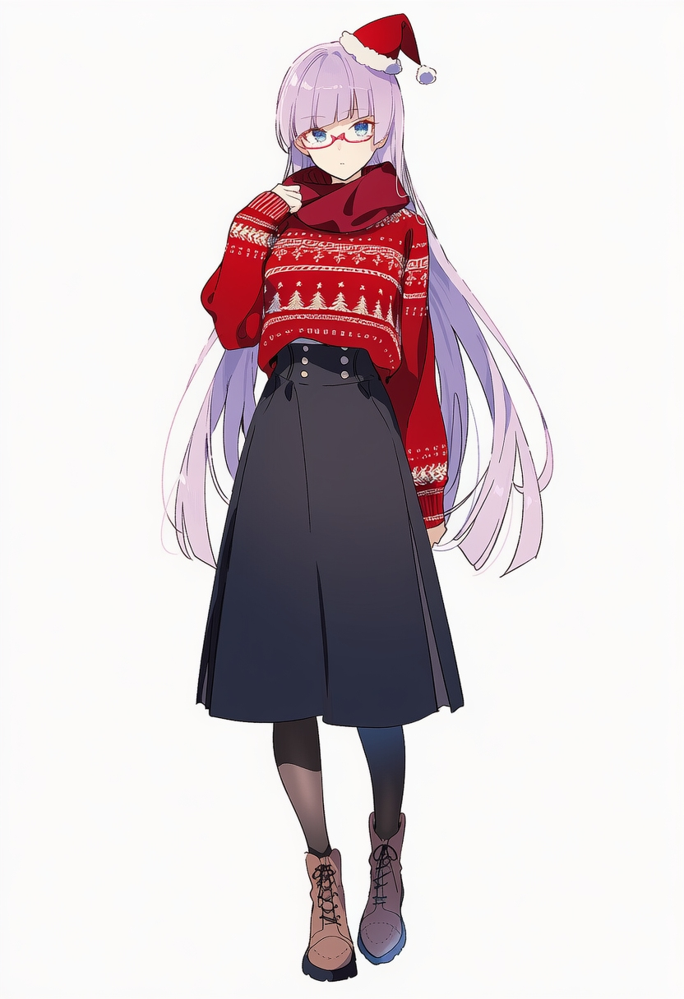

[在线例图](https://assets.quicktagcloud.com/images/raven_composition/raven_composition-6350.jpg?v=47fc42a8560d660d)

<a id="raven_composition-6361"></a>

## 隼鹰·META

ID：`raven_composition-6361`；分类：角色图鉴 / 碧蓝航线 / META；来源标记：`safe`。

来源说明：

> 作品：碧蓝航线
> 角色英文名：Junyou META
> 首次登场时间（国服实装）：2022-02-01
> 阵营：META

正向提示词：

```text
junyou_(meta)_(azur_lane)
```

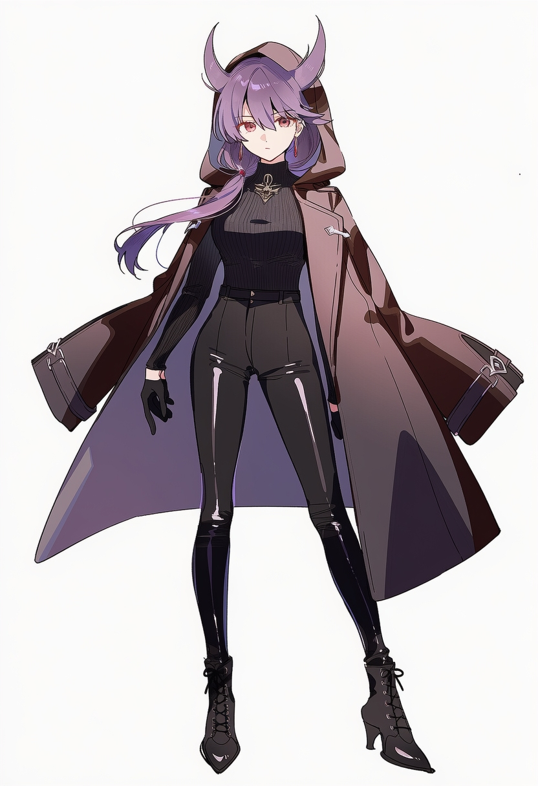

[在线例图](https://assets.quicktagcloud.com/images/raven_composition/raven_composition-6361.jpg?v=03782a04701429cb)

<a id="raven_composition-6367"></a>

## 沙恩霍斯特·META

ID：`raven_composition-6367`；分类：角色图鉴 / 碧蓝航线 / META；来源标记：`safe`。

来源说明：

> 作品：碧蓝航线
> 角色英文名：Scharnhorst META
> 首次登场时间（国服实装）：2022-03-10
> 阵营：META

正向提示词：

```text
scharnhorst_(meta)_(azur_lane)
```

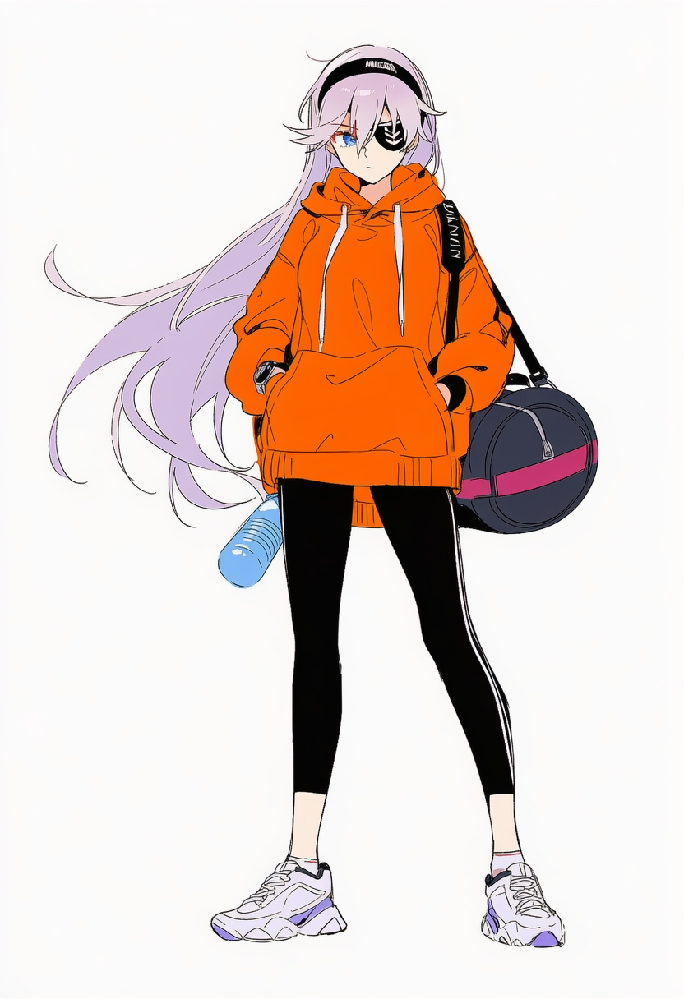

[在线例图](https://assets.quicktagcloud.com/images/raven_composition/raven_composition-6367.jpg?v=adb932bf4331593d)

<a id="raven_composition-6371"></a>

## 山城·META

ID：`raven_composition-6371`；分类：角色图鉴 / 碧蓝航线 / META；来源标记：`safe`。

来源说明：

> 作品：碧蓝航线
> 角色英文名：Yamashiro META
> 首次登场时间（国服实装）：2022-04-01
> 阵营：META

正向提示词：

```text
yamashiro_(meta)_(azur_lane)
```


[在线例图](https://assets.quicktagcloud.com/images/raven_composition/raven_composition-6371.jpg?v=497084d05368381f)

<a id="raven_composition-6386"></a>

## 孟菲斯·META

ID：`raven_composition-6386`；分类：角色图鉴 / 碧蓝航线 / META；来源标记：`safe`。

来源说明：

> 作品：碧蓝航线
> 角色英文名：Memphis META
> 首次登场时间（国服实装）：2022-06-01
> 阵营：META

正向提示词：

```text
memphis_(meta)_(azur_lane)
```


[在线例图](https://assets.quicktagcloud.com/images/raven_composition/raven_composition-6386.jpg?v=1f422c43af0ecc39)

<a id="raven_composition-6387"></a>

## 反击·META

ID：`raven_composition-6387`；分类：角色图鉴 / 碧蓝航线 / META；来源标记：`safe`。

来源说明：

> 作品：碧蓝航线
> 角色英文名：Repulse META
> 首次登场时间（国服实装）：2022-06-09
> 阵营：META

正向提示词：

```text
repulse_(meta)_(azur_lane)
```

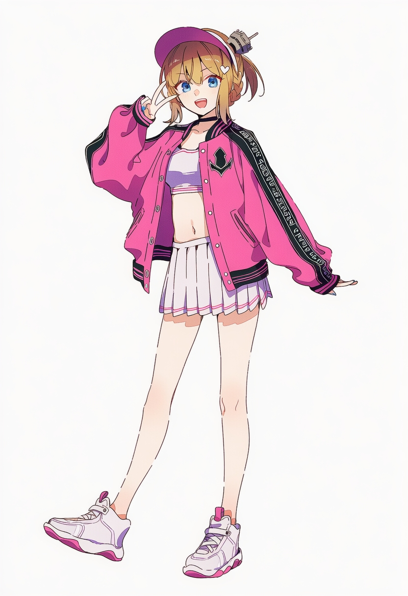

[在线例图](https://assets.quicktagcloud.com/images/raven_composition/raven_composition-6387.jpg?v=6e93455b798f65b7)

<a id="raven_composition-6402"></a>

## 特伦托·META

ID：`raven_composition-6402`；分类：角色图鉴 / 碧蓝航线 / META；来源标记：`safe`。

来源说明：

> 作品：碧蓝航线
> 角色英文名：Trento META
> 首次登场时间（国服实装）：2022-08-01
> 阵营：META

正向提示词：

```text
trento_(meta)_(azur_lane)
```


[在线例图](https://assets.quicktagcloud.com/images/raven_composition/raven_composition-6402.jpg?v=c4ea22f399efab9c)

<a id="raven_composition-6405"></a>

## 声望·META

ID：`raven_composition-6405`；分类：角色图鉴 / 碧蓝航线 / META；来源标记：`safe`。

来源说明：

> 作品：碧蓝航线
> 角色英文名：Renown META
> 首次登场时间（国服实装）：2022-09-01
> 阵营：META

正向提示词：

```text
renown_(meta)_(azur_lane)
```

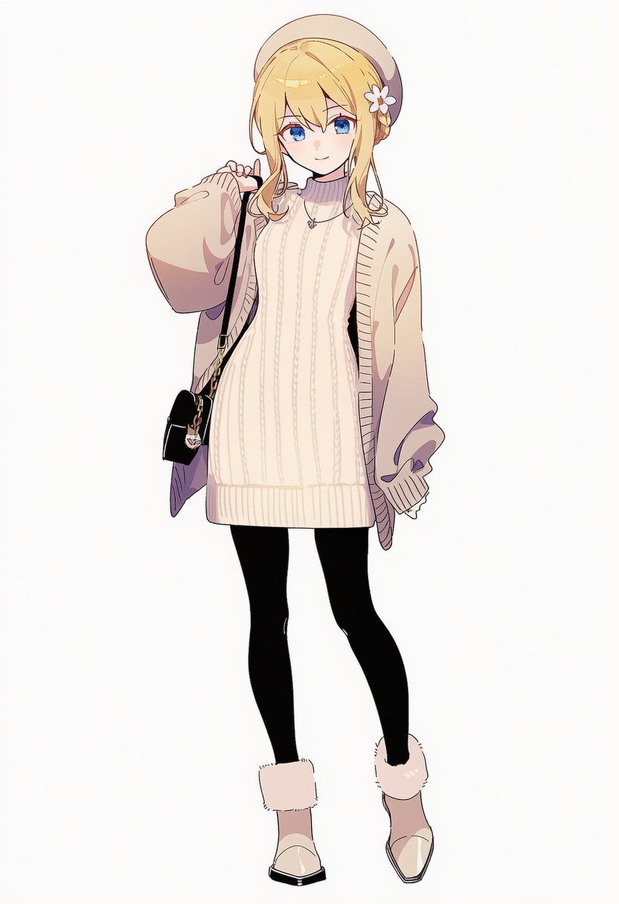

[在线例图](https://assets.quicktagcloud.com/images/raven_composition/raven_composition-6405.jpg?v=85d6f5c33537d609)

<a id="raven_composition-6416"></a>

## 亚利桑那·META

ID：`raven_composition-6416`；分类：角色图鉴 / 碧蓝航线 / META；来源标记：`safe`。

来源说明：

> 作品：碧蓝航线
> 角色英文名：Arizona META
> 首次登场时间（国服实装）：2022-12-08
> 阵营：META

正向提示词：

```text
arizona_(meta)_(azur_lane)
```

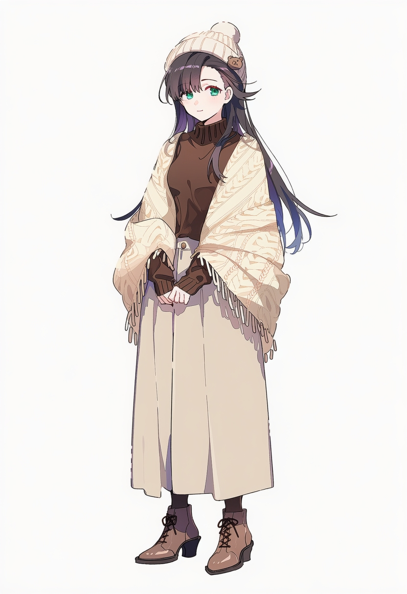

[在线例图](https://assets.quicktagcloud.com/images/raven_composition/raven_composition-6416.jpg?v=4aa8dd7312df6951)

<a id="raven_composition-6426"></a>

## 谢菲尔德·META

ID：`raven_composition-6426`；分类：角色图鉴 / 碧蓝航线 / META；来源标记：`safe`。

来源说明：

> 作品：碧蓝航线
> 角色英文名：Sheffield META
> 首次登场时间（国服实装）：2023-02-01
> 阵营：META

正向提示词：

```text
sheffield_(meta)_(azur_lane)
```

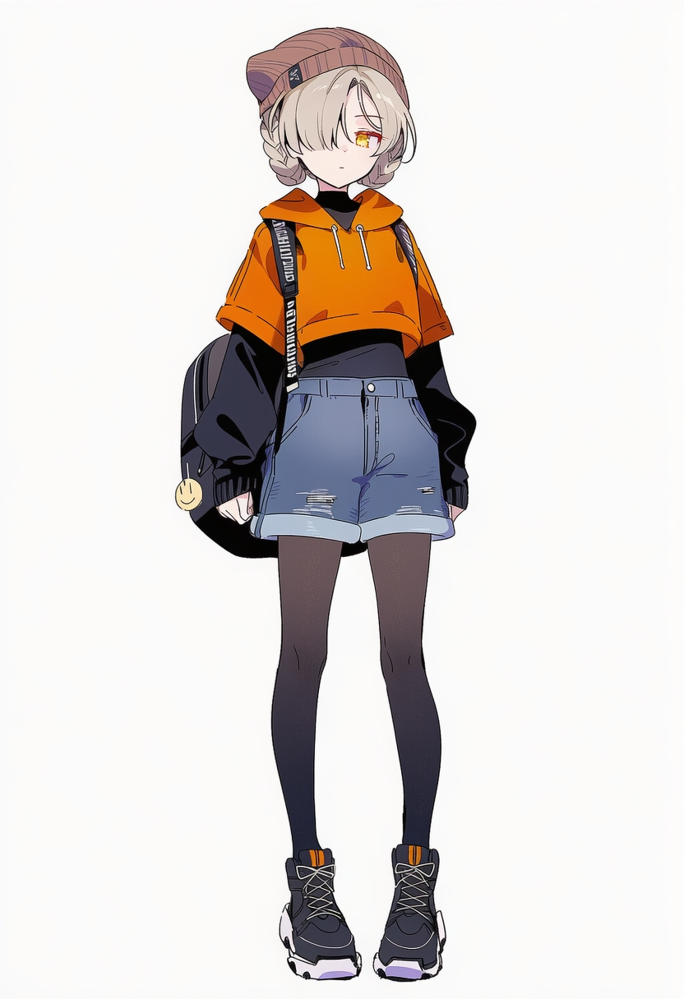

[在线例图](https://assets.quicktagcloud.com/images/raven_composition/raven_composition-6426.jpg?v=acebbea819005259)

<a id="raven_composition-6431"></a>

## 伊丽莎白女王·META

ID：`raven_composition-6431`；分类：角色图鉴 / 碧蓝航线 / META；来源标记：`safe`。

来源说明：

> 作品：碧蓝航线
> 角色英文名：Queen Elizabeth META
> 首次登场时间（国服实装）：2023-03-09
> 阵营：META

正向提示词：

```text
queen_elizabeth_(meta)_(azur_lane)
```

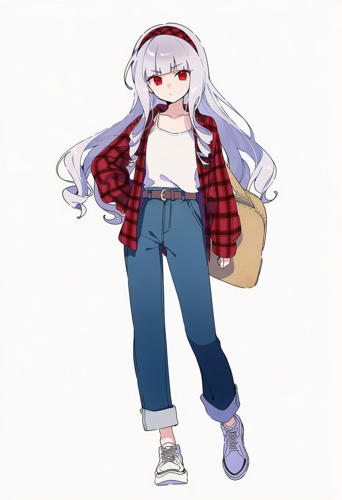

[在线例图](https://assets.quicktagcloud.com/images/raven_composition/raven_composition-6431.jpg?v=75424b8135051b9f)

<a id="raven_composition-6435"></a>

## 拉·加利索尼埃·META

ID：`raven_composition-6435`；分类：角色图鉴 / 碧蓝航线 / META；来源标记：`safe`。

来源说明：

> 作品：碧蓝航线
> 角色英文名：La Galissonnière META
> 首次登场时间（国服实装）：2023-04-01
> 阵营：META

正向提示词：

```text
la_galissonniere_(meta)_(azur_lane)
```


[在线例图](https://assets.quicktagcloud.com/images/raven_composition/raven_composition-6435.jpg?v=11bb500a5e318e72)

<a id="raven_composition-6441"></a>

## U-556·META

ID：`raven_composition-6441`；分类：角色图鉴 / 碧蓝航线 / META；来源标记：`safe`。

来源说明：

> 作品：碧蓝航线
> 角色英文名：U-556 META
> 首次登场时间（国服实装）：2023-05-25
> 阵营：META

正向提示词：

```text
u-556_(meta)_(azur_lane)
```

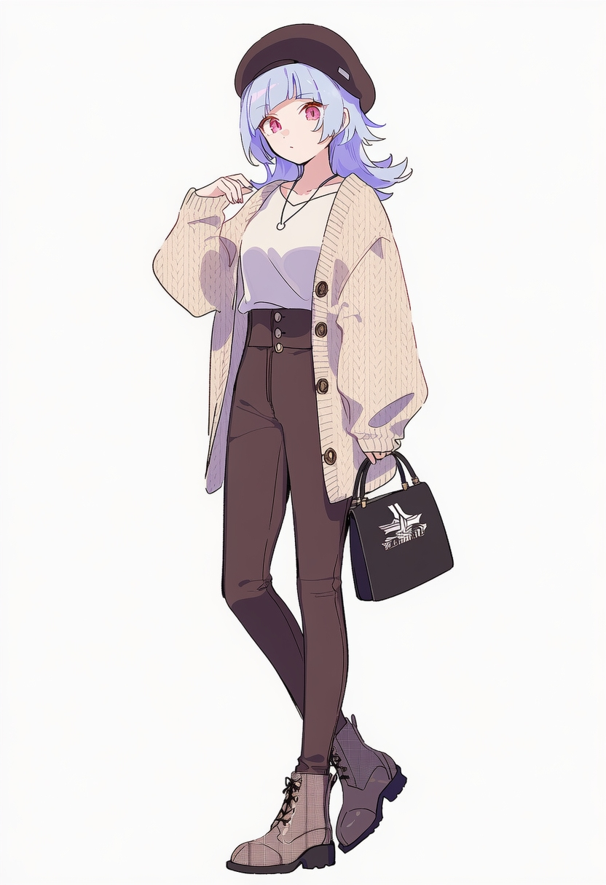

[在线例图](https://assets.quicktagcloud.com/images/raven_composition/raven_composition-6441.jpg?v=8065a56954c06809)

<a id="raven_composition-6443"></a>

## 女灶神·META

ID：`raven_composition-6443`；分类：角色图鉴 / 碧蓝航线 / META；来源标记：`safe`。

来源说明：

> 作品：碧蓝航线
> 角色英文名：Vestal META
> 首次登场时间（国服实装）：2023-06-01
> 阵营：META

正向提示词：

```text
vestal_(meta)_(azur_lane)
```

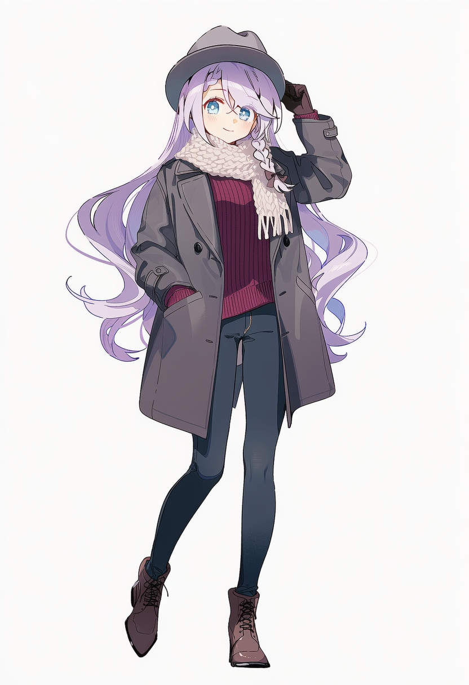

[在线例图](https://assets.quicktagcloud.com/images/raven_composition/raven_composition-6443.jpg?v=7bd6421fe3b4b3a0)

<a id="raven_composition-6444"></a>

## 阿尔及利亚·META

ID：`raven_composition-6444`；分类：角色图鉴 / 碧蓝航线 / META；来源标记：`safe`。

来源说明：

> 作品：碧蓝航线
> 角色英文名：Algérie META
> 首次登场时间（国服实装）：2023-06-08
> 阵营：META

正向提示词：

```text
algerie_(meta)_(azur_lane)
```

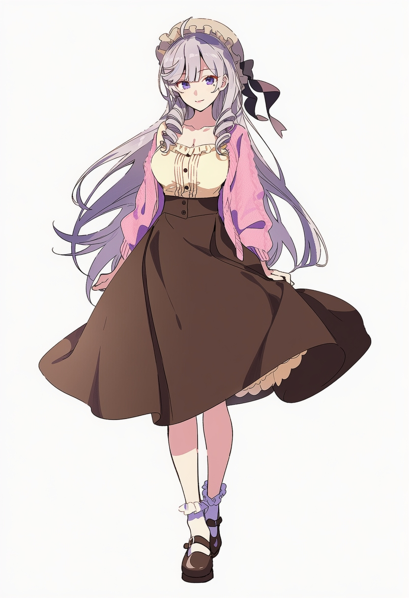

[在线例图](https://assets.quicktagcloud.com/images/raven_composition/raven_composition-6444.jpg?v=6c14d9f44a56114e)

<a id="raven_composition-6460"></a>

## 神通·META

ID：`raven_composition-6460`；分类：角色图鉴 / 碧蓝航线 / META；来源标记：`safe`。

来源说明：

> 作品：碧蓝航线
> 角色英文名：Jintsuu META
> 首次登场时间（国服实装）：2023-08-31
> 阵营：META

正向提示词：

```text
jintsuu_(meta)_(azur_lane)
```

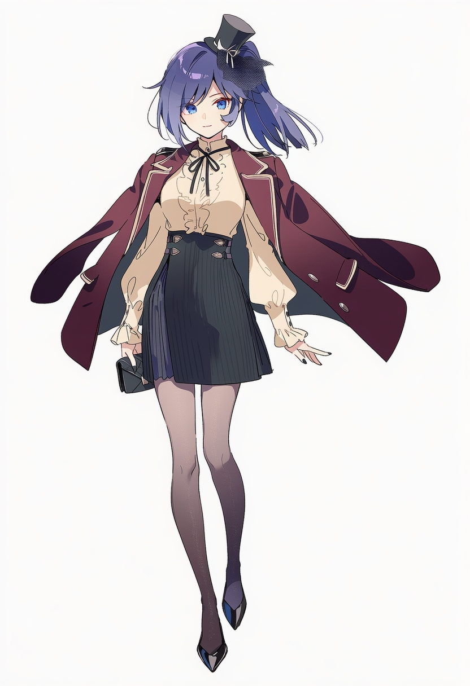

[在线例图](https://assets.quicktagcloud.com/images/raven_composition/raven_composition-6460.jpg?v=917c742aa2e38ba9)

<a id="raven_composition-6466"></a>

## 普林斯顿·META

ID：`raven_composition-6466`；分类：角色图鉴 / 碧蓝航线 / META；来源标记：`safe`。

来源说明：

> 作品：碧蓝航线
> 角色英文名：Princeton META
> 首次登场时间（国服实装）：2023-10-01
> 阵营：META

正向提示词：

```text
princeton_(meta)_(azur_lane)
```

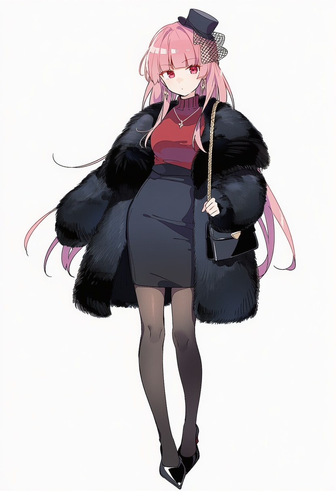

[在线例图](https://assets.quicktagcloud.com/images/raven_composition/raven_composition-6466.jpg?v=0015445e7aeb6403)

<a id="raven_composition-6473"></a>

## 黑暗界·META

ID：`raven_composition-6473`；分类：角色图鉴 / 碧蓝航线 / META；来源标记：`safe`。

来源说明：

> 作品：碧蓝航线
> 角色英文名：Erebus META
> 首次登场时间（国服实装）：2023-12-01
> 阵营：META

正向提示词：

```text
erebus_(meta)_(azur_lane)
```


[在线例图](https://assets.quicktagcloud.com/images/raven_composition/raven_composition-6473.jpg?v=dbdfe24aca0b8424)

<a id="raven_composition-6474"></a>

## 基洛夫·META

ID：`raven_composition-6474`；分类：角色图鉴 / 碧蓝航线 / META；来源标记：`safe`。

来源说明：

> 作品：碧蓝航线
> 角色英文名：Kirov META
> 首次登场时间（国服实装）：2023-12-07
> 阵营：META

正向提示词：

```text
kirov_(meta)_(azur_lane)
```

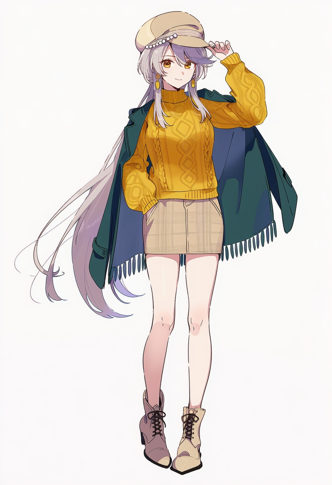

[在线例图](https://assets.quicktagcloud.com/images/raven_composition/raven_composition-6474.jpg?v=ec89e5e2cf695096)

<a id="raven_composition-6488"></a>

## 水星纪念·META

ID：`raven_composition-6488`；分类：角色图鉴 / 碧蓝航线 / META；来源标记：`safe`。

来源说明：

> 作品：碧蓝航线
> 角色英文名：Pamiat' Merkuria META
> 首次登场时间（国服实装）：2024-02-29
> 阵营：META

正向提示词：

```text
pamiat_merkuria_(meta)_(azur_lane)
```

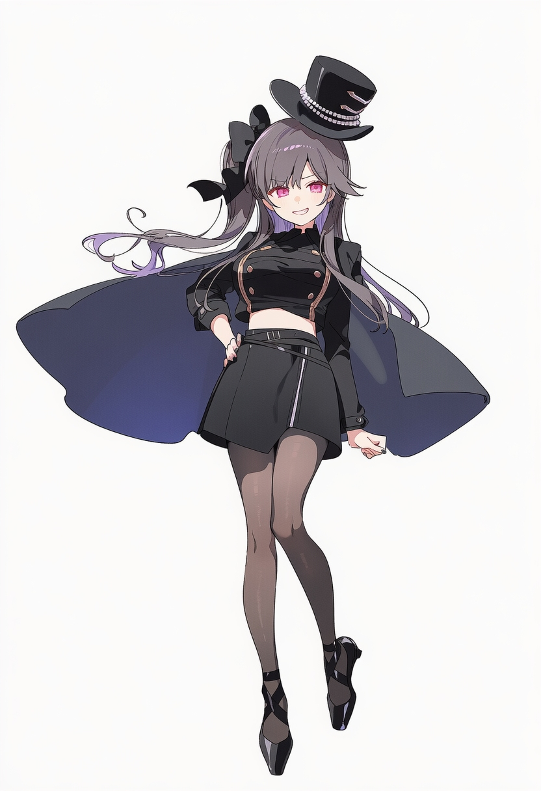

[在线例图](https://assets.quicktagcloud.com/images/raven_composition/raven_composition-6488.jpg?v=cfdcc295472ed2fb)

<a id="raven_composition-6491"></a>

## 罗德尼·META

ID：`raven_composition-6491`；分类：角色图鉴 / 碧蓝航线 / META；来源标记：`safe`。

来源说明：

> 作品：碧蓝航线
> 角色英文名：Rodney META
> 首次登场时间（国服实装）：2024-03-14
> 阵营：META

正向提示词：

```text
rodney_(meta)_(azur_lane)
```

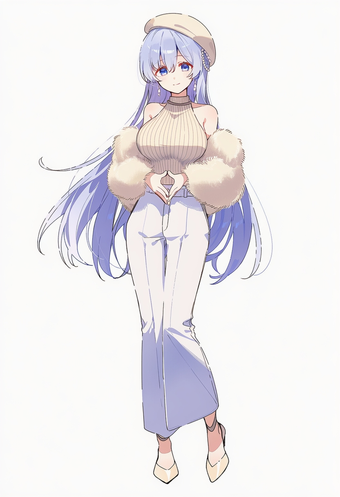

[在线例图](https://assets.quicktagcloud.com/images/raven_composition/raven_composition-6491.jpg?v=1e4222348ba59997)

<a id="raven_composition-6496"></a>

## 吸血鬼·META

ID：`raven_composition-6496`；分类：角色图鉴 / 碧蓝航线 / META；来源标记：`safe`。

来源说明：

> 作品：碧蓝航线
> 角色英文名：Vampire META
> 首次登场时间（国服实装）：2024-04-01
> 阵营：META

正向提示词：

```text
vampire_(meta)_(azur_lane)
```

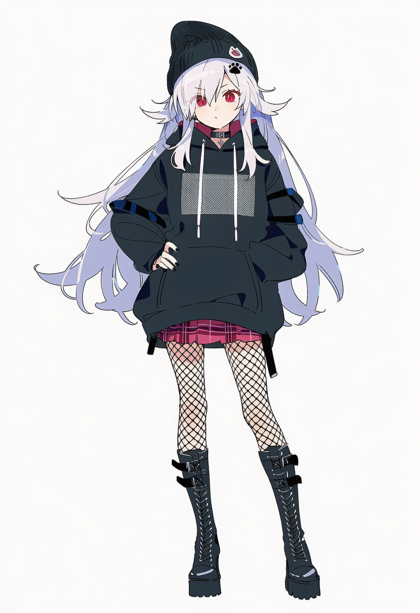

[在线例图](https://assets.quicktagcloud.com/images/raven_composition/raven_composition-6496.jpg?v=71d173168047a187)

<a id="raven_composition-6509"></a>

## 贝亚恩·META

ID：`raven_composition-6509`；分类：角色图鉴 / 碧蓝航线 / META；来源标记：`safe`。

来源说明：

> 作品：碧蓝航线
> 角色英文名：Béarn META
> 首次登场时间（国服实装）：2024-05-21
> 阵营：META

正向提示词：

```text
bearn_(meta)_(azur_lane)
```

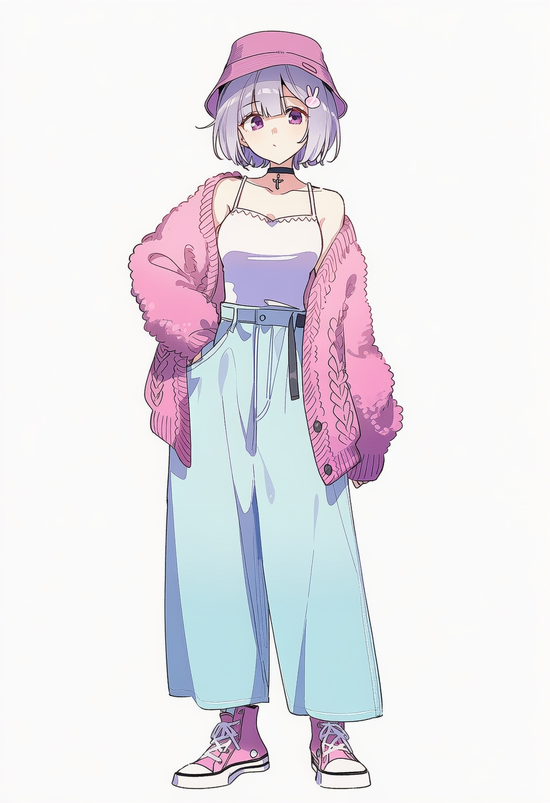

[在线例图](https://assets.quicktagcloud.com/images/raven_composition/raven_composition-6509.jpg?v=e4aa88dea16ad58c)

<a id="raven_composition-6511"></a>

## 福煦·META

ID：`raven_composition-6511`；分类：角色图鉴 / 碧蓝航线 / META；来源标记：`safe`。

来源说明：

> 作品：碧蓝航线
> 角色英文名：Foch META
> 首次登场时间（国服实装）：2024-06-01
> 阵营：META

正向提示词：

```text
foch_(meta)_(azur_lane)
```

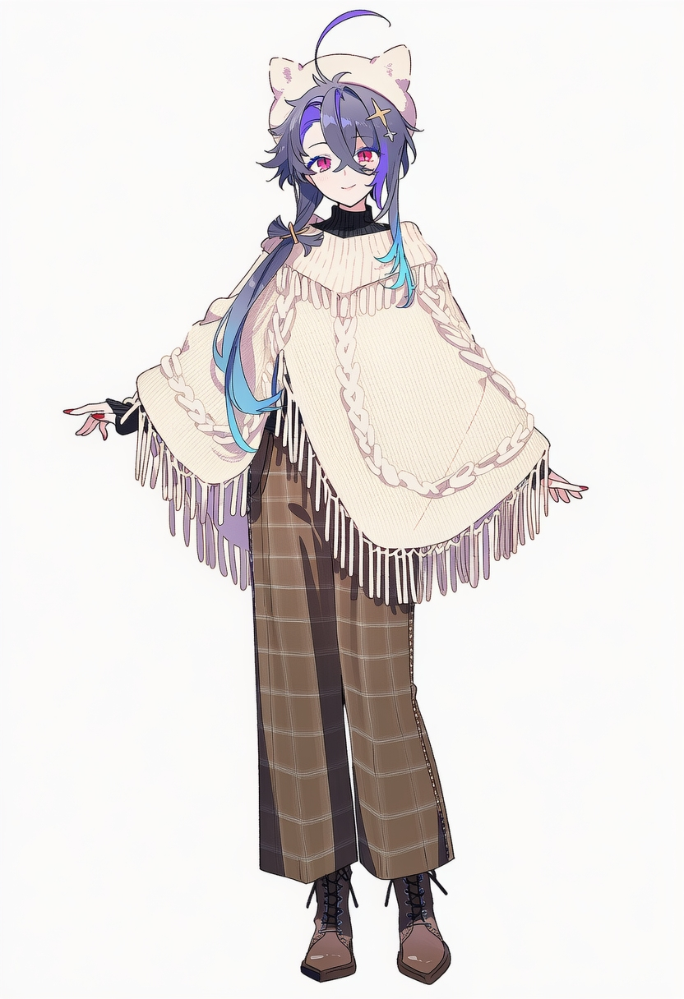

[在线例图](https://assets.quicktagcloud.com/images/raven_composition/raven_composition-6511.jpg?v=33a7747a5aa95b5a)

<a id="raven_composition-6512"></a>

## 威奇塔·META

ID：`raven_composition-6512`；分类：角色图鉴 / 碧蓝航线 / META；来源标记：`safe`。

来源说明：

> 作品：碧蓝航线
> 角色英文名：Wichita META
> 首次登场时间（国服实装）：2024-06-13
> 阵营：META

正向提示词：

```text
wichita_(meta)_(azur_lane)
```


[在线例图](https://assets.quicktagcloud.com/images/raven_composition/raven_composition-6512.jpg?v=d0bb3554a8d08dd9)

<a id="raven_composition-6525"></a>

## 霞·META

ID：`raven_composition-6525`；分类：角色图鉴 / 碧蓝航线 / META；来源标记：`safe`。

来源说明：

> 作品：碧蓝航线
> 角色英文名：Kasumi META
> 首次登场时间（国服实装）：2024-08-01
> 阵营：META

正向提示词：

```text
kasumi_(meta)_(azur_lane)
```

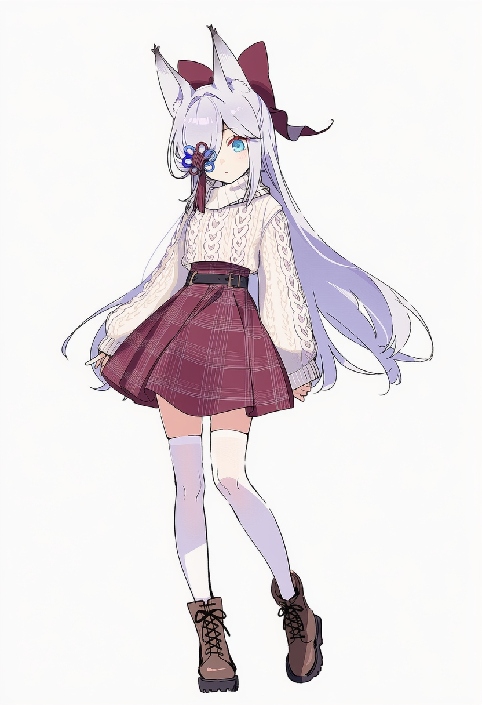

[在线例图](https://assets.quicktagcloud.com/images/raven_composition/raven_composition-6525.jpg?v=d505937c7751ff8d)

<a id="raven_composition-6533"></a>

## 长门·META

ID：`raven_composition-6533`；分类：角色图鉴 / 碧蓝航线 / META；来源标记：`safe`。

来源说明：

> 作品：碧蓝航线
> 角色英文名：Nagato META
> 首次登场时间（国服实装）：2024-09-05
> 阵营：META

正向提示词：

```text
nagato_(meta)_(azur_lane)
```

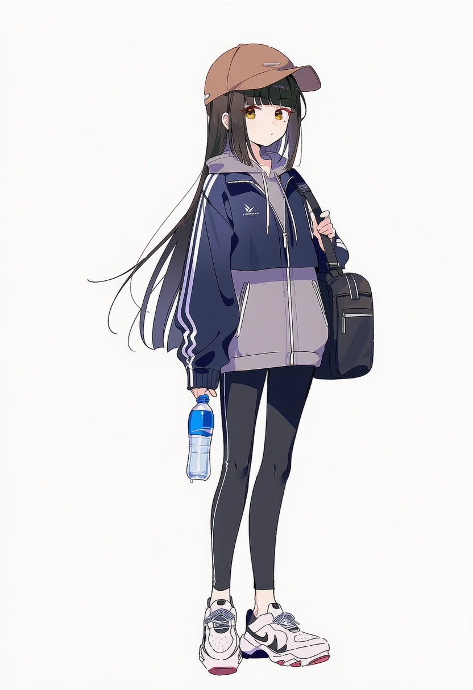

[在线例图](https://assets.quicktagcloud.com/images/raven_composition/raven_composition-6533.jpg?v=9e2117dd4bd780fd)

<a id="raven_composition-6537"></a>

## 比叡·META

ID：`raven_composition-6537`；分类：角色图鉴 / 碧蓝航线 / META；来源标记：`safe`。

来源说明：

> 作品：碧蓝航线
> 角色英文名：Hiei META
> 首次登场时间（国服实装）：2024-09-12
> 阵营：META

正向提示词：

```text
hiei_(meta)_(azur_lane)
```

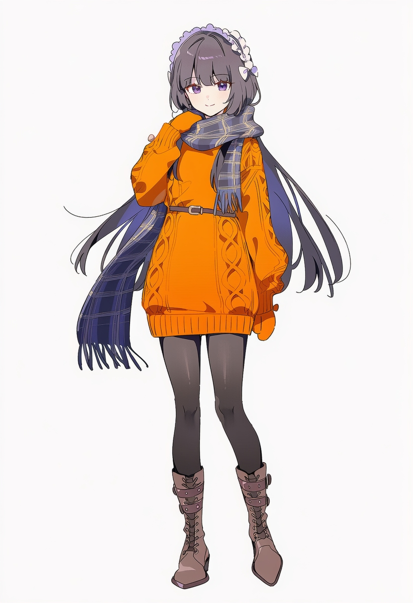

[在线例图](https://assets.quicktagcloud.com/images/raven_composition/raven_composition-6537.jpg?v=19c1e7ae5790f614)

<a id="raven_composition-6539"></a>

## 凤翔·META

ID：`raven_composition-6539`；分类：角色图鉴 / 碧蓝航线 / META；来源标记：`safe`。

来源说明：

> 作品：碧蓝航线
> 角色英文名：Houshou META
> 首次登场时间（国服实装）：2024-10-01
> 阵营：META

正向提示词：

```text
houshou_(meta)_(azur_lane)
```

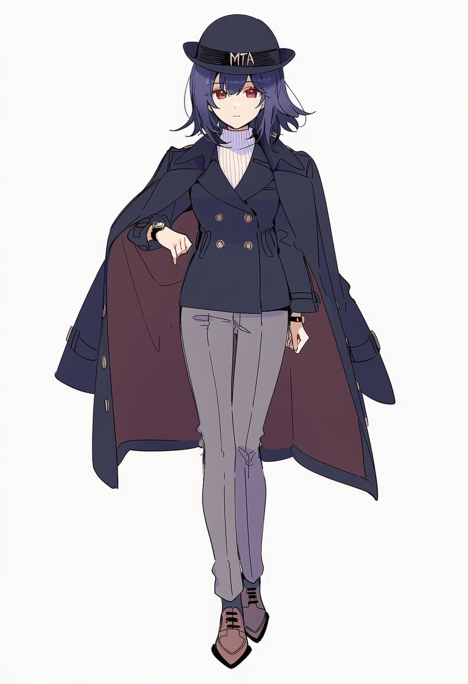

[在线例图](https://assets.quicktagcloud.com/images/raven_composition/raven_composition-6539.jpg?v=ccefccb3a390b9ef)

<a id="raven_composition-6545"></a>

## 朱利奥·凯撒·META

ID：`raven_composition-6545`；分类：角色图鉴 / 碧蓝航线 / META；来源标记：`safe`。

来源说明：

> 作品：碧蓝航线
> 角色英文名：Giulio Cesare META
> 首次登场时间（国服实装）：2024-12-01
> 阵营：META

正向提示词：

```text
giulio_cesare_(meta)_(azur_lane)
```

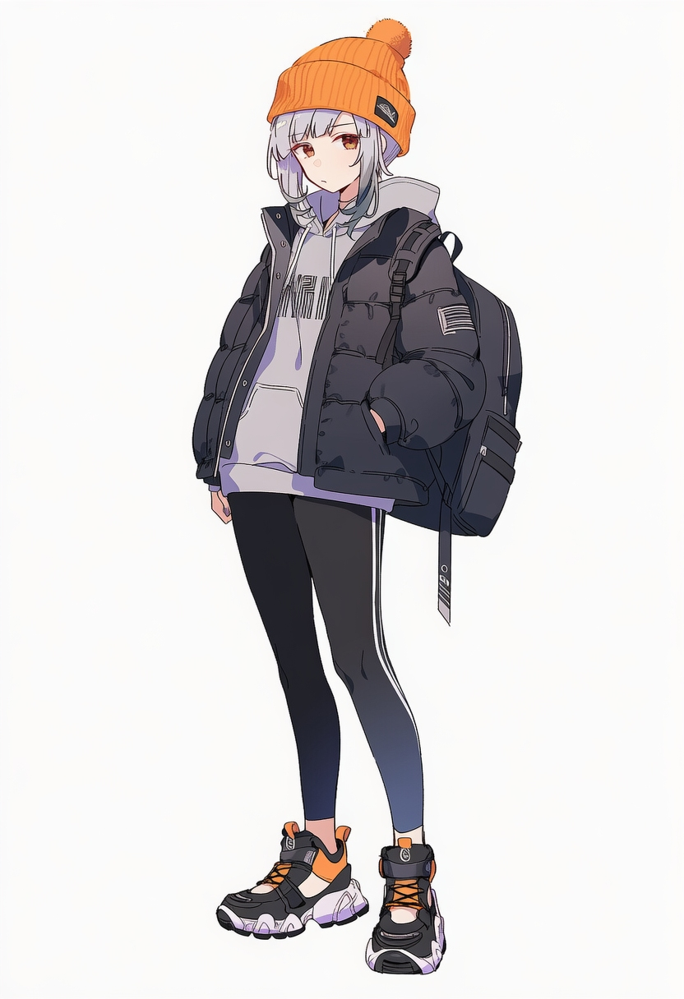

[在线例图](https://assets.quicktagcloud.com/images/raven_composition/raven_composition-6545.jpg?v=00911d89ab4c4990)

<a id="raven_composition-6550"></a>

## 希佩尔海军上将·META

ID：`raven_composition-6550`；分类：角色图鉴 / 碧蓝航线 / META；来源标记：`safe`。

来源说明：

> 作品：碧蓝航线
> 角色英文名：Admiral Hipper META
> 首次登场时间（国服实装）：2024-12-19
> 阵营：META

正向提示词：

```text
admiral_hipper_(meta)_(azur_lane)
```

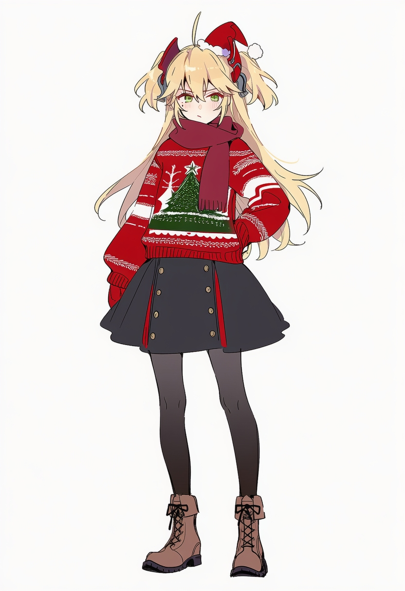

[在线例图](https://assets.quicktagcloud.com/images/raven_composition/raven_composition-6550.jpg?v=d7b92f065951a2b5)

<a id="raven_composition-6556"></a>

## 博尔扎诺·META

ID：`raven_composition-6556`；分类：角色图鉴 / 碧蓝航线 / META；来源标记：`safe`。

来源说明：

> 作品：碧蓝航线
> 角色英文名：Bolzano META
> 首次登场时间（国服实装）：2025-02-01
> 阵营：META

正向提示词：

```text
bolzano_(meta)_(azur_lane)
```

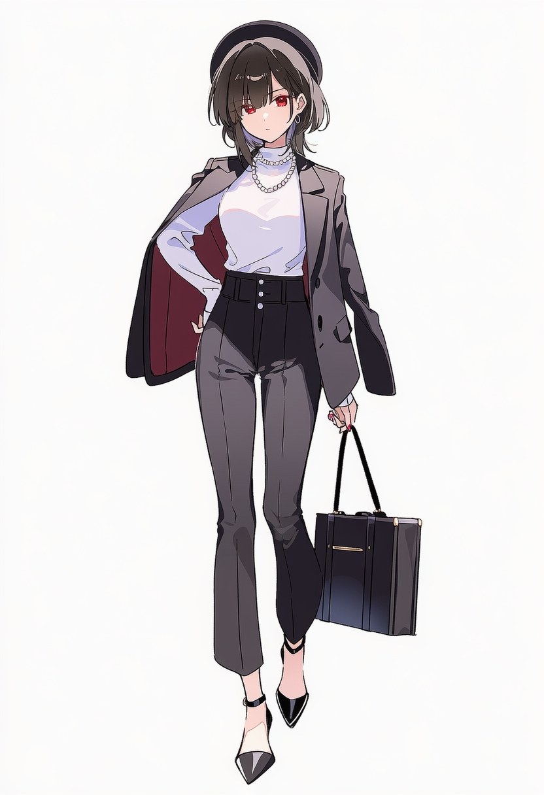

[在线例图](https://assets.quicktagcloud.com/images/raven_composition/raven_composition-6556.jpg?v=f9b07511f641b288)

<a id="raven_composition-6561"></a>

## 大黄蜂·META

ID：`raven_composition-6561`；分类：角色图鉴 / 碧蓝航线 / META；来源标记：`safe`。

来源说明：

> 作品：碧蓝航线
> 角色英文名：Hornet META
> 首次登场时间（国服实装）：2025-03-13
> 阵营：META

正向提示词：

```text
hornet_(meta)_(azur_lane)
```

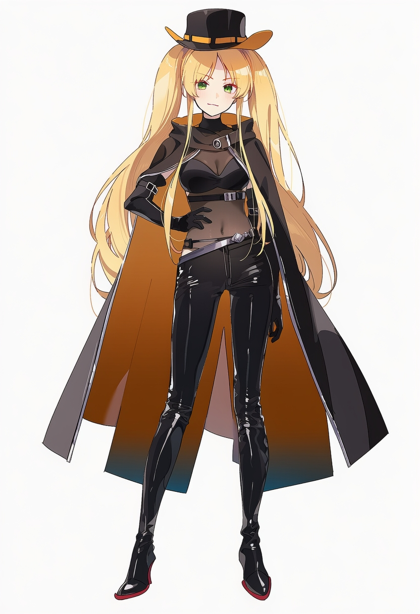

[在线例图](https://assets.quicktagcloud.com/images/raven_composition/raven_composition-6561.jpg?v=f6706173bfbbbb8a)

<a id="raven_composition-6565"></a>

## 内华达·META

ID：`raven_composition-6565`；分类：角色图鉴 / 碧蓝航线 / META；来源标记：`safe`。

来源说明：

> 作品：碧蓝航线
> 角色英文名：Nevada META
> 首次登场时间（国服实装）：2025-04-01
> 阵营：META

正向提示词：

```text
nevada_(meta)_(azur_lane)
```

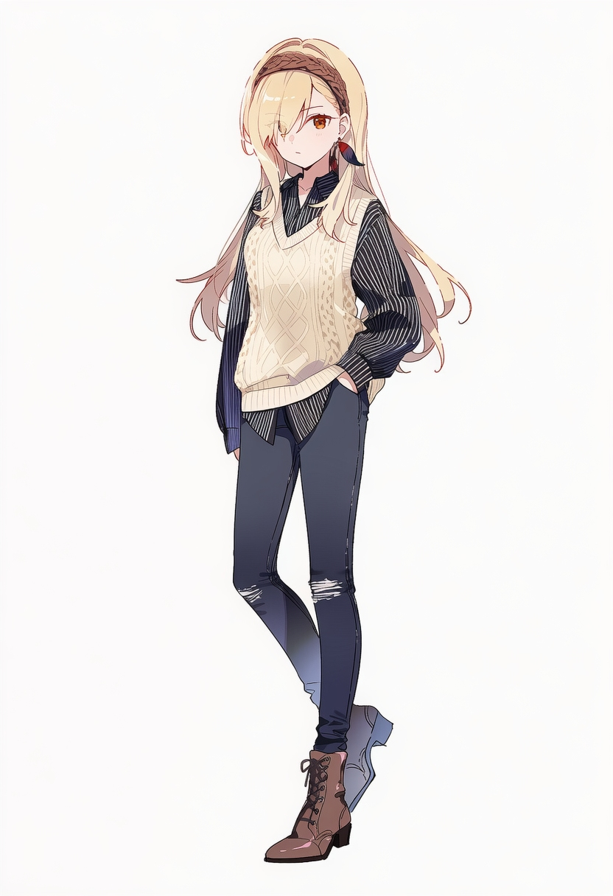

[在线例图](https://assets.quicktagcloud.com/images/raven_composition/raven_composition-6565.jpg?v=a7de48cf146e5df8)

<a id="raven_composition-6575"></a>

## 光荣·META

ID：`raven_composition-6575`；分类：角色图鉴 / 碧蓝航线 / META；来源标记：`safe`。

来源说明：

> 作品：碧蓝航线
> 角色英文名：Glorious META
> 首次登场时间（国服实装）：2025-05-20
> 阵营：META

正向提示词：

```text
glorious_(meta)_(azur_lane)
```

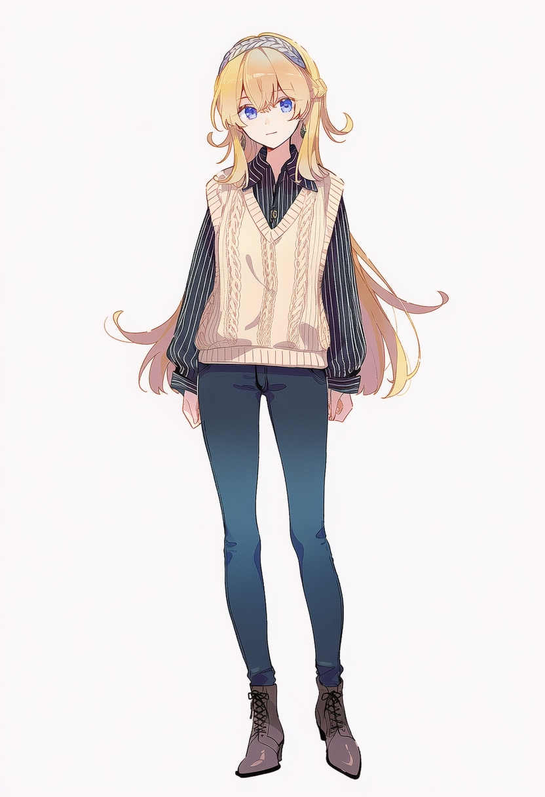

[在线例图](https://assets.quicktagcloud.com/images/raven_composition/raven_composition-6575.jpg?v=fad4daa5bf9a8692)

<a id="raven_composition-6577"></a>

## 格伦维尔·META

ID：`raven_composition-6577`；分类：角色图鉴 / 碧蓝航线 / META；来源标记：`safe`。

来源说明：

> 作品：碧蓝航线
> 角色英文名：Grenville META
> 首次登场时间（国服实装）：2025-06-01
> 阵营：META

正向提示词：

```text
grenville_(meta)_(azur_lane)
```

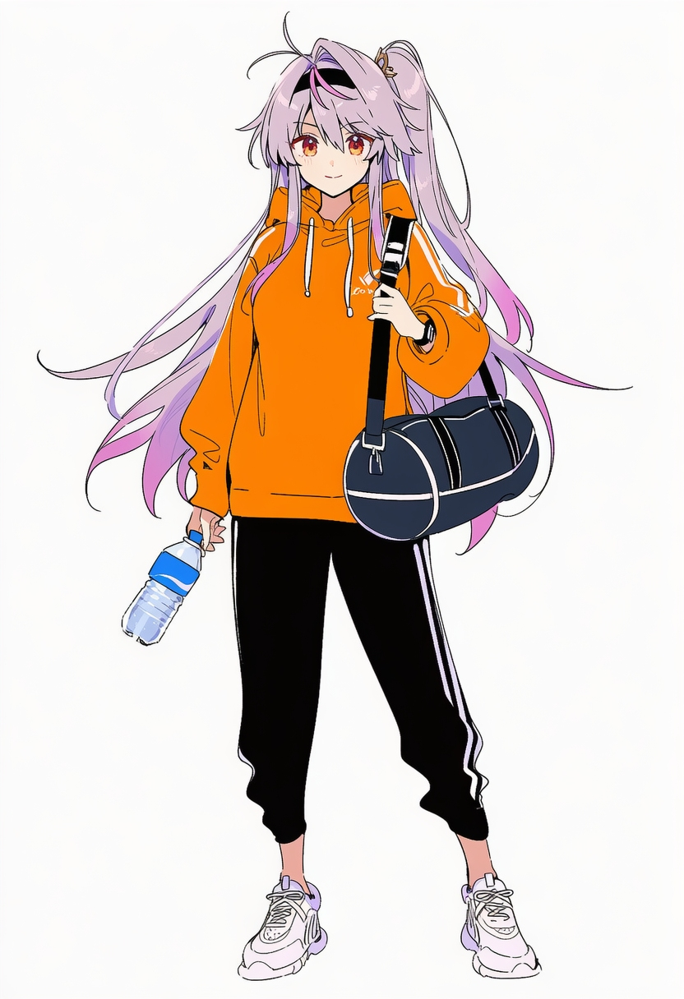

[在线例图](https://assets.quicktagcloud.com/images/raven_composition/raven_composition-6577.jpg?v=09a81e798342d9e4)

<a id="raven_composition-6578"></a>

## 江风·META

ID：`raven_composition-6578`；分类：角色图鉴 / 碧蓝航线 / META；来源标记：`safe`。

来源说明：

> 作品：碧蓝航线
> 角色英文名：Kawakaze META
> 首次登场时间（国服实装）：2025-06-05
> 阵营：META

正向提示词：

```text
kawakaze_(meta)_(azur_lane)
```

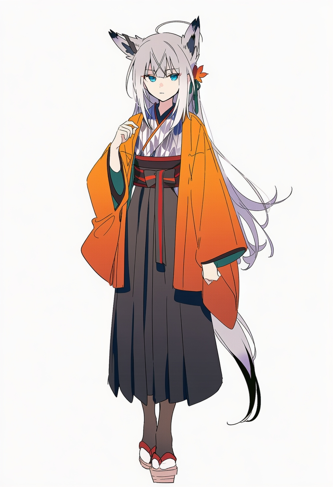

[在线例图](https://assets.quicktagcloud.com/images/raven_composition/raven_composition-6578.jpg?v=f8ca03cb178abab0)

<a id="raven_composition-6587"></a>

## 敦刻尔克·META

ID：`raven_composition-6587`；分类：角色图鉴 / 碧蓝航线 / META；来源标记：`safe`。

来源说明：

> 作品：碧蓝航线
> 角色英文名：Dunkerque META
> 首次登场时间（国服实装）：2025-08-01
> 阵营：META

正向提示词：

```text
dunkerque_(meta)_(azur_lane)
```


[在线例图](https://assets.quicktagcloud.com/images/raven_composition/raven_composition-6587.jpg?v=dcd59116754ddb8e)

<a id="raven_composition-6593"></a>

## 夕立·META

ID：`raven_composition-6593`；分类：角色图鉴 / 碧蓝航线 / META；来源标记：`safe`。

来源说明：

> 作品：碧蓝航线
> 角色英文名：Yuudachi META
> 首次登场时间（国服实装）：2025-09-04
> 阵营：META

正向提示词：

```text
yuudachi_(meta)_(azur_lane)
```


[在线例图](https://assets.quicktagcloud.com/images/raven_composition/raven_composition-6593.jpg?v=f4b56220d7d8d9ed)

<a id="raven_composition-6600"></a>

## 杜威·META

ID：`raven_composition-6600`；分类：角色图鉴 / 碧蓝航线 / META；来源标记：`safe`。

来源说明：

> 作品：碧蓝航线
> 角色英文名：Dewey META
> 首次登场时间（国服实装）：2025-10-01
> 阵营：META

正向提示词：

```text
dewey_(meta)_(azur_lane)
```

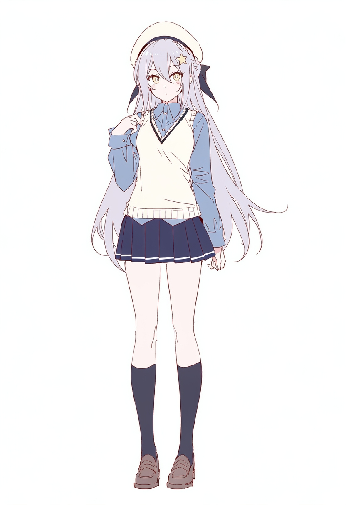

[在线例图](https://assets.quicktagcloud.com/images/raven_composition/raven_composition-6600.jpg?v=5fdeafaf9c9c0456)

<a id="raven_composition-6606"></a>

## 博伊西·META

ID：`raven_composition-6606`；分类：角色图鉴 / 碧蓝航线 / META；来源标记：`safe`。

来源说明：

> 作品：碧蓝航线
> 角色英文名：Boise META
> 首次登场时间（国服实装）：2025-12-01
> 阵营：META

正向提示词：

```text
boise_(meta)_(azur_lane)
```

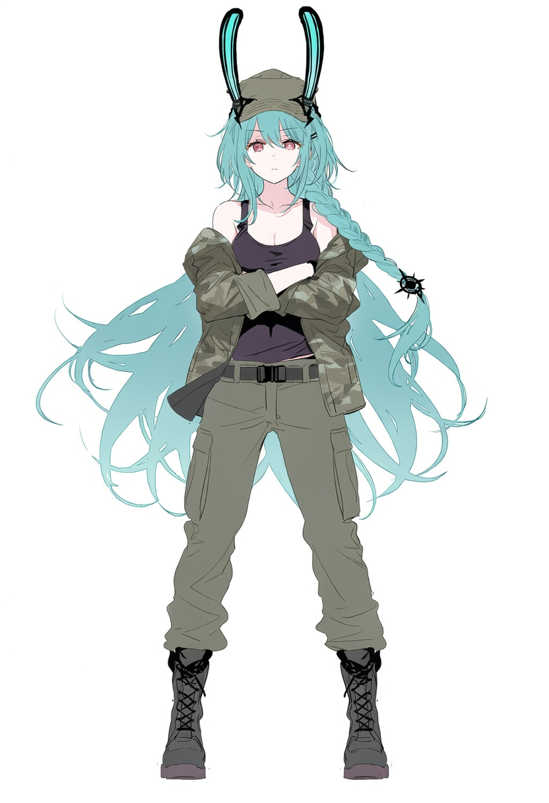

[在线例图](https://assets.quicktagcloud.com/images/raven_composition/raven_composition-6606.jpg?v=6916e03777373a74)

<a id="raven_composition-6609"></a>

## 克利夫兰·META

ID：`raven_composition-6609`；分类：角色图鉴 / 碧蓝航线 / META；来源标记：`safe`。

来源说明：

> 作品：碧蓝航线
> 角色英文名：Cleveland META
> 首次登场时间（国服实装）：2025-12-18
> 阵营：META

正向提示词：

```text
cleveland_(meta)_(azur_lane)
```

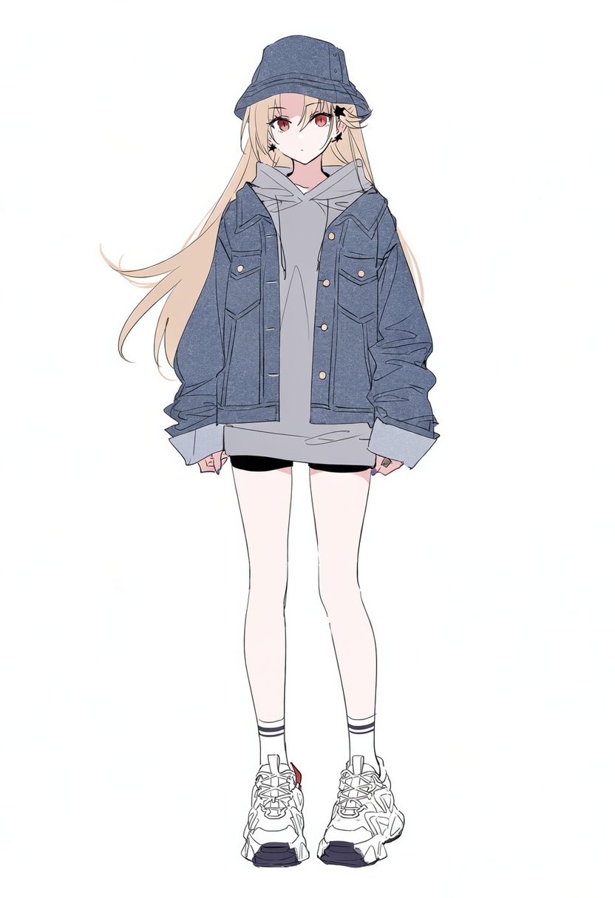

[在线例图](https://assets.quicktagcloud.com/images/raven_composition/raven_composition-6609.jpg?v=ed83802ad7eab508)

<a id="raven_composition-6633"></a>

## 好人理查德·META

ID：`raven_composition-6633`；分类：角色图鉴 / 碧蓝航线 / META；来源标记：`safe`。

来源说明：

> 作品：碧蓝航线
> 角色英文名：Bon Homme Richard META
> 首次登场时间（国服实装）：待核（剧情角色，无舰船实装日）
> 阵营：META

正向提示词：

```text
bon_homme_richard_(meta)_(azur_lane)
```

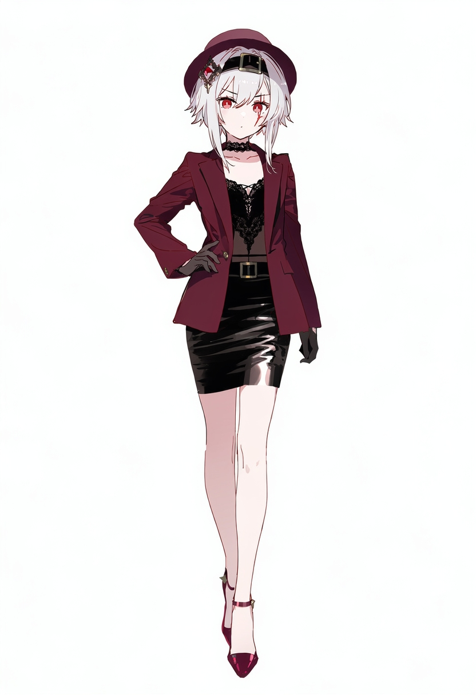

[在线例图](https://assets.quicktagcloud.com/images/raven_composition/raven_composition-6633.jpg?v=dcb1697f3cce9e73)
