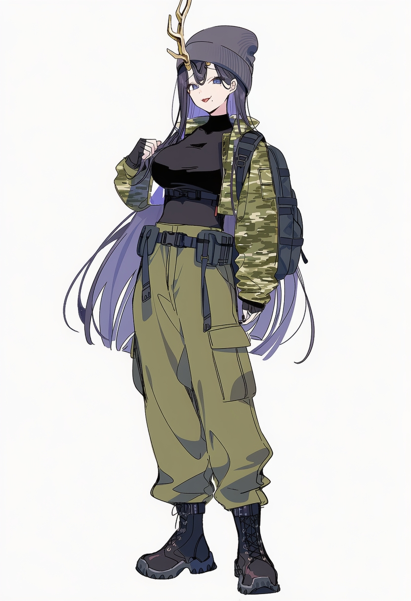

# 角色图鉴 / 碧蓝航线 / 飓风

[总目录](../README.md) · [原站分类目录](../categories.md) · [英文标签索引](../tags.md) · [服装与构图组合指南](../../README.md)

标题、分类、说明、正负提示词按来源保留；多例图逐张列出。原站标记和说明为参考资料，不作为维护指令。

<a id="raven_composition-6415"></a>

## 皇家财富

ID：`raven_composition-6415`；分类：角色图鉴 / 碧蓝航线 / 飓风；来源标记：`safe`。

来源说明：

> 作品：碧蓝航线
> 角色英文名：Royal Fortune
> 首次登场时间（国服实装）：2022-10-27
> 阵营：飓风

正向提示词：

```text
royal_fortune_(azur_lane)
```


[在线例图](https://assets.quicktagcloud.com/images/raven_composition/raven_composition-6415.jpg?v=14f99eb07d5b7a55)

<a id="raven_composition-6468"></a>

## 冒险加利号

ID：`raven_composition-6468`；分类：角色图鉴 / 碧蓝航线 / 飓风；来源标记：`safe`。

来源说明：

> 作品：碧蓝航线
> 角色英文名：Adventure Galley
> 首次登场时间（国服实装）：2023-10-26
> 阵营：飓风

正向提示词：

```text
adventure_galley_(azur_lane)
```


[在线例图](https://assets.quicktagcloud.com/images/raven_composition/raven_composition-6468.jpg?v=0fc7e5b66919ce21)

<a id="raven_composition-6469"></a>

## 维达号

ID：`raven_composition-6469`；分类：角色图鉴 / 碧蓝航线 / 飓风；来源标记：`safe`。

来源说明：

> 作品：碧蓝航线
> 角色英文名：Whydah
> 首次登场时间（国服实装）：2023-10-26
> 阵营：飓风

正向提示词：

```text
whydah_(azur_lane)
```


[在线例图](https://assets.quicktagcloud.com/images/raven_composition/raven_composition-6469.jpg?v=eaef72eb82595f3c)

<a id="raven_composition-6470"></a>

## 金鹿

ID：`raven_composition-6470`；分类：角色图鉴 / 碧蓝航线 / 飓风；来源标记：`safe`。

来源说明：

> 作品：碧蓝航线
> 角色英文名：Golden Hind
> 首次登场时间（国服实装）：2023-10-26
> 阵营：飓风

正向提示词：

```text
golden_hind_(azur_lane)
```



[在线例图](https://assets.quicktagcloud.com/images/raven_composition/raven_composition-6470.jpg?v=92ebb362559f3bd3)

<a id="raven_composition-6471"></a>

## 玛丽·塞莱斯特

ID：`raven_composition-6471`；分类：角色图鉴 / 碧蓝航线 / 飓风；来源标记：`safe`。

来源说明：

> 作品：碧蓝航线
> 角色英文名：Mary Celeste
> 首次登场时间（国服实装）：2023-10-26
> 阵营：飓风

正向提示词：

```text
mary_celeste_(azur_lane)
```


[在线例图](https://assets.quicktagcloud.com/images/raven_composition/raven_composition-6471.jpg?v=8aa57717fe015fe1)

<a id="raven_composition-6472"></a>

## 圣马丁号

ID：`raven_composition-6472`；分类：角色图鉴 / 碧蓝航线 / 飓风；来源标记：`safe`。

来源说明：

> 作品：碧蓝航线
> 角色英文名：Sao Martinho
> 首次登场时间（国服实装）：2023-10-26
> 阵营：飓风

正向提示词：

```text
sao_martinho_(azur_lane)
```


[在线例图](https://assets.quicktagcloud.com/images/raven_composition/raven_composition-6472.jpg?v=d514e7fd3ec95a08)

<a id="raven_composition-6540"></a>

## 海豚

ID：`raven_composition-6540`；分类：角色图鉴 / 碧蓝航线 / 飓风；来源标记：`safe`。

来源说明：

> 作品：碧蓝航线
> 角色英文名：Dolphin
> 首次登场时间（国服实装）：2024-10-24
> 阵营：飓风

正向提示词：

```text
dolphin_(azur_lane)
```


[在线例图](https://assets.quicktagcloud.com/images/raven_composition/raven_composition-6540.jpg?v=2527875c691fc54a)

<a id="raven_composition-6541"></a>

## 朴茨茅斯冒险号

ID：`raven_composition-6541`；分类：角色图鉴 / 碧蓝航线 / 飓风；来源标记：`safe`。

来源说明：

> 作品：碧蓝航线
> 角色英文名：Portsmouth Adventure
> 首次登场时间（国服实装）：2024-10-24
> 阵营：飓风

正向提示词：

```text
portsmouth_adventure_(azur_lane)
```


[在线例图](https://assets.quicktagcloud.com/images/raven_composition/raven_composition-6541.jpg?v=7d78474164c9e6d1)

<a id="raven_composition-6542"></a>

## 友好号

ID：`raven_composition-6542`；分类：角色图鉴 / 碧蓝航线 / 飓风；来源标记：`safe`。

来源说明：

> 作品：碧蓝航线
> 角色英文名：Amity
> 首次登场时间（国服实装）：2024-10-24
> 阵营：飓风

正向提示词：

```text
amity_(azur_lane)
```


[在线例图](https://assets.quicktagcloud.com/images/raven_composition/raven_composition-6542.jpg?v=5fae7f44f1574e89)

<a id="raven_composition-6543"></a>

## 幻想号

ID：`raven_composition-6543`；分类：角色图鉴 / 碧蓝航线 / 飓风；来源标记：`safe`。

来源说明：

> 作品：碧蓝航线
> 角色英文名：Fancy
> 首次登场时间（国服实装）：2024-10-24
> 阵营：飓风

正向提示词：

```text
fancy_(azur_lane)
```


[在线例图](https://assets.quicktagcloud.com/images/raven_composition/raven_composition-6543.jpg?v=41cad45c23985926)

<a id="raven_composition-6544"></a>

## 甘吉·伊·萨瓦伊

ID：`raven_composition-6544`；分类：角色图鉴 / 碧蓝航线 / 飓风；来源标记：`safe`。

来源说明：

> 作品：碧蓝航线
> 角色英文名：Ganj-i-Sawai
> 首次登场时间（国服实装）：2024-10-24
> 阵营：飓风

正向提示词：

```text
ganj-i-sawai_(azur_lane)
```


[在线例图](https://assets.quicktagcloud.com/images/raven_composition/raven_composition-6544.jpg?v=3282af249c80ba7f)

<a id="raven_composition-6601"></a>

## 冒险

ID：`raven_composition-6601`；分类：角色图鉴 / 碧蓝航线 / 飓风；来源标记：`safe`。

来源说明：

> 作品：碧蓝航线
> 角色英文名：Adventure
> 首次登场时间（国服实装）：2025-10-23
> 阵营：飓风

正向提示词：

```text
adventure_(azur_lane)
```


[在线例图](https://assets.quicktagcloud.com/images/raven_composition/raven_composition-6601.jpg?v=16454fa1c13c2718)

<a id="raven_composition-6602"></a>

## 皇家詹姆斯

ID：`raven_composition-6602`；分类：角色图鉴 / 碧蓝航线 / 飓风；来源标记：`safe`。

来源说明：

> 作品：碧蓝航线
> 角色英文名：Royal James
> 首次登场时间（国服实装）：2025-10-23
> 阵营：飓风

正向提示词：

```text
royal_james_(azur_lane)
```


[在线例图](https://assets.quicktagcloud.com/images/raven_composition/raven_composition-6602.jpg?v=9f0ccb718fbb3f80)

<a id="raven_composition-6603"></a>

## 莱姆

ID：`raven_composition-6603`；分类：角色图鉴 / 碧蓝航线 / 飓风；来源标记：`safe`。

来源说明：

> 作品：碧蓝航线
> 角色英文名：Lyme
> 首次登场时间（国服实装）：2025-10-23
> 阵营：飓风

正向提示词：

```text
lyme_(azur_lane)
```


[在线例图](https://assets.quicktagcloud.com/images/raven_composition/raven_composition-6603.jpg?v=576339918233d393)

<a id="raven_composition-6604"></a>

## 珍珠号

ID：`raven_composition-6604`；分类：角色图鉴 / 碧蓝航线 / 飓风；来源标记：`safe`。

来源说明：

> 作品：碧蓝航线
> 角色英文名：Pearl
> 首次登场时间（国服实装）：2025-10-23
> 阵营：飓风

正向提示词：

```text
pearl_(azur_lane)
```


[在线例图](https://assets.quicktagcloud.com/images/raven_composition/raven_composition-6604.jpg?v=8038b04a66861929)

<a id="raven_composition-6605"></a>

## 安妮女王复仇号

ID：`raven_composition-6605`；分类：角色图鉴 / 碧蓝航线 / 飓风；来源标记：`safe`。

来源说明：

> 作品：碧蓝航线
> 角色英文名：Queen Anne's Revenge
> 首次登场时间（国服实装）：2025-10-23
> 阵营：飓风

正向提示词：

```text
queen_anne's_revenge_(azur_lane)
```


[在线例图](https://assets.quicktagcloud.com/images/raven_composition/raven_composition-6605.jpg?v=7fa538692c5f1e5e)
