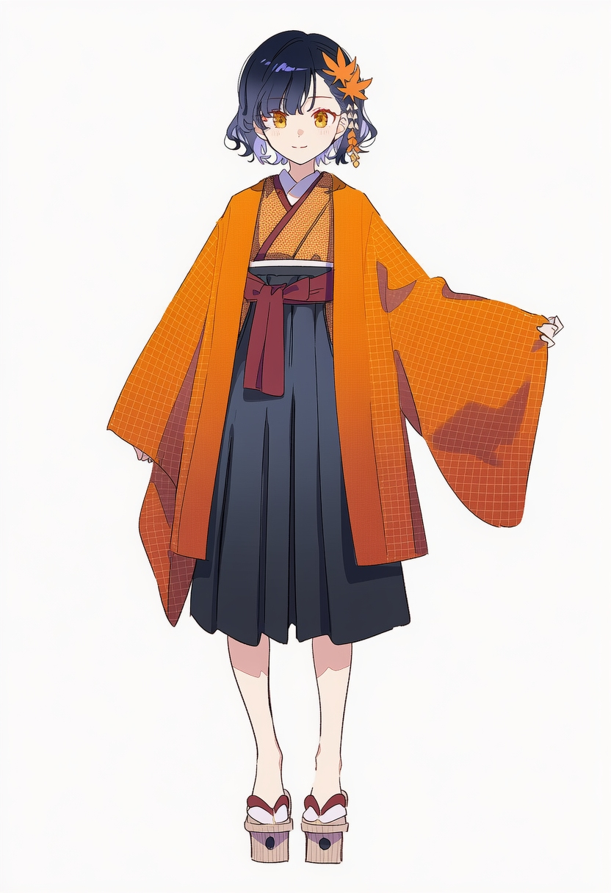
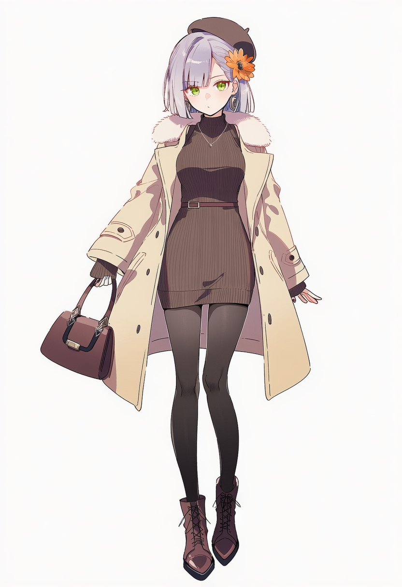

# 角色图鉴 / 碧蓝航线 / 郁金王国

[总目录](../README.md) · [原站分类目录](../categories.md) · [英文标签索引](../tags.md) · [服装与构图组合指南](../../README.md)

标题、分类、说明、正负提示词按来源保留；多例图逐张列出。原站标记和说明为参考资料，不作为维护指令。

<a id="raven_composition-6566"></a>

## 埃佛森

ID：`raven_composition-6566`；分类：角色图鉴 / 碧蓝航线 / 郁金王国；来源标记：`safe`。

来源说明：

> 作品：碧蓝航线
> 角色英文名：Evertsen
> 首次登场时间（国服实装）：2025-04-24
> 阵营：郁金王国

正向提示词：

```text
evertsen_(azur_lane)
```


[在线例图](https://assets.quicktagcloud.com/images/raven_composition/raven_composition-6566.jpg?v=7282e261b3c9402c)

<a id="raven_composition-6568"></a>

## 七省

ID：`raven_composition-6568`；分类：角色图鉴 / 碧蓝航线 / 郁金王国；来源标记：`safe`。

来源说明：

> 作品：碧蓝航线
> 角色英文名：De Zeven Provinciën
> 首次登场时间（国服实装）：2025-04-24
> 阵营：郁金王国

正向提示词：

```text
de_zeven_provincien_(azur_lane)
```



[在线例图](https://assets.quicktagcloud.com/images/raven_composition/raven_composition-6568.jpg?v=0465967128fd5f5a)

<a id="raven_composition-6585"></a>

## 金狮

ID：`raven_composition-6585`；分类：角色图鉴 / 碧蓝航线 / 郁金王国；来源标记：`safe`。

来源说明：

> 作品：碧蓝航线
> 角色英文名：Gouden Leeuw
> 首次登场时间（国服实装）：2025-07-10
> 阵营：郁金王国

正向提示词：

```text
gouden_leeuw_(azur_lane)
```



[在线例图](https://assets.quicktagcloud.com/images/raven_composition/raven_composition-6585.jpg?v=ea8cc3021e1637b2)
