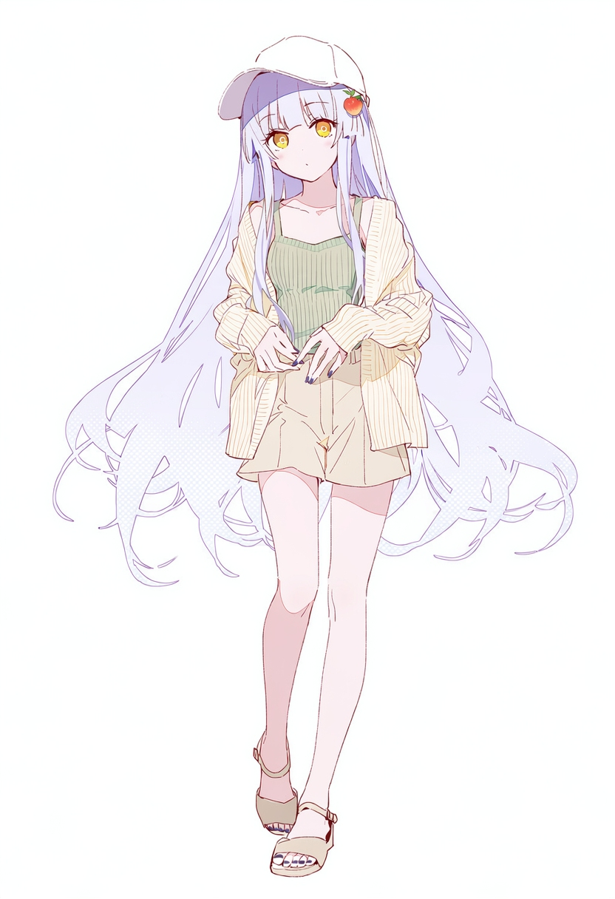
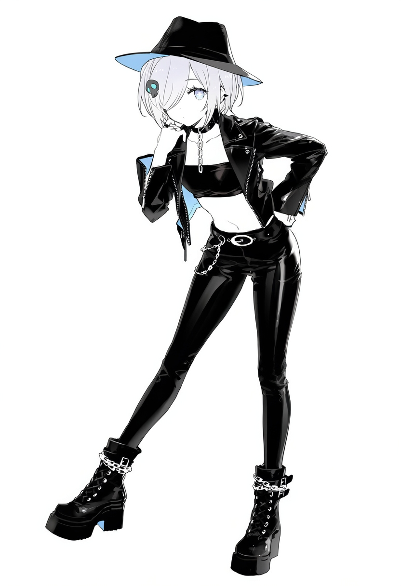
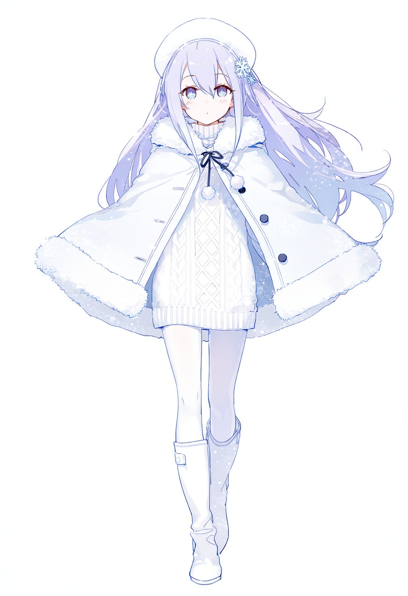
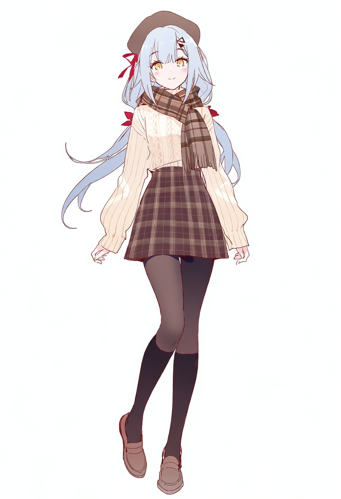
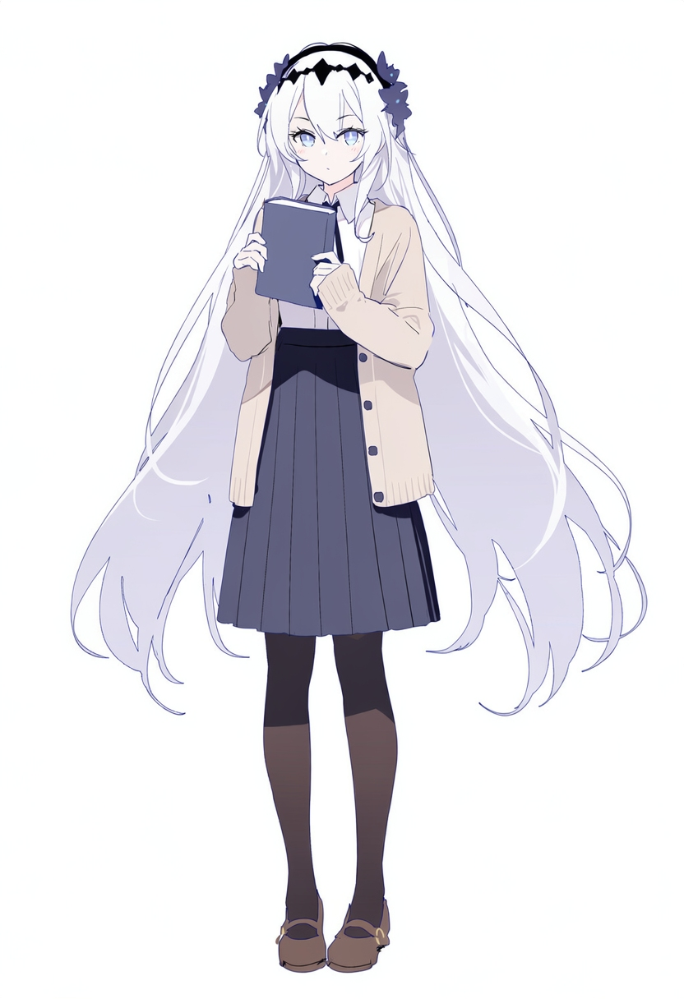
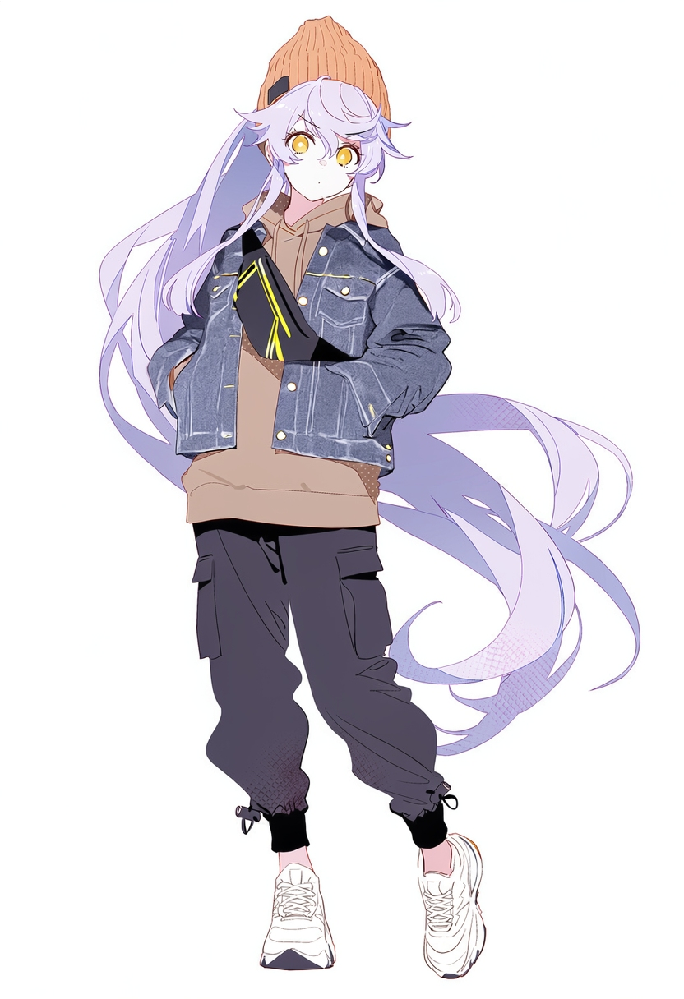
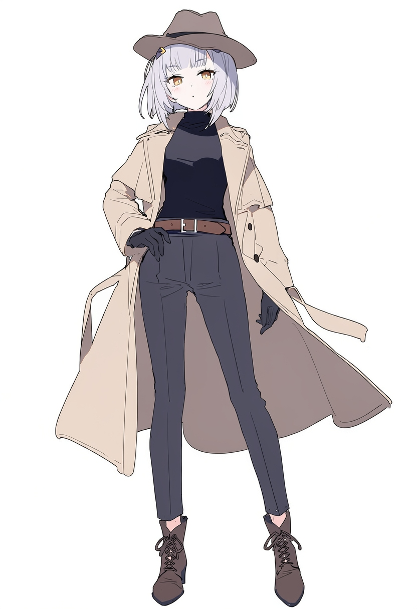
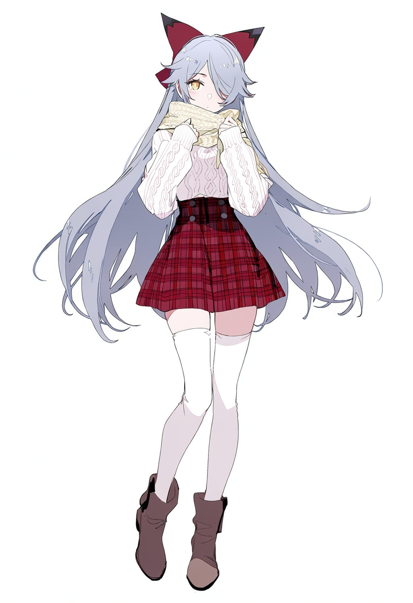

# 角色图鉴 / 碧蓝航线 / 塞壬

[总目录](../README.md) · [原站分类目录](../categories.md) · [英文标签索引](../tags.md) · [服装与构图组合指南](../../README.md)

标题、分类、说明、正负提示词按来源保留；多例图逐张列出。原站标记和说明为参考资料，不作为维护指令。

<a id="raven_composition-6634"></a>

## 观察者α

ID：`raven_composition-6634`；分类：角色图鉴 / 碧蓝航线 / 塞壬；来源标记：`safe`。

来源说明：

> 作品：碧蓝航线
> 角色英文名：Observer Alpha
> 首次登场时间（国服实装）：待核（剧情角色，无舰船实装日）
> 阵营：塞壬

正向提示词：

```text
observer_alpha_(azur_lane)
```



[在线例图](https://assets.quicktagcloud.com/images/raven_composition/raven_composition-6634.jpg?v=6f60d2be3fc260d5)

<a id="raven_composition-6635"></a>

## 观察者零

ID：`raven_composition-6635`；分类：角色图鉴 / 碧蓝航线 / 塞壬；来源标记：`safe`。

来源说明：

> 作品：碧蓝航线
> 角色英文名：Observer Zero
> 首次登场时间（国服实装）：待核（剧情角色，无舰船实装日）
> 阵营：塞壬

正向提示词：

```text
observer_zero_(azur_lane)
```



[在线例图](https://assets.quicktagcloud.com/images/raven_composition/raven_composition-6635.jpg?v=1748527cd5f8070b)

<a id="raven_composition-6636"></a>

## 塞壬

ID：`raven_composition-6636`；分类：角色图鉴 / 碧蓝航线 / 塞壬；来源标记：`safe`。

来源说明：

> 作品：碧蓝航线
> 角色英文名：Siren
> 首次登场时间（国服实装）：待核（剧情角色，无舰船实装日）
> 阵营：塞壬

正向提示词：

```text
siren_(azur_lane)
```



[在线例图](https://assets.quicktagcloud.com/images/raven_composition/raven_composition-6636.jpg?v=5410027b3a33b7af)

<a id="raven_composition-6637"></a>

## 追迹者

ID：`raven_composition-6637`；分类：角色图鉴 / 碧蓝航线 / 塞壬；来源标记：`safe`。

来源说明：

> 作品：碧蓝航线
> 角色英文名：Siren Chaser
> 首次登场时间（国服实装）：待核（剧情角色，无舰船实装日）
> 阵营：塞壬

正向提示词：

```text
tracker_(azur_lane)
```



[在线例图](https://assets.quicktagcloud.com/images/raven_composition/raven_composition-6637.jpg?v=a75cc503e8571057)

<a id="raven_composition-6638"></a>

## 仲裁者·女皇III

ID：`raven_composition-6638`；分类：角色图鉴 / 碧蓝航线 / 塞壬；来源标记：`safe`。

来源说明：

> 作品：碧蓝航线
> 角色英文名：Siren Empress
> 首次登场时间（国服实装）：待核（剧情角色，无舰船实装日）
> 阵营：塞壬

正向提示词：

```text
arbiter_the_empress_iii_(azur_lane)
```



[在线例图](https://assets.quicktagcloud.com/images/raven_composition/raven_composition-6638.jpg?v=0d94eaa0ac6e4192)

<a id="raven_composition-6639"></a>

## 净化者

ID：`raven_composition-6639`；分类：角色图鉴 / 碧蓝航线 / 塞壬；来源标记：`safe`。

来源说明：

> 作品：碧蓝航线
> 角色英文名：Siren Purifier
> 首次登场时间（国服实装）：待核（剧情角色，无舰船实装日）
> 阵营：塞壬

正向提示词：

```text
purifier_(azur_lane)
```



[在线例图](https://assets.quicktagcloud.com/images/raven_composition/raven_composition-6639.jpg?v=0b762c7b2f13e8a6)

<a id="raven_composition-6640"></a>

## 探索者

ID：`raven_composition-6640`；分类：角色图鉴 / 碧蓝航线 / 塞壬；来源标记：`safe`。

来源说明：

> 作品：碧蓝航线
> 角色英文名：Siren Scavenger
> 首次登场时间（国服实装）：待核（剧情角色，无舰船实装日）
> 阵营：塞壬

正向提示词：

```text
explorer_(azur_lane)
```



[在线例图](https://assets.quicktagcloud.com/images/raven_composition/raven_composition-6640.jpg?v=1788785aecadc797)

<a id="raven_composition-6641"></a>

## 测试者

ID：`raven_composition-6641`；分类：角色图鉴 / 碧蓝航线 / 塞壬；来源标记：`safe`。

来源说明：

> 作品：碧蓝航线
> 角色英文名：Siren Tester
> 首次登场时间（国服实装）：待核（剧情角色，无舰船实装日）
> 阵营：塞壬

正向提示词：

```text
tester_(azur_lane)
```



[在线例图](https://assets.quicktagcloud.com/images/raven_composition/raven_composition-6641.jpg?v=fc64733cd741d62b)
